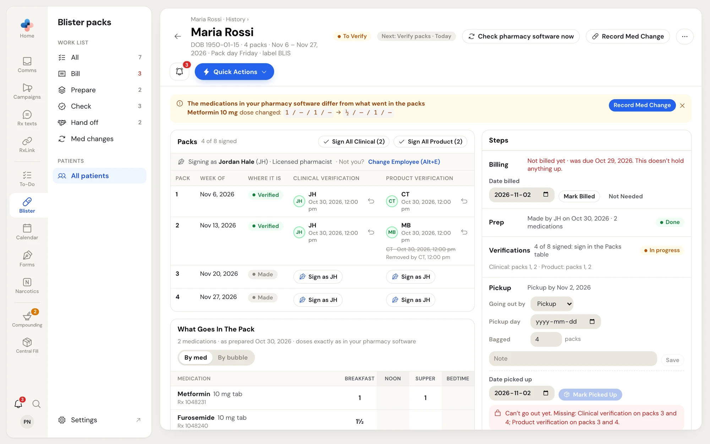

A **fill** is one batch of weekly packs prepared together. Most days you never need its page: the work list does everything with one tap. Open the fill page when you need to sign packs one at a time (for example after a remake), record a step with a date other than today, or work a med change.

## Open a fill

- From **Check** on the work list: click **⋯ › Sign packs one at a time**.
- From the patient page: **Sign packs one at a time** on the Check card, **Open the med change**, or **Open** on a fill in the **History** tab.

The back arrow returns to where you came from, for example **Maria Rossi · History**.

<Frame caption="The fill page: packs and signatures on the left, steps on the right">
  
</Frame>

## The header

Under the patient's name: date of birth, the number of packs, their dates, the pack day and the label type. On the right:

- **The status chip** — **To Prepare**, **To Verify**, **Ready To Go Out**, **Med Change**, **Handed Over** or **Void**.
- **The next step chip** — for example **Next: Verify packs · Today**.
- **Check pharmacy software now** — compares the medications in your pharmacy software with what went in the packs.
- **Record Med Change** — see [Med changes](#med-changes).
- **⋯** — **Print** prints the fill page. **Void Fill** cancels the fill and asks for a reason; it's only available for an open fill with no signed packs and no med change.

When the medications in your pharmacy software changed after the packs were made, an amber notice says **The medications in your pharmacy software differ from what went in the packs** and lists each change. Click **Record Med Change**, or (pharmacists only) **Not A Change For The Packs** to dismiss it. PharmaTools checks this by itself when you open the fill.

## Packs

The **Packs** panel lists each pack with **Week of**, **Where it is** (for example **Made**, **Verified**, **Remade**) and one column for each check: **Clinical verification** and **Product verification**. The count next to the title reads, for example, **4 of 8 signed**.

The bar above the table reads **Signing as** your name, initials and role. If that's not you, click **Change Employee (Alt+E)** or press **Alt+E** and sign in as yourself.

- Click **Sign as** your initials in a cell to sign that pack's check. It signs straight away, with **Undo** in the message at the bottom.
- **Sign All Clinical (N)** and **Sign All Product (N)** sign every unsigned pack you're allowed to sign. They ask first: click **Sign N Packs**.
- A signed cell shows the signer's initials and the time. Click the undo arrow beside it to remove the signature; it asks **Remove this signature?** and keeps a crossed-out line with who removed it.

Clinical checks need a pharmacist with a licence number. Product checks need a pharmacist or a registered technician with a licence number.

## What Goes In The Pack

The medication list saved when the packs were prepared, **as prepared** on that date with the doses exactly as in your pharmacy software. Switch between **By med** and **By bubble** (see [What goes in the packs](/blister-packs/work-list#see-what-goes-in-the-packs)).

## Steps

The **Steps** panel records each step with its own date (today unless you change it).

| Step | What you can do |
|---|---|
| **Billing** | Shows whether the packs are billed and when it was due. Set **Date billed**, then **Mark Billed**, or **Not Needed**. Click **Undo** to reopen it. Billing doesn't hold up any other step. |
| **Prep** | **Mark Prepared** reads the medications from your pharmacy software as they are now. Packs not made yet can be removed by lowering the count. Needs the pharmacy software PC to be on. |
| **Verifications** | How many packs are signed, and which. Sign them in the Packs table. |
| **Pickup** or **Delivery** | **Going out by** (Pickup or Delivery), the **Pickup day** or **Delivery day**, how many packs are **Bagged**, and a **Note**; click **Save**. Then set **Date picked up** (or **Date delivered**) and click **Mark Picked Up** (or **Mark Delivered**). |

Hand off stays locked until every pack has both checks. The red box says what's missing, for example **Can't go out yet. Missing: Clinical verification on packs 3 and 4.** If your pharmacy allows packs out without both checks, PharmaTools asks you to confirm instead, and the fill is flagged **Went out unverified**.

## Notes and To-Do

- **Notes** — type anything the next person should know about this fill, then click **Save Note**.
- **To-Do** — the To-Do tasks for this fill's steps. Tasks close when the step is recorded. Click a task to open it in To-Do.
- **Med change history** — every med change on this fill.

## Med changes

A med change corrects packs that were already made, when a dose changed, a drug stopped or a new medication was added.

<Steps>
  <Step title="Record the med change">
    Click **Record Med Change**. In **Record a med change**, pick **What changed** (**Dose changed**, **Drug stopped**, **New medication** or **Other reason**), add a **Note** for the record, and tick the packs to correct under **Packs to correct**. Click **Correct N Packs**.
  </Step>
  <Step title="Packs come back">
    If the packs are already with the patient, get them back and click **Packs Are Back**.
  </Step>
  <Step title="Remake packs">
    Remake the packs, then click **Mark Remade**. It re-reads the medications from your pharmacy software, so it needs the pharmacy software PC to be on.
  </Step>
  <Step title="Re-verify">
    Sign both checks on the packs marked **Remade** in the Packs table.
  </Step>
  <Step title="Back to patient">
    Click **Return Packs To Patient**.
  </Step>
</Steps>

The purple panel at the top of the fill page shows these steps with the current one highlighted. To stop a med change, click the cancel button at the right of the panel and give a reason. While a med change is open, the patient shows under **Med changes** on the work list.
