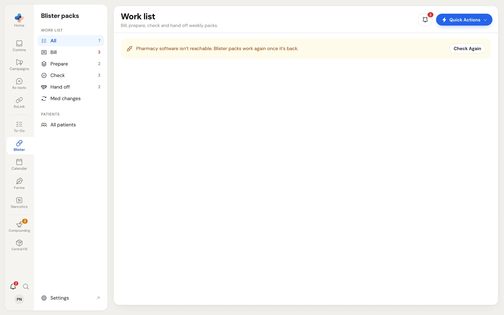
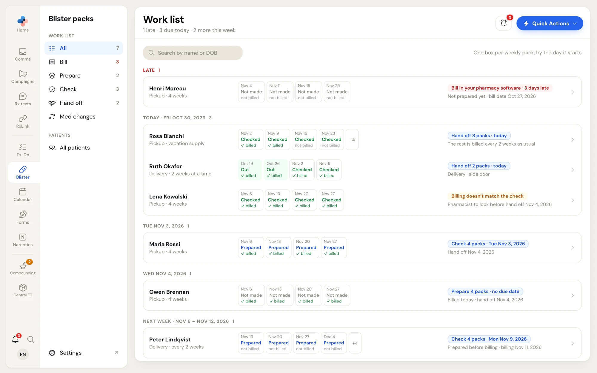

**Blister packs** tracks every weekly blister pack your pharmacy makes, from billing to the moment it leaves with the patient or the driver. It reads your patients' blister profiles (the medications, the pack day and the billing) straight from your pharmacy software, so you never type a patient or a medication into PharmaTools.

## Before you start

Blister packs needs two things:

1. **The module turned on.** Turn on **Add Blister packs** in the Modules step of your account setup, or later a manager or admin adds it in **Settings › Plan & modules**.
2. **PharmaTools Desktop on the PC that runs your pharmacy software.** A manager or admin installs it from **Settings › Desktop app**. PharmaTools Desktop reads the blister profiles and new Rx fills from your pharmacy software.

<Warning>
  When the PC that runs your pharmacy software is off, or PharmaTools Desktop can't reach it, every Blister packs screen shows one amber line, **Your pharmacy software isn't reachable. Blister packs work again once it's back.**, and no buttons. Nothing can be billed, prepared, checked or handed off until it's back. Turn the PC on, then click **Check Again**.

  <Frame caption="Blister packs while the pharmacy software PC is off">
    
  </Frame>
</Warning>

## Open Blister packs

Click **Blister** in the left rail. The side menu next to the rail has:

| Group | Item | Opens |
|---|---|---|
| **Work list** | **All** | One row per patient with something open, and their next step |
| | **Bill**, **Prepare**, **Check**, **Hand off** | The patients waiting on that step, with the one-tap button for it |
| | **Med changes** | Packs coming back, being remade or checked again |
| **Patients** | **All patients** | Everyone on blister packs in your pharmacy software |
| (bottom) | **Settings** | **Settings › Blister packs**. Shown to managers and admins only. |

Each item shows how many are waiting. The **Bill** count is red when a bill is late.

<Frame caption="Blister packs › Work list › All">
  
</Frame>

## How a weekly pack moves

Every weekly pack is tracked on its own. It starts on the patient's pack day and covers 7 days. Each pack goes through four steps:

<Steps>
  <Step title="Bill">
    Someone bills the blister Rxs in your pharmacy software. When the new Rx fills appear, PharmaTools ticks **Billed** by itself.
  </Step>
  <Step title="Prepare">
    Someone makes the packs and taps **Prepared…**, saying how many weekly packs were made. The medication list is saved with the packs at that moment.
  </Step>
  <Step title="Check">
    A pharmacist signs the **Clinical** check, and a pharmacist or registered technician signs the **Product** check, each with one tap for all the packs.
  </Step>
  <Step title="Hand off">
    The packs are **Picked up** or **Sent for delivery**.
  </Step>
</Steps>

**Bill and Prepare can happen in any order**, by the same person or different people. **Check needs only Prepare**: some pharmacies check before billing. When packs are checked before they are billed, PharmaTools compares the billing with what the pharmacist checked once it shows up, and stops for a pharmacist if they don't match. **Hand off comes after Check.**

<Info>
  There is no "start a fill" step. A patient shows as due on the work list, and whoever records the first step (Billed or Prepared) starts the record for those packs.
</Info>

### Each step covers its own number of packs

Billing, preparing and handing off don't have to cover the same weeks. For example, a patient can be billed every 14 days, have 4 weeks prepared at a time, and have 2 weeks handed off at a time. You set the usual sizes for the pharmacy in **Settings › Blister packs**, and per patient on the patient's **Setup** tab. **Prepared…** and the hand-off button still ask how many packs each time.

### Due dates come from rules

Each step's due date is worked out from dates your pharmacy software already has: the **bill date** (last fill plus days supply) and the **pack start** (the dosette start date). You set the rule once, for example **2 days before pack start** for hand off, and every patient's dates follow. See [Settings](/blister-packs/settings).

## Who can do what

| Action | Who |
|---|---|
| See the work list and patients, tap **Billed**, **Prepared…**, hand off packs | Every employee |
| Change a patient's **Setup** tab | Every employee |
| Sign the **Clinical** check | A pharmacist with a licence number on their employee profile |
| Sign the **Product** check | A pharmacist or a registered technician with a licence number |
| Decide which side is wrong when billing doesn't match the check | A pharmacist |
| Change **Settings › Blister packs** | Managers and admins (everyone else sees it read-only) |

The person signing is the person signed in. On **Check**, the bar reads **Signing as** your name and role; click **Not you?** to switch to yourself before signing.

## Related pages

<CardGroup cols={2}>
  <Card title="The work list" icon="list-checks" href="/blister-packs/work-list">
    All, Bill, Prepare, Check, Hand off and Med changes.
  </Card>
  <Card title="Patients" icon="users" href="/blister-packs/patients">
    The patient list, the 8-week pack grid and each patient's setup.
  </Card>
  <Card title="The fill page" icon="layers" href="/blister-packs/fill-page">
    One batch of packs: signing pack by pack, med changes, notes.
  </Card>
  <Card title="Settings" icon="settings" href="/blister-packs/settings">
    Step sizes, due date rules, To-Do tasks and check rules.
  </Card>
</CardGroup>
