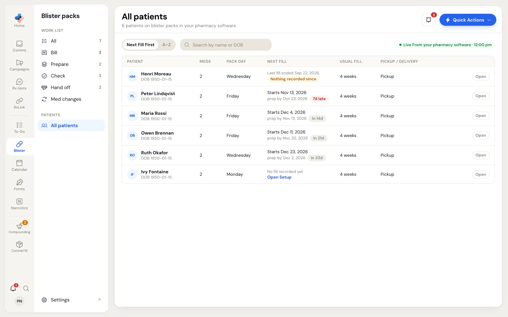
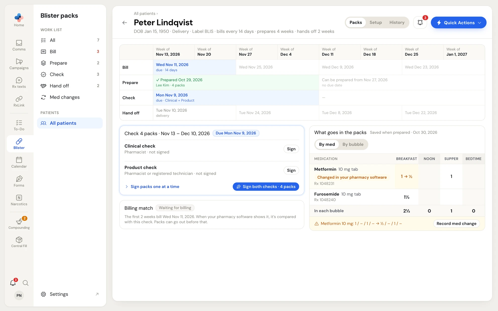
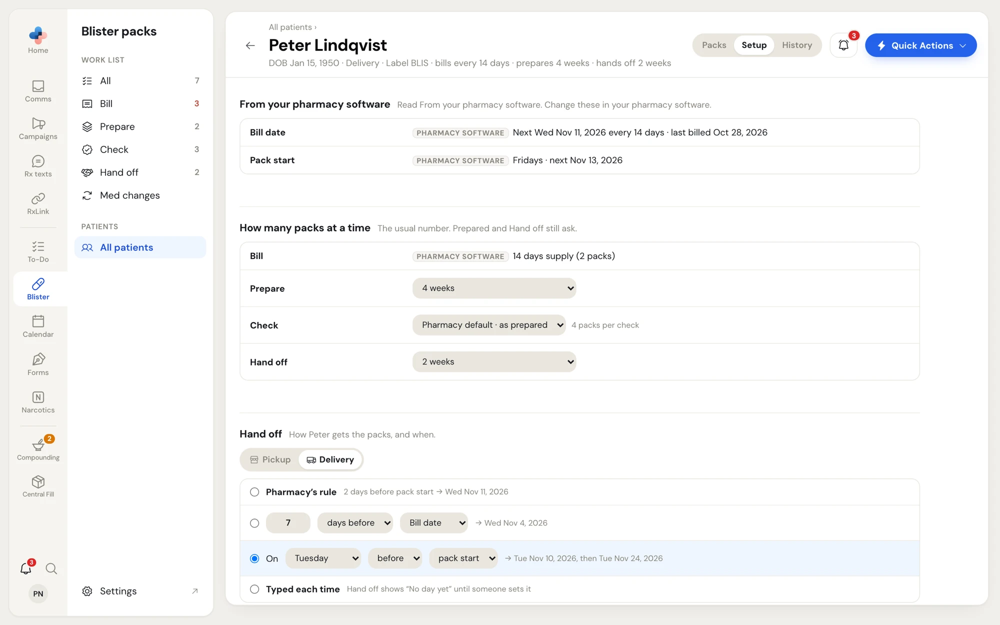
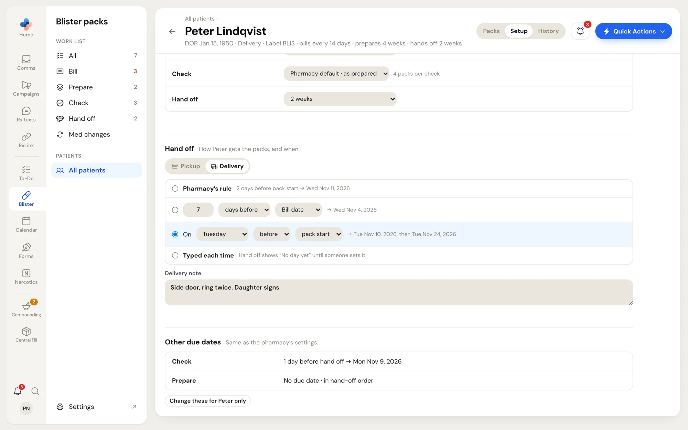
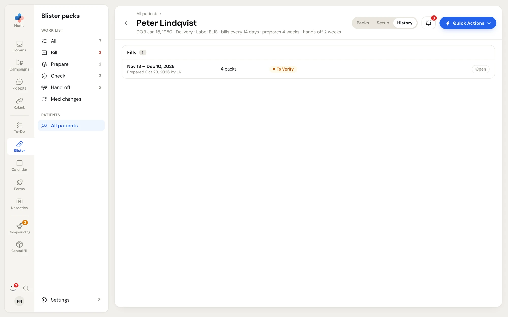

## All patients

Click **All patients** in the Blister packs side menu. The list shows everyone on blister packs in your pharmacy software. The title line counts them, for example **6 patients on blister packs in your pharmacy software**.

<Frame caption="Blister packs › All patients">
  
</Frame>

The chip on the right says where the list came from: **Live from your pharmacy software** with the time it was read, or **Saved list** while the pharmacy software PC is off (names and dates of birth still show).

| Column | Shows |
|---|---|
| **Patient** | Name and date of birth. A **Nursing home** chip marks nursing home patients. |
| **Meds** | How many medications are on the blister profile. A red **None** means the profile has no medications. |
| **Pack Day** | The weekday each weekly pack starts |
| **Next Fill** | When the next packs start and when to prepare them, with **In 14d** or a red **7d late**. **Last fill ended … Nothing recorded since** (amber) means the patient's packs stopped. **No fill recorded yet** comes with an **Open Setup** link. |
| **Usual Fill** | How many weeks the patient usually gets |
| **Pickup / Delivery** | How the packs go out |

- **Next Fill First** sorts by the next fill; **A–Z** sorts by name.
- **Search by name or DOB** finds a patient.
- Click the patient's name or **Open** to open the patient page.

<Note>
  Patients come from your pharmacy software's blister profiles. To add or remove a blister patient, change their profile in your pharmacy software. There is no "start a fill" button: the first **Billed** or **Prepared…** on the work list starts the record.
</Note>

## The patient page

The patient page has the patient's name, date of birth, pickup or delivery, label type and usual sizes (for example **bills every 14 days · prepares 4 weeks · hands off 2 weeks**). Three tabs sit on the right: **Packs**, **Setup** and **History**. The back arrow returns to the list or work-list view you opened the patient from.

### Packs

<Frame caption="Patient page › Packs: the 8-week grid, the next step and the saved medication list">
  
</Frame>

**The grid** shows the patient's coming 8 weeks, one column per week (**Week of Nov 13, 2026**), against four rows: **Bill**, **Prepare**, **Check** and **Hand off**. Each box is as wide as the packs that step covers, so you can see at a glance that, for example, 4 weeks were prepared together but they go out 2 weeks at a time.

- A blue box is the step that's due next, with its date (**Mon Nov 9, 2026 · due · Clinical + Product**).
- A green box is done (**✓ Prepared Oct 29, 2026 · Lee Kim · 4 packs**).
- Grey boxes further right are worked out from the patient's sizes and due rules (**Can be prepared from Nov 27, 2026 · no due date**).

**The next-step card** under the grid shows only the one next thing to do, with its button, the same as the row on the work list:

- **Bill**, **Prepare** and **Hand off** show the work-list row with **Rxs to bill**, **Prepared…** or the hand-off button.
- **Check** shows a card with a **Clinical check** row (**Pharmacist · not signed**) and a **Product check** row (**Pharmacist or registered technician · not signed**), each with **Sign**. **Sign both checks · N packs** signs both at once when allowed, and **Sign packs one at a time** opens the fill page. If the Check step makes a To-Do task, the card names who it goes to.
- **Billing match · Waiting for billing** appears when the packs were checked before billing: when the billing shows up in your pharmacy software, it's compared with this check. The packs can go out before that.
- **Billing doesn't match the check** shows the differences and the pharmacist's choices (see [Check](/blister-packs/work-list#when-billing-doesnt-match-the-check)).
- When nothing is due, the card says so and when the next packs will show on the work list.

**What goes in the packs** (on the right) is the medication list saved when the packs were prepared, with **Saved when prepared** and the date. Switch between **By med** and **By bubble**. PharmaTools compares it with your pharmacy software when you open the page:

- **Your pharmacy software still matches** with when it was read — nothing changed.
- An amber line naming each change (for example a dose going from 1 to ½), with **Record med change**. The changed dose shows in the grid as **1 → ½** with **Changed in your pharmacy software**.

### Setup

The **Setup** tab is where one patient differs from the pharmacy's settings. Every employee can change it. It saves as you go.

<Frame caption="Patient page › Setup">
  
</Frame>

<AccordionGroup>
  <Accordion title="From your pharmacy software" icon="monitor">
    **Bill date** (the next bill date, how often, and when it was last billed) and **Pack start** (the pack weekday and the next start) are read from your pharmacy software and can't be typed in PharmaTools. Change them in your pharmacy software and every due date moves with them.
  </Accordion>
  <Accordion title="How many packs at a time" icon="layers">
    The usual number for each step. **Prepared…** and the hand-off button still ask each time.

    - **Bill** — the days supply billed in your pharmacy software (14 days = 2 packs). If it hasn't been read yet, type how many days the patient is billed for.
    - **Prepare** and **Hand off** — a number of weeks, or the pharmacy's default.
    - **Check** — **As prepared** (what was prepared together) or **As billed** (each billing), or the pharmacy's default.
  </Accordion>
  <Accordion title="Hand off" icon="truck">
    Pick **Pickup** or **Delivery**, and when the hand off is due:

    - **Pharmacy's rule** — the rule from **Settings › Blister packs**, with the date it gives.
    - **N days before / after** the **Bill date** or **Pack start**.
    - **On** a weekday **before / after** the **pack start** or **bill date**, for example **On Tuesday before pack start**.
    - **Typed each time** — the Hand off view shows **No day yet** until someone sets the day.

    Each choice shows the dates it gives for this patient. For delivery, type a **Delivery note** (for example "Side door, ring twice"); it shows on the Hand off row.
  </Accordion>
  <Accordion title="Other due dates" icon="calendar-clock">
    **Check** and **Prepare** follow the pharmacy's rules (**Same as the pharmacy's settings.**). Click **Change these for** the patient's first name **only** to give this patient their own rules, and **Use the pharmacy's** to go back.
  </Accordion>
</AccordionGroup>

<Frame caption="Setup › Hand off and Other due dates">
  
</Frame>

### History

The **History** tab lists the patient's fills. A fill is one batch of packs prepared together.

<Frame caption="Patient page › History">
  
</Frame>

Each fill shows its dates, who prepared it and when (or when it was picked up or delivered), the number of packs and its status:

| Status | Meaning |
|---|---|
| **To Prepare** | Not prepared yet |
| **To Verify** | Prepared, checks not all signed |
| **Ready To Go Out** | Both checks signed, waiting for hand off |
| **Med Change** | A med change is open |
| **Handed Over** | Picked up or delivered |
| **Void** | Voided, with the reason |

Flags can follow: **Not billed**, **Went out unverified**, **Imported** (brought over from the old blister tool) and **One-off**. Click **Open** to open the [fill page](/blister-packs/fill-page).
