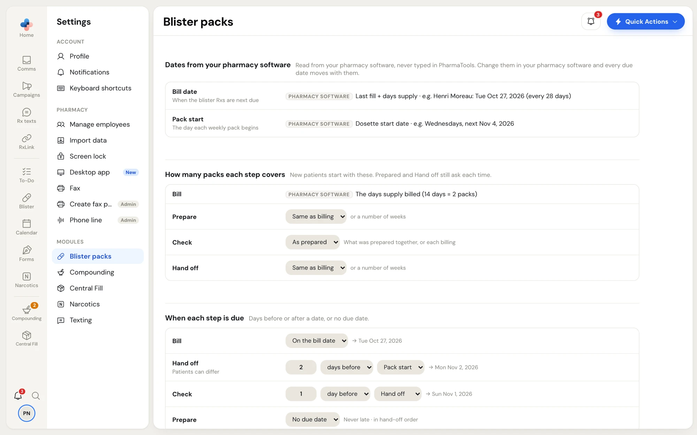
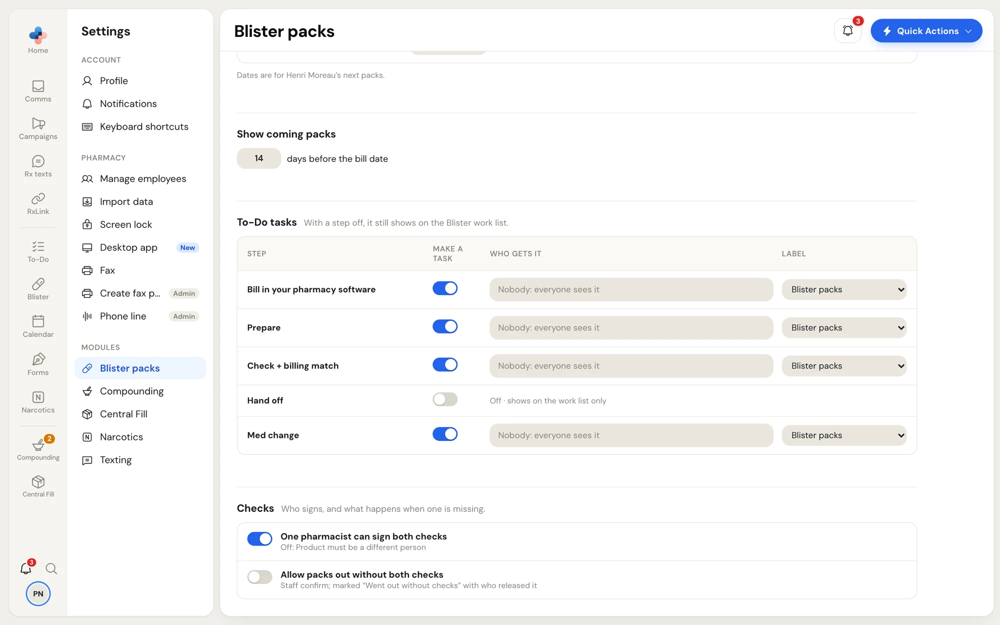

**Settings › Blister packs** holds the pharmacy-wide rules for every blister patient. A single patient's exceptions live on their patient page, **Setup** tab (see [Patients › Setup](/blister-packs/patients#setup)). New patients start with these settings.

Open it from **Settings** under **Modules › Blister packs**, or click **Settings** at the bottom of the Blister packs side menu.

<Note>
  Only managers and admins can change these settings. Everyone else sees them read-only, with **Only a manager or an admin can change these.** The **Settings** item in the Blister packs side menu shows only for managers and admins. Changes save as you go.
</Note>

<Frame caption="Settings › Blister packs: dates, sizes and due rules">
  
</Frame>

## Dates from your pharmacy software

Two dates drive every due date. They are read from your pharmacy software, never typed in PharmaTools:

- **Bill date** — when the blister Rxs are next due: last fill plus days supply.
- **Pack start** — the day each weekly pack begins: the dosette start date.

Change them in your pharmacy software and every due date moves with them. The examples show the dates for a real patient on your work list.

## How many packs each step covers

| Step | Choices |
|---|---|
| **Bill** | Read from your pharmacy software: the days supply billed (14 days = 2 packs) |
| **Prepare** | **Same as billing**, or 1 to 12 weeks |
| **Check** | **As prepared** (what was prepared together) or **As billed** (each billing) |
| **Hand off** | **Same as billing**, or 1 to 12 weeks |

For example, a pharmacy that bills every 14 days, prepares 4 weeks ahead and hands off every 2 weeks sets **Prepare** to **4 weeks** and leaves **Hand off** on **Same as billing**. **Prepared…** and the hand-off button on the work list still ask how many each time.

## When each step is due

Each step's rule is a number of days before or after a date, or no due date. The date the rule gives for the example patient shows to the right, for example **→ Mon Nov 2, 2026**.

| Step | Default | You can count from |
|---|---|---|
| **Bill** | **On the bill date** | The bill date |
| **Hand off** | **2 days before** **Pack start** | **Bill date** or **Pack start**. Patients can differ: on a patient's Setup tab you can also pick a weekday (**On Tuesday before pack start**) or **Typed each time**. |
| **Check** | **1 day before** **Hand off** | **Bill date**, **Pack start** or **Hand off** |
| **Prepare** | **No due date** (never late; listed in hand-off order) | **Bill date**, **Pack start**, **Hand off** or **Check** |

Rules only count from steps that come earlier in the chain: hand off is worked out first, then check, then prepare. So **Check: 1 day before Hand off** means that if Peter's packs start Friday Nov 13, 2026 and hand off is 2 days before pack start (Wed Nov 11, 2026), the check is due Tue Nov 10, 2026.

## Show coming packs

**Show coming packs** sets how many days before the bill date a patient's next packs appear on the work list (14 by default, up to 60).

## To-Do tasks

<Frame caption="Settings › Blister packs: coming packs, To-Do tasks and checks">
  
</Frame>

Each step can make a task in To-Do. One row per step:

| Step | Covers |
|---|---|
| **Bill in your pharmacy software** | Billing reminders |
| **Prepare** | Packs to make |
| **Check + billing match** | Clinical and Product checks, and a billing that doesn't match the check |
| **Hand off** | Packs going out |
| **Med change** | Packs to bring back, re-verify, and medication changes found after prep |

For each row:

- **Make a task** — turn the task on or off. With a step off, it still shows on the Blister work list (**Off · shows on the work list only**).
- **Who gets it** — click to pick teams and people. **Nobody: everyone sees it** means the task isn't assigned.
- **Label** — the To-Do label the task carries (**Blister packs** by default).

Tasks close themselves when the step is recorded. Changing a row's setting also moves the open tasks of that step; turning it off removes them.

## Checks

- **One pharmacist can sign both checks** — on: a pharmacist sees **Sign both checks** and signs Clinical and Product in one tap. Off: Product must be signed by a different person.
- **Allow packs out without both checks** — off by default. On: staff can hand off packs that don't have both checks after confirming; the packs are marked **Went out without checks** with who released them.
