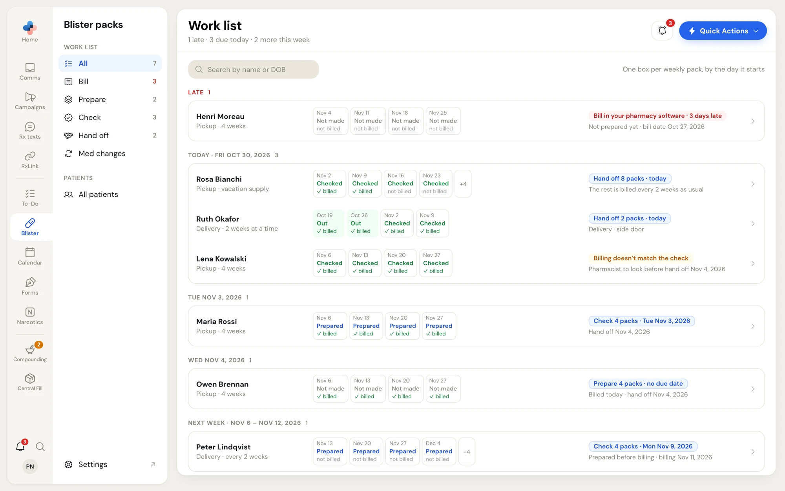
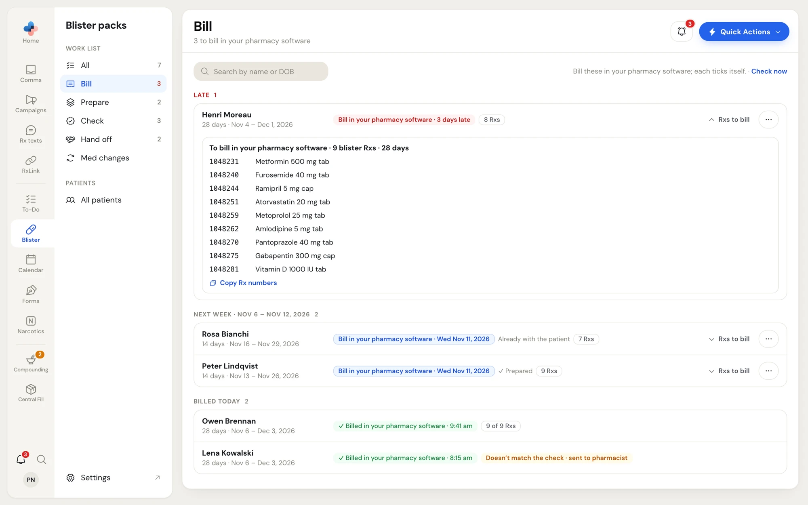
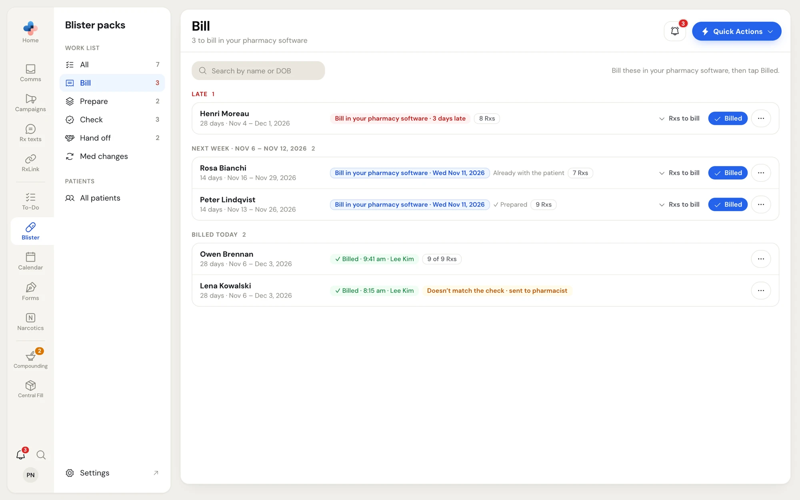
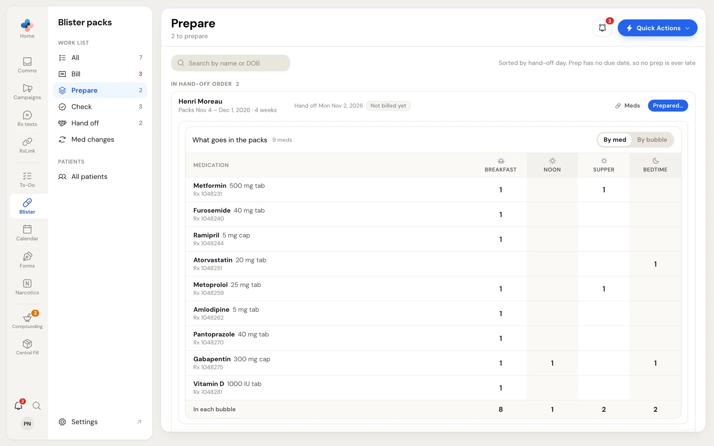
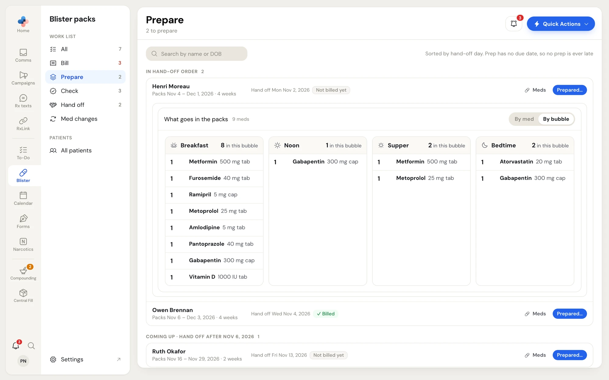
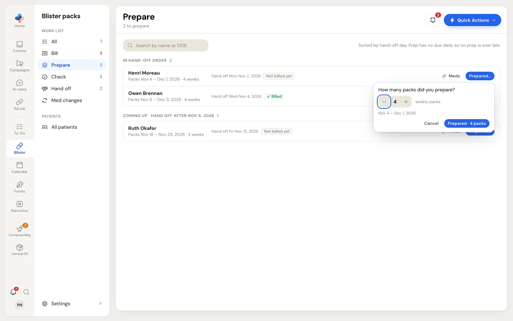
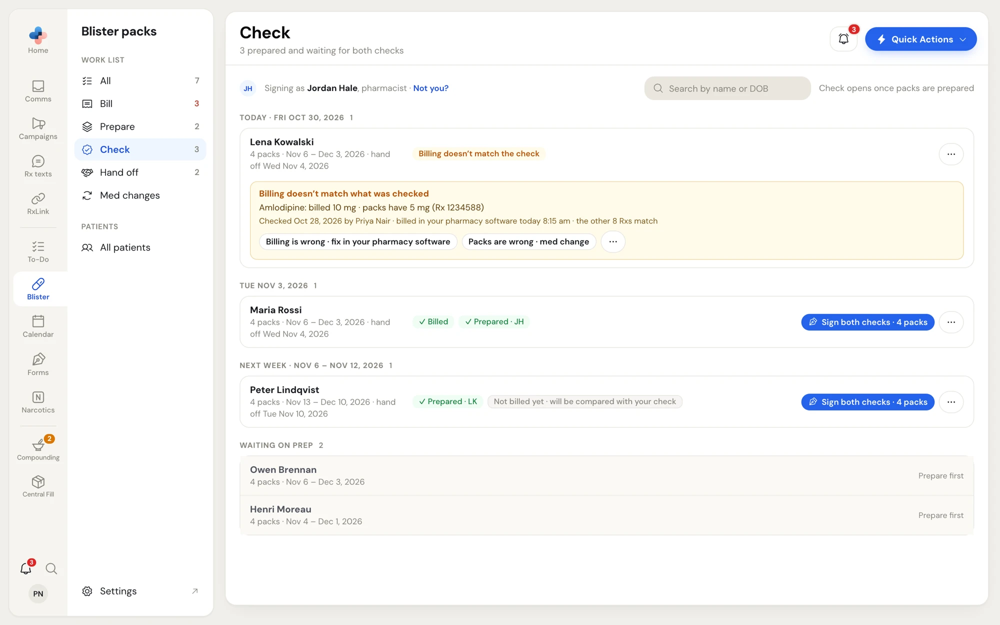
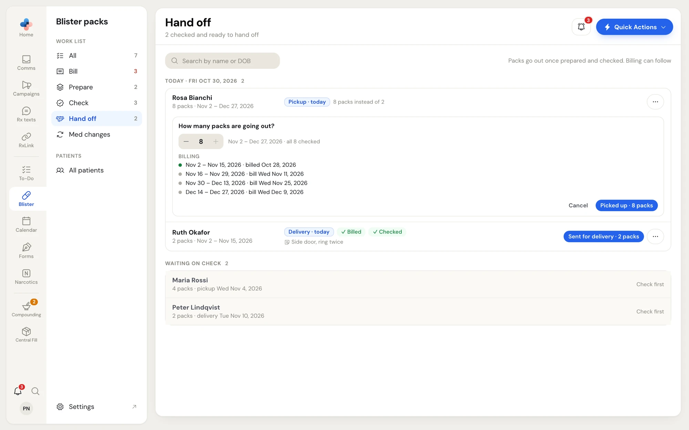

The work list is where blister work gets done. Pick a view under **Work list** in the Blister packs side menu. Each view keeps its own address (for example `/blister-packs?tab=check`), and the list reads your pharmacy software again every minute while it's open.

Every view has **Search by name or DOB** at the top left, and rows grouped by date the way To-Do groups them:

| Group | Holds |
|---|---|
| **Late** (red) | Anything past its due date |
| **Today · Fri Oct 30, 2026** | Due today |
| **Tomorrow · Sat Oct 31, 2026** | Due tomorrow |
| One group per day for the next five days | For example **Tue Nov 3, 2026** |
| **Next week · Nov 6 – Nov 12, 2026** | Due 7 to 13 days from today |
| **Later** | Further out, or no date |

Click a patient's name on any row to open their patient page. When you open a patient from a view, the back arrow on the patient page returns you to that view.

## All

**All** shows one row per patient with something open, and only their next step. Nothing is recorded from **All**: click the row to open the patient. The line under the title sums up the day, for example **1 late · 3 due today · 2 more this week**.

<Frame caption="Work list › All: one row per patient, one box per weekly pack">
  
</Frame>

Each row shows:

- **The patient**, with how they get their packs and how often, for example **Delivery · every 2 weeks**.
- **Week boxes** — one box per weekly pack, by the day it starts. Up to four show; **+N** means more weeks follow. Each box says where that pack is:

  | Box | Meaning |
  |---|---|
  | **Not made** | Not prepared yet |
  | **Prepared** (blue) | Made, waiting for checks |
  | **Checked** (green) | Both checks signed |
  | **Out** (green background) | Picked up or sent for delivery |

  The small line under each box reads **✓ billed** or **not billed**. Hover a box for the full date.
- **The next step chip**: blue when it's on time (for example **Check 4 packs · Tue Nov 3, 2026**), red when late (**Bill in your pharmacy software · 3 days late**), amber for **Billing doesn't match the check**, purple for a med change. The grey line under it adds context, for example **Prepared before billing · billing Nov 11, 2026**.

<Note>
  Packs show on the work list a set number of days before their bill date (14 by default). Change it in **Settings › Blister packs › Show coming packs**.
</Note>

## Bill

**Bill** is the reminder list for billing in your pharmacy software. The title line says how many are waiting, for example **3 to bill in your pharmacy software**.

<Frame caption="Work list › Bill, with Rxs to bill opened">
  
</Frame>

Each row shows the billing period (for example **28 days · Nov 4 – Dec 1, 2026**), when to bill (**Bill in your pharmacy software · Wed Nov 11, 2026**, or **· N days late** in red), and the number of blister Rxs. **N of M Rxs billed** in amber means some of the Rxs are billed and some aren't yet. **✓ Prepared** or **Already with the patient** tells you the packs were made before billing.

<Steps>
  <Step title="See what to bill">
    Click **Rxs to bill** on the row. The list reads **To bill in your pharmacy software · 9 blister Rxs · 28 days**, with each Rx number and drug, read live from your pharmacy software. Click **Copy Rx numbers** to copy them all, one per line.
  </Step>
  <Step title="Bill in your pharmacy software">
    Bill the Rxs as usual in your pharmacy software.
  </Step>
  <Step title="Billed ticks itself">
    Billing creates new Rx fills dated that day. PharmaTools sees them and moves the row to **Billed today** with **✓ Billed in your pharmacy software** and the time. The line at the top reads **Bill these in your pharmacy software; each ticks itself.** Click **Check now** to read the billing straight away instead of waiting.
  </Step>
</Steps>

### When billing is recorded by hand

If PharmaTools can't read billing from your pharmacy software yet, the top line reads **Bill these in your pharmacy software, then tap Billed.** and each row has a **Billed** button. Tap it after you bill. A message at the bottom confirms it, with **Undo**.

<Frame caption="Work list › Bill with the Billed button">
  
</Frame>

### Billing that isn't needed

Click **⋯** on a row and choose **Not needed for this billing**, for example when the patient's Rxs are on hold. A message confirms it, with **Undo**. Rows billed or marked not needed by hand today show under **Billed today**; click **⋯ › Not billed after all** or **Needed after all** to put one back on the list.

## Prepare

**Prepare** lists the packs to make. The title line reads **N to prepare**.

When the pharmacy has no due date for prep (the default), the list is sorted by hand-off day and no prep is ever late. The rows sit under **In hand-off order** (hand-offs in the next week) and **Coming up · hand off after Nov 6, 2026**. With a prep rule set, rows are grouped by the day each prep is due.

Each row shows the packs to make (**Packs Nov 4 – Dec 1, 2026 · 4 weeks**), the hand-off day, and whether they're billed: **✓ Billed**, **Part billed** or **Not billed yet**. You can prepare before billing.

### See what goes in the packs

Click **Meds** on the row. **What goes in the packs** is read live from your pharmacy software. Switch between two views with **By med** and **By bubble**; PharmaTools remembers your choice on this computer, and the same views appear on the patient page and the fill page.

<Tabs>
  <Tab title="By med">
    One row per medication with its Rx number, and a column per time of day: **Breakfast**, **Noon**, **Supper**, **Bedtime**. **In each bubble** at the bottom adds up how many go in each bubble. Half doses read ½ and 1½.

    <Frame caption="What goes in the packs, by med">
      
    </Frame>
  </Tab>
  <Tab title="By bubble">
    One card per time of day, listing what goes in that bubble and how many, for example **Breakfast · 8 in this bubble**.

    <Frame caption="What goes in the packs, by bubble">
      
    </Frame>
  </Tab>
</Tabs>

### Record the prep

<Steps>
  <Step title="Click Prepared…">
    The window asks **How many packs did you prepare?** It starts at the patient's usual number.
  </Step>
  <Step title="Set the number of weekly packs">
    Use **−** and **+** (1 to 12). The dates under it change as you go, for example **Nov 4 – Dec 1, 2026**.
  </Step>
  <Step title="Confirm">
    Click **Prepared · 4 packs**. The medication list from your pharmacy software is saved with these packs at this moment, and they move to **Check**.
  </Step>
</Steps>

<Frame caption="How many packs did you prepare?">
  
</Frame>

<Note>
  Recording the prep needs the pharmacy software PC to be on, because it reads the medication list. If the blister profile has no medications, PharmaTools asks **No medications on the blister profile** first; click **Record The Prep Anyway** only if that's right. Weeks already in another batch can't be prepared twice.
</Note>

## Check

**Check** lists prepared packs waiting for both checks. The bar at the top reads **Signing as** your name and role (for example **Signing as Jordan Hale, pharmacist**). If that's not you, click **Not you?** and sign in as yourself first.

<Frame caption="Work list › Check">
  
</Frame>

Each row shows the packs (**4 packs · Nov 13 – Dec 10, 2026 · hand off Tue Nov 10, 2026**) and chips: **✓ Billed**, **✓ Prepared** with the preparer's initials, and **Not billed yet · will be compared with your check** when you check before billing.

### Sign the checks in one tap

- When one pharmacist may sign both checks (the default), a pharmacist sees **Sign both checks · 4 packs**. One tap signs Clinical, then Product, on every pack in the row.
- Otherwise you see **Sign Clinical · N packs** and/or **Sign Product · N packs**, for the checks you're allowed to sign.
- When you can't sign, the row says why, for example **A pharmacist signs the Clinical check** or **Both checks signed**.

| Check | Who signs |
|---|---|
| **Clinical check** | A pharmacist with a licence number |
| **Product check** | A pharmacist or a registered technician with a licence number. With **One pharmacist can sign both checks** turned off, it must be a different person from the Clinical signer. |

Click **⋯** on a row for **Sign packs one at a time** (opens the fill page, for remade packs) or **Open patient**. Packs that aren't prepared yet sit under **Waiting on prep** with **Prepare first**.

### When billing doesn't match the check

When packs were checked before billing, PharmaTools compares the new billing with what the pharmacist checked once it shows up in your pharmacy software. If they differ, the row shows **Billing doesn't match the check** and moves to the top, and the amber box lists each difference (for example **Amlodipine: billed 10 mg · packs have 5 mg (Rx 1234588)**) with who checked it and when it was billed.

A pharmacist decides which side is wrong:

- **Billing is wrong · fix in your pharmacy software** — fix the billing; the packs stay as they are.
- **Packs are wrong · med change** — asks first, then starts a med change: get the packs back if they're out, remake them, and check them again. Click **Start Med Change**.
- **⋯ › Both are right (add a reason)** — type why, for the record, and click **Save**.

Anyone else sees **A pharmacist decides which side is wrong.**

## Hand off

**Hand off** lists packs going out. The title line reads **N checked and ready to hand off**; the line at the top, **Packs go out once prepared and checked. Billing can follow**.

<Frame caption="Work list › Hand off, with How many packs are going out? open">
  
</Frame>

Each ready row shows **Pickup** or **Delivery** with the day (for example **Pickup · today**), **✓ Billed** and **✓ Checked**, and the patient's delivery note. **8 packs instead of 2** means more packs than usual are going out together, for example a vacation supply.

<Steps>
  <Step title="Click the hand-off button">
    It reads **Picked up · N packs** or **Sent for delivery · N packs**.
  </Step>
  <Step title="Say how many packs are going out">
    **How many packs are going out?** starts at the usual number. Use **−** and **+**. The line beside it shows the dates and how many are checked, for example **Nov 2 – Dec 27, 2026 · all 8 checked**. Under **Billing**, each billing period the packs cover is listed with **billed** and its date, or **bill** and the day it's due, so you can see what still needs billing later.
  </Step>
  <Step title="Confirm">
    Click **Picked up · N packs** (or **Sent for delivery · N packs**). The packs show as **Out**.
  </Step>
</Steps>

- When the hand-off rule is **Typed each time**, the row shows **No day yet · Set day** with a date box. Pick the day.
- Packs that can't go out yet sit under **Waiting on check** with **Check first**, **Prepare first** or **Med change first**.
- Click **⋯ › Open patient** to open the patient page.

<Warning>
  If a manager turned on **Allow packs out without both checks**, packs without both checks can still go out. The button reads **Picked up without checks · N packs** and warns: **Some packs don't have both checks. They'll be marked "Went out without checks", released by you.**
</Warning>

## Med changes

**Med changes** lists patients with an open med change: packs coming back, being remade, or checked again. The rows look like **All**. Click one to open the patient, then **Open the med change** to work it on the fill page. See [Med changes](/blister-packs/fill-page#med-changes).

## To-Do tasks

Each step can also make a To-Do task, for example a reminder to bill a patient in your pharmacy software. The task closes itself when the step is recorded on the work list. Which steps make tasks, and who gets them, is set in [Settings › Blister packs › To-Do tasks](/blister-packs/settings#to-do-tasks). A step with its task turned off still shows on the work list.
