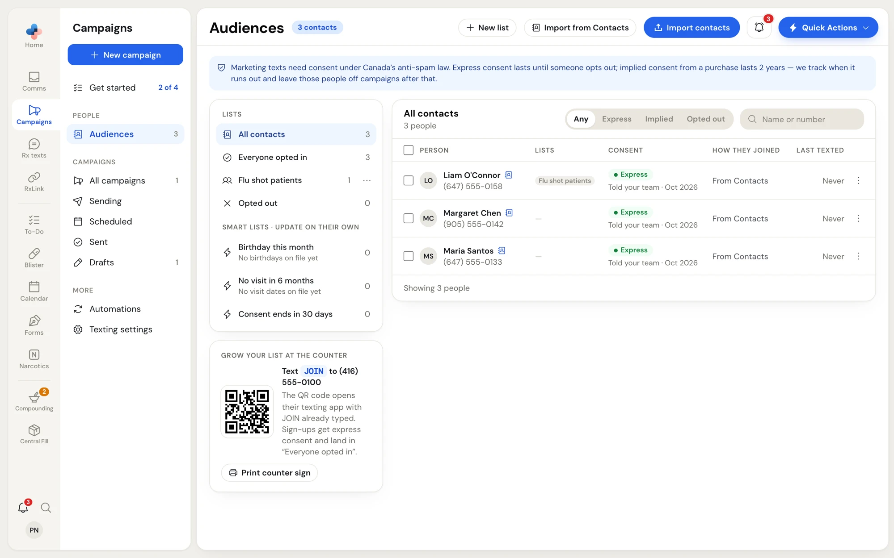
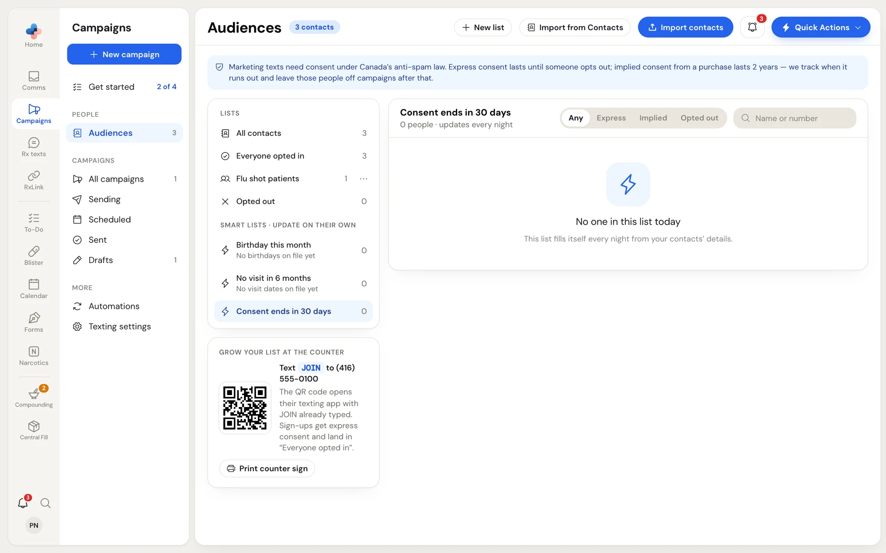
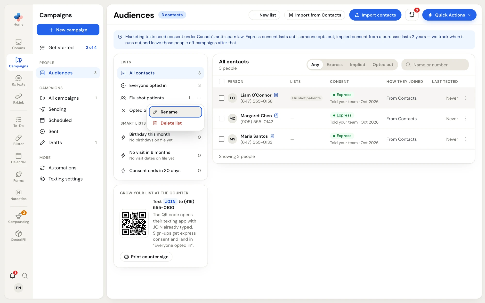
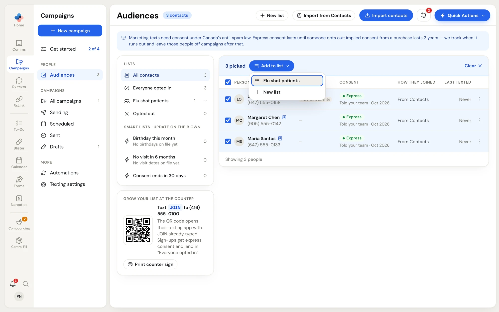
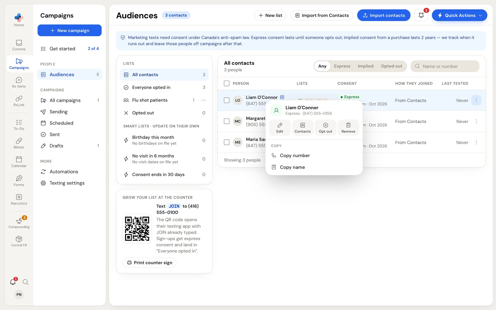
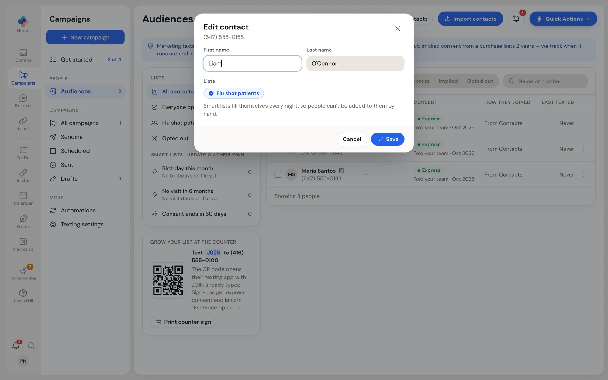
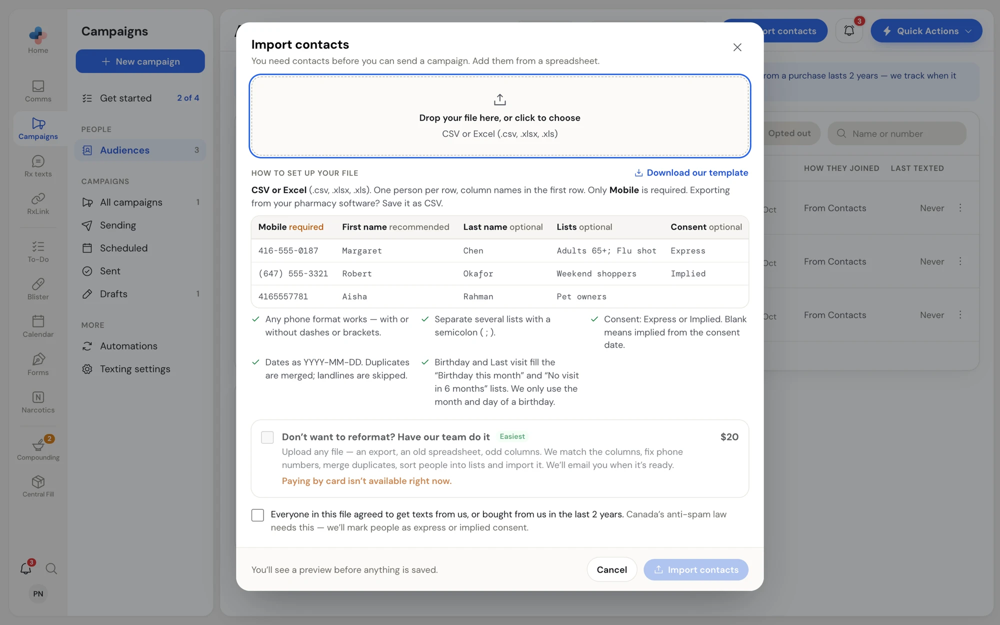
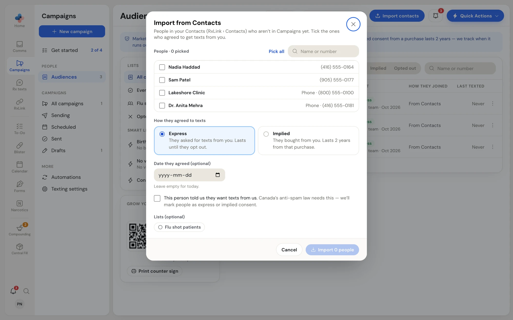

**Audiences** holds everyone your pharmacy can text with Campaigns, the lists you send to, and each person's consent. Open it from **Campaigns › Audiences** in the side menu.

<Frame caption="Audiences: your lists on the left, the people in the picked list on the right">

</Frame>

## Consent under Canada's anti-spam law

Marketing texts need consent. Every contact carries one of these consent states, shown as a coloured pill in the **Consent** column:

| Consent | What it means | Gets campaigns? |
| --- | --- | --- |
| **Express** (green) | They asked for texts from you: they signed up, texted JOIN, or you recorded that they agreed. Lasts until they opt out. | Yes |
| **Implied** (blue) | They bought from you. Lasts 2 years from that purchase. | Yes |
| **Implied · ending** (amber) | Their 2 years end soon. The **Keep me subscribed** automation can ask them to stay. | Yes, until it ends |
| **Implied · ended** (grey) | More than 2 years since the purchase, or no consent on file. | No |
| **Opted out** (grey) | They replied STOP, used their opt-out link, or your team opted them out. | No |

Campaigns tracks the end dates for you and leaves ended and opted-out people off every campaign, even when they're still on a list.

## The lists

The **Lists** card on the left has three kinds of list:

- **Built-in lists**: **All contacts** (everyone), **Everyone opted in** (everyone who may be texted today) and **Opted out**.
- **Your own lists**, like *Flu shot patients*. You make, rename and delete these.
- **Smart lists · update on their own**: **Birthday this month**, **No visit in 6 months** and **Consent ends in 30 days**. They rebuild every night from your contacts' birthday, last-visit and consent dates. You can't add people to them by hand. When nobody has the date a smart list needs, it says so, for example *No birthdays on file yet*.

Click a list to show its people on the right. The heading shows the list name and how many people are in it (a smart list adds *updates every night*).

<Frame caption="A smart list with no one in it today">

</Frame>

### Make, rename or delete a list

- **Make a list:** click **New list** at the top of the page, type the name, and press Enter or click the tick. A name you already use is refused (*You already have a list with that name.*).
- **Rename or delete:** hover over one of your own lists, click **⋯**, then **Rename** or **Delete list**. Deleting a list never deletes the people in it; they stay in your contacts.

<Frame caption="The options for one of your own lists">

</Frame>

## The people table

The table shows **Person** (name and mobile number), **Lists**, **Consent** (with how and when they agreed), **How they joined** and **Last texted** (for example *Never* or *Oct 8, 2026*).

- Filter by consent with **Any**, **Express**, **Implied** or **Opted out**.
- Search with **Name or number**.
- A small address-book icon beside a name means the person is also in **RxLink › Contacts** with the same number.
- *Landline · not texted* under a number means it's a landline. Campaigns skips it.
- At the bottom, *Showing 50 of 4,026 people* tells you how many are loaded. Click **Show more** for the next page.

### Add several people to a list at once

<Steps>
  <Step title="Tick the people">
    Tick the box beside each person, or tick the box in the header to pick everyone shown. The table's top row turns into a blue bar that says how many are picked.
  </Step>
  <Step title="Choose the list">
    Click **Add to list** and pick one of your own lists, or **New list** to make one and add them to it.
  </Step>
</Steps>

Click **Clear** to drop the picks.

<Frame caption="Three people picked, with the Add to list menu open">

</Frame>

### Fill an empty list

When one of your own lists has no one in it, the table shows **Add people**. It opens **Add people to "…"**: search by name or number, tick people (or **Pick all shown**), and click **Add N people**. This only puts people who are already in Campaigns on the list. To bring in new people, use **Import contacts** or **Import from Contacts**.

### Right-click a person

Right-click a row, or click its **⋮**, for that person's menu:

<Frame caption="One person's menu">

</Frame>

| Menu item | What it does |
| --- | --- |
| **Edit** | Opens **Edit contact**: change the first and last name, and tick or untick your own lists. Click **Save**. |
| **Contacts** / **To Contacts** | Opens the person in **RxLink › Contacts**, or adds them there if they aren't in it yet. Shows only if your pharmacy has Contacts. |
| **Opt out** | Asks **Opt out …?** They get no more campaigns or automated texts. Only the person can undo this, by signing up again. |
| **Remove** | Asks **Remove …?** Deletes their name, details and list memberships. If they had opted out, that is kept, so a later import can't sign them back up. |
| **Copy number**, **Copy name** | Copies to your clipboard. |

<Frame caption="Edit contact: names and your own lists">

</Frame>

## Import contacts from a spreadsheet

Click **Import contacts** at the top of **Audiences**.

<Frame caption="Import contacts: the file, how to set it up, and the consent box">

</Frame>

<Steps>
  <Step title="Choose the file">
    Drag a CSV or Excel file (.csv, .xlsx, .xls, up to 10 MB) onto **Drop your file here, or click to choose**. If you're exporting from your pharmacy software, save it as CSV. **Download our template** gives you a file with the right columns.
  </Step>
  <Step title="Check the columns">
    One person per row, column names in the first row. Only **Mobile** is required.

    | Column | Notes |
    | --- | --- |
    | **Mobile** (required) | Any phone format works. Landlines are skipped. |
    | **First name** (recommended) | Fills `{First name}` in your texts. |
    | **Last name**, **Lists** | Separate several lists with a semicolon ( ; ). New list names are made for you. |
    | **Consent**, **Consent date** | **Express** or **Implied**. Blank means implied from the consent date. Dates as YYYY-MM-DD. |
    | **Birthday**, **Last visit** | Fill the **Birthday this month** and **No visit in 6 months** smart lists. Only the month and day of a birthday are used. |
  </Step>
  <Step title="Confirm consent">
    Tick *Everyone in this file agreed to get texts from us, or bought from us in the last 2 years.* The law needs this. **Import contacts** stays grey until you do.
  </Step>
  <Step title="Read the preview">
    Click **Import contacts**. **Check your contacts** shows what was found, and nothing is saved yet: **Rows read**, **New**, **Updated**, **Duplicates merged**, **Couldn't read**, **Landlines skipped** and **Already opted out**, the columns it matched and didn't use, any new lists, the rows it couldn't read with the reason, and a sample with what happens to each row (**New**, **Update** or **Skip**).
  </Step>
  <Step title="Import">
    Click **Import N contacts**, or **Back** to choose another file. A message confirms what was imported. People who opted out before stay opted out.
  </Step>
</Steps>

### Have our team do it

If your file isn't in shape, tick **Don't want to reformat? Have our team do it** ($20 plus tax). Upload any file, such as an old spreadsheet or an export, add notes in **Anything we should know?**, then pay by card. Our team matches the columns, fixes phone numbers, merges duplicates, sorts people into lists and imports them, then emails you. Your requests and their progress show under **Your import requests**. Only a Manager or Admin can pay for this.

## Import from Contacts

If your pharmacy uses **RxLink › Contacts**, click **Import from Contacts** to bring people over without a spreadsheet.

<Frame caption="Import from Contacts: pick people and say how they agreed">

</Frame>

1. Tick the people who agreed to get texts (or **Pick all**). Only people with a phone number who aren't in Campaigns yet are listed.
2. Under **How they agreed to texts**, pick **Express** (they asked for texts; lasts until they opt out) or **Implied** (they bought from you; lasts 2 years).
3. Enter **Date they agreed** (optional; empty means today) or, for Implied, **Date of their last purchase** (one date for everyone picked; use the oldest if they differ).
4. Tick the box confirming they told you they want texts, pick any **Lists**, and click **Import N people**.

## Grow your list at the counter

The **Grow your list at the counter** card under the lists has a QR code for customers to scan:

- **Two-way texting:** the code opens the customer's texting app with **JOIN** typed to your number. Sending it gives express consent and adds them to **Everyone opted in**.
- **Outgoing-only texting:** the code opens your online sign-up page. See [What patients see](/campaigns/what-patients-see).

Click **Print counter sign** for a letter-size sign with the QR code and the sign-up instructions.
