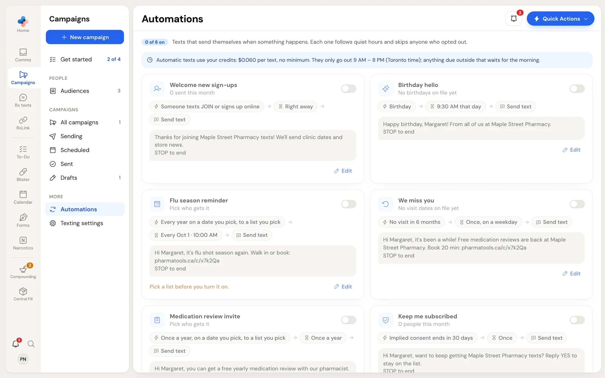
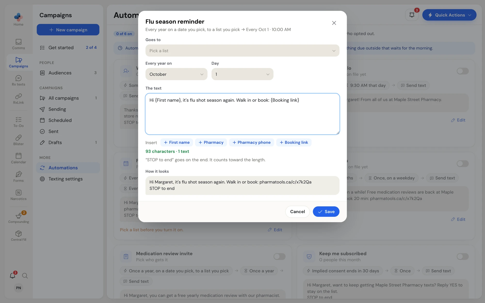
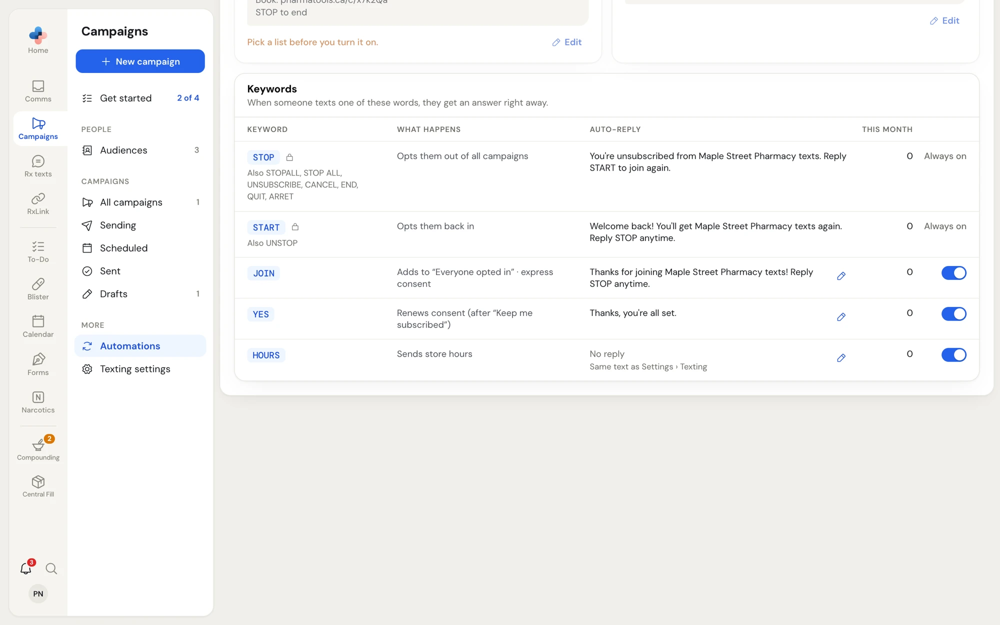

**Campaigns › Automations** has six texts that send on their own, and, for two-way texting, the **Keywords** table. Only Managers and Admins can turn them on or change them; everyone else sees them with the switches locked.

<Frame caption="Automations: each card shows what starts it, when it sends and the text">

</Frame>

The badge at the top (for example **0 of 6 on**) shows how many are running. Every automation follows your quiet hours and skips anyone who opted out or whose consent ran out.

<Info>
Automatic texts use your credits at $0.060 per text, with no $6.00 minimum. If your credits run out, automatic texts pause, a note on this page offers **Buy credits**, and the pharmacy is emailed.
</Info>

## The six automations

Each card reads left to right: what starts it, when it sends, then **Send text**, with the text below it as a sample person gets it (ending with the opt-out line).

| Automation | Starts when | Sends | The line under its name |
| --- | --- | --- | --- |
| **Welcome new sign-ups** | Someone texts JOIN or signs up online (outgoing only: signs up online) | Right away | *N sent this month* |
| **Birthday hello** | Their birthday | 9:30 AM that day | *N birthdays this month*, or *No birthdays on file yet* |
| **Flu season reminder** | Every year on a date you pick, to a list you pick | That date, 10:00 AM | *Next: …*, or *Pick who gets it* |
| **We miss you** | No visit in 6 months | Once, on a weekday | *Would reach N now*, or *No visit dates on file yet* |
| **Medication review invite** | Once a year, on a date you pick, to a list you pick | Once a year | *Next: …*, or *Pick who gets it* |
| **Keep me subscribed** | Implied consent ends in 30 days | Once | *N people this month* |

Birthdays and visit dates come from the **Birthday** and **Last visit** columns of your contact import.

**Keep me subscribed** asks people whose implied consent is about to end whether they want to stay. With two-way texting they reply **YES**; with outgoing-only texting the text carries a `{Stay link}` that opens the [keep-subscribed page](/campaigns/what-patients-see). Either way their consent becomes express, which lasts until they opt out.

## Turn an automation on or off

Click the switch at the top right of the card, or right-click the card and choose **Turn on** or **Turn off**. The switch answers at once; if the server refuses (for example, no mailing address yet), it flips back and a message says why.

- **Flu season reminder** and **Medication review invite** can't be turned on until you pick who gets them. The card says *Pick a list before you turn it on.*
- Without a mailing address in **Settings › Texting**, no automation can be turned on, and ones already on are paused.
- An automation whose text uses `{Booking link}` waits until a booking link is set.

## Change an automation's text

Click **Edit** on the card (or right-click › **Edit**).

<Frame caption="Editing the Flu season reminder: the list, the date and the text">

</Frame>

- **Goes to** (yearly automations only): pick one of your lists. With none yet, **Make one in Audiences** takes you there.
- **Every year on** and **Day** (yearly automations only): the date it sends each year.
- **The text**: up to 480 characters. **Insert** adds `{First name}`, `{Pharmacy}`, `{Pharmacy phone}` or `{Booking link}` (and `{Stay link}` for **Keep me subscribed** with outgoing-only texting). The counter shows the length and how many texts it takes, counting the opt-out line.
- **How it looks**: the text as a sample person gets it.

Click **Save**. When you opened the editor by turning the automation on, the button reads **Save and turn on** (or **Save without turning on** while the mailing address is missing).

<Warning>
**Keep me subscribed** must keep a way to stay: with two-way texting keep "Reply YES" in the text; with outgoing-only texting keep `{Stay link}`. The editor won't save it otherwise.
</Warning>

## Keywords

The **Keywords** table (two-way texting only) answers words people text to your number, right away.

<Frame caption="The Keywords table">

</Frame>

| Keyword | What happens | Can you change it? |
| --- | --- | --- |
| **STOP** (also STOPALL, STOP ALL, UNSUBSCRIBE, CANCEL, END, QUIT, ARRET) | Opts them out of all campaigns. | Always on. Required, can't be turned off. |
| **START** (also UNSTOP) | Opts them back in. | Always on. Required, can't be turned off. |
| **JOIN** | Adds them to **Everyone opted in** with express consent (and runs **Welcome new sign-ups** if it's on). | Edit the reply, turn on or off. |
| **YES** | Renews consent after **Keep me subscribed**. | Edit the reply, turn on or off. |
| **HOURS** | Sends your store hours. | The reply is set in **Settings › Texting** (**Reply to HOURS**). |

**This month** counts how often each keyword was used. To change a reply, click the pencil (or right-click the row › **Edit reply**), edit the text, and click **Save**. **Use the default reply** puts the original wording back. The **JOIN** reply must keep "Reply STOP" so new sign-ups know how to opt out.

<Note>
With outgoing-only texting, nothing comes back to the pharmacy, so keywords are off. STOP is still honoured through each person's opt-out link.
</Note>
