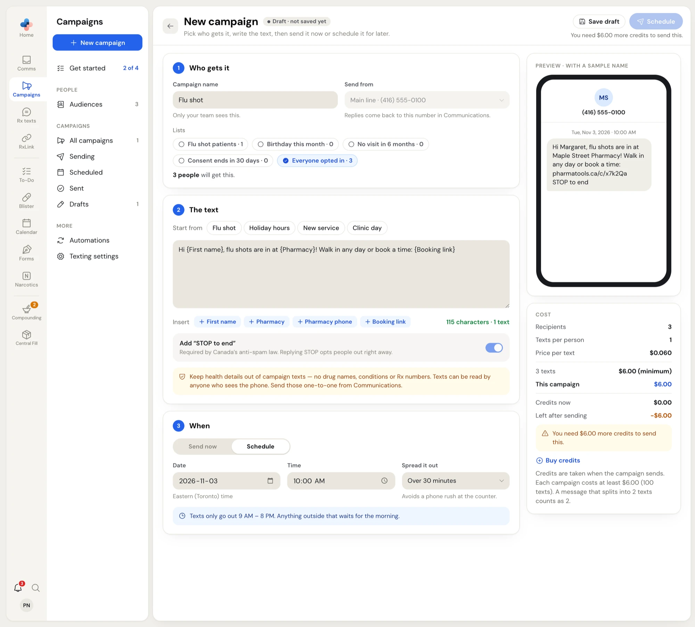
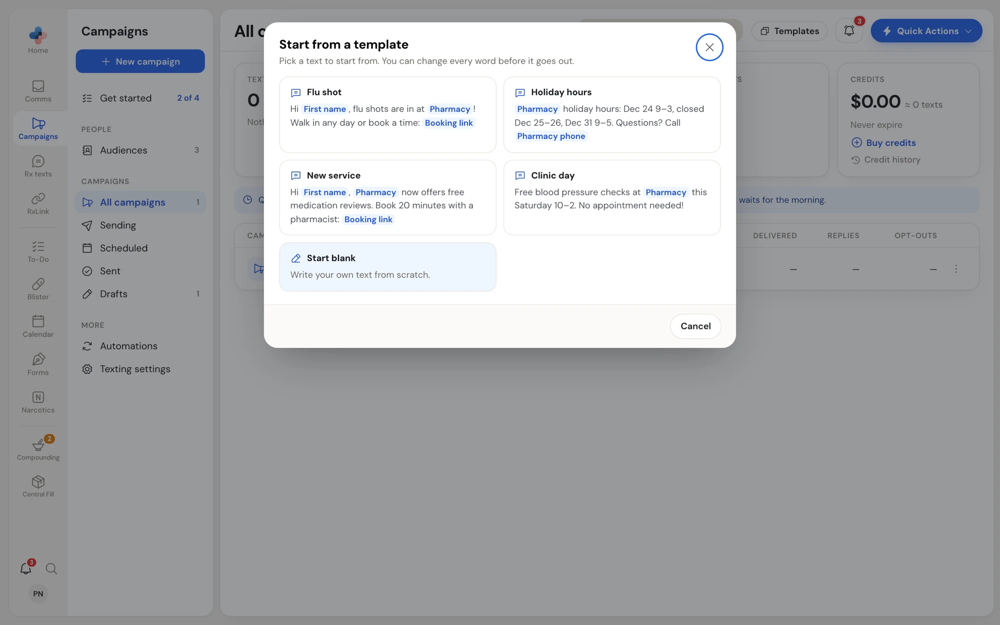

Click **New campaign** in the Campaigns side menu. To start from a ready-made text instead, click **Templates** at the top of the campaigns list.

The editor has three numbered steps on the left (**Who gets it**, **The text**, **When**) and, on the right, a phone preview and the cost.

<Frame caption="The campaign editor, with a schedule set and the cost card showing the credits still needed">

</Frame>

## Start from a template

**Templates** opens **Start from a template** with four starting texts: **Flu shot**, **Holiday hours**, **New service** and **Clinic day**, plus **Start blank**. Click one to open the editor with its name and text filled in. You can change every word before it goes out.

<Frame caption="Start from a template">

</Frame>

The same four appear as **Start from** buttons above the message box. If you've already written something, picking one asks **Replace your text?** first.

## 1 · Who gets it

<Steps>
  <Step title="Campaign name">
    Type a name, like *Flu shots are here*. Only your team sees it.
  </Step>
  <Step title="Send from">
    The number the texts come from. With two-way texting this is your **Main line**, and replies come back to it in **Comms**. With outgoing-only texting it's a PharmaTools number, or **Your own number** if one has been approved (that adds $10.00 to each campaign). See [Texting settings and credits](/campaigns/texting-settings-and-credits).
  </Step>
  <Step title="Lists">
    Click one or more list buttons. Each shows how many people it holds, for example **Everyone opted in · 3**. Under them the editor counts who will actually get it: *1,204 people will get this. We left out 37 who opted out or whose consent ran out.* Someone on two of your lists gets one text, not two.
  </Step>
</Steps>

## 2 · The text

Type the message in the box. Under it:

- **Insert** buttons add a merge field where your cursor is:

  | Merge field | Becomes |
  | --- | --- |
  | `{First name}` | Each person's first name, or *there* ("Hi there,") when none is on file. |
  | `{Pharmacy}` | Your pharmacy name from **Settings › Texting**. |
  | `{Pharmacy phone}` | Your phone from **Settings › Texting**. |
  | `{Booking link}` | Your booking page. Each person gets their own short link (pharmatools.ca/c/…), so the results show who tapped it. |

- **The counter** (for example *115 characters · 1 text*) counts the text as it will go out, including the opt-out line. It turns amber when the message splits into more than one text. One text holds 160 plain characters (153 per part once it splits). A special character such as a curly quote (’) or an emoji makes each text hold only 70 (67 per part). When curly quotes are the only reason, click **Use plain quotes** to fix it.
- **The opt-out line** is always added and can't be turned off. With two-way texting the switch reads **Add "STOP to end"** and replying STOP opts people out. With outgoing-only texting it reads **Add an opt-out link** and each person gets their own link that unsubscribes them in one tap.
- **The health-details warning** reminds you to keep drug names, conditions and Rx numbers out. Send those one-to-one from **Comms**.

If your text uses `{Booking link}` but no booking link is set yet, an amber note links to **Settings › Texting**. You can't send until it's added or you remove the field.

The **Preview · with a sample name** phone shows the text exactly as a person gets it, with a sample first name, your number at the top and the opt-out line at the end.

<Tip>
Some pharmacies also see **Make it shorter** beside **The text**. It suggests a shorter version of your message to bring it down to one text.
</Tip>

## 3 · When

- **Send now** sends as soon as you confirm.
- **Schedule** shows **Date** and **Time** (in your pharmacy's time zone, shown under the date, for example *Eastern (Toronto) time*). It starts with tomorrow at 10:00 AM.
- **Spread it out** sends the texts gradually so the phone doesn't ring all at once: **All at once**, **Over 30 minutes** (the default for a new campaign) or **Over 2 hours**.

The blue note under it shows your quiet hours, for example *Texts only go out 9 AM – 8 PM. Anything outside that waits for the morning.* If you schedule a time outside them, the note adds that it will start when quiet hours end. A spread that runs past the end of quiet hours carries on the next morning.

## The cost card

The **Cost** card works out the price from your current lists and text:

| Line | Meaning |
| --- | --- |
| **Recipients** | People who will get it. |
| **Texts per person** | 1, or more if the message splits. |
| **Price per text** | $0.060. |
| **N texts** | The texts' cost. *(minimum)* shows when the $6.00 minimum applies. |
| **Sending from your own number** | + $10.00, only when you send from your own number. |
| **This campaign** | The total taken from your credits. |
| **Credits now**, **Left after sending** | Your balance before and after. |

If you're short, an amber note says how much more you need, for example *You need $6.00 more credits to send this.* Click **Buy credits** right there. Credits are taken when the campaign starts sending.

## Send or schedule

<Steps>
  <Step title="Check the button">
    The blue button at the top right reads **Send now** or **Schedule**. When it's grey, the line under it says what to fix first, for example *Give the campaign a name.*, *Pick at least one list.*, *Write the text first.*, *Pick a time in the future.* or *You need $6.00 more credits to send this.*
  </Step>
  <Step title="Confirm">
    Click it. **Send this campaign?** (or **Schedule this campaign?**) repeats the name, how many people, the date for a schedule, and what comes out of your credits. Click **Send now** or **Schedule** to go ahead, or **Not yet**.
  </Step>
  <Step title="Watch it go">
    You're taken back to the campaigns list with *Your campaign is sending* or *Scheduled for Tue, Nov 3, 2026 at 10:00 AM*. If the price changed in the meantime (someone opted out, a list changed), nothing is sent and the editor shows the new cost so you can check and send again.
  </Step>
</Steps>

<Note>
Only Managers and Admins can send or schedule. Everyone else can write the campaign and click **Save draft**; the button then says *Only managers can send campaigns.*
</Note>

## Drafts

- **Save draft** saves without sending. The pill beside the title shows *Draft · not saved yet*, *Draft · unsaved changes* or *Draft · saved*.
- Leaving the editor inside PharmaTools (the back arrow, the side menu, the rail) saves your changes as a draft for you. Closing or reloading the browser tab asks first.
- If a colleague changed the same draft after you opened it, your save is refused so their text isn't overwritten. Reload to see their version.
- A scheduled campaign can't be edited. Unschedule it from the campaigns list first (right-click › **Unschedule**); it goes back to your drafts.

## When a campaign can't be sent at all

Amber notes at the top of the editor explain account-level problems:

- **No mailing address**: *Add your mailing address in Settings › Texting first. The law asks for it on the opt-out page.* Staff who aren't managers are told to ask a manager.
- **No number to send from**: *There's no number to send campaign texts from yet.* Two-way texting needs your own texting number.
- **No contacts**: *You can't send a campaign without contacts.* with an **Import contacts** link.
