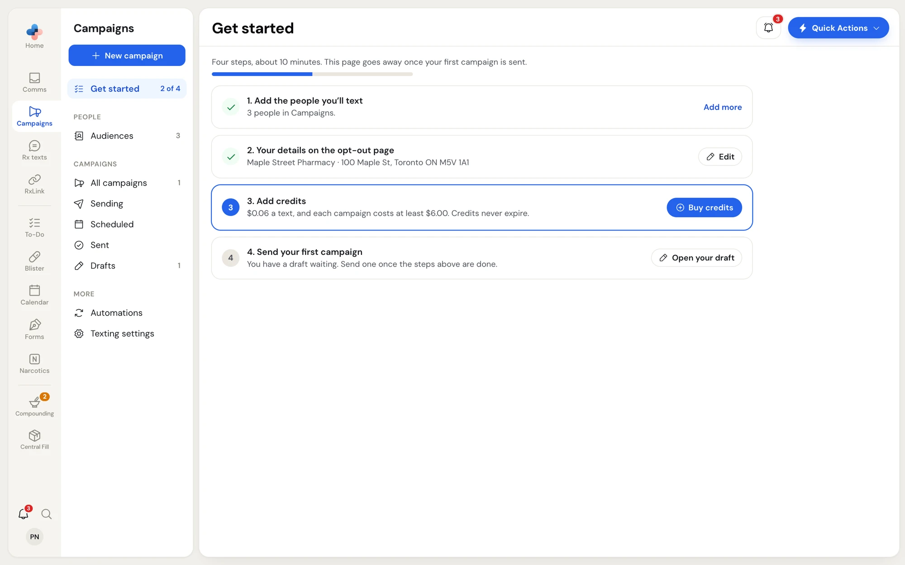
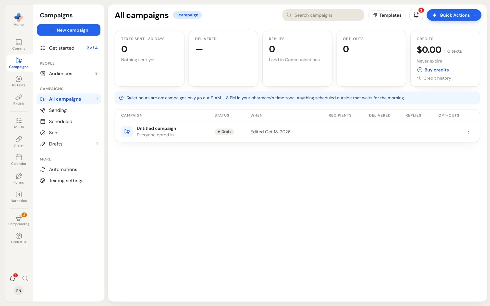
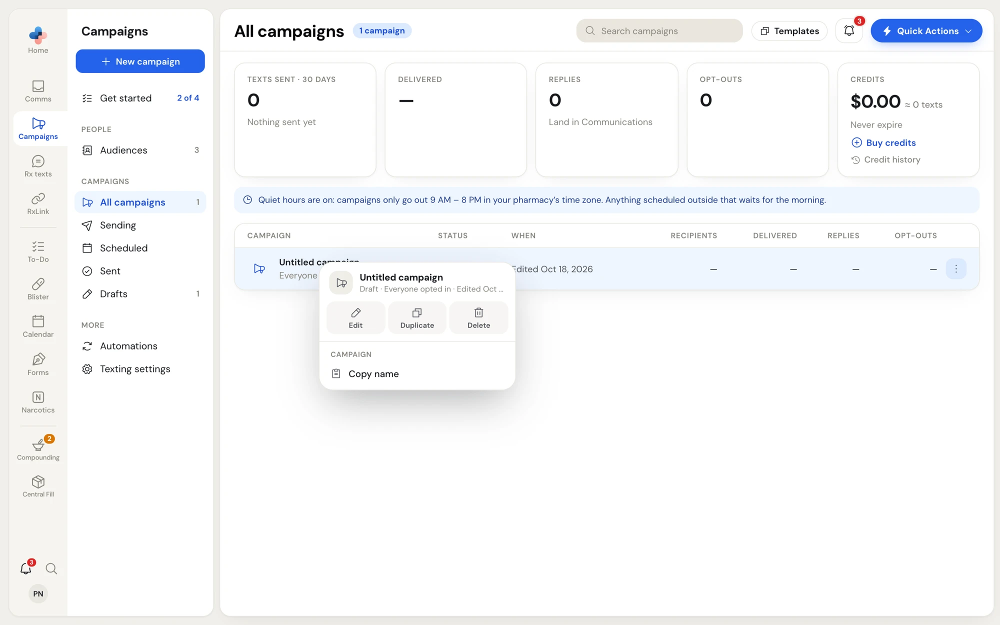

**Campaigns** sends one text to many people at once: flu clinic dates, holiday hours, a new service. It only texts people who gave consent under Canada's anti-spam law, adds the opt-out line for you, and shows how many texts were delivered, who tapped your link, who replied and who opted out.

<Note>
Campaigns is for marketing texts. Keep health details out of them: no drug names, conditions or Rx numbers. To text one patient about their own prescription, use **Comms** or [Rx texts](/rx-texts/overview).
</Note>

## Before you start

- **Campaigns is an add-on.** If the **Campaigns** tile in the rail opens a locked page, the add-on isn't on your plan. An Admin can add it in **Settings › Plan & modules**.
- **Texts cost credits.** One text costs $0.06 of credit. Each campaign costs at least $6.00 (100 texts). Credits never expire. See [Texting settings and credits](/campaigns/texting-settings-and-credits).
- **Your mailing address is required.** The law asks every campaign to say who sent it. Your pharmacy's name, phone and mailing address appear on the opt-out page each text links to. Nothing can be sent until the mailing address is filled in.

## Who can do what

| Action | Assistant, Technician, Pharmacist | Manager, Admin |
| --- | --- | --- |
| Import contacts, make and edit lists, edit a contact | Yes | Yes |
| Write and save campaign drafts | Yes | Yes |
| Send, schedule, stop or unschedule a campaign | No | Yes |
| Buy credits | No | Yes |
| Export a report, resend a campaign | No | Yes |
| Turn automations and keywords on or off, change their texts | No | Yes |
| Change **Settings › Texting** | No | Yes |
| Pay our team to reformat a contact file | No | Yes |

If you aren't a Manager or Admin, the **Send now** button stays grey and says *Only managers can send campaigns.* Save the draft and ask a manager to send it.

## Find your way around

Click **Campaigns** in the rail. The side menu next to it holds every part of the module:

| Side menu item | What it opens |
| --- | --- |
| **New campaign** (blue button) | The campaign editor. Until you have contacts, this button reads **Import contacts** instead. |
| **Get started** | A four-step checklist for your first campaign. It shows *2 of 4* and so on, and disappears once your first campaign has been sent. |
| **People › Audiences** | Your contacts, lists and consent. See [Audiences and consent](/campaigns/audiences). |
| **Campaigns › All campaigns, Sending, Scheduled, Sent, Drafts** | The campaigns list, filtered by status, with a count beside each. |
| **More › Automations** | Texts that send themselves (welcome, birthday, flu season…) and keyword replies. See [Automations and keywords](/campaigns/automations). |
| **More › Texting settings** | Opens **Settings › Texting**. |

## Get started

Until your first campaign goes out, clicking **Campaigns** opens **Get started**. Each step can be done right on the card:

<Frame caption="Get started: four steps, with the step you're on outlined in blue">

</Frame>

<Steps>
  <Step title="Add the people you'll text">
    Choose **Upload a spreadsheet**, or **From your Contacts** if your pharmacy has Contacts in **RxLink**. Once done, the card shows how many people are in Campaigns and offers **Add more**.
  </Step>
  <Step title="Your details on the opt-out page">
    Click **Fill in** (or **Edit**) to enter **Pharmacy name**, **Phone**, **Mailing address** and an optional **Booking link**, then **Save and continue**. Only a Manager or Admin can change these. **All texting settings** opens **Settings › Texting**.
  </Step>
  <Step title="Add credits">
    Click **Buy credits**. Once you have enough for a campaign, the card shows your balance and the button reads **Buy more**.
  </Step>
  <Step title="Send your first campaign">
    Click **Write it** to open the editor, or **Open your draft** if you already saved one. You can write the campaign before you have credits and send it once they're in.
  </Step>
</Steps>

## The campaigns list

Click **All campaigns** (or one of the status views) in the side menu.

<Frame caption="All campaigns: the 30-day totals, your credit balance, the quiet-hours note and the list">

</Frame>

**Across the top** are your totals for the last 30 days:

- **Texts sent · 30 days**
- **Delivered**: the percentage delivered, with the number that failed under it.
- **Replies** (two-way texting) or **Link clicks** (outgoing-only texting). Replies land in **Comms**.
- **Opt-outs**: how many people opted out, and what share of recipients that is.
- **Credits**: your balance in dollars and roughly how many texts it buys, with **Buy credits** and **Credit history**.

Under the totals, a blue note reminds you of your quiet hours (by default, 9 AM to 8 PM in your pharmacy's time zone).

**The table** lists one campaign per row: **Campaign** (name and the lists it went to), **Status**, **When**, **Recipients**, **Delivered**, **Replies** (or **Clicks**), and **Opt-outs**. Click a row to open it: a draft opens in the editor, any other campaign opens its [results](/campaigns/campaign-results).

Use **Search campaigns** at the top to find a campaign by name, and **Templates** to start a new campaign from a ready-made text.

While a campaign is sending, the list refreshes itself every 10 seconds and the status shows a progress bar.

### Campaign statuses

| Status | What it means |
| --- | --- |
| **Draft** | Saved but not sent or scheduled. Anyone can edit it. |
| **Scheduled** | Set to go out at a date and time. Credits are taken when it starts sending. |
| **Sending · 40%** | Going out now. The percentage is how much has been sent. |
| **Sent** | Every text has gone out. |
| **Stopped** | A Manager stopped it part-way. Credits for texts that hadn't gone out were returned. |
| **Waiting for quiet hours to end** (blue) | It's outside your sending hours. It carries on at the start of the next window. |
| **Waiting for credits** | Your balance is too low. Buy credits and it starts. |
| **Waiting — no mailing address** | Add the mailing address in **Settings › Texting**. |
| **Waiting — billing**, **Waiting — Campaigns is off**, **Waiting — no texting number**, **Waiting — two-way needs SMS** | Something on your account stops texts. Fix it, and the campaign carries on. |

<Warning>
A campaign that stays in a **Waiting** status for 48 hours is cancelled and you're emailed. A scheduled campaign goes back to your drafts; one that was already sending is stopped and the unused credits are returned.
</Warning>

### Right-click a campaign

Right-click any row, or click its **⋮** button, to open its menu:

<Frame caption="The menu for a draft: Edit, Duplicate, Delete and Copy name">

</Frame>

| Menu item | When it shows | What it does |
| --- | --- | --- |
| **Edit** | Drafts | Opens the draft in the editor. |
| **Report** / **View report** | Sending, sent or stopped campaigns | Opens its [results](/campaigns/campaign-results). |
| **Open** | Scheduled campaigns | Opens the campaign. |
| **Duplicate** | Always | Copies the campaign as a new draft and opens it (*Copied as a new draft*). |
| **Unschedule** | Scheduled (Managers and Admins) | Asks **Cancel this scheduled campaign?** **Cancel schedule** turns it back into a draft. No credits are taken. |
| **Stop** | Sending (Managers and Admins) | Asks **Stop sending "…"?** Texts already sent can't be taken back; credits for the rest come back to you. |
| **Delete** | Drafts | Asks **Delete this draft?** The draft is gone for good. |
| **Copy name** | Always | Copies the campaign name. |

## Where to go next

<CardGroup cols={2}>
  <Card title="Audiences and consent" icon="book-user" href="/campaigns/audiences">
    Import contacts, build lists and understand consent.
  </Card>
  <Card title="Create a campaign" icon="pen-line" href="/campaigns/create-a-campaign">
    Write the text, pick the lists, send or schedule.
  </Card>
  <Card title="Campaign results" icon="chart-column" href="/campaigns/campaign-results">
    Delivered, clicks, replies, opt-outs and resending.
  </Card>
  <Card title="What patients see" icon="smartphone" href="/campaigns/what-patients-see">
    The sign-up, opt-out and keep-subscribed pages.
  </Card>
</CardGroup>
