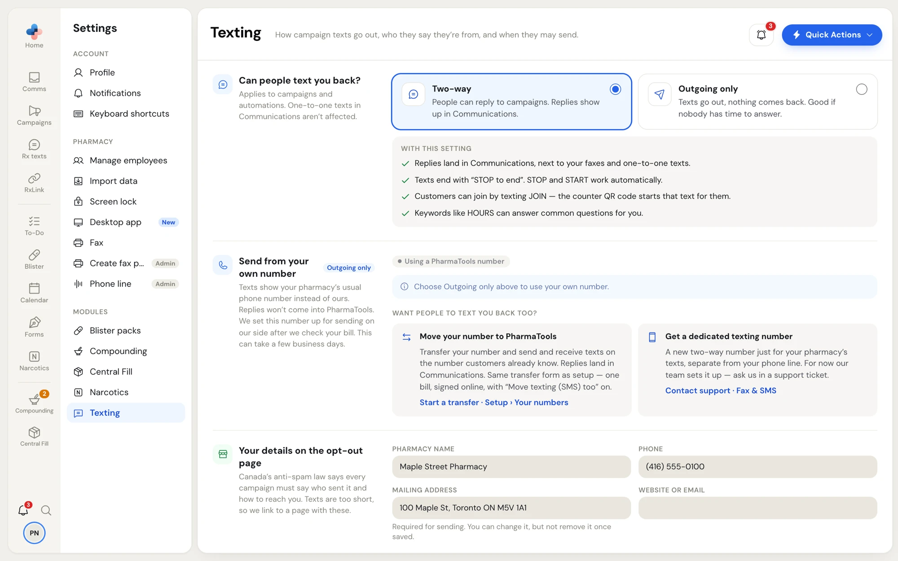

## Settings › Texting

Open it from **Campaigns › Texting settings** in the side menu, or **Settings › Texting**. Anyone can read it; only a Manager or Admin can change it. Click **Save changes** at the bottom when you're done.

<Frame caption="Settings › Texting">

</Frame>

### Can people text you back?

This applies to campaigns and automations only. One-to-one texts in **Comms** aren't affected.

| | **Two-way** | **Outgoing only** |
| --- | --- | --- |
| Replies | Land in **Comms**, next to your faxes and one-to-one texts. | Nothing comes back, so there's no inbox to watch. |
| Opt-out line | Texts end with "STOP to end". STOP and START work automatically. | Texts end with a short personal link. One tap unsubscribes. |
| How customers join | Texting JOIN (the counter QR code starts that text). | Your online sign-up page (the counter QR code opens it). |
| Keywords | On, for example HOURS. | Off. |
| Results show | Replies. | Link clicks. |
| Number | Needs your own texting number. | Can send from a shared PharmaTools number. |

### Send from your own number (outgoing only)

With outgoing-only texting, texts can show your pharmacy's usual number instead of a PharmaTools one. Replies still don't come into PharmaTools. Click **Use my own number**, enter the number, the name on the phone account and a recent phone bill, tick the ownership statement, and click **Send for approval**. While it's **Waiting for approval**, campaigns keep sending from the PharmaTools number; you can **Withdraw request**. Once approved, each campaign sent from it costs $10.00 more, and **Stop using this number** switches back.

**Want people to text you back too?** Move your number to PharmaTools (**Start a transfer · Setup › Your numbers**) or ask for a dedicated texting number (**Contact support · Fax & SMS**).

### Your details on the opt-out page

**Pharmacy name**, **Phone**, **Mailing address** and **Website or email**. Canada's anti-spam law says every campaign must say who sent it and how to reach you; texts are too short, so each text links to a page with these. The mailing address is required before anything can be sent, and once saved it can be changed but not removed.

### Booking link

**Booking page**: where `{Booking link}` in a campaign takes people, for example your online booking page. Each person gets their own short link, so the results show who tapped it.

### Reply to HOURS (two-way only)

The text someone gets when they text HOURS to your number. It doesn't use your credits. Keep it to one text (160 characters).

### Quiet hours

**Send from** and **Until** (between 7 AM and 10 PM) and **Time zone**. Campaigns and automations wait outside these hours. The default is 9 AM to 8 PM. **Texting number** shows the number your texts go out from.

## Credits

Campaign and automation texts are paid for with credits you buy ahead of time.

- One text costs **$0.06** of credit, before tax.
- Each campaign costs at least **$6.00** (100 texts). Automations have no minimum.
- A message that splits into 2 texts counts as 2 for every person.
- Sending from your own number adds **$10.00** to each campaign.
- Credits never expire. They're taken when a campaign starts sending, and texts that never left are refunded.

### Buy credits

Only a Manager or Admin can buy credits. Click **Buy credits** on the **Credits** card of the campaigns list, in the editor's **Cost** card, or on **Get started**.

<Steps>
  <Step title="Pick an amount">
    Choose a pack, or type a number in **Or enter a number of texts** (at least 100). The window shows the price, tax for your province, **Balance now**, **Adding** and **Balance after**.
  </Step>
  <Step title="Billing address">
    If no billing address is on file yet, fill in **Street address**, **City**, **Province** and **Postal code**. Tax depends on your province, and the address is kept for next time.
  </Step>
  <Step title="Pay">
    Credits are paid by card. Check the card shown (**Change card** opens **Settings › Billing**), tick the payment terms, and click **Pay $…**. A secure payment window asks for the card if none is on file. Credits are added once the payment is confirmed, and a receipt is emailed.
  </Step>
</Steps>

<Note>
Paying online isn't available for pharmacies in Saskatchewan yet. The window says so and gives our email address to set up billing.
</Note>

Staff who aren't managers see the balance and *Ask a manager to buy credits.*

### Credit history

Click **Credit history** on the **Credits** card. It lists, newest first: **Credits bought**, **Campaign sent**, **Own number fee**, **Automation text**, **Refund for texts that didn't go out** and **Adjustment by PharmaTools**, with your balance at the bottom and a **Buy credits** button.
