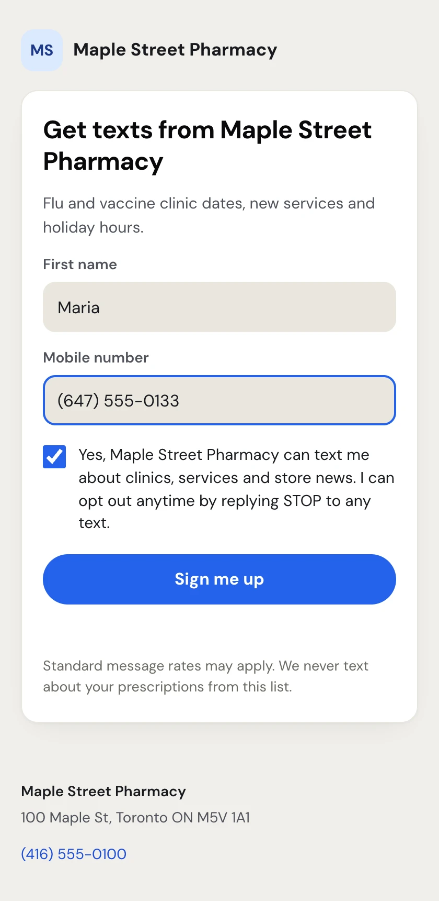
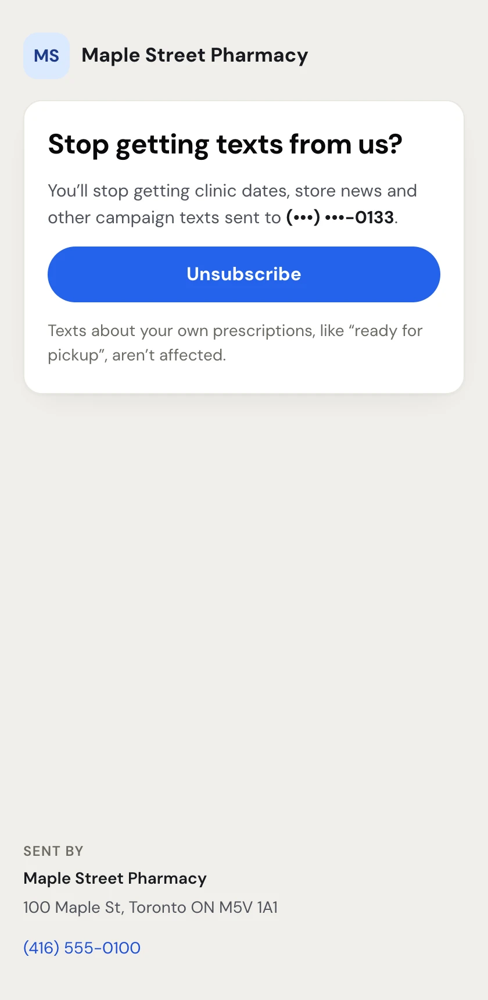
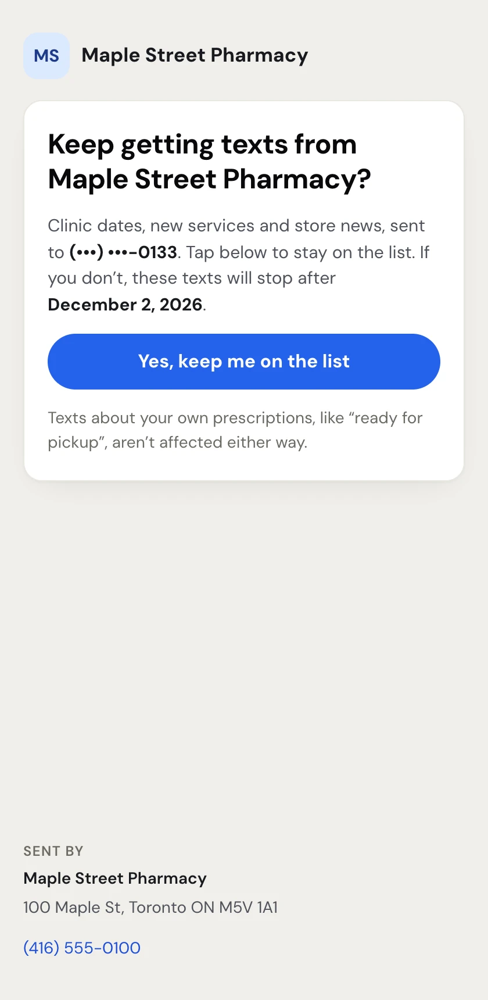

Every campaign text gives the customer a way out, and some give them a way in. These pages open on the customer's phone. They don't need an account; each link is unique to that person. Every page shows your pharmacy's name at the top and, at the bottom, your name, mailing address, phone and website from **Settings › Texting**.

## The sign-up page

With outgoing-only texting, customers reach it by scanning the QR code on your printed counter sign, or by typing the web address printed under it (see **Grow your list at the counter** in [Audiences](/campaigns/audiences)).

<Frame caption="The sign-up page, filled in by a customer">

</Frame>

The customer:

1. Enters **First name** and **Mobile number** (10 digits).
2. Ticks the consent box, for example *Yes, Maple Street Pharmacy can text me about clinics, services and store news. I can opt out anytime by replying STOP to any text.* With outgoing-only texting the sentence ends *with the link in each text* instead. The box starts unticked, and the exact sentence they tick is recorded as their consent.
3. Taps **Sign me up**.

They see **You're on the list** and, if **Welcome new sign-ups** is on, are told a welcome text is coming. They join **Everyone opted in** with express consent.

If the number opted out before, the page explains how to come back: text START to your number. With two-way texting, customers can also sign up by texting **JOIN** to your number.

## The opt-out page

Every outgoing-only campaign text ends with a personal link like *Stop: pharmatools.ca/u/x7k2Qa*. Two-way texts end with "STOP to end" instead, and the customer replies STOP.

<Frame caption="The opt-out page a customer opens from their link">

</Frame>

**Stop getting texts from us?** shows the masked number the texts go to. Tapping **Unsubscribe** opts them out at once and shows **You're unsubscribed**. If they tapped by mistake, **Changed your mind? Subscribe again** puts them back.

Both pages say that texts about their own prescriptions, like "ready for pickup", aren't affected.

## The keep-subscribed page

With outgoing-only texting, the **Keep me subscribed** automation sends a link to people whose implied consent ends soon.

<Frame caption="The keep-subscribed page, with the date the texts would stop">

</Frame>

The page says the texts will stop after a date (for example *December 2, 2026*) unless they stay. Tapping **Yes, keep me on the list** gives express consent and shows **You're all set**. Someone who has already opted out sees **You're unsubscribed** with a **Subscribe again** link instead.

## Booking links

When a campaign uses `{Booking link}`, each person's text has their own short link (pharmatools.ca/c/…). Tapping it counts a click in your [results](/campaigns/campaign-results) and opens your booking page straight away. The customer only briefly sees *Opening…*.

## Broken or old links

A link that was typed wrong or is no longer active shows **This link isn't working**. If the problem was on our side, a **Try again** button appears.

## Replying STOP or START (two-way)

- **STOP** (or STOPALL, UNSUBSCRIBE, CANCEL, END, QUIT, ARRET) opts the number out of all campaigns and automations and sends your STOP reply.
- **START** (or UNSTOP) opts them back in.

The message itself still shows in the conversation in **Comms**.
