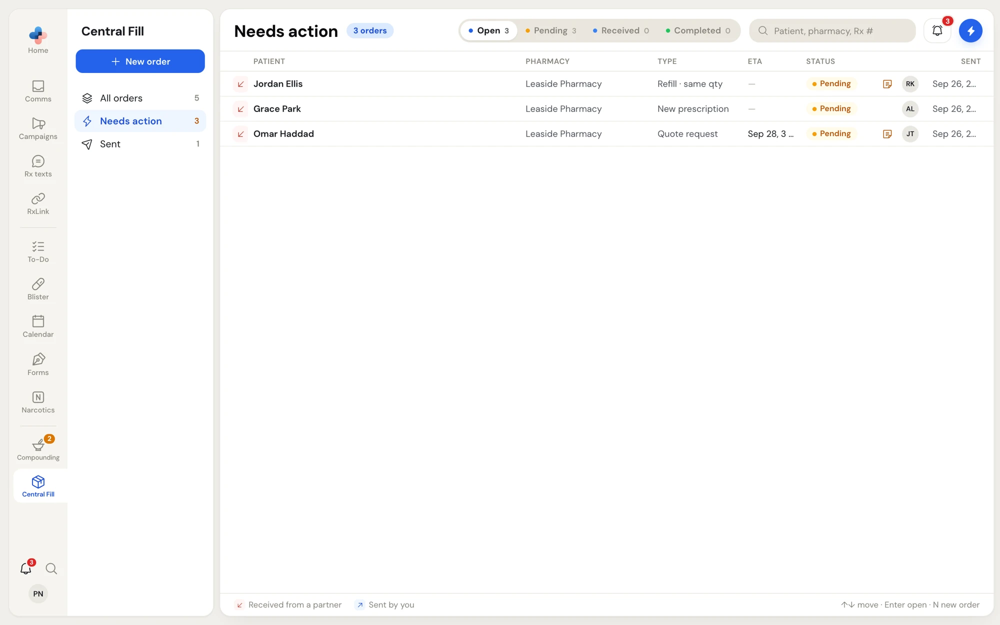
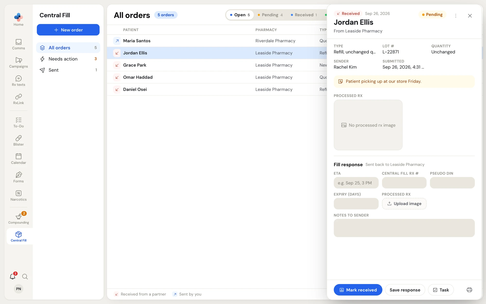
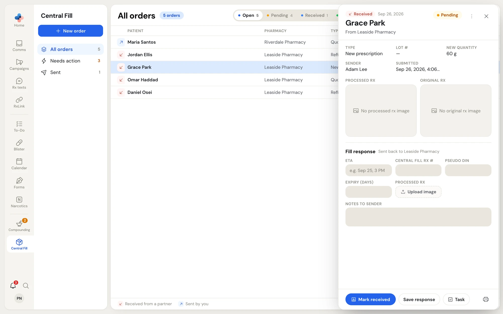
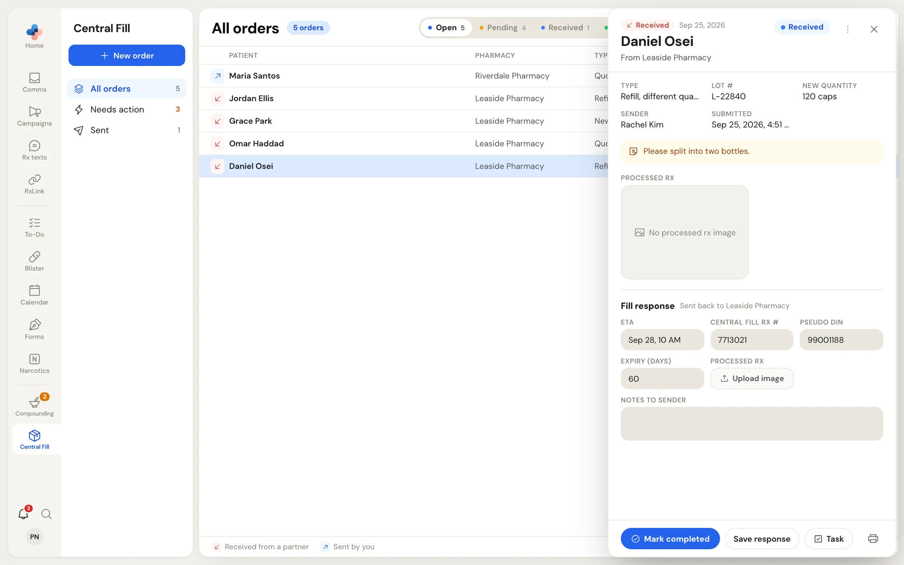
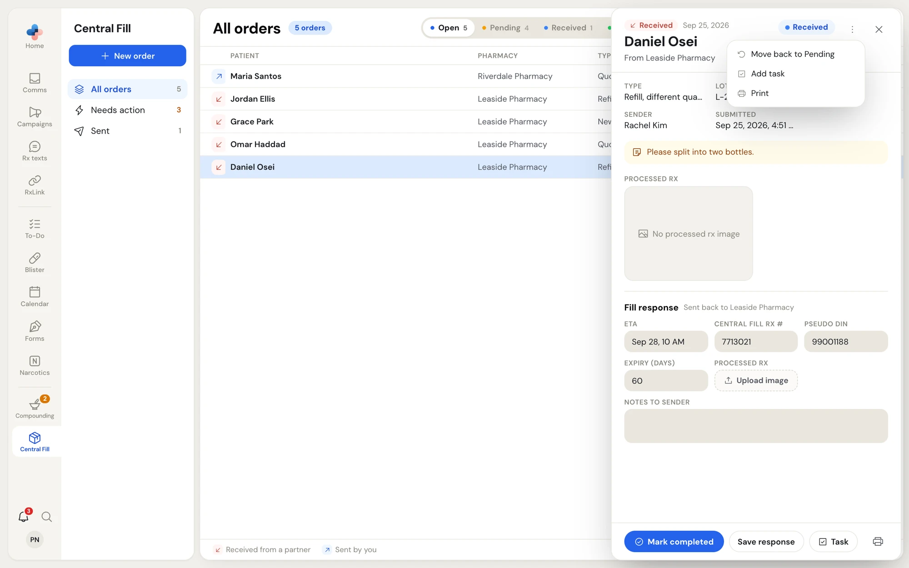
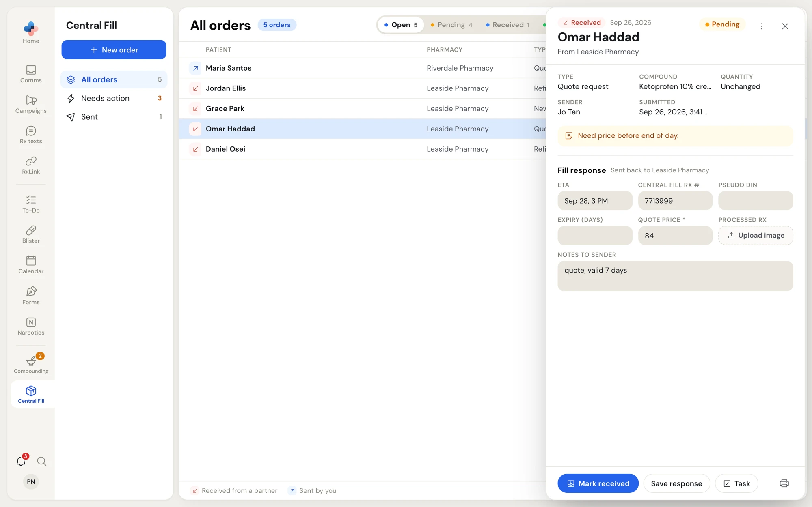
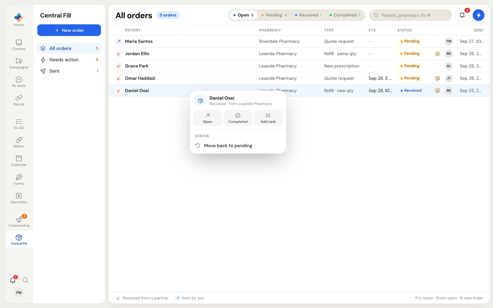

This page is for the **central fill pharmacy**: the pharmacy that prepares compounds for its partner pharmacies. Your pharmacy needs the Central Fill role **Receiver** or **Both** (see [Your pharmacy's Central Fill role](/central-fill/overview#your-pharmacys-central-fill-role)).

## Find new orders

Orders your partners send show in **All orders** with a red down-left arrow. New ones are **Pending**.

**Central Fill › Needs action** lists every order you received that nobody has marked received yet. Its amber number counts them. Check it at the start of each shift.

<Frame caption="Needs action: orders partners sent you that are still Pending">
  
</Frame>

The **Central Fill** card on the Dashboard lists the same orders, and a dot on the **Central Fill** rail icon means a pharmacy is asking to connect.

## Open an order

Click the order. The pane shows **Received**, the date, the patient and **From** the sending pharmacy, with the status on the right.

<Frame caption="An incoming order that is Pending: the facts, the sender's note, the processed Rx and the fill response form">
  
</Frame>

You see:

- **Type**, **LOT #** (or **Compound** for a quote request), **Quantity** or **New quantity**, **Sender** (who sent it) and **Submitted** (date and time, with the year).
- The sender's note in amber, if there is one.
- **Processed Rx**, and for a **New prescription** also **Original Rx**. Click an image to see it full size.
- **Fill response**, the form you send back. Its hint says **Sent back to** the sending pharmacy.

<Frame caption="A new prescription shows the original Rx beside the processed Rx">
  
</Frame>

## Move an order forward

The blue button at the bottom of the pane moves the order one step:

<Steps>
  <Step title="Mark received">
    Click **Mark received** as soon as you start on the order. The sender sees **Received** straight away, so they know you have it. The order leaves **Needs action**.
  </Step>
  <Step title="Send the fill response">
    Fill in what you know and click **Save response** (see below). You can save it as often as you need while the order is open.
  </Step>
  <Step title="Mark completed">
    When the order is ready, click **Mark completed**. The fill response is now final: the form turns into a read-only summary for both pharmacies.
  </Step>
</Steps>

You can also move an order from the list without opening it: right-click it and click **Received** or **Completed**.

<Frame caption="A Received order: the button now says Mark completed, and the fill response is filled in">
  
</Frame>

### Move an order back

If someone marked an order by mistake, open it, click **⋯** (top right of the pane) and choose **Move back to Pending** or **Move back to Received**. From the list, right-click the order and choose **Move back to pending** or **Move back to received**. It moves back one step.

<Frame caption="The ⋯ menu on a Received order">
  
</Frame>

A completed order you move back to **Received** gets its fill response form back.

## The fill response

All fields are optional except **Quote price** on a quote request.

| Field | What to enter |
| --- | --- |
| **ETA** | When the order will be ready or delivered, for example `Sep 25, 3 PM` |
| **Central Fill Rx #** | The prescription number in your own system |
| **Pseudo DIN** | The pseudo DIN for this compound, which the sender uses to bill |
| **Expiry (days)** | Days until the preparation expires, from its beyond-use date |
| **Quote price** | The price, for a **Quote request**. Required. |
| **Processed Rx** | Click **Upload image** to attach your own processed prescription. Images only: JPG, PNG, GIF or WebP. |
| **Notes to sender** | Anything the sender should know: a substitution, a delay, handling instructions |

Click **Save response**. A message confirms **Response sent to** the pharmacy. The sender sees your response on the order the next time they open it. The **ETA** also shows in both pharmacies' order lists.

<Frame caption="A quote request: Quote price is required before you can save the response">
  
</Frame>

## Print an order

Click the printer at the bottom right of the pane, or **⋯ › Print**. The printout has the patient, the sending pharmacy, the status, the order's facts, the sender's note, your fill response and the images. Use it as a worksheet at the bench.

## Add a task

Click **Task** in the pane, **⋯ › Add task**, or **Add task** in the right-click menu. A To-Do task opens linked to the order, for example to remind a technician to start the compound.

<Frame caption="Right-click on a Received order you received">
  
</Frame>

## What you can't do

- You can't edit or delete an order a partner sent you. Only the sender can, and only while it is **Pending**. Ask the sender, or send them a message from the partner's page.
- You can't create an order for a partner that sends to you. **New order** only offers pharmacies that fill orders for you.

<CardGroup cols={2}>
  <Card title="Partners and connections" icon="handshake" href="/central-fill/partners">
    Accept a new sender or register one.
  </Card>
  <Card title="Onboarding documents" icon="file-signature" href="/central-fill/onboarding-documents">
    Your partner agreement and each sender's OCP notice.
  </Card>
</CardGroup>
