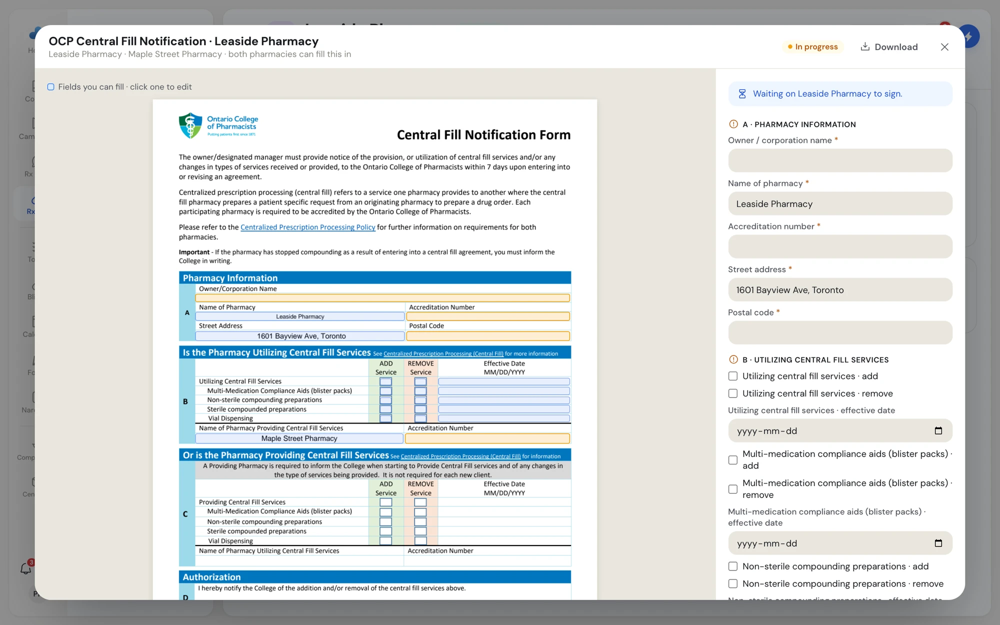
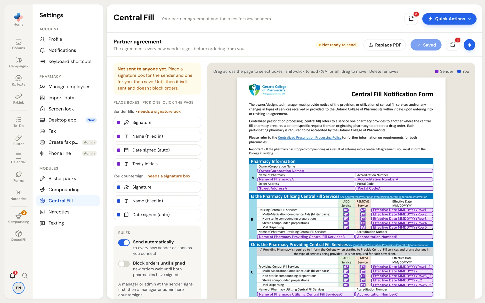

When two pharmacies become Central Fill partners, they have two documents to finish:

- The **OCP Central Fill Notification**: the dispensing pharmacy (the sender) must tell the Ontario College of Pharmacists that it now uses central fill services. PharmaTools fills in the College's form, collects the signature and faxes it to the College for you.
- The **Partner agreement**: the central fill pharmacy's own agreement, if it uses one. The sender signs first, then the central fill pharmacy countersigns.

Both pharmacies see the same documents, the same progress and the same activity on the partner's page: **RxLink › Central Fill partners**, then click the partner. See [A partner's page](/central-fill/partners#a-partners-page).

## When the documents start

- **When a connection is accepted**, PharmaTools starts the OCP notice. If the central fill pharmacy has a partner agreement with **Send automatically** on, the agreement is sent too.
- **When a central fill pharmacy registers a sender** with **Register sender**, the same happens, because the two pharmacies are partners from the start.
- **By hand** on the partner's page: **Start OCP notice** or **Send agreement**. Partners who connected before onboarding existed see **You connected before onboarding existed, so nothing is required here. Start the notice if one is still needed.**

Whoever has to act next gets a To-Do task and an email. Every manager and admin at that pharmacy gets the task, because only they can sign. The tasks close when the document is finished.

## The OCP notice

The **OCP Central Fill Notification** card on the partner's **Documents** tab shows four steps, with who did each one and when:

| Step | What happens | Who |
| --- | --- | --- |
| **Filled** | The form's fields are filled in | Either pharmacy can fill in fields |
| **Signed** | Section D is signed | A manager or admin at the sender |
| **Faxed** | The signed form is faxed to the College | The sender |
| **Delivered** | The College's fax machine confirmed delivery | Automatic |

The pill on the card says where it stands: **Draft · needs signing** (for the sender) or **Draft · waiting on them** (for the central fill pharmacy), **Faxing to OCP…**, **Delivered** with the date, or **Fax failed · resend**. The notice is due 7 days after both pharmacies sign the partner agreement, or 7 days after connecting when there is no agreement. The due date shows on the card.

### Fill in and sign the notice

<Steps>
  <Step title="Open the notice">
    On the partner's page, click **Open & sign** (sender) or **Open** (central fill pharmacy). The document opens in a window.
  </Step>
  <Step title="Fill in the fields">
    The left side shows the form exactly as it will be faxed. Blue boxes are fields you can fill; purple boxes are where someone signs. The right side lists the fields by section, with an amber mark on any section that still has a required field empty. Click a field on either side to edit it. Each value saves when you leave the field, and the other pharmacy sees it straight away.
  </Step>
  <Step title="Sign">
    When every required field is filled in, the **Your signature** box shows **Sign** to a manager or admin at the sender. Click it, then sign: **Draw** your signature, **Type** your name, use your **Saved** signature, or **Upload signed copy** if you signed a printed copy. Click **Sign**. Once it is signed, the fields are locked.
  </Step>
  <Step title="Send it to the College">
    The **Send to OCP** box shows the College's fax number. Type **Your fax number (printed on the cover for replies)**, then click **Send to OCP**. The fax goes out on the PharmaTools notification line with a cover page from your pharmacy.
  </Step>
</Steps>

<Frame caption="The OCP notice window: the College's form on the left, its fields by section on the right">
  
</Frame>

The **Faxes** list in the window shows each attempt with its status: **Queued**, **Sending**, **Delivered**, **Failed**, **Cancelled** or **Paused**. Click the receipt icon to download the fax receipt. **Fax receipt** on the partner's page downloads the latest one.

If the fax fails, the pill says **Fax failed · resend**. Open the notice and send it again.

<Info>
Only the sender's managers and admins can sign the notice, and only the sender can send it to the College. The central fill pharmacy can open the notice, fill in fields and follow its progress.
</Info>

## The partner agreement

The **Partner agreement** card shows three steps: **Sent**, **Sender signs** and **Countersign**.

| Pill | What it means |
| --- | --- |
| **Ready to sign** | The sender's manager or admin can sign now (seen by the sender) |
| **Awaiting their signature** | The sender hasn't signed yet (seen by the central fill pharmacy) |
| **Ready to countersign** | The sender signed; a manager or admin at the central fill pharmacy can countersign |
| **Waiting on their countersign** | You signed; the central fill pharmacy hasn't countersigned yet (seen by the sender) |
| **Signed** | Both signed, with the date |

To sign, click **Open & sign** (sender) or **Open & countersign** (central fill pharmacy), check the agreement, and use **Sign** the same way as for the OCP notice.

If the card says **Not sent to this partner yet.**, the central fill pharmacy clicks **Send agreement**. If it says **You don't have a partner agreement set up.**, click **Set one up** to go to **Settings › Central Fill**.

<Warning>
If the central fill pharmacy turned on **Block orders until signed**, the sender can't send orders until both pharmacies have signed the agreement.
</Warning>

## Share another document

At the bottom of the **Documents** tab, **Add a document** shares any PDF with the partner.

<Steps>
  <Step title="Choose the PDF">
    Click **Upload PDF** and choose the file. Give it a **Name**.
  </Step>
  <Step title="Choose what the partner does">
    - **Just share it**: they can view and download it.
    - **Ask them to sign**: place where they sign, and where you countersign if you do.
  </Step>
  <Step title="Send it">
    Click **Share** or **Send for signature**. The document shows under **Shared documents** with its status, such as **Shared**, **Ready for you to sign** or **Signed** with the date.
  </Step>
</Steps>

## Withdraw or download a document

In the document window:

- **Download** saves the PDF as it stands, with the values and signatures so far.
- **Withdraw this document** (at the bottom) cancels a document that isn't finished. Only the pharmacy that started it can withdraw it: the sender for the OCP notice, the central fill pharmacy for its agreement, the pharmacy that shared any other document. Both pharmacies then see it as withdrawn.

## Set up your partner agreement (central fill pharmacies)

Open **Settings › Central Fill**. Managers and admins can change it.

<Frame caption="Settings › Central Fill: the partner agreement, the boxes to place, the rules and the versions">
  
</Frame>

<Steps>
  <Step title="Upload the agreement">
    Click **Upload agreement PDF** and choose your agreement. To change it later, click **Replace PDF**.
  </Step>
  <Step title="Place the boxes">
    Under **Place boxes · pick one, click the page**, pick a box and click the page where it goes:
    - **Sender fills**: **Signature**, **Name (filled in)**, **Date signed (auto)** and **Text / initials**.
    - **You countersign**: **Signature**, **Name (filled in)** and **Date signed (auto)**.

    You need at least one signature box for each. Drag a box to move it. Drag across the page to select several, shift-click to add one, **⌘A** (or **Ctrl+A**) selects all, and **Delete** removes the selection. Click a box to mark it **Required** or **Optional**, or **Remove box**.
  </Step>
  <Step title="Save">
    Click **Save**. Until both signature boxes are placed and saved, the page says **Not ready to send**, and the agreement isn't sent and doesn't block orders. Once saved, the page shows the version in use, for example **v1 in use**.
  </Step>
</Steps>

### Rules

| Rule | What it does |
| --- | --- |
| **Send automatically** | Sends the agreement to every new sender as soon as you connect |
| **Block orders until signed** | New orders from a sender wait until both pharmacies have signed |

A manager or admin at the sender signs first; then a manager or admin at your pharmacy countersigns.

### Versions

**Versions** lists every version of your agreement with its date, what changed and who changed it, and how many senders signed it. Senders keep the version they were sent; a new version only goes to new senders.

<CardGroup cols={2}>
  <Card title="Partners and connections" icon="handshake" href="/central-fill/partners">
    Connect with a pharmacy and open its page.
  </Card>
  <Card title="Send orders" icon="send" href="/central-fill/sending-orders">
    Create your first order once onboarding is done.
  </Card>
</CardGroup>
