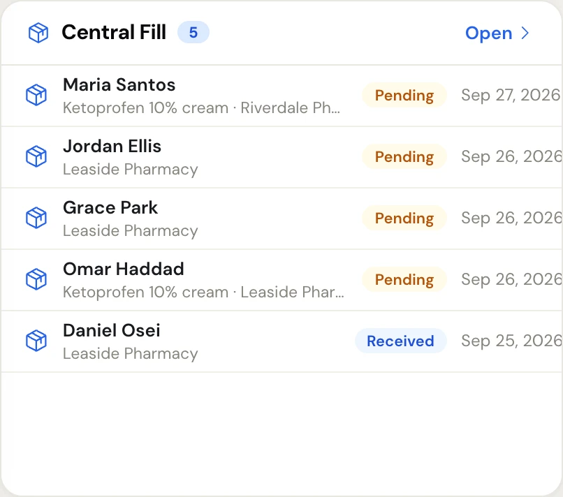
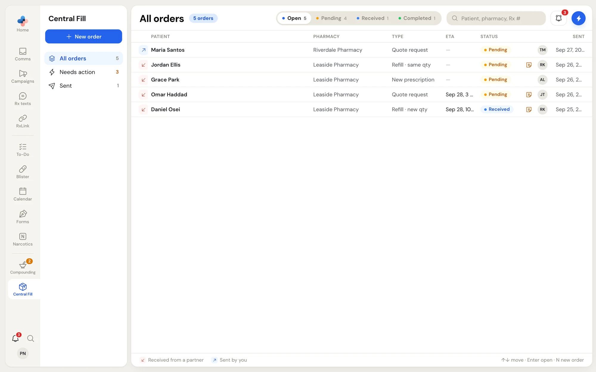
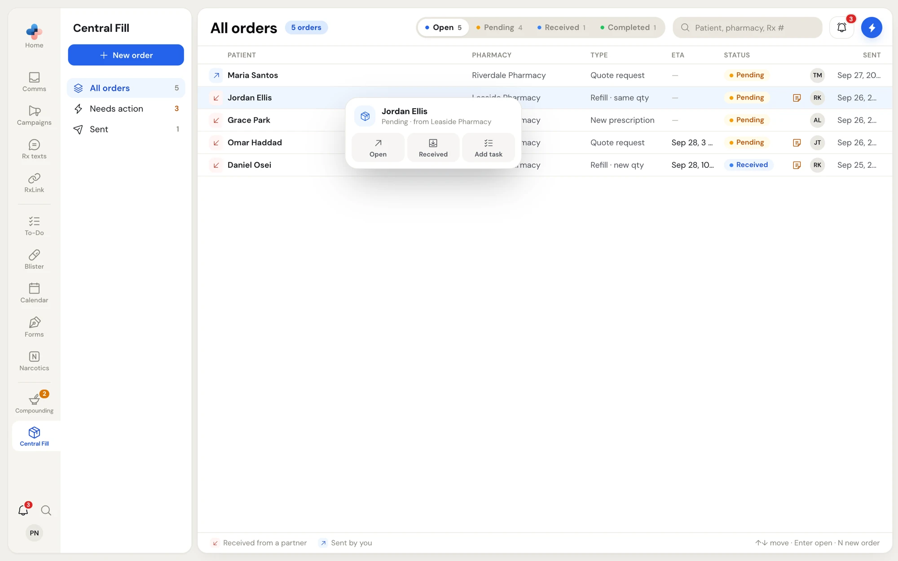

**Central Fill** connects two pharmacies that have a central fill agreement. The **dispensing pharmacy** (the sender) receives the prescription and sends an order. The **central fill pharmacy** (the receiver) prepares the compound and sends back a fill response: the ETA, its own Rx number, the pseudo DIN and the expiry.

Both pharmacies work in the same order list. Each order shows whether you sent it or received it, and both pharmacies see the same status as it moves from **Pending** to **Received** to **Completed**.

<Info>
Central Fill is a module your pharmacy has to have. Without it, the **Central Fill** icon in the left rail shows a padlock.
</Info>

## Open Central Fill

- Click **Central Fill** in the left rail. A dot on the icon means a pharmacy is asking to connect with you for Central Fill.
- On the **Dashboard**, the **Central Fill** card lists your open orders and connection requests. Click a row to open it, or **Open** to go to the full list.

<Frame caption="The Central Fill card on the Dashboard: open orders with their status and the date sent">
  
</Frame>

Right-click a row on the Dashboard card for the same menu as in the order list (see [Right-click an order](#right-click-an-order)). Its **Central Fill** button opens the full list. Completed orders leave the card but stay in Central Fill.

## Your pharmacy's Central Fill role

PharmaTools gives every Central Fill pharmacy one role. The role decides which views and buttons you see.

| Role | What the pharmacy does | What it sees in Central Fill |
| --- | --- | --- |
| **Sender** | Sends orders to a central fill pharmacy | **All orders**, **Sent**, the **New order** button |
| **Receiver** | Fills orders that partner pharmacies send | **All orders**, **Needs action**, **Register sender**. No **New order** button. |
| **Both** | Sends some orders and fills others | Everything above |

If your pharmacy's role looks wrong, contact PharmaTools.

## The order list

<Frame caption="Central Fill › All orders: received and sent orders in one list, with the status filter and search at the top">
  
</Frame>

### The side menu

| Item | What it lists |
| --- | --- |
| **New order** | Opens a blank order. Shown to senders. Keyboard: **N**. |
| **All orders** | Every order you sent or received. Central Fill opens on this view. |
| **Needs action** | Orders a partner sent you that are still **Pending**: nobody at your pharmacy has marked them received yet. Shown to receivers. |
| **Sent** | Orders your pharmacy sent. Shown to senders. |

The number beside each view counts its orders that aren't **Completed**.

### Filter and search

The switch at the top right narrows the view you are in:

- **Open**: every order that isn't **Completed**. This is the default.
- **Pending**, **Received**, **Completed**: only orders in that status.

The number on each choice counts the orders in it. Completed orders stay in the order list for good; choose **Completed** to find an old order.

Search with the **Patient, pharmacy, Rx #** box. It matches the patient's name, the partner pharmacy's name and the Central Fill Rx number.

### Columns

| Column | What it shows |
| --- | --- |
| Arrow icon | A red arrow pointing down-left is an order **Received from a partner**. A blue arrow pointing up-right is an order **Sent by you**. The legend is under the list. |
| **Patient** | The patient's full name. |
| **Pharmacy** | The other pharmacy: the central fill pharmacy for an order you sent, the sender for an order you received. |
| **Type** | **Refill · same qty**, **Refill · new qty**, **New prescription** or **Quote request**. |
| **ETA** | The ETA the central fill pharmacy entered in its fill response, or a dash. |
| **Status** | **Pending**, **Received** or **Completed**. |
| Note icon | The order has a note from the sender. Hover it to read the note. |
| Initials | Who sent the order. Hover for the full name. |
| **Sent** | The time for orders sent today; the date (with the year) for older orders. |

On a narrow window, **Type**, **ETA** and the sender's initials hide so the patient's name stays readable.

### Open an order

Click an order to open it in a pane beside the list. The list keeps its view, filter and search while you move between orders. Close the pane with **×**.

Drag the left edge of the pane to make it wider or narrower. Double-click the edge to go back to the default width. PharmaTools remembers the width on this computer.

### Keyboard shortcuts

| Key | What it does |
| --- | --- |
| **↑** / **↓** | Move up and down the list |
| **Enter** | Open the highlighted order |
| **N** | Start a new order (senders only) |

## Order statuses

| Status | What it means | Who changes it |
| --- | --- | --- |
| **Pending** | The sender sent the order. The central fill pharmacy hasn't confirmed it yet. The sender can still edit or delete it. | Set when the order is sent |
| **Received** | The central fill pharmacy confirmed it has the order and is working on it. | The central fill pharmacy, with **Mark received** |
| **Completed** | The central fill pharmacy finished the order. Its fill response is final. | The central fill pharmacy, with **Mark completed** |

Only the central fill pharmacy moves an order forward. If someone moved it by mistake, the central fill pharmacy moves it back one step from the order's **⋯** menu or its right-click menu.

## Right-click an order

Right-click any order in the list (or on the Dashboard card) for its menu. The top shows the patient, the status and the other pharmacy. The buttons depend on the order:

| Button | When it shows | What it does |
| --- | --- | --- |
| **Open** | Always | Opens the order in the pane |
| **Received** | Orders you received that are **Pending** | Marks the order received |
| **Completed** | Orders you received that are **Received** | Marks the order completed |
| **Add task** | Always | Opens a new To-Do task linked to this order |
| **Edit** | Orders you sent that are still **Pending** | Opens the order with its form ready to change |
| **Move back to pending** / **Move back to received** | Orders you received that are **Received** or **Completed** | Moves the order back one status |

<Frame caption="Right-click on an order you received that is Pending">
  
</Frame>

## Who can do what

| Action | Who |
| --- | --- |
| Send, edit and delete orders | Anyone at a **Sender** or **Both** pharmacy. Edit and delete only while the order is **Pending**. |
| Mark received, mark completed, move back, save a fill response | Anyone at the central fill pharmacy that received the order |
| Request, accept and decline Central Fill connections | Anyone at your pharmacy |
| Sign the OCP notice and the partner agreement | Managers and admins. See [Onboarding documents](/central-fill/onboarding-documents). |
| Change **Settings › Central Fill** | Managers and admins |

<CardGroup cols={2}>
  <Card title="Send orders" icon="send" href="/central-fill/sending-orders">
    For the dispensing pharmacy: create, edit and track an order.
  </Card>
  <Card title="Fill orders" icon="inbox" href="/central-fill/filling-orders">
    For the central fill pharmacy: confirm, fill and complete an order.
  </Card>
  <Card title="Partners and connections" icon="handshake" href="/central-fill/partners">
    Connect with a pharmacy, see each partner, and register a sender.
  </Card>
  <Card title="Onboarding documents" icon="file-signature" href="/central-fill/onboarding-documents">
    The OCP notice, the partner agreement and shared documents.
  </Card>
</CardGroup>
