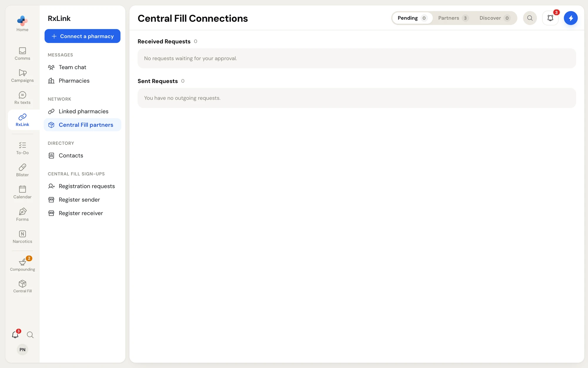
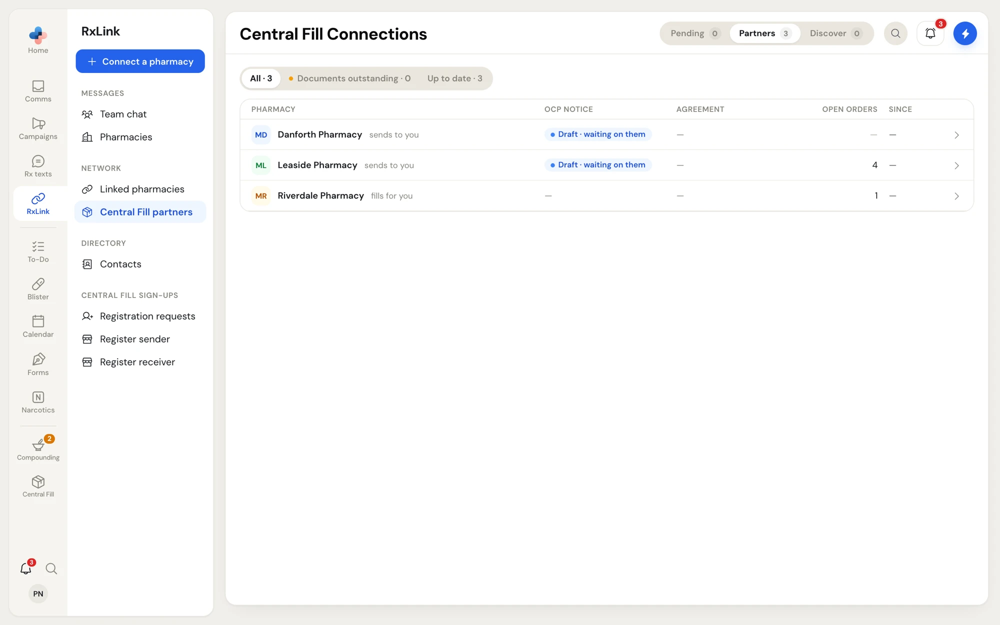
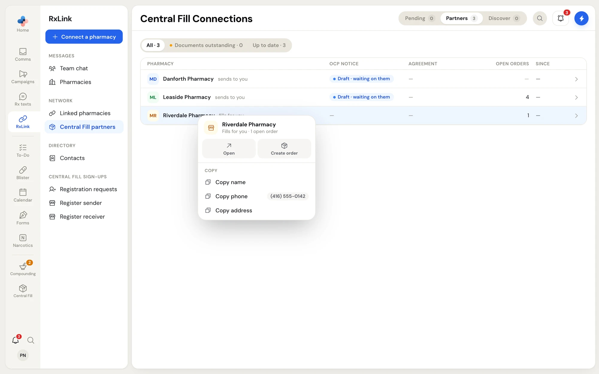
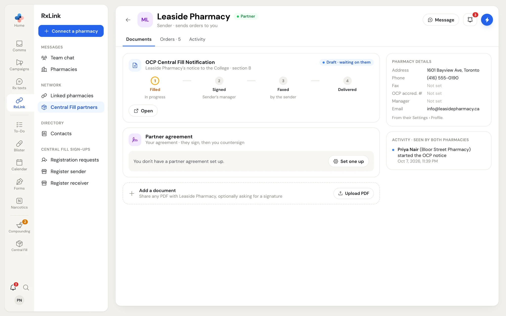
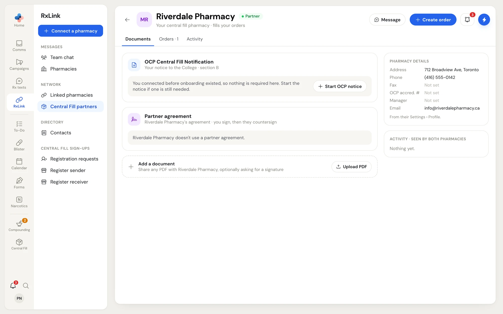
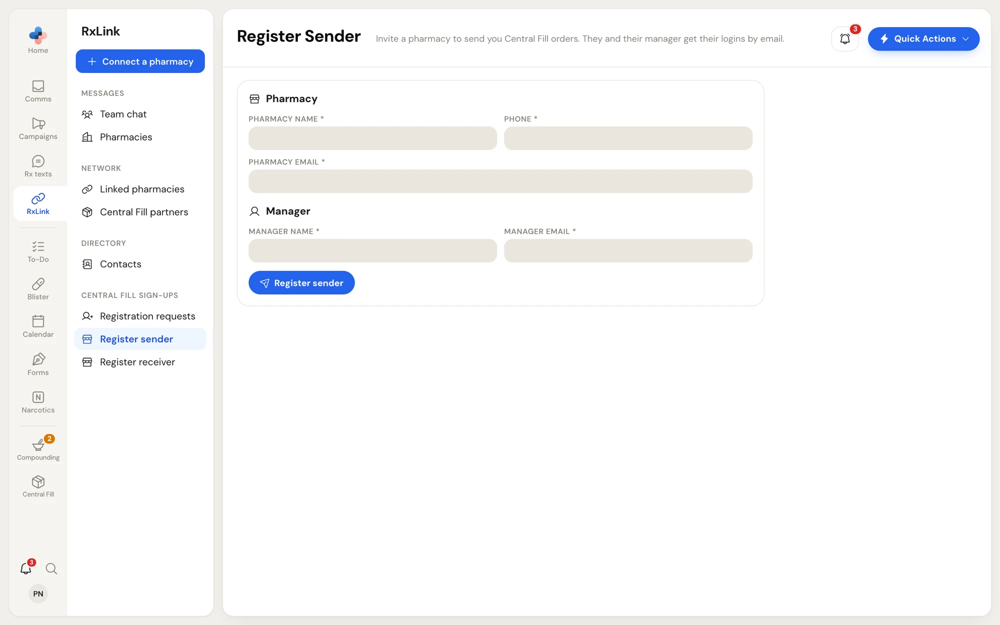

Two pharmacies can send each other Central Fill orders only once they are **connected**: one pharmacy asks, the other accepts. Every connection has a direction. The **sender** sends orders; the **receiver** fills them.

Your Central Fill network lives in **RxLink**, beside the pharmacies you message:

- **RxLink › Central Fill partners**: your partners, pending requests, and pharmacies you can connect with.
- **RxLink › Central Fill sign-ups › Register sender**: sign up a pharmacy that isn't on PharmaTools yet (central fill pharmacies only).

<Note>
These pages show only when your pharmacy has the Central Fill module. A dot on **Central Fill partners** (and on the **Central Fill** rail icon) means a pharmacy is waiting for your answer. An amber dot means a partner has onboarding documents outstanding.
</Note>

## Central Fill Connections

Open **RxLink › Central Fill partners**. The page is called **Central Fill Connections** and has three tabs at the top right:

| Tab | What it lists |
| --- | --- |
| **Pending** | Requests waiting for an answer: ones other pharmacies sent you (**Received Requests**) and ones you sent (**Sent Requests**). **Central Fill Connections** opens on this tab while a pharmacy is waiting for your answer. |
| **Partners** | Every pharmacy you are connected with. **Central Fill Connections** opens on this tab the rest of the time. |
| **Discover** | Pharmacies with Central Fill that you aren't connected with yet. |

The magnifier searches the tab you're on by pharmacy name.

### Ask a pharmacy to connect

<Steps>
  <Step title="Open Discover">
    Click **Connect a pharmacy** at the top of the RxLink side menu, or the **Discover** tab. Each card shows the pharmacy's name, whether it is a **Dispensing Pharmacy**, a **Central Fill Pharmacy** or both, and its phone and fax.
  </Step>
  <Step title="Request the connection">
    Click **Request connection** on the pharmacy's card. The request moves to **Pending › Sent Requests** with **awaiting their approval** and the date you sent it.
  </Step>
  <Step title="Wait for their answer">
    The other pharmacy accepts or declines. Once it accepts, the pharmacy shows on **Partners**.
  </Step>
</Steps>

<Warning>
The pharmacy that sends the request becomes the **sender** in the connection, and the pharmacy that accepts becomes the **receiver**. A dispensing pharmacy should send the request to its central fill pharmacy, not the other way round.
</Warning>

To take back a request before it is answered, click **Cancel request** on it in **Sent Requests**.

### Answer a request

Requests other pharmacies sent you are under **Pending › Received Requests**, marked **wants to connect** with the date.

<Frame caption="The Pending tab: requests you received and requests you sent">
  
</Frame>

- Click **Accept** to connect. The pharmacy moves to **Partners**, and PharmaTools starts the onboarding documents for the two of you (see [Onboarding documents](/central-fill/onboarding-documents)).
- Click **Decline** to refuse. Nothing is connected.

You can also right-click a request for **Accept**, **Decline** or **Cancel request**.

## Your partners

The **Partners** tab is a table of every pharmacy you are connected with.

<Frame caption="The Partners tab: each partner's onboarding documents and open orders">
  
</Frame>

| Column | What it shows |
| --- | --- |
| **Pharmacy** | The partner, with **sends to you** (it sends you orders) or **fills for you** (it fills your orders) |
| **OCP notice** | Where the sender's notice to the Ontario College of Pharmacists stands, for example **Draft · waiting on them** or **Delivered** with the date. A dash means none was started. |
| **Agreement** | Where the receiver's partner agreement stands, for example **Ready to sign** or **Signed** with the date. A dash means the receiver doesn't use one. |
| **Open orders** | Orders with this partner that aren't **Completed** |
| **Since** | When you connected |

The switch above the table filters it: **All**, **Documents outstanding** (partners with a document still to finish; they sort to the top) and **Up to date**.

Click a partner to open its page. Right-click a partner for **Open**, **Create order** (partners that fill for you), and **Copy name**, **Copy phone** and **Copy address**.

<Frame caption="Right-click on a partner that fills your orders">
  
</Frame>

<Note>
The partner table has no button to end a partnership. To disconnect from a Central Fill partner, contact PharmaTools.
</Note>

## A partner's page

The partner's page shows who they are, the onboarding documents you share, your orders with them, and everything either pharmacy has done.

<Frame caption="A partner's page, seen by the central fill pharmacy: the sender's OCP notice and the partner agreement">
  
</Frame>

The header shows the partner's name, a pill (**Partner**, or **Onboarding** with how many documents are done), and what the partner is to you: **Your central fill pharmacy · fills your orders** or **Sender · sends orders to you**, with the date you became partners. Its buttons:

- **Message** opens an RxLink message to the partner.
- **Send fax** opens a fax to the partner's fax number (shown when the partner has one).
- **Create order** starts an order for this partner (shown when it fills your orders).
- The back arrow returns to **Central Fill Connections**.

### Tabs

| Tab | What it shows |
| --- | --- |
| **Documents** | The **OCP Central Fill Notification**, the **Partner agreement**, any **Shared documents**, and **Add a document**. An amber number counts documents still open. See [Onboarding documents](/central-fill/onboarding-documents). |
| **Orders** | Every order with this partner, sent and received, with its type, status and date. Click one to open it in Central Fill. |
| **Activity** | Everything either pharmacy did to the documents: who started, filled in, signed, uploaded or faxed them, and when OCP confirmed delivery. Both pharmacies see the same list. |

<Frame caption="A partner that fills your orders: you start the OCP notice and sign its agreement">
  
</Frame>

On the right, **Pharmacy details** lists the partner's address, phone, fax, OCP accreditation number, manager (with OCP number) and email. They come from the partner's own **Settings › Profile**, so ask the partner to fix anything that says **Not set**. Under it, **Activity · seen by both pharmacies** shows the latest six events.

## Register a sender

A central fill pharmacy can sign up a dispensing pharmacy that isn't on PharmaTools yet. The new pharmacy becomes your partner straight away, and onboarding starts.

Open **RxLink › Central Fill sign-ups › Register sender**. It shows to pharmacies with the Central Fill role **Receiver** or **Both**.

<Frame caption="Register Sender: the pharmacy and its manager">
  
</Frame>

<Steps>
  <Step title="Enter the pharmacy">
    Fill in **Pharmacy name**, **Phone** and **Pharmacy email**.
  </Step>
  <Step title="Enter its manager">
    Fill in **Manager name** and **Manager email**.
  </Step>
  <Step title="Register">
    Click **Register sender**. PharmaTools emails the pharmacy and its manager their logins, and a message confirms **registered · emails sent**.
  </Step>
</Steps>

If the manager already has a PharmaTools account, the form asks for **Manager's PIN**. The manager types it themselves; never ask them to tell you their PIN. Then click **Register sender** again.

<CardGroup cols={2}>
  <Card title="Onboarding documents" icon="file-signature" href="/central-fill/onboarding-documents">
    The OCP notice and partner agreement each new partner completes.
  </Card>
  <Card title="RxLink overview" icon="link" href="/rxlink/overview">
    Messages and the rest of your pharmacy network.
  </Card>
</CardGroup>
