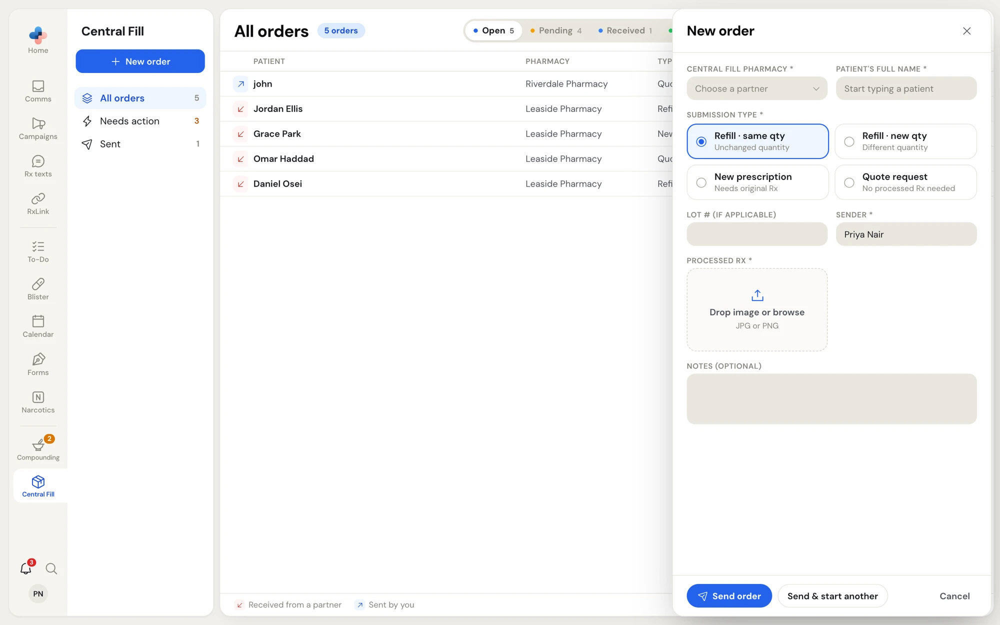
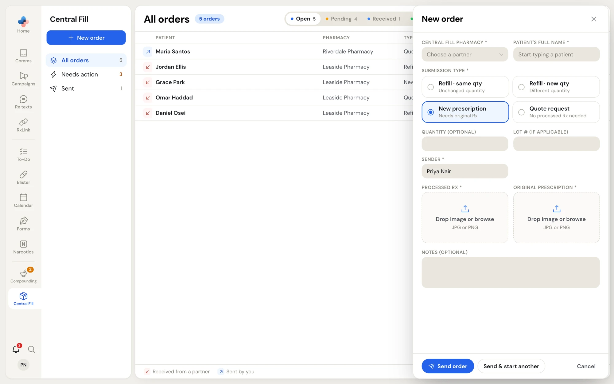
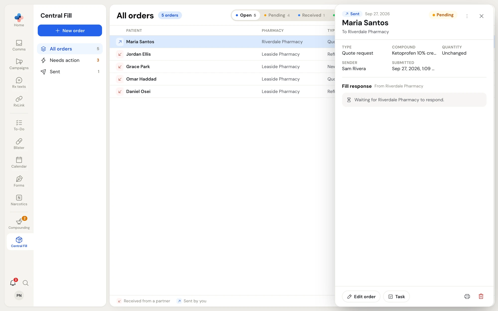
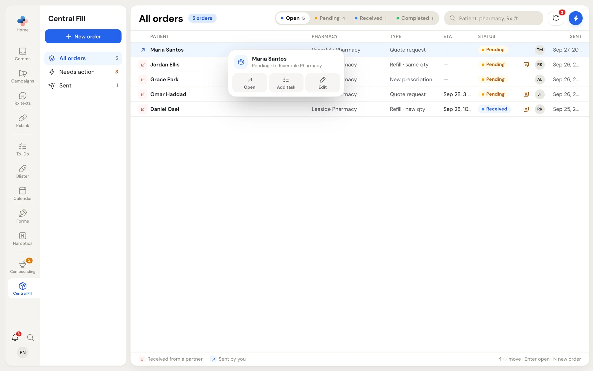

This page is for the **dispensing pharmacy**: the pharmacy that has the prescription and asks a partner central fill pharmacy to prepare it. Your pharmacy needs the Central Fill role **Sender** or **Both** (see [Your pharmacy's Central Fill role](/central-fill/overview#your-pharmacys-central-fill-role)).

<Note>
You can only send orders to a pharmacy you are connected with as its sender. If the pharmacy you need isn't in the list, connect with it first: [Partners and connections](/central-fill/partners).
</Note>

## Create an order

Start a new order in any of these ways:

- **Central Fill › New order**, or press **N** in the order list.
- **RxLink › Central Fill partners**: click **Create order** on a partner, or right-click the partner and choose **Create order**. The partner is filled in for you.
- On a partner's page, click **Create order**.

The **New order** form opens in the pane beside the list.

<Frame caption="The New order form with Refill · same qty selected">
  
</Frame>

<Steps>
  <Step title="Choose the central fill pharmacy">
    Pick it in **Central Fill pharmacy**. The list shows only active partners that fill orders for you. With none, the field says **No active partners**.
  </Step>
  <Step title="Enter the patient">
    Type the patient's full name in **Patient's full name**, as it appears on the prescription.
  </Step>
  <Step title="Choose the submission type">
    | Type | Use it for | What the form asks for |
    | --- | --- | --- |
    | **Refill · same qty** (Unchanged quantity) | A refill with the same quantity as last time | **LOT # (if applicable)**, **Processed Rx** |
    | **Refill · new qty** (Different quantity) | A refill with a different quantity | **New quantity requested** (required), **LOT # (if applicable)**, **Processed Rx** |
    | **New prescription** (Needs original Rx) | A prescription the central fill pharmacy hasn't filled before | **Quantity (optional)**, **LOT # (if applicable)**, **Processed Rx**, **Original prescription** |
    | **Quote request** (No processed Rx needed) | Asking what a compound would cost before you order it | **Prescribed compound name** (required). **Processed Rx** becomes optional. |
  </Step>
  <Step title="Check the sender">
    **Sender** is filled in with the name of the person signed in. Change it if someone else is sending the order.
  </Step>
  <Step title="Attach the images">
    Drop an image on **Processed Rx**, or click it to browse. This is the processed prescription from your pharmacy software. For a **New prescription**, also attach the **Original prescription**. Images only: JPG, PNG, GIF or WebP.
  </Step>
  <Step title="Add a note">
    Use **Notes (optional)** for anything the central fill pharmacy should know, such as a pickup day. The note shows on the order in amber, and a note icon marks the order in the list.
  </Step>
  <Step title="Send it">
    Click **Send order**. To send this one and start another for the same pharmacy, click **Send & start another**: the form clears but keeps the pharmacy and the sender.
  </Step>
</Steps>

<Frame caption="A New prescription order asks for the original prescription as well as the processed Rx">
  
</Frame>

If a required field is empty, PharmaTools marks it and doesn't send the order. **Cancel** closes the form without sending.

<Warning>
If the central fill pharmacy blocks orders until its partner agreement is signed, the order doesn't send. You see a message that the agreement needs to be signed by both pharmacies first. See [Onboarding documents](/central-fill/onboarding-documents).
</Warning>

## Track an order you sent

Your orders show in **All orders** and **Sent** with a blue up-right arrow. Click one to open it.

<Frame caption="An order you sent that is still Pending: Edit order and the delete button are available">
  
</Frame>

The pane shows:

- **Sent**, the date, the patient and **To** the central fill pharmacy, with the status on the right.
- The order's facts: **Type**, **LOT #** (or **Compound** for a quote request), **Quantity** or **New quantity**, **Sender** and **Submitted**.
- Your note, and the **Processed Rx** and **Original Rx** images. Click an image to see it full size.
- **Fill response**: what the central fill pharmacy sent back. Until it responds, it says **Waiting for** the pharmacy **to respond**.

### Read the fill response

Once the central fill pharmacy saves its response, you see:

| Field | What it is |
| --- | --- |
| **ETA** | When the central fill pharmacy expects the order to be ready |
| **Central Fill Rx #** | The Rx number in the central fill pharmacy's own system |
| **Pseudo DIN** | The pseudo DIN for billing the compound |
| **Expiry** | Days until the preparation expires (its beyond-use date) |
| **Quote** | The price, for a quote request |
| Note | The central fill pharmacy's notes to you |
| **Processed Rx** | The central fill pharmacy's own processed prescription image |

The central fill pharmacy can update its response until it marks the order **Completed**. After that it is final.

## Edit or delete an order

You can change or delete an order only while it is **Pending**. Once the central fill pharmacy marks it **Received**, the buttons go away.

- **Edit**: click **Edit order** in the pane, or right-click the order and choose **Edit**. The same form opens with your answers. Change what you need and click **Save changes**. Images you don't replace stay as they were.
<Frame caption="Right-click on an order you sent that is still Pending">
  
</Frame>

- **Delete**: click the red bin at the bottom right of the pane. Confirm with **Delete**, or click **Keep**. The central fill pharmacy no longer sees the order.

## Print an order

Click the printer at the bottom right of the pane, or **⋯ › Print**. The printout has the patient, the pharmacy, the status, the order's facts, your note, the fill response if there is one, and the images.

## Add a task

Click **Task** in the pane, **⋯ › Add task**, or **Add task** in the right-click menu. A new To-Do task opens, linked to the order, so someone can follow up (for example, call the patient when the ETA arrives).

<CardGroup cols={2}>
  <Card title="Fill orders" icon="inbox" href="/central-fill/filling-orders">
    What the central fill pharmacy does with your order.
  </Card>
  <Card title="Partners and connections" icon="handshake" href="/central-fill/partners">
    Connect with a central fill pharmacy.
  </Card>
</CardGroup>
