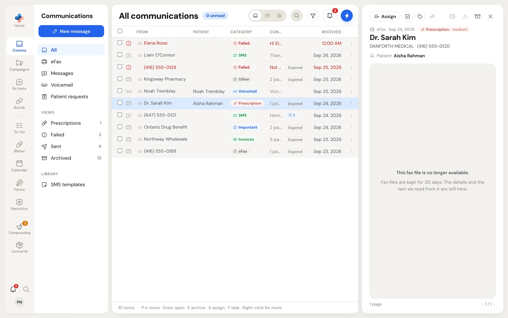
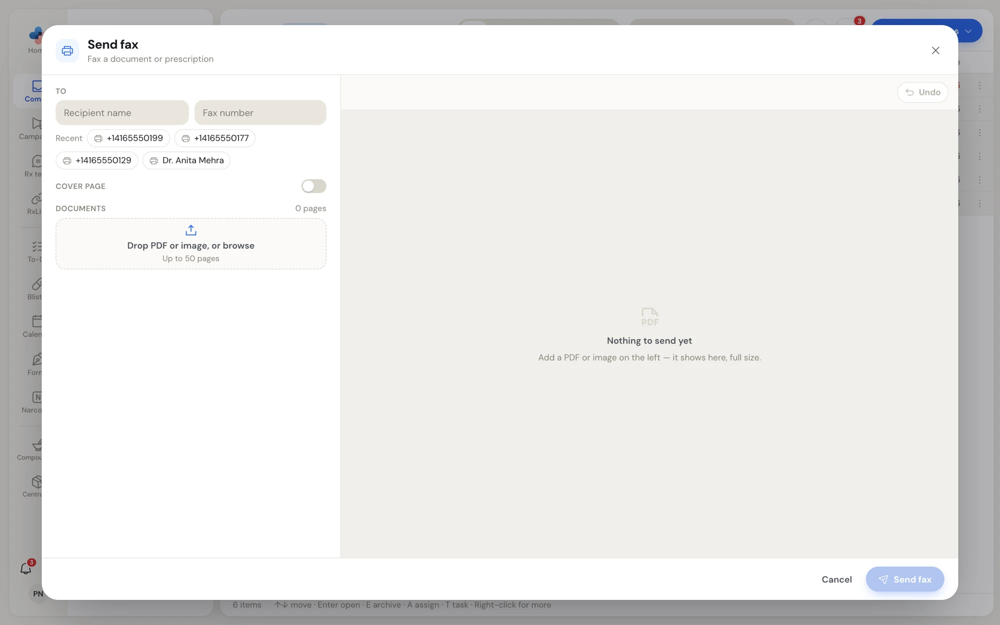
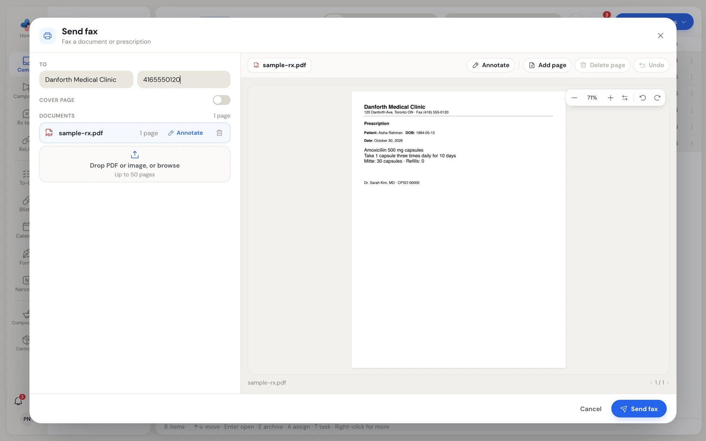
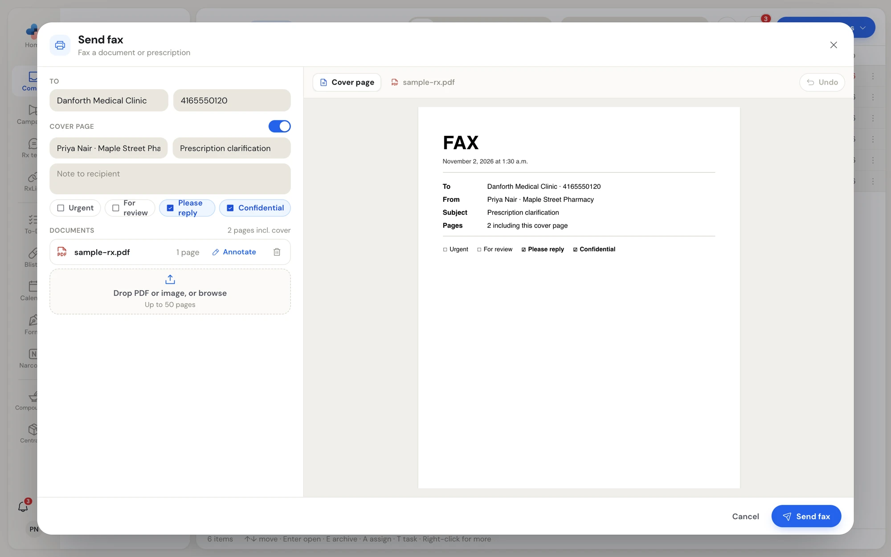
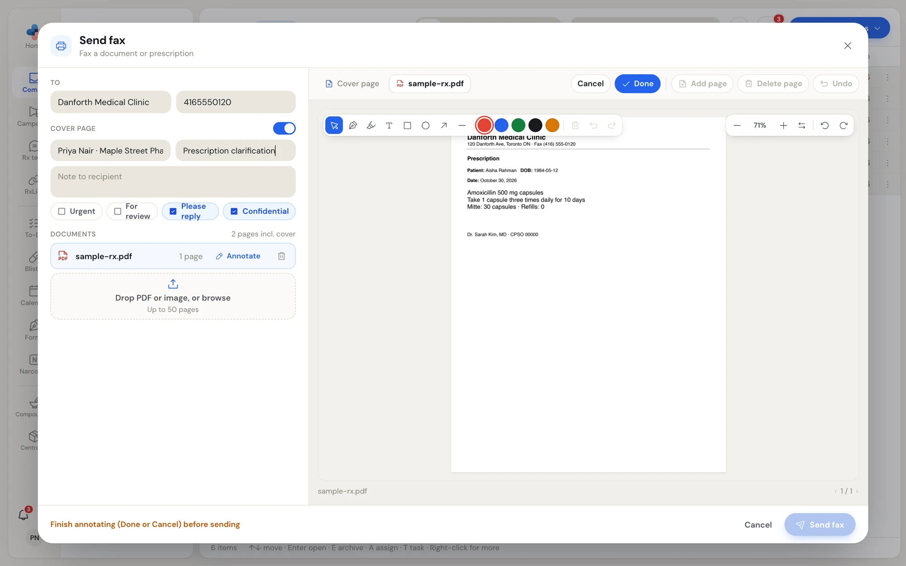
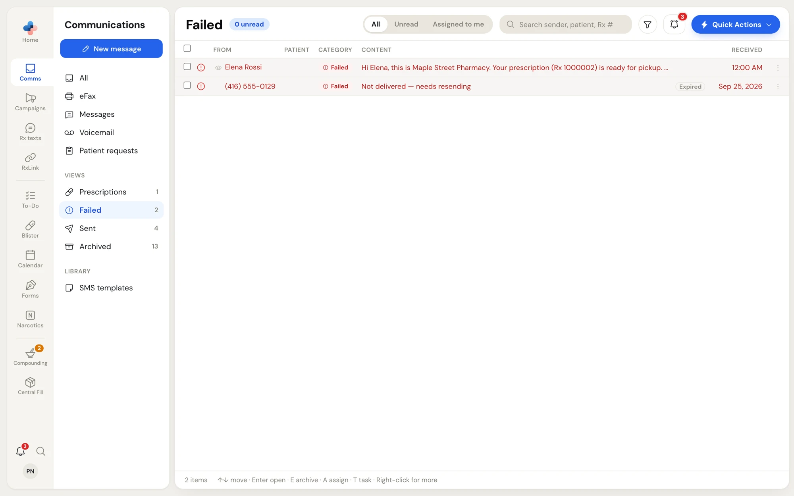
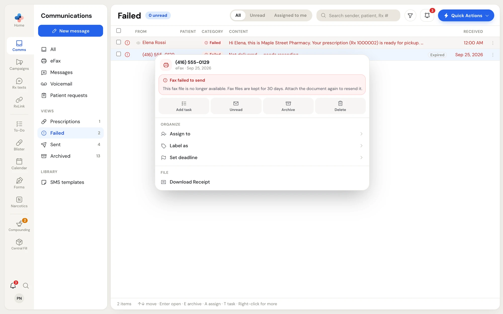
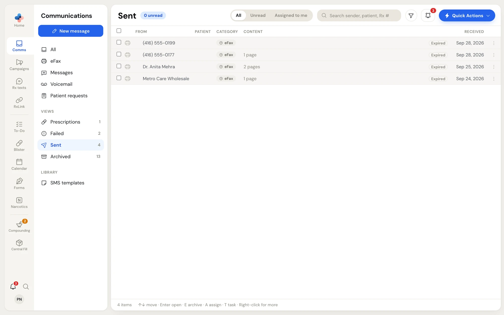

Your pharmacy's fax line delivers every fax to **Comms › eFax**. Faxes also show in **Comms › All**, and the ones PharmaTools reads as prescriptions show in **Comms › Prescriptions**. Faxes you send go to **Comms › Sent** once delivered, or to **Comms › Failed** if they were not.

<Note>
  eFax needs a fax number for your pharmacy. Until your pharmacy has one, **eFax**, **Prescriptions** and **Failed** are hidden from the side menu.
</Note>

## How long a fax file is kept

PharmaTools does not store a second copy of a fax that came over the phone network. Each time you open, print, download, forward or resend a fax, PharmaTools fetches the file from your fax line, which keeps fax files for **30 days**.

| What you see | What it means |
| --- | --- |
| **Fax file kept until Thu, Oct 22, 2026. Download or print it to keep a copy.** under the sender in the preview pane | The file is available until the end of that day. |
| The same line in amber, and an **Expires soon** badge on the row | 2 days or less are left. |
| **Expired** badge on the row, and **This fax file is no longer available.** in the preview | The file is gone. The row, the sender, the patient, the AI category and the text PharmaTools read from the fax stay in Comms. **Print**, **Download**, **Forward** and **Resend** are greyed out; hover over one to see why. |

A fax sent between two pharmacies that both use PharmaTools is **Delivered directly** into the other pharmacy's Comms inbox instead of going over the phone network. PharmaTools keeps that file, so it never expires.

## Read a received fax

Click the fax in the list. The preview pane opens on the right.

<Frame caption="A received fax in the preview pane">
  
</Frame>

From the top of the pane down:

1. **The toolbar**: **Assign**, **Task**, **Label** and **Forward** on the left; **Print**, **Download**, **Archive** and **×** (close) on the right. When the pane is narrow the buttons show icons only; hover to see each name.
2. **The type line**: **eFax**, the date received, and the AI category PharmaTools gave the fax (**Prescription**, **Invoices**, **Important**, **Advertisement** or **Other**) with how sure it was (for example **· medium**). Any labels follow.
3. **The sender**: the prescriber's name in large type, with the sending fax machine's name and number under it.
4. **Patient**: the patient PharmaTools read from the fax.
5. **The fax file line**, telling you until when the file is kept.
6. **The document**, one page at a time, with **‹ 1 / 3 ›** under it to move between pages.

The viewer has its own controls in the top right corner of the page:

| Control | What it does |
| --- | --- |
| **–** / **+** | Zoom out or in. |
| The percentage | Click to fit the whole page. |
| Two arrows | Fit the page to the width of the pane. |
| Rotate left / Rotate right | Turn the page a quarter turn. |
| **Open larger** | Opens the fax in a large window over the app. |

While a fax you sent is still going out, the viewer shows **Fax is pending** and the document appears once the fax has finished.

### Print or download

- Click the printer icon in the preview pane to print the fax.
- Click the download icon in the preview pane, or **Download** in the row menu, to save it as a PDF. A toast says **Downloading** with the file name.

### Download a fax receipt

Right-click a fax and choose **Download Receipt** under **File**. PharmaTools saves a one-page PDF titled **Fax Receipt** showing the fax's **Direction**, **Status**, **From**, **To**, **Pages** and **File Size**. Use it as proof that a fax was sent or received.

## Send a fax

<Steps>
  <Step title="Open Send fax">
    In **Comms › eFax**, click **Send fax** at the top of the side menu. You can also open **Quick Actions** and choose **Send Fax** (**⌥ F**), or click **Send fax** on a contact or a linked pharmacy in **RxLink**, which fills in the recipient for you.

    <Frame caption="Send fax before anything is added">
      
    </Frame>
  </Step>
  <Step title="Enter the recipient">
    Under **To**, type the **Recipient name** and the **Fax number**. Under the fields, **Recent** lists the last numbers your pharmacy faxed. Start typing and it changes to **Matches** from your contacts' fax numbers. Click one to fill both fields.
  </Step>
  <Step title="Add the documents">
    Drag a PDF or an image (JPEG, PNG or WEBP) onto **Drop PDF or image, or browse**, or click it to pick a file. You can add several documents; they are sent in the order listed. A fax can be up to 50 pages.

    Each document shows its page count. Click a document to show it in the pane on the right. Click the trash icon to remove it.

    <Frame caption="The document shows full size on the right as you build the fax">
      
    </Frame>
  </Step>
  <Step title="Add a cover page if you want one">
    Turn on **Cover page**. Fill in **From** (it starts with your name and your pharmacy), **Subject** and **Note to recipient**, and tick any of **Urgent**, **For review**, **Please reply** and **Confidential**. **Please reply** and **Confidential** are ticked to start with.

    A **Cover page** tab appears in the document pane so you can see the cover as the recipient will receive it, with the date, **To**, **From**, **Subject** and the page count including the cover.

    <Frame caption="The cover page preview">
      
    </Frame>
  </Step>
  <Step title="Send it">
    Check the page count above the documents (for example **2 pages incl. cover**), then click **Send fax**. The button reads **Sending 2 pages…** while it goes, then a toast says **Fax queued**.
  </Step>
</Steps>

If something is missing when you click **Send fax**, PharmaTools points at it: the fax number needs 10 digits and at least one document is needed. If the fax line refuses the number, the reason shows in a red strip above the buttons.

Press **Esc** or click **Cancel** to close the window without sending.

After you send, the fax shows in **Comms › Sent** once delivered. If it is not delivered, it shows in red in **Comms › Failed**, **eFax** and **All**.

## Change the document before you send it

Use the buttons above the document pane. They apply to the document whose tab is showing.

### Annotate

Click **Annotate** above the pane, or **Annotate** beside the document in the list. The markup tools appear over the document.

<Frame caption="Annotating a document before sending">
  
</Frame>

| Tool | Use it to |
| --- | --- |
| **Select / move** | Click a mark to select it, then drag it or delete it. |
| **Pen** | Draw freehand, for example to circle a dose. |
| **Highlighter** | Highlight text in yellow. |
| **Text box** | Click on the document and type a note. |
| **Rectangle**, **Circle**, **Arrow**, **Line** | Draw shapes. |
| Colour dots | Red, blue, green, black or orange for new marks and for the selected mark. |
| Trash | Delete the selected mark. |
| **Undo** / **Redo** | Step back and forward through your marks. |

Click **Done** to write the marks into the document, or **Cancel** to throw them away. The document then shows an **Annotated** tag. While you are annotating, **Send fax** is greyed out and the footer says **Finish annotating (Done or Cancel) before sending**.

### Add or delete a page

- **Add page** inserts a blank page after the page showing, for example to write a note on.
- **Delete page** removes the page showing. It is greyed out when the document has only one page; remove the whole document instead.
- **Undo** (at the right) takes back the last change to the documents: an annotation, an added or deleted page, or a removed document.

Annotate, Add page and Delete page work on PDFs. An image document is sent as it is.

## Forward a fax

Forward sends a received fax on to someone else, such as another pharmacy or a prescriber.

1. Open the fax in the preview pane.
2. Click **Forward**. **Send fax** opens with the fax already attached as a document.
3. Enter the recipient, annotate or add a cover page if you want, and click **Send fax**.

Forward is greyed out once the fax file has expired.

## Resend a fax

Open a fax you sent from **Comms › Sent** or **Comms › Failed**. The preview pane shows two extra buttons:

- **Resend** opens **Send fax** with the original document attached and the same number filled in. A blue note says **Resending to the same fax number.**
- The pencil, **Resend to a different number**, opens it with the number empty. The note says **Enter the new fax number to resend to.**

If you send it unchanged (or only change the number), it goes out as a resend of the original fax and the toast says **Fax resent**. If you annotate it, add a document or add a cover page, it goes out as a new fax.

## Failed faxes

A fax that was not delivered shows in red with a **Failed** category and the content **Not delivered — needs resending**. It stays in **Comms › Failed**, **Comms › eFax** and **Comms › All** until you resend, archive or delete it.

<Frame caption="Comms › Failed lists faxes and texts that were not delivered">
  
</Frame>

Right-click a failed fax to see a red **Fax failed to send** box at the top of the menu with two buttons:

- **Resend fax** opens **Send fax** with the original document attached and the same number filled in, the same as **Resend** in the preview pane.
- **Different number…** opens it with the number empty so you can enter another one.

<Frame caption="When the file has expired, the failed fax can only be resent by attaching the document again">
  
</Frame>

When the failed fax's file has expired, the box says the file is no longer available and asks you to attach the document again. Open **Send fax**, attach the document from your pharmacy software or your scanner, and send it as a new fax.

## Sent faxes

**Comms › Sent** lists the faxes and texts your pharmacy sent that were delivered. A delivered fax is a record, so it does not show in **All** or **eFax**. Each row shows the recipient: the contact's name when the number is in your contacts (with **To** and the number under it in the preview), or the number.

<Frame caption="Comms › Sent">
  
</Frame>
