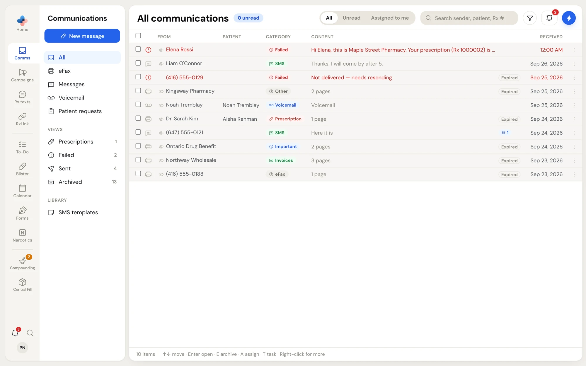
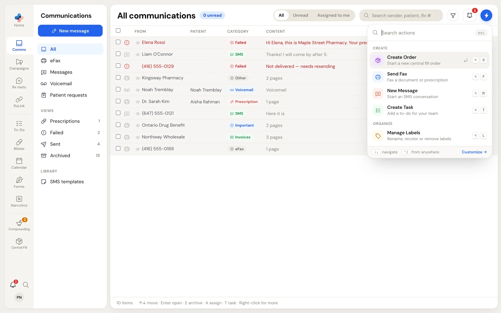
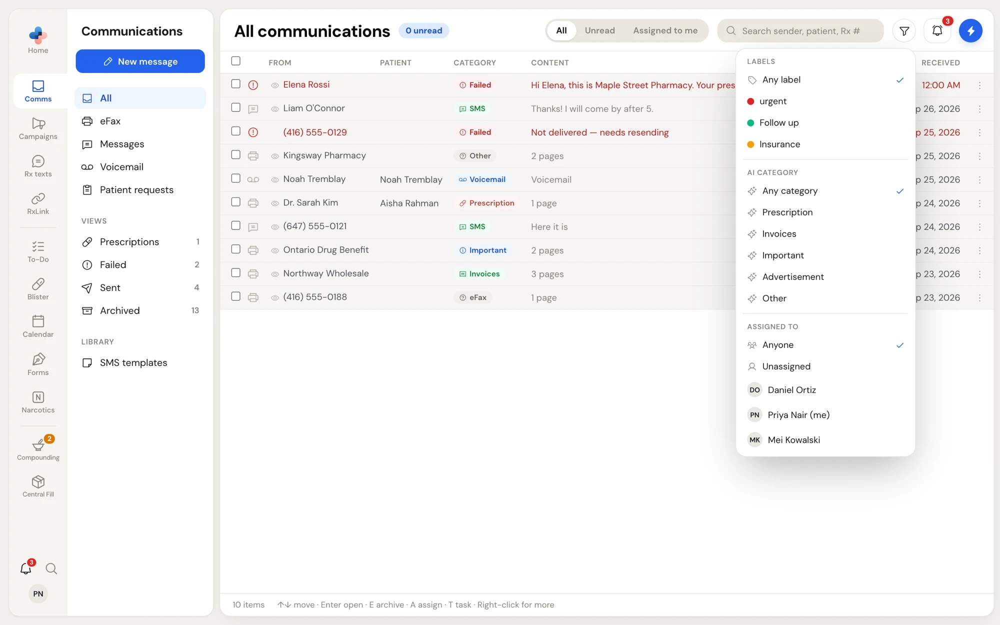
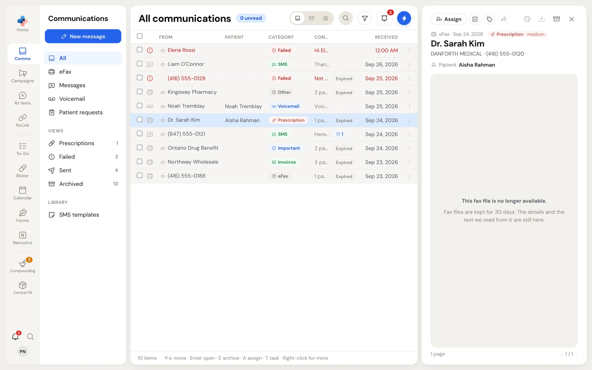

**Comms** is where everything that reaches your pharmacy from outside lands: faxes from prescribers and insurers, text messages from patients, voicemail left on your pharmacy line, and refill, transfer and new prescription requests from patients. Everyone on your pharmacy team works from the same inbox, so you can see what has been opened, who has it, and what is still waiting.

To open it, click **Comms** in the left rail. The address is `/communications`.

<Frame caption="Comms › All: every channel in one list, newest first">
  
</Frame>

## The side menu

The column beside the rail chooses what the list shows. Its blue button changes with the channel you are in: **Send fax** while you are in **eFax**, and **New message** everywhere else.

| Group | Item | What the list shows | Number beside it |
| --- | --- | --- | --- |
| Channels | **All** | Every fax, text, voicemail and patient request that is not archived. Faxes you sent successfully are left out (they are in **Sent**). | Unread items |
| | **eFax** | Faxes you received, and faxes you sent that failed. | Unread faxes |
| | **Messages** | Text message conversations with patients, plus RxLink conversations with linked pharmacies. | Unread conversations |
| | **Voicemail** | Voicemail left on your pharmacy line, with its transcript. | Unread voicemail |
| | **Patient requests** | Refill, transfer and new prescription requests from your online form, your automated phone line and your automated text line. | Requests still in **New** |
| Views | **Prescriptions** | Received faxes that PharmaTools sorted as a prescription. | Total items |
| | **Failed** | Faxes and texts you sent that were not delivered. | Total items |
| | **Sent** | Faxes and texts you sent that were delivered. | Total items |
| | **Archived** | Everything you archived, from every channel. | Total items |
| Library | **SMS templates** | Opens the saved text message templates. See [Text messages](/communications/text-messages#sms-templates). | — |

<Note>
  **eFax**, **Voicemail**, **Prescriptions** and **Failed** need a fax number for your pharmacy. Until your pharmacy has one, those items are hidden and you can still use **Messages**, **Patient requests**, **Sent** and **Archived**. If Comms is not part of your plan, clicking **Comms** shows **Access Restricted** with the address to write to.
</Note>

## The header

Across the top of the list, from left to right:

- **The title and its count.** The title names the channel or view (for example **All communications**). The blue pill beside it counts the unread items in that list, or the requests still in **New** in **Patient requests**.
- **All / Unread / Assigned to me.** Narrows the list to unread items, or to items assigned to you. In **Patient requests** this switch is **All / New / In progress / Ready** instead.
- **Search.** Type a sender, a patient, a phone number or an Rx number. In **Patient requests** it also searches the reference number, what the patient wrote, the pharmacy a transfer comes from and the Rx numbers.
- **Filter** (the funnel). Narrows the list by label, by AI category, or by who it is assigned to. The funnel turns blue while a filter is on.
- **The bell** opens your notifications.
- **Quick Actions** (the lightning bolt) opens the actions you can run from anywhere, such as **Send Fax**, **New Message**, **Create Task** and **Manage Labels**.

<Frame caption="Quick Actions, opened from the lightning bolt or with Ctrl + J">
  
</Frame>

Each Quick Action has a shortcut that works from anywhere in PharmaTools, shown beside it (for example **⌥ F** for **Send Fax** and **⌥ M** for **New Message**). Press **Ctrl + J** to open Quick Actions from anywhere. You can change these keys in **Settings › Keyboard shortcuts**.

<Frame caption="The filter: one choice from each group">
  
</Frame>

The filter has three groups. Pick one choice in each; the list shows only items that match all three.

- **Labels**: **Any label** or one of your pharmacy's labels.
- **AI category**: **Any category**, **Prescription**, **Invoices**, **Important**, **Advertisement** or **Other**.
- **Assigned to**: **Anyone**, **Unassigned**, or one person on your team. You are marked **(me)**.

## Reading the list

Each row is one fax, one text conversation, one voicemail or one patient request.

| Column | What it shows |
| --- | --- |
| Checkbox | Select the row for a bulk action. The checkbox in the header selects every row shown. |
| Icon | The channel: printer for a fax, speech bubble for a text, tape for voicemail, clipboard for a patient request. A red warning icon means the item failed to send. |
| **From** | For a received fax: the prescriber, then the sending fax machine's name, then the number. For a fax you sent: the contact's name if the number is in your contacts, otherwise the number. For a text or voicemail: the contact's name or the phone number. |
| **Patient** | The patient the item is about, when PharmaTools knows it. |
| **Category** | A coloured pill. Faxes show their AI category (**Prescription**, **Invoices**, **Important**, **Advertisement**, **Other**), or **eFax** when they have none. Texts show **SMS**, voicemail shows **Voicemail**, patient requests show **Refill**, **Transfer** or **New Rx**, and anything that was not delivered shows **Failed**. |
| **Content** | The page count of a fax, the last text in a conversation, the voicemail transcript, or a summary of a patient request. |
| Badges | Up to two labels (and **+2** and so on for more), a flag with the deadline date, a checklist icon with the number of tasks linked to the item, and for faxes **Expires soon**, **Expired** or **Delivered directly**. |
| Initials | The person the item is assigned to. |
| **Received** | The time for today's items, the date with its year for older ones (for example **Sep 24, 2026**). |
| **⋮** | Opens the same menu as right-clicking the row. |

A row in bold with a blue dot is unread. A row that has been read shows an eye instead; hover over the eye to see who on your team opened it, or marked it read, and when.

The list draws 60 rows at a time. Scroll to the bottom to load the next 60. The footer shows how many items match.

### Fax file badges

PharmaTools fetches a fax's document from the fax line each time you open, print, download, forward or resend it, and the fax line keeps each fax file for 30 days.

- **Expires soon** (amber) means 2 days or less are left. Download or print the fax now if you need to keep it.
- **Expired** means the file is gone. The row, its details and the text PharmaTools read from it stay in Comms, but you can no longer view, print, download, forward or resend it.
- **Delivered directly** (green) is on a fax you sent to another pharmacy that uses PharmaTools. It went straight to that pharmacy's Comms inbox instead of over the phone network, and PharmaTools keeps that file with no expiry.

## The preview pane

Click a row to open it in the pane on the right. What the pane shows depends on the channel: the fax document, the text conversation, the voicemail player or the patient request. The guides for each channel cover the pane in detail.

<Frame caption="A received fax open in the preview pane">
  
</Frame>

- Drag the left edge of the pane to make it wider or narrower.
- Click **×** at the top right to close it.
- When the pane is open the header folds: the switch shows icons only and the search becomes a magnifier you click to open.

Opening an item marks it read for your whole pharmacy, and PharmaTools records that you opened it.

## Keyboard shortcuts

The footer of the list reminds you of the shortcuts. They work while you are not typing in a field.

| Key | What it does |
| --- | --- |
| **↑** / **↓** | Move up and down the list. |
| **Enter** | Open the highlighted item in the preview pane. |
| **E** | Archive the highlighted item, or every checked item. In **Archived**, **E** moves them back to the inbox. |
| **A** | Open the **Assign** list for the highlighted item. |
| **T** | Add a task for the highlighted item. |
| Right-click | Open the row menu. |

## What to read next

<CardGroup cols={2}>
  <Card title="Working an item" icon="mouse-pointer-click" href="/communications/working-items">
    Mark read, assign, label, set a deadline, add a task, archive and delete.
  </Card>
  <Card title="Faxes" icon="printer" href="/communications/faxes">
    View, print and download faxes, send a fax, forward and resend.
  </Card>
  <Card title="Text messages" icon="message-square" href="/communications/text-messages">
    Text patients, use templates and send Secure Portal links.
  </Card>
  <Card title="Patient requests" icon="clipboard-list" href="/communications/patient-requests">
    Work refill, transfer and new prescription requests from New to Ready.
  </Card>
</CardGroup>
