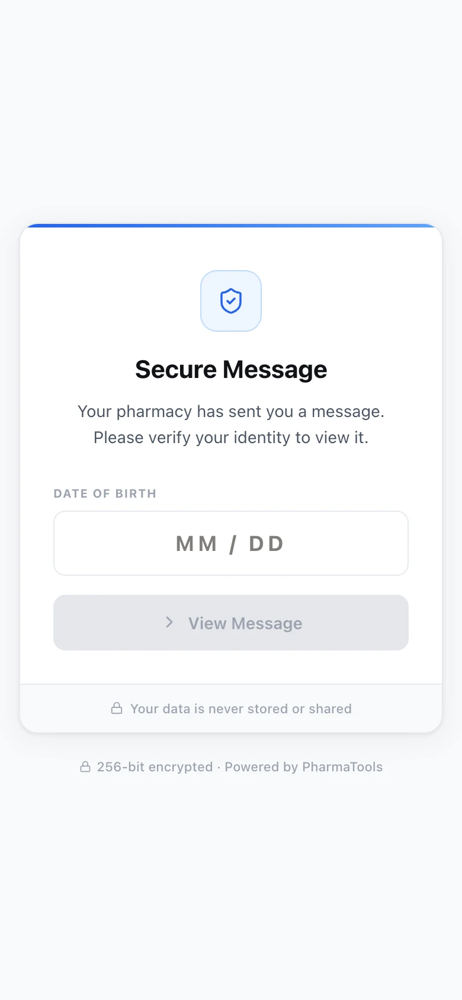
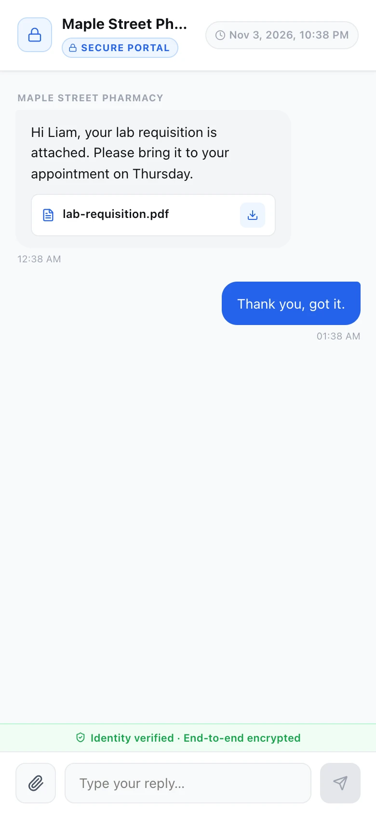
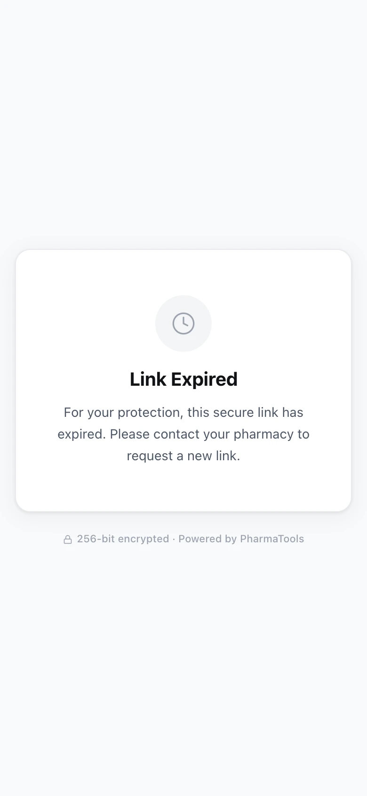

When you send a message as **Secure Portal** (see [Text messages](/communications/text-messages#send-a-secure-portal-link)), the patient gets a text from your pharmacy's number with a private link. This guide shows what the patient sees when they tap it, so you can talk them through it on the phone.

The patient does not need an account or an app. The page works in any phone or computer browser.

## 1. The patient confirms their date of birth

The link opens a **Secure Message** page: "Your pharmacy has sent you a message. Please verify your identity to view it."

<Frame caption="The patient types the month and day of their date of birth">
  
</Frame>

The patient types the month and day of their birth in **Date of Birth** (for example `04 / 12`) and taps **View Message**. It must match the date you entered in **Patient DOB** when you sent the message.

| What the patient sees | What it means | What you do |
| --- | --- | --- |
| **Incorrect date of birth. Please try again.** | The date does not match. | Check the date you entered. If it was wrong, send a new Secure Portal message with the right date. |
| **Too many incorrect attempts. Please contact your pharmacy to unlock this link.** | The link is locked after repeated wrong dates. | Send the patient a new Secure Portal message. |
| **Too many attempts from this connection. Please wait an hour and try again.** | Too many tries came from the same internet connection. | Ask the patient to wait an hour, or send a new link. |

## 2. The patient reads your message and replies

Once the date matches, the patient sees your pharmacy's name, a **Secure Portal** badge, the date and time the link expires, and your message with any files.

<Frame caption="The patient's view of your message, with a reply box">
  
</Frame>

- **Files you attached** show as cards. The patient taps the download button to save one.
- **To reply**, the patient types in **Type your reply…** and taps the send arrow. They can tap the paperclip to attach a photo or a file, such as a picture of an insurance card.
- New messages you send from the same conversation appear in the patient's Secure Portal view while they have it open.

Each reply arrives in **Comms › Messages**, in the patient's conversation, as a green **Secure reply** bubble.

## 3. The link expires

The link works for the time you chose when you sent it (**24 hours**, **48 hours**, **72 hours** or **7 days**), unless you extend it or revoke it from the conversation. After that, the patient sees **Link Expired**: "For your protection, this secure link has expired. Please contact your pharmacy to request a new link."

<Frame caption="The page a patient sees after the link has expired or been revoked">
  
</Frame>

A link that does not exist (for example, one typed in wrong) shows **Link Not Found** and asks the patient to contact the pharmacy.

To give the patient more time before the link expires, change **Extend expiry** in the conversation. To send something after it has expired, send a new Secure Portal message.
