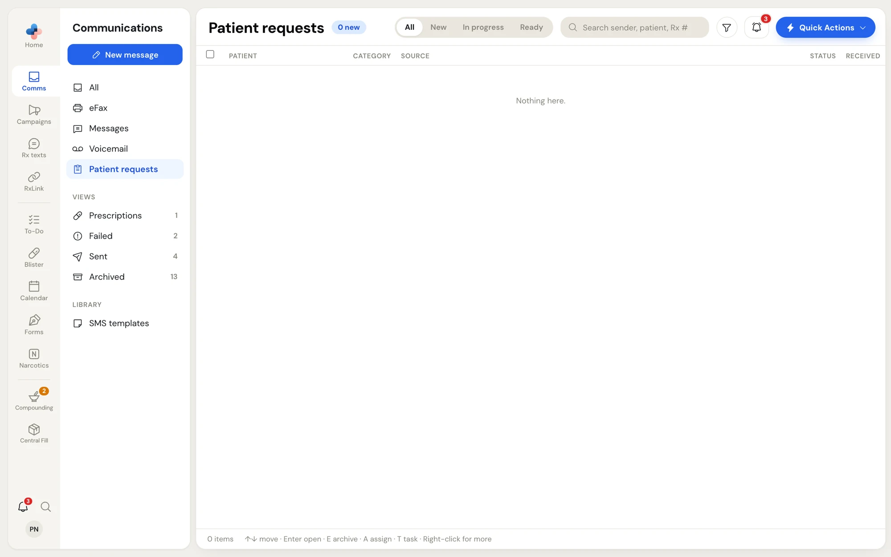
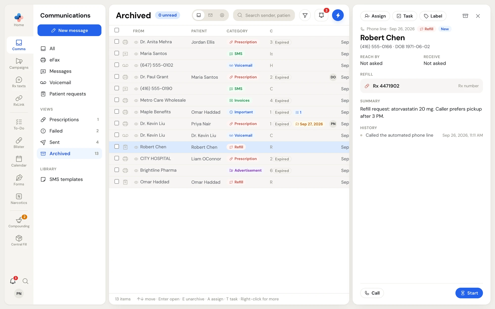
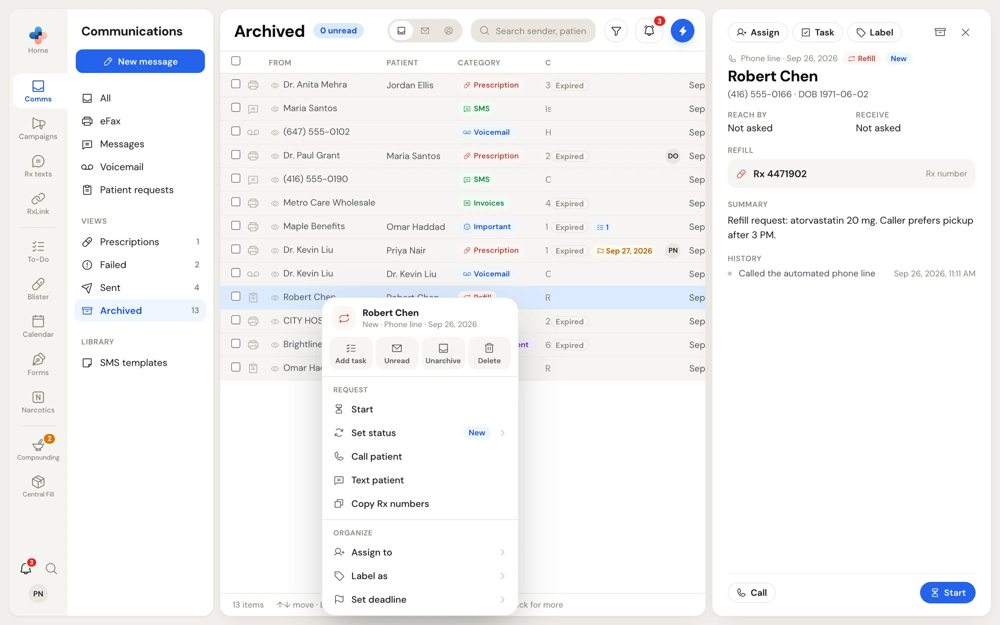

**Comms › Patient requests** collects every request a patient makes without talking to your staff:

| Source | Where it comes from |
| --- | --- |
| **Online form** | The refill, transfer and new prescription form on your pharmacy's own website. Set it up in [Settings › Online requests](/settings/online-requests). |
| **Phone line** | Your automated phone line, when a caller asks for a refill. |
| **Text line** | Your automated text line, when a patient texts for a refill. |

Each request is one of three kinds: **Refill**, **Transfer** or **New Rx**.

## The Patient requests list

The side menu shows how many requests are still **New**. The list has its own columns and its own switch.

<Frame caption="Comms › Patient requests with its All / New / In progress / Ready switch">
  
</Frame>

| Column | What it shows |
| --- | --- |
| **Patient** | The patient's name, or their phone number. Bold while the request is **New**. |
| **Category** | **Refill**, **Transfer** or **New Rx**. |
| **Source** | **Online form**, **Phone line** or **Text line**, with any labels, deadline, linked tasks and the assignee's initials. |
| **Status** | **New** (blue), **In progress** (amber) or **Ready** (green). |
| **Received** | The time today, or the date with its year. |

Use the switch in the header to show **All**, **New**, **In progress** or **Ready**. The count beside the title, for example **3 new**, is the number of requests nobody has started.

Search finds a request by the patient's name, phone number, reference number, Rx numbers, what the patient wrote, or the pharmacy a transfer comes from.

## Statuses

A request moves through three statuses:

1. **New**: it has arrived and nobody has started it.
2. **In progress**: someone at your pharmacy is working on it.
3. **Ready**: the refill, transfer or new prescription is done.

The patient is told by text when a request is ready only if your pharmacy sends the ready text (see below).

## Open a request

Click a request to open it in the preview pane.

<Frame caption="A refill request from the phone line">
  
</Frame>

From the top down:

- **The meta line**: the source and the time, the kind (**Refill**, **Transfer** or **New Rx**), the status and any labels.
- **The patient**: their name, then their phone number, date of birth and the request's reference number.
- **Reach by**: how the patient wants to be contacted: **Text**, **Call**, **Email** (with the address), or **Not asked**.
- **Receive**: **Pickup in store**, **Delivery**, or **Not asked**.
- **The items**, headed by the kind:
  - A refill from the online form lists each line the patient typed, each marked **Rx number** or **Medication name**.
  - A refill from the phone or text line lists the Rx numbers it collected, and **All due refills** when the patient asked for everything that is due.
  - A transfer lists what the patient wrote (**Patient wrote**) and the pharmacy it comes from (**Current pharmacy**).
  - A new prescription points to the photos: **See the prescription photos**.
- **Summary**: on phone and text line requests, the line's own write-up of the call or conversation.
- **Photos**: prescription photos (**Rx · 1**, **Rx · 2**) and drug plan cards (**Drug plan card**). Click a photo to see it larger; files that cannot be shown as a picture offer **Download**.
- **Patient's note**: anything extra the patient added.
- **History**: each step with its time: **Sent from** your website (or **Called the automated phone line**, **Texted the automated line**), **Confirmation text sent**, **Marked in progress**, **Marked ready**, **Ready text sent**.

Select any text in the request with your mouse to get a **Create task** button that starts a task with those words.

## Move a request along

The blue button at the bottom right of the pane is always the next step:

| Status | Button | What it does |
| --- | --- | --- |
| **New** | **Start** | Moves the request to **In progress**. |
| **In progress** | **Mark ready** | Moves it to **Ready**. |
| **Ready** | **Text patient** | Sends the patient the ready text. After it has gone once, the button reads **Text again**. A toast confirms **Ready text sent to** and the number. |

**Text patient** only shows when your pharmacy can text and the request has a phone number. **Call** at the bottom left dials the patient with your computer's calling app.

If a change does not go through, a red message says **Couldn't update the request** (or **Couldn't send the text**) and the request goes back to how it was.

## The row menu

Right-click a request (or click **⋮**) for the same actions without opening it.

<Frame caption="The row menu of a patient request">
  
</Frame>

Under **Request**:

- The next step: **Start**, **Mark ready** or **Text patient**.
- **Set status**: pick **New**, **In progress** or **Ready** directly, for example to move a request back.
- **Call patient** and **Text patient** (or **Write a text…** when the ready text is the next step): **Text patient** opens **New message** to the patient so you can write your own words.
- **Copy reference #** and **Copy Rx numbers** copy them to paste into your pharmacy software.

**Organize** (assign, label, deadline) and the buttons across the top work as on every item. See [Working an item](/communications/working-items).

## Alerts for new requests

When a new request arrives while PharmaTools is open, a pop-up appears in the corner with a short chime: **New patient request**, followed by the kind and the source, for example **Refill · Online form**. It never shows the patient's name or a medication, because the screen may face your counter. Click it to open the request.

- Your pharmacy turns the pop-up and sound on or off for every computer in [Settings › Online requests](/settings/online-requests), under **Alerts for your team** › **Pop-up and sound for new requests**.
- Each person can choose their own pop-up and sound for patient requests in **Settings › Notifications**. With the pharmacy's alerts off, nobody gets the pop-up.
