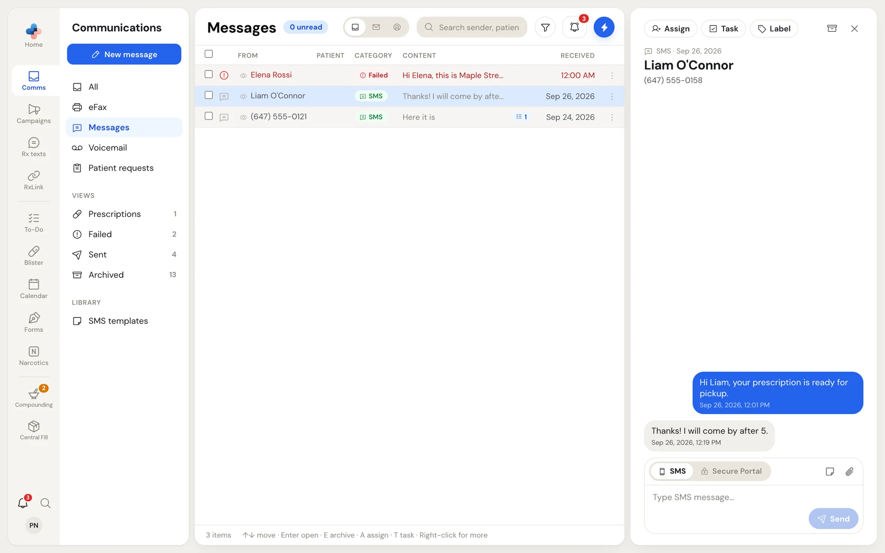
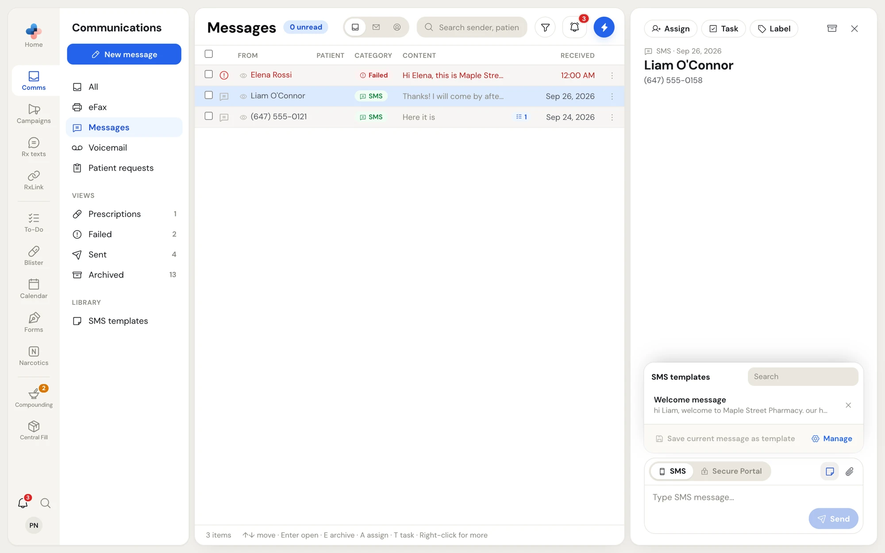
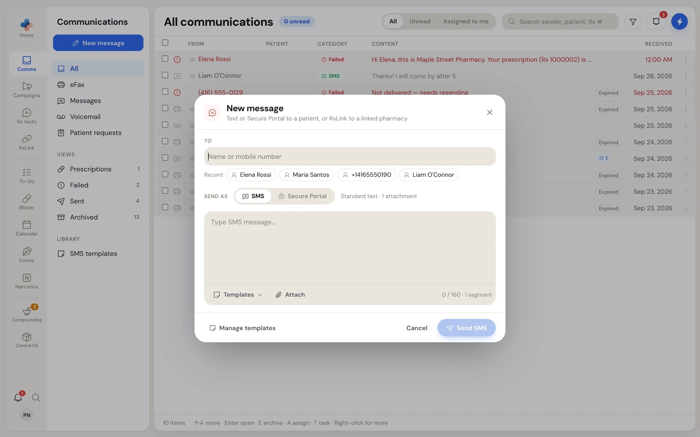
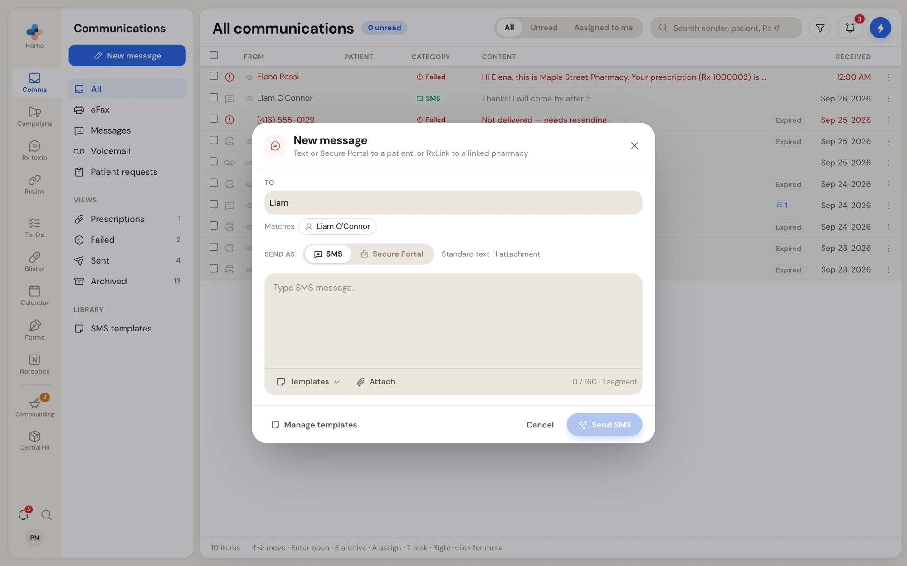
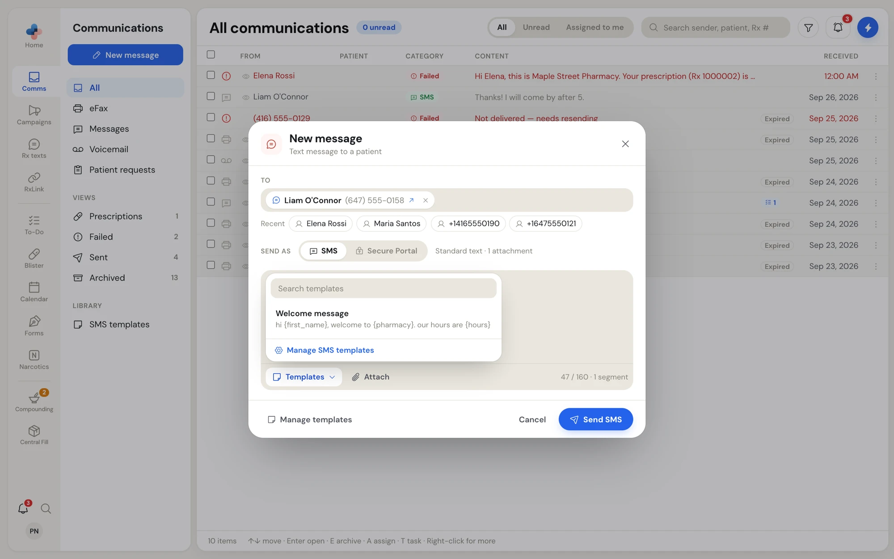
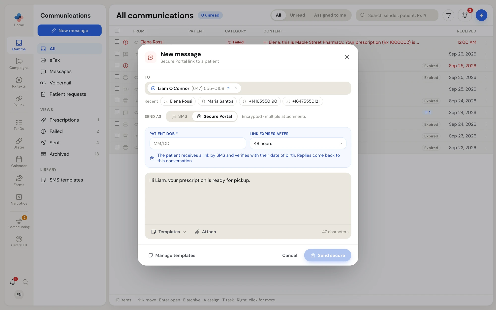
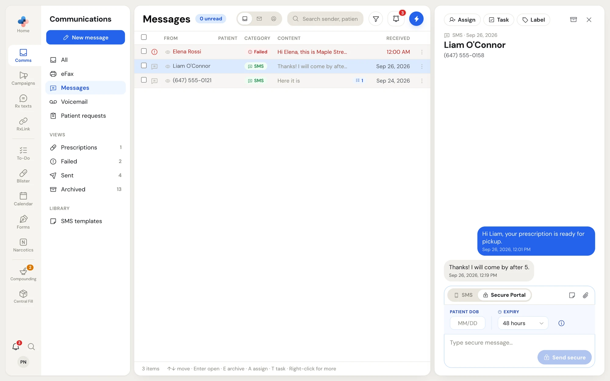
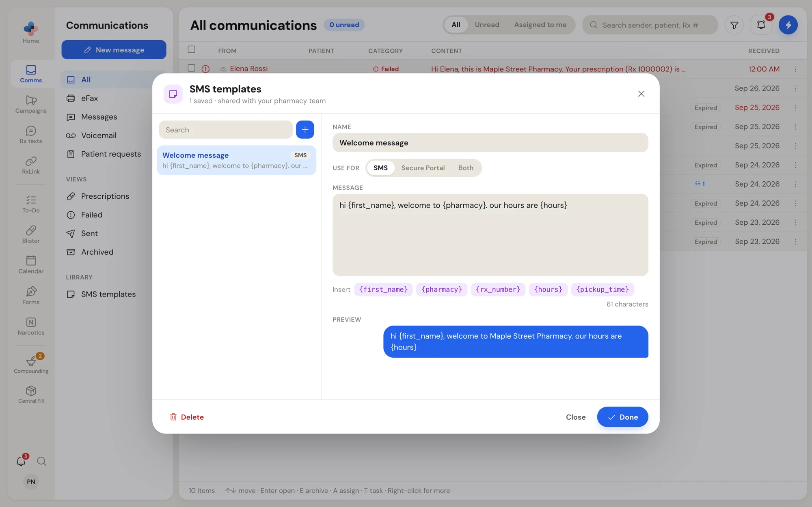
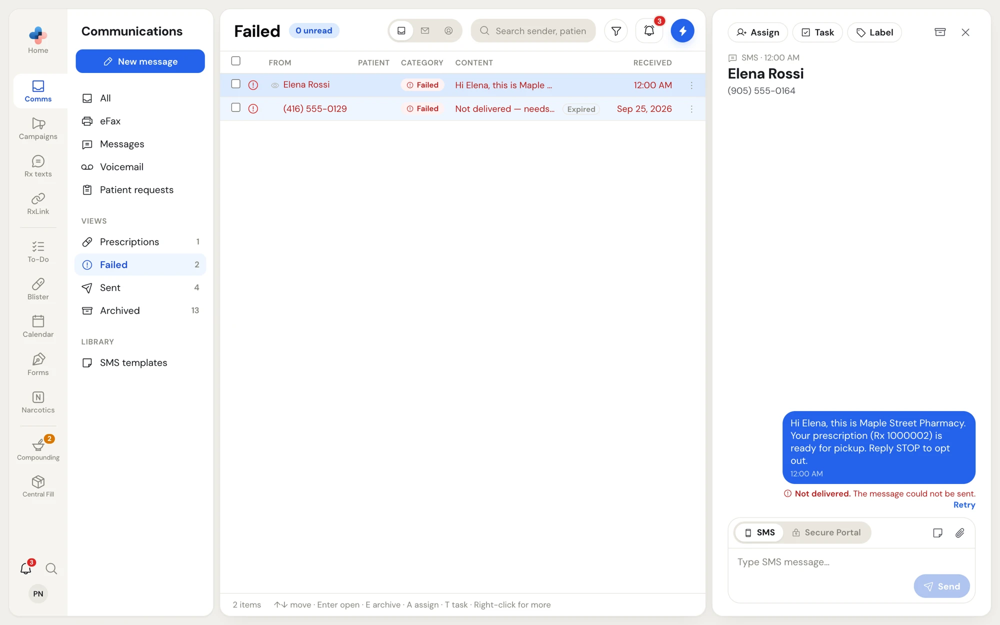

**Comms › Messages** holds your pharmacy's text conversations with patients, one row per phone number. Conversations with linked pharmacies over RxLink are listed there too, marked **RxLink partner**; see [Linked pharmacies](/rxlink/pharmacies) for how those work.

You can reach a patient two ways:

| Send as | What the patient receives | Attachments |
| --- | --- | --- |
| **SMS** | A normal text message from your pharmacy's number. | 1 |
| **Secure Portal** | A text with a private link. The patient opens it, confirms their date of birth, and reads your message on a secure page where they can reply and send files. See [What the patient sees](/communications/patient-portal). | Up to 10 |

<Note>
  Texting needs an SMS number for your pharmacy. Until your pharmacy has one, **Comms › Messages** shows an amber note saying texting is not set up and you can only message linked pharmacies over RxLink. Write to admin@pharmatools.ca to add texting.
</Note>

## Read a conversation

Click a conversation in **Comms › Messages** (or **Comms › All**). The thread opens in the preview pane with the newest message at the bottom.

<Frame caption="A text conversation with a patient">
  
</Frame>

How to read the bubbles:

| Bubble | Meaning |
| --- | --- |
| Grey, on the left | A text from the patient. |
| Blue, on the right | A text your pharmacy sent. **Sending…** shows under it until the text has gone out. |
| Dark blue with a lock | A Secure Portal message. The footer shows the time left on the link, for example **Secure portal · 40h 12m left**, or **Link expired**. |
| Green with a lock | The patient's reply from the Secure Portal, marked **Secure reply**. |
| Red note under a bubble | **Not delivered.** with the reason and **Retry**. See [Texts that were not delivered](#texts-that-were-not-delivered). |

Photos the patient sends show in the bubble; click one to see it larger. Other files show as a card you click to download.

When the number is not in your contacts, the toolbar shows **Add contact**. Click it to open **RxLink › Contacts** with a new contact already holding that number.

## Reply in a conversation

The composer sits under the thread.

<Steps>
  <Step title="Choose SMS or Secure Portal">
    The switch at the top of the composer starts on **SMS**. Switch to **Secure Portal** for anything private, such as test results or a file. See [Send a Secure Portal link](#send-a-secure-portal-link).
  </Step>
  <Step title="Type your message">
    The box grows as you type. Press **Shift + Enter** for a new line.
  </Step>
  <Step title="Add a template or a file if you need one">
    Click the note icon (**Insert template**) to pick a saved template, or the paperclip (**Attach file**) to add a file. A text message carries one attachment; switch to **Secure Portal** to send more.
  </Step>
  <Step title="Send">
    Press **Enter** or click **Send**.
  </Step>
</Steps>

### Use a template in a conversation

Click the note icon in the composer.

<Frame caption="The template list in a conversation">
  
</Frame>

- Click a template to put its text in the box. PharmaTools fills in the patient's first name, your pharmacy's name and your hours where the template has **{first_name}**, **{pharmacy}** and **{hours}**.
- Anything it cannot fill, such as **{rx_number}** or **{pickup_time}**, stays in braces. **Send** stays greyed out with the hint **Fill in the {placeholders} first** until you type over them.
- **Save current message as template** saves what is in the box as a new template.
- **Manage** opens the full template editor.
- The **×** beside a template deletes it.

Only templates set to the channel you are on (**SMS** or **Secure Portal**, or **Both**) are listed. Templates for Secure Portal show a lock.

## Start a new message

<Steps>
  <Step title="Open New message">
    Click **New message** at the top of the **Comms** side menu, or open **Quick Actions** and choose **New Message** (**⌥ M**). A voicemail's **Text back**, a patient request's **Text patient** and a contact's **Message** open the same window with the recipient filled in.

    <Frame caption="The New message window">
      
    </Frame>
  </Step>
  <Step title="Add recipients">
    In **To**, type a name or a mobile number. Click a suggestion under **Matches**, or press **Enter**. Before you type, **Recent** lists the last people you texted. A typed number becomes a recipient when you move on to the message.

    A recipient you have texted before shows a speech bubble and an arrow; click it to open that conversation instead (your draft is discarded). A number you have never texted shows **New**. Press **Backspace** in an empty **To** field to remove the last recipient.

    You can add several recipients. Each one gets their own copy in their own conversation; nobody sees the others.

    <Frame caption="Typing a name lists matching contacts">
      
    </Frame>
  </Step>
  <Step title="Choose how to send">
    Under **Send as**, pick **SMS** (**Standard text · 1 attachment**) or **Secure Portal** (**Encrypted · multiple attachments**).
  </Step>
  <Step title="Write the message">
    Type in the box, or click **Templates** to insert one: search the list and click a template, or click **Manage SMS templates** at its foot. Click **Attach** to add a file.

    <Frame caption="Templates in the New message window">
      
    </Frame>
 For SMS the counter shows characters and segments, for example **47 / 160 · 1 segment**; a long text is split into several segments and turns the counter amber.
  </Step>
  <Step title="Send">
    Click **Send SMS** (or **Send secure** for Secure Portal). A toast confirms: **Message sent**, **Message sent to 3**, **Secure link sent** or **Secure links sent to 2 patients**.
  </Step>
</Steps>

When **To** holds both patients and linked pharmacies, the pharmacies always get the message over RxLink inside PharmaTools, **Send as** changes to **Send to patients as**, and a note under it says which pharmacies get RxLink.

## Send a Secure Portal link

Use the Secure Portal for anything you would not put in a plain text: lab results, a copy of a prescription, a form, or a conversation about a sensitive medication.

<Frame caption="Secure Portal in the New message window">
  
</Frame>

1. Switch **Send as** (or the composer in a conversation) to **Secure Portal**.
2. Enter the patient's date of birth as month and day in **Patient DOB** (for example `04/12`). The patient must type the same date to open the message. It is required.
3. Choose how long the link works in **Link expires after**: **24 hours**, **48 hours** (the default), **72 hours** or **7 days**.
4. Write the message and attach up to 10 files.
5. Click **Send secure**.

The patient receives a text with the link. Their replies come back into the same conversation as green **Secure reply** bubbles.

### Extend or revoke a live link

While a Secure Portal link is still open, the composer in that conversation shows **Secure portal active · expires** with the date.

<Frame caption="Secure Portal in a conversation">
  
</Frame>

- **Extend expiry**: pick a new length from the list. The link's expiry moves right away to that long from now.
- **Revoke portal access** (the red trash icon): asks **Revoke portal access?** Click **Yes, Revoke Access** and the link stops working immediately. The composer switches back to **SMS**.

<Info>
  Secure Portal is a premium feature. When it is not on for your pharmacy, choosing it shows **Secure Portal is a premium feature. Contact support@pharmatools.ca to enable.**
</Info>

## SMS templates

Templates are saved messages your whole pharmacy shares. Open them from **Comms › SMS templates** in the side menu, **Manage templates** in the New message window, or **Manage** in a conversation's template list.

<Frame caption="The SMS templates editor">
  
</Frame>

- Search the list on the left, or click **+** to add a template.
- **Name**: what you see in the template list.
- **Use for**: **SMS**, **Secure Portal** or **Both**.
- **Message**: the text. Click a placeholder under it to insert it: **{first_name}**, **{pharmacy}**, **{rx_number}**, **{hours}**, **{pickup_time}**.
- **Preview** shows the message as a bubble with your pharmacy's name filled in.
- **Delete** removes the selected template.

Click **Done** to finish, or **Close**.

## Texts that were not delivered

When a text you sent was not delivered, its conversation turns red in the list with a **Failed** category, and it shows in **Comms › Failed**.

<Frame caption="A text that was not delivered, with Retry">
  
</Frame>

1. Open the conversation. Under the text, a red note says **Not delivered.** and the reason.
2. Click **Retry** to send the same text again.
3. If it fails again, check the number with the patient, or reach them another way.

Right-clicking a failed conversation shows a red **Text didn't send** box with the reason and the reminder to open the conversation to send it again.
