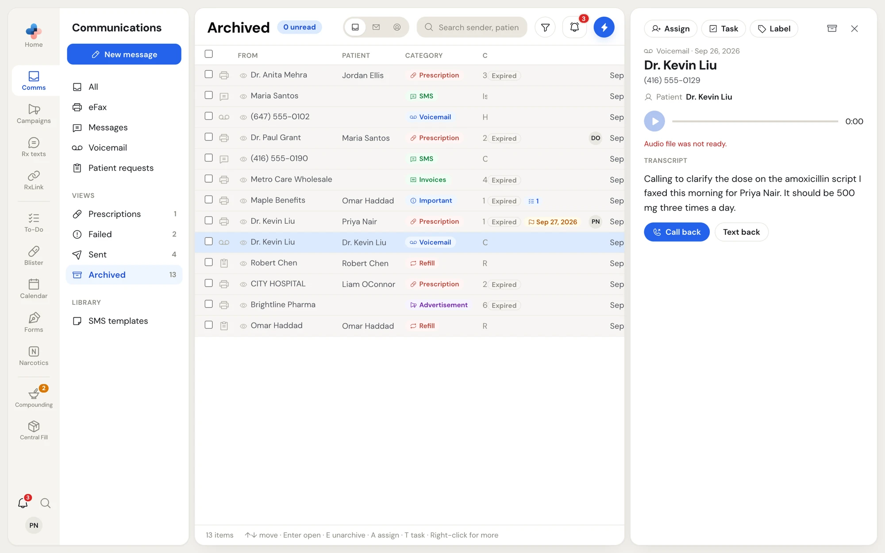

Voicemail left on your pharmacy's phone line arrives in **Comms › Voicemail**, and in **Comms › All**. Each voicemail is one row: the caller's name from caller ID (or the number, or **Unknown caller**), and the start of the transcript in **Content**.

<Note>
  Voicemail comes with your pharmacy's fax number. Until your pharmacy has a fax number, **Voicemail** is hidden from the side menu.
</Note>

## Listen to a voicemail

Click the voicemail to open it in the preview pane.

<Frame caption="A voicemail with its transcript">
  
</Frame>

1. Click the round play button. The bar shows how far through you are, and the time counts up. Click anywhere on the bar to jump to that point. Click the button again to pause.
2. Read the **Transcript** under the player. When there is none, the pane says **Transcription unavailable for this message.**, or **Transcription is not enabled for your account.** if your pharmacy does not have transcription.
3. If the player shows **Audio file was not ready.**, the recording has not finished arriving from the phone line. Try again in a few minutes.

**Patient** under the caller shows the caller ID name, as the best guess at who the call is about. Check it against the transcript before you act.

## Call or text the caller back

When the voicemail has a phone number, two buttons sit under the transcript:

- **Call back** dials the number with your computer's calling app (for example, a softphone or the phone app linked to your computer).
- **Text back** opens **New message** with the caller as the recipient. See [Text messages](/communications/text-messages#start-a-new-message).

## Organize voicemail

Voicemail works like every other item: assign it, label it, give it a deadline, make it a task, archive it or delete it. See [Working an item](/communications/working-items). A voicemail asking for a callback before a set time is a good one to turn into a task with a deadline.
