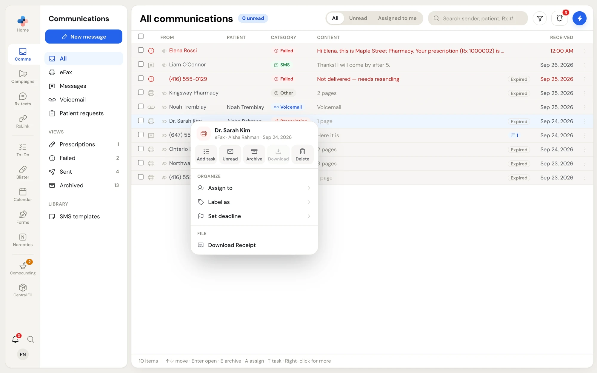
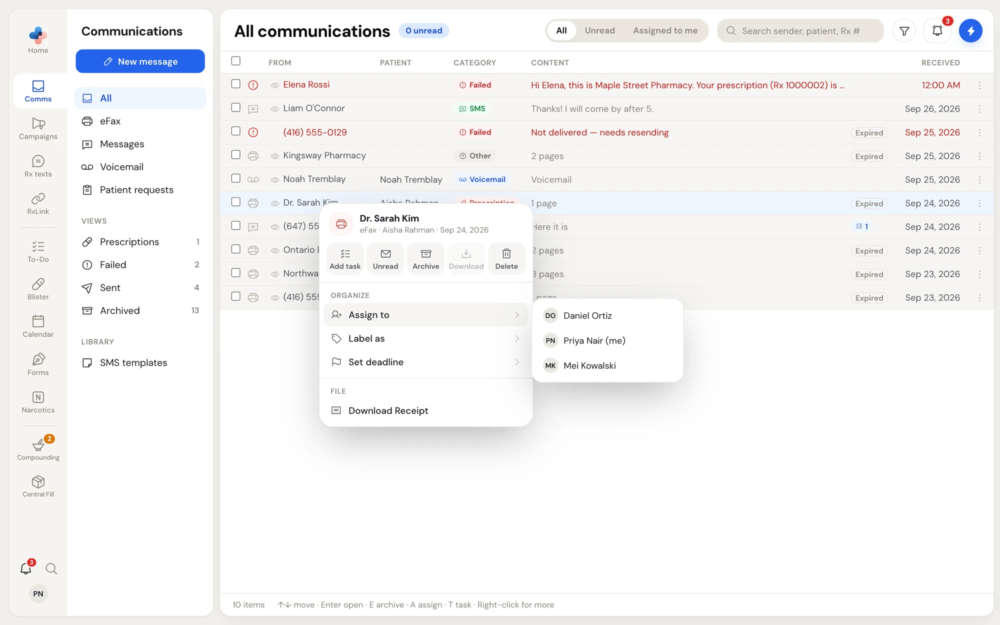
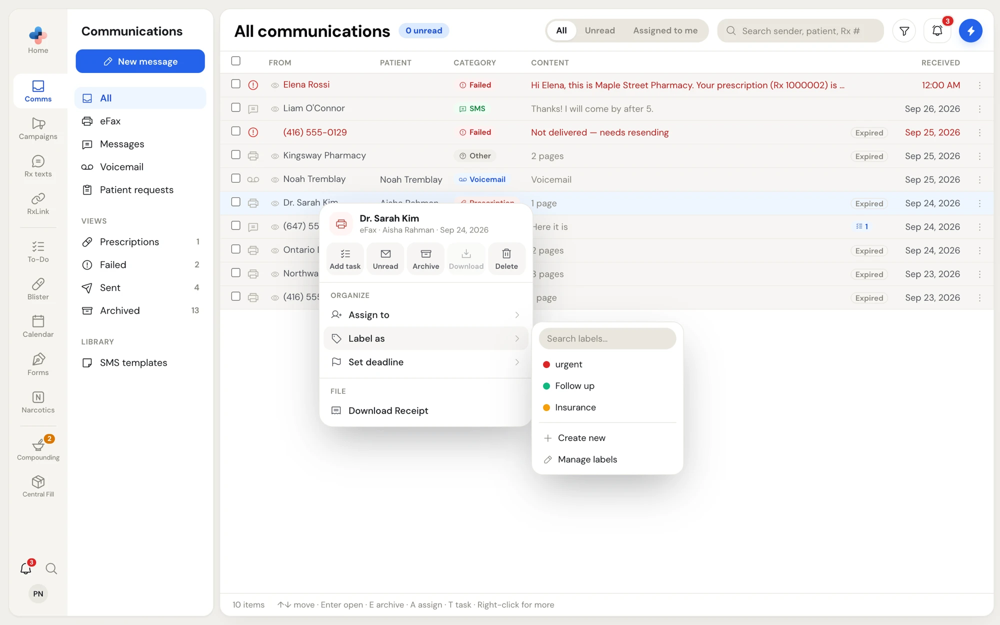
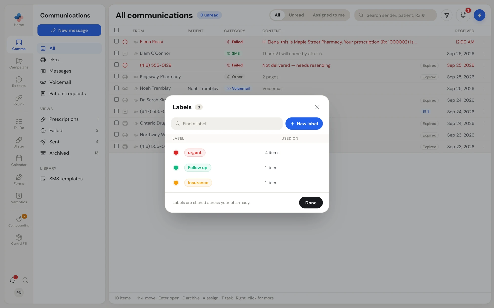
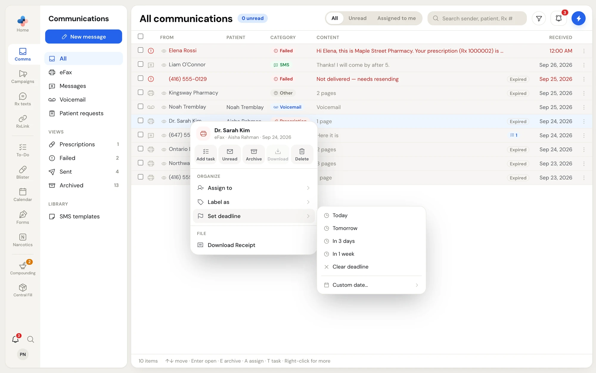
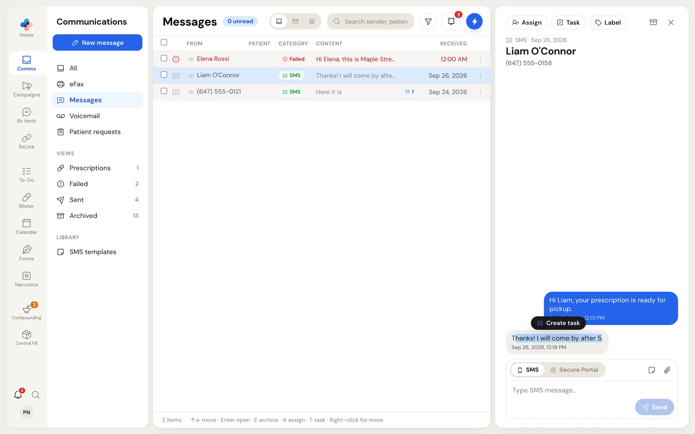
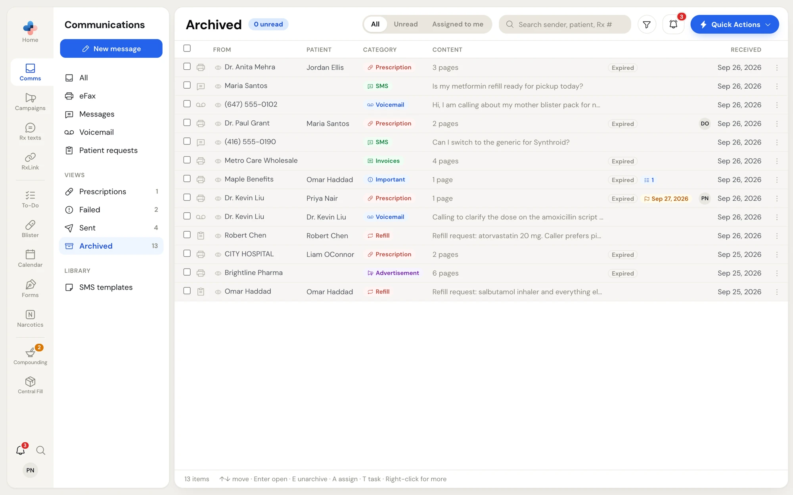
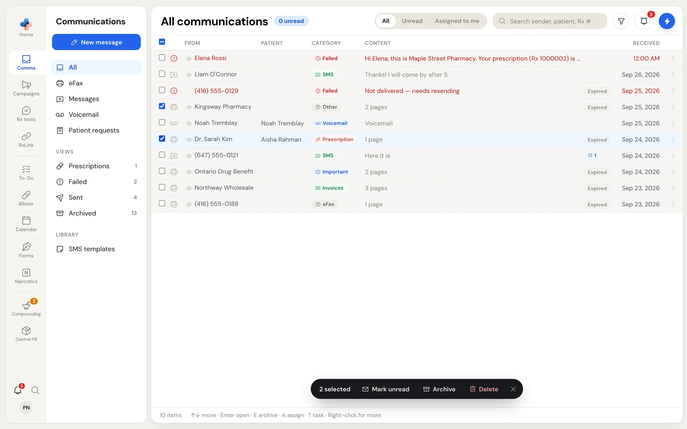

Every fax, text conversation, voicemail and patient request in **Comms** can be organized the same way. You can act from three places:

- **The row menu**: right-click a row, or click **⋮** at the end of it.
- **The preview pane toolbar**: **Assign**, **Task** and **Label**, plus **Archive** and **×** on the right.
- **The bulk bar**: tick the checkboxes of several rows.

Labels, assignments and deadlines are shared across your pharmacy. Everyone signed in to your pharmacy sees the same labels and the same assignee on an item.

## The row menu

Right-click any row (or click **⋮**) to open its menu. The top shows who the item is from, its channel, the patient and the date.

<Frame caption="The row menu of a received fax">
  
</Frame>

The row of buttons across the top:

| Button | What it does |
| --- | --- |
| **Add task** | Opens the To-Do panel with a new task linked to this item. |
| **Read** / **Unread** | Marks the item read, or back to unread. The button shows whichever applies. |
| **Archive** / **Unarchive** | Moves the item to **Archived**, or back to the inbox when it is already archived. |
| **Download** | Faxes only. Saves the fax as a PDF. Greyed out once the fax file has expired. |
| **Delete** | Deletes the item permanently, after a 5-second Undo window. |

Under **Organize** are **Assign to**, **Label as** and **Set deadline**. Hover over one to open its list.

Other sections appear when they apply:

- **Request**: on patient requests. See [Patient requests](/communications/patient-requests#the-row-menu).
- **File** › **Download Receipt**: on faxes. See [Faxes](/communications/faxes#download-a-fax-receipt).
- **Tasks** › **Linked tasks**: when tasks are linked to the item. The number shows how many; hover to list them, and click one to open it.
- A red **Fax failed to send** or **Text didn't send** box: on items that were not delivered. See [Faxes](/communications/faxes#failed-faxes) and [Text messages](/communications/text-messages#texts-that-were-not-delivered).

Press **Esc** or click outside the menu to close it. You can also move through the menu with the arrow keys and press **Enter** to choose.

## Mark read or unread

Opening an item marks it read for everyone at your pharmacy. To change it yourself:

- Right-click the row and click **Read** or **Unread**.
- Or tick several rows and click **Mark read** or **Mark unread** in the bulk bar.

A dark toast at the bottom says **Marked as read** or **Marked as unread** with an **Undo** button.

The eye beside a read row shows who opened the item and who marked it read, with the time. Hover over it to see the names.

## Assign an item

Assigning puts a person's initials on the row, and the item shows when they choose **Assigned to me** in the header.

<Frame caption="Assign to lists everyone at your pharmacy">
  
</Frame>

<Steps>
  <Step title="Open the Assign list">
    Right-click the row and hover over **Assign to**. You can also click **Assign** in the preview pane, or highlight the row and press **A**.
  </Step>
  <Step title="Pick a person">
    Click a name. You are marked **(me)**. The person's initials appear on the row, and the preview pane's button changes to their first name.
  </Step>
  <Step title="Change or clear it">
    An item has one assignee. Click another name to reassign it, or click **Unassign** to clear it.
  </Step>
</Steps>

## Label an item

Labels are coloured tags your pharmacy creates, such as **Urgent** or **Follow up**. A row shows up to two labels, then **+1**, **+2** and so on.

<Frame caption="Label as: tick labels on and off, or create one">
  
</Frame>

<Steps>
  <Step title="Open the label list">
    Right-click the row and hover over **Label as**, or click **Label** in the preview pane.
  </Step>
  <Step title="Tick the labels you want">
    Click a label to put it on; click it again to take it off. An item can carry several labels.
  </Step>
  <Step title="Create a label if it does not exist">
    Type in **Search labels…**. When nothing matches, the list offers **Create "…"** with what you typed; click it (or press **Enter**) to create the label and put it on the item. **Create new** opens the label manager with a fresh label.
  </Step>
</Steps>

To find every item with a label, use the funnel in the header and pick the label under **Labels**.

### Manage labels

Click **Manage labels** in the label list, or open **Quick Actions** and choose **Manage Labels** (**⌥ L**).

<Frame caption="The Labels window">
  
</Frame>

In the **Labels** window you can:

- **Find a label** by typing its name.
- Click **New label** to add one.
- **Rename** a label: click the pencil, type, and press **Enter**.
- **Change color**: click the coloured dot and pick one of the preset colours or type a hex value.
- See where each label is **Used on**: the number of items, or **Unused**.
- Set **Default people**: the people or teams a task gets when this label goes on it and nobody is assigned yet.
- **Delete** a label: click the trash icon. A toast offers **Undo**.

Click **Done** to close the window. Labels are shared across your pharmacy, so a rename or deletion changes the label for everyone.

## Set a deadline

A deadline puts an amber flag with the date on the row.

<Frame caption="Set deadline offers quick dates and a calendar">
  
</Frame>

Right-click the row, hover over **Set deadline**, and choose **Today**, **Tomorrow**, **In 3 days** or **In 1 week**. Choose **Custom date…** to pick a day from a calendar. **Clear deadline** removes it.

## Turn an item into a task

When an item needs follow-up, make it a task on your pharmacy's To-Do list. The task stays linked to the item, and the row shows a checklist badge with the number of linked tasks.

- Click **Task** in the preview pane, click **Add task** in the row menu, or highlight the row and press **T**.
- To start the task with words from a text message or a patient request, select the words with your mouse. A dark **Create task** button appears above them; click it and the selected text becomes the task's title.

<Frame caption="Select text in a message to start a task with it">
  
</Frame>

The To-Do panel opens on the right so you can set the due date, assignee and other details. See [Work with a task](/todo/task-details) for those fields.

## Archive and unarchive

Archive an item once it is dealt with. It leaves every channel and goes to **Archived**. Nothing is lost: labels, tasks and the assignee stay on it.

- Click **Archive** in the row menu, the archive icon in the preview pane, or press **E**.
- To archive several items, tick them and click **Archive** in the bulk bar (or press **E**).

A toast says **Archived** with **Undo** for 5 seconds. When the item you archive is open in the preview pane, the pane moves on to the next item in the list.

To bring an item back, open **Archived**, then click **Unarchive** in the row menu, or press **E**. The toast says **Moved to inbox**.

<Frame caption="Archived keeps every channel's archived items together">
  
</Frame>

## Delete permanently

**Delete** removes the item from PharmaTools for everyone at your pharmacy.

1. Click **Delete** in the row menu, or tick rows and click **Delete** in the bulk bar.
2. The row disappears and a toast says **Deleted** with **Undo**.
3. You have 5 seconds to click **Undo**. After that the item is deleted and cannot be brought back. Leaving or reloading PharmaTools during those 5 seconds still deletes it.

<Warning>
  Archive anything you might need again, such as a prescription or an invoice. Delete is for junk, such as advertisement faxes.
</Warning>

## Bulk actions

Tick the checkbox at the start of each row you want, or the checkbox in the header to select every row shown. A dark bar appears at the bottom of the list.

<Frame caption="The bulk bar with two items selected">
  
</Frame>

| Button | Shown when |
| --- | --- |
| **Mark read** | At least one selected item is unread. |
| **Mark unread** | At least one selected item has been read. |
| **Archive** | At least one selected item is not archived. |
| **Unarchive** | Every selected item is already archived. |
| **Delete** | Always. The same 5-second Undo applies. |

Click **×** at the end of the bar to clear the selection. Changing channel, search or filter also clears it.
