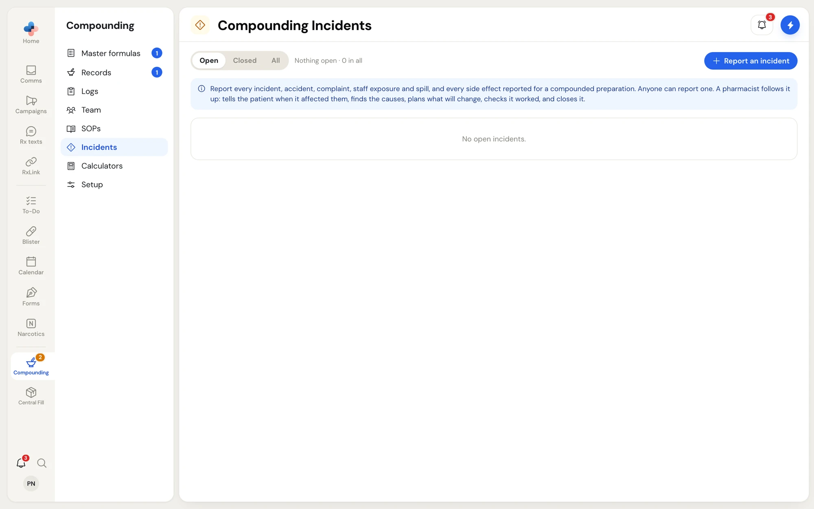
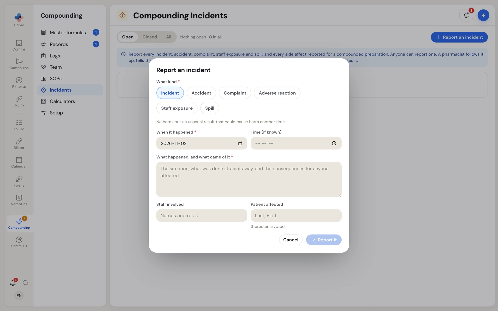

**Compounding › Incidents** is the incident and accident log NAPRA asks for. Anyone reports what happened. A pharmacist follows it up: tells the patient when it affected them, records the causes and the corrections considered, plans actions with owners and deadlines, checks each action worked, and closes the file.

<Frame caption="Compounding › Incidents with the Open, Closed and All tabs">

</Frame>

## Who can do what

| Action | Who |
| --- | --- |
| Report an incident, add a note, attach the first file, mark an action they own done | Everyone |
| Take the follow-up, record disclosure, causes and corrections, add actions, check an action worked, replace a file, close and sign | Pharmacist, Manager, Admin |

## The list

Filter with **Open**, **Closed** or **All**. Each row shows **No.**, **Happened**, **What**, **Status**, **Actions** (for example **1 of 2 done**, with **Overdue** in red when a deadline passed) and **Follow-up** (who took it, or **Not taken**).

| Status | Meaning |
| --- | --- |
| **Reported** | Reported; no pharmacist has taken the follow-up yet |
| **Being followed up** | A pharmacist took the follow-up |
| **Checking actions** | Every action is done; each is being checked |
| **Closed** | Closed and signed by a pharmacist; it now takes notes only |

Right-click a row for **Open**, **Add note**, **Add action**, **Close and sign…**, **Copy number** and **Copy summary**. If a file can't be closed yet, a note says what is missing, with a button to open it.

## Report an incident

<Steps>
  <Step title="Click Report an incident">
    Choose **What kind**:

    | Kind | When |
    | --- | --- |
    | **Incident** | No harm, but an unusual result that could cause harm another time |
    | **Accident** | Harmed, or could have harmed, a patient, staff or anyone else |
    | **Complaint** | About a compounded preparation |
    | **Adverse reaction** | A side effect reported for a preparation |
    | **Staff exposure** | Contact with a hazardous product |
    | **Spill** | A spill of a hazardous or other product |
  </Step>
  <Step title="Say what happened">
    Enter **When it happened**, the **Time (if known)**, and **What happened, and what came of it**: the situation, what was done straight away and the consequences for anyone affected. Add **Staff involved** and the **Patient affected** (stored encrypted).

    <Frame caption="Report an incident">
    
    </Frame>
  </Step>
  <Step title="Click Report it">
    The incident opens with the status **Reported**.
  </Step>
</Steps>

<Warning>
For a staff exposure or a spill, follow your exposure or spill SOP first. Report it once the person is safe and the area is cleaned.
</Warning>

<Tip>
A problem or reaction reported later on an approved compounding record can be turned into an incident from that record's **Approve** step. The incident opens pre-filled and linked to the record, and takes the patient's name from it.
</Tip>

## Follow an incident up (pharmacist)

The incident page follows NAPRA's incident template from top to bottom.

<Steps>
  <Step title="What happened">
    The report as filed, the patient and staff involved, and a link to the compounding record when there is one. Click **Attach a file** to add a photo or document; a pharmacist can **Replace the attachment** (the old file is kept). For an exposure or spill, a note suggests reassessing the person in the training file (reason **After an incident**) and adding that as an action.
  </Step>
  <Step title="Follow-up">
    Record **Told the patient?** (**Yes**, **No, or no patient affected**, or **Not yet**), the **Causes** (the process, the people, the setting, the products) and the **Corrections considered** (the options looked at and which were chosen). Click **Take the follow-up**; the status changes to **Being followed up**, and later edits save with **Save**.
  </Step>
  <Step title="Action plan">
    Click **Add action**: **What will be done**, **Who** (a team member, or someone else by name and company) and **By when**. Each action goes on its owner's To-Do list. The owner or a pharmacist clicks **Mark done** and says what was done. When every action is done, the status changes to **Checking actions**.
  </Step>
  <Step title="Check each action worked">
    A pharmacist clicks **Check it worked** on each done action and records how they checked and what they found.
  </Step>
  <Step title="Close and sign">
    **Close and sign** opens once the causes are recorded, every action is done and each has a check that it worked. Until then, the line beside it says what is missing. Add an optional closing note and click **Close and sign**. Your name and today's date close the file.
  </Step>
</Steps>

**Notes** take a dated, signed note at any time, even after the file is closed. Right-click an action for **Mark done**, **Check it worked** and **Copy action**.

Open incidents feed the **Incidents followed up and closed** line in **Logs › Due checks**, and the incident log is part of **Export for an inspector**.
