**Compounding › Logs** keeps the records NAPRA's non-sterile standards ask a compounding pharmacy to keep. Every line is signed with the name of whoever is signed in.

<Frame caption="Compounding › Logs › Today: what each room needs now">
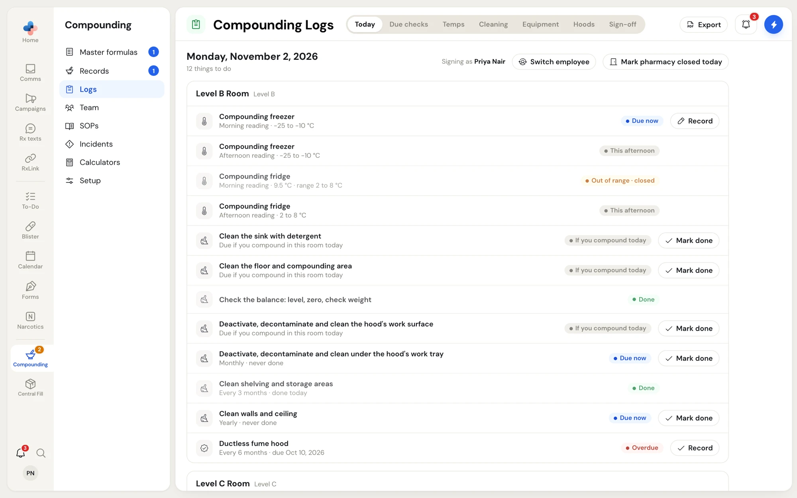
</Frame>

## Tabs

| Tab | What it holds |
| --- | --- |
| **Today** | What each room needs now: morning and afternoon temperature readings, cleans due today, and calibrations or certifications coming due |
| **Due checks** | Your QA program: each periodic check, how often, when last done, when next due |
| **Temps** | Each fridge, freezer and room as a month sheet of readings |
| **Cleaning** | Each room's cleans and checks, and the month's cleaning log |
| **Equipment** | Calibration of every device in your compounding profile, and the balance's daily check |
| **Hoods** | Hood certifications and hazardous surface wipe sampling |
| **Sign-off** | Each month's logs, closed and signed by a pharmacist |

**Export** in the header makes one PDF for an inspector (see [Export for an inspector](#export-for-an-inspector)).

## Who can do what

| Action | Who |
| --- | --- |
| Record a reading, mark a clean done, record a calibration or certification, add a note | Anyone signed in |
| Close an out-of-range reading, void a line, add or edit what is monitored, edit the cleaning schedule, change how often a due check repeats, mark the pharmacy closed today, close and sign a month | Pharmacist, Manager, Admin |

<Tip>
On a shared computer, check **Signing as** at the top of **Today** before you record anything. Click **Switch employee** to sign in as yourself with your PIN.
</Tip>

## Today

Each room lists its items with a status: **Due now**, **This afternoon**, **If you compound today**, **Due soon**, **Overdue**, **Done**, or **Out of range · open** / **Out of range · closed**. Click **Record** or **Mark done** beside an item.

- **Record** a temperature: enter **Now (°C)** and, from a min/max thermometer, **Lowest (°C)** and **Highest (°C)**, then **Save reading**. A reading outside the range asks **What you did**, and the reading shows in red under **Out-of-range readings to close** until a pharmacist clicks **Close…** and says what was checked and what happens to the stock.
- **Mark done** a clean: add an optional note. A pharmacist can tick **Done by someone without a PharmaTools account** and name who did it.
- **Mark pharmacy closed today** (pharmacist): no temperature readings or daily cleans are due on a day the pharmacy is closed.

<Frame caption="Recording a temperature reading">
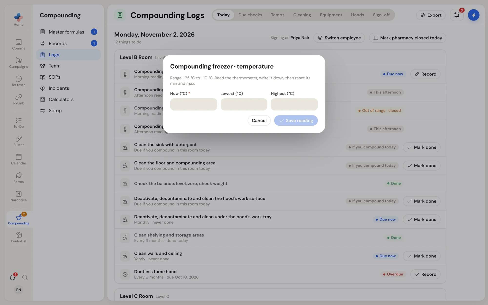
</Frame>

Right-click any item for its menu: the main action as a quick button, a link to its log tab, **Add a note** and, for a pharmacist, **Void…**.

<Frame caption="Right-click an item on Today">
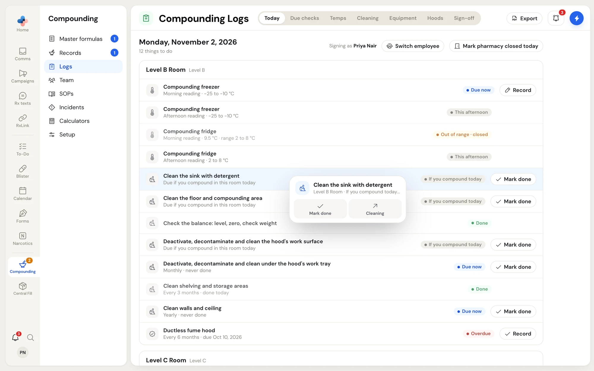
</Frame>

<Note>
Cleans a compounding record needs are written for you: the bench clean ticked on a record's **Get ready** step shows in the cleaning log as **Ready check**, and the work-surface clean after each record is marked from **Today**.
</Note>

## Due checks

The QA program on one page, with how often each check runs, **Last done**, **Next due** and a status. Each row either records the check here or opens the place it is kept.

<Frame caption="Due checks: NAPRA's periodic checks with last done, next due and status">
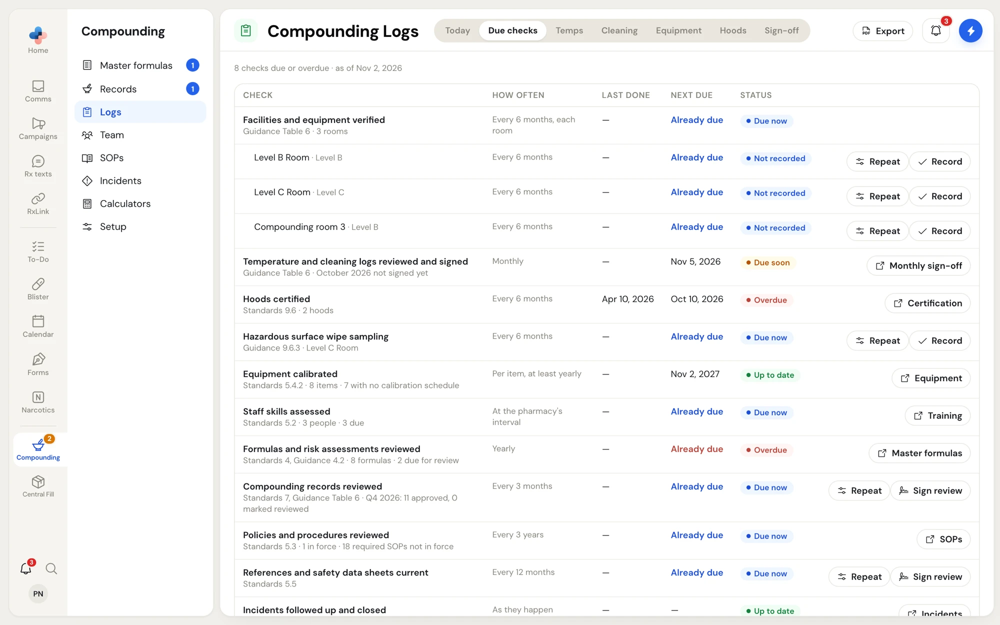
</Frame>

| Check | Where you do it |
| --- | --- |
| Facilities and equipment verified (each room, every 6 months) | **Record** opens the area check: tick what is in place, or say what will be done about anything not met |
| Temperature and cleaning logs reviewed and signed | **Monthly sign-off** |
| Hoods certified | **Certification** |
| Hazardous surface wipe sampling (Level C rooms) | **Record** here or on **Hoods** |
| Equipment calibrated | **Equipment** |
| Staff skills assessed | **Training** ([Team & training](/compounding/training)) |
| Formulas and risk assessments reviewed | **Master formulas** |
| Compounding records reviewed (every 3 months) | **Sign review**: say which records you sampled and what you found |
| Policies and procedures reviewed | **SOPs** ([SOP manual](/compounding/sops)) |
| References and safety data sheets current | **Sign review** |
| Incidents followed up and closed | **Incidents** ([Incidents](/compounding/incidents)) |

**Repeat** (pharmacist) sets how often a check runs or switches it off with a reason. Setting a check less often than NAPRA's guidance, or switching it off, shows a warning that your QA program won't meet that guidance; the reason is kept and shown to an inspector.

## Temps

Each fridge, freezer, cool storage area and room you monitor has a month sheet with **Morning** and **Afternoon** readings. Move between months with the arrows. Click **Record reading** in today's row, or **Record morning reading** in the header.

<Frame caption="A month sheet of readings; right-click a reading for Note, Copy line and Void line">
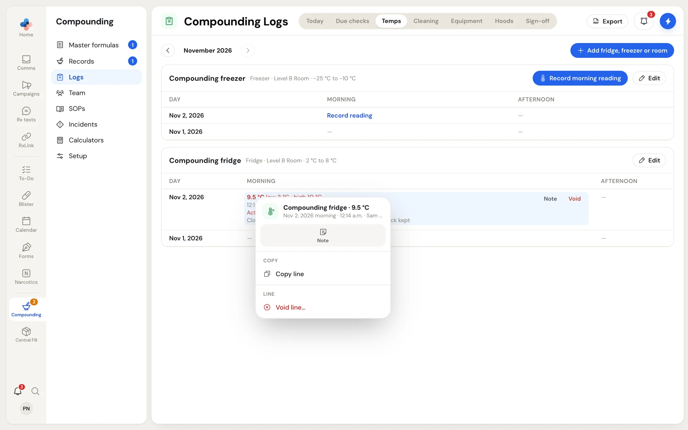
</Frame>

A pharmacist clicks **Add fridge, freezer or room** to add one: **Name**, **Kind** (**Fridge**, **Freezer**, **Cool storage** or **Room**), **Room**, and the **Lowest allowed (°C)** and **Highest allowed (°C)**, which start at NAPRA's range for the kind. **Edit** changes it; **Stop monitoring** and **Monitor again** are in its edit sheet and its right-click menu.

## Cleaning

Each room lists its cleans and checks, how many were done this month and when last, with **Mark done**. A pharmacist clicks **Edit schedule** to change how often each repeats (**After each compounding record**, **Each compounding day**, **Every day open**, **Weekly**, **Monthly**, **Every 3 months**, **Yearly**, or **Every…** a number of days, weeks, months or years), **Switch off** one with a reason, or **Add a clean or check** of your own for a room or the whole pharmacy. Click **Done editing the schedule** to finish.

<Frame caption="Edit schedule: how often each clean repeats">
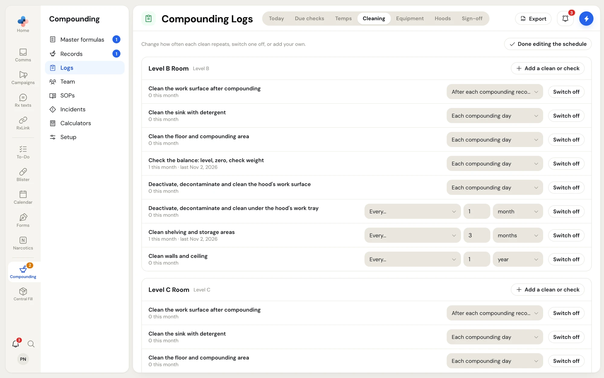
</Frame>

Below the rooms, **Cleaning log** lists every clean recorded in the month.

## Equipment

Every device your compounding profile says you own, with **Model · serial**, how often it is calibrated (**Every**), **Next due** and **Last calibration**. Your balance also has **Daily check: level, zero, check weight**; click **Record daily check** each compounding day.

<Frame caption="Equipment: calibrations and the balance's daily check">
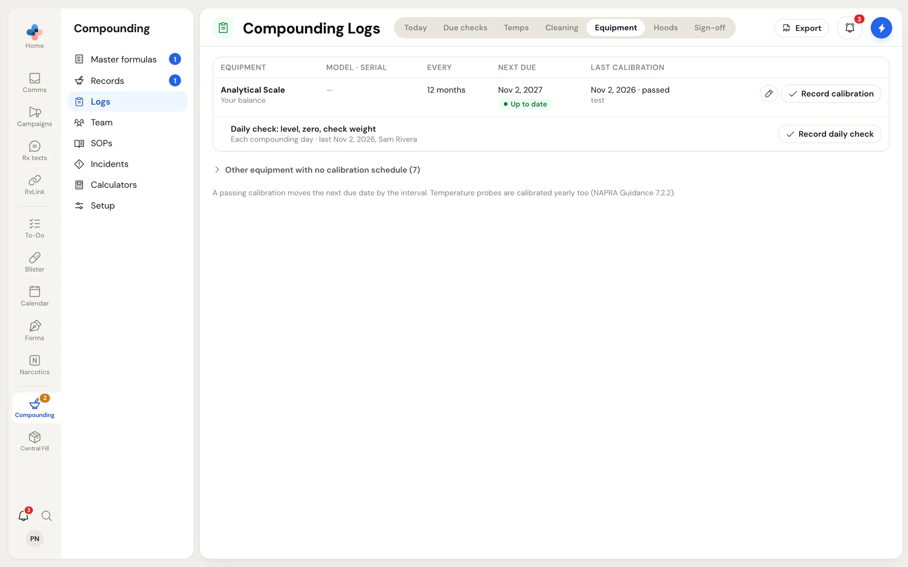
</Frame>

Click **Record calibration**: the **Date**, **Done by**, **Result** (**Passed** or **Failed**), notes, and **Attach report**. A passing calibration moves the next due date by the interval; a failed one leaves it where it is. The pencil edits the model, serial number, interval (**Calibrated every (months)**) and next due date. Equipment with no due date and nothing on file is folded under **Other equipment with no calibration schedule**.

## Hoods

Each room with a containment hood shows how often it is certified, when last and when next, with **Record certification** (date, certifier, **Passed** or **Failed**, notes and **Attach certificate**). Certify at installation, every 6 months, and after a repair or a contamination problem.

Each Level C room also has **Hazardous surface wipe sampling**: **Record wipe sampling** takes the date, lab, result (**No contamination found** or **Contamination found**), the sites sampled, and the lab report. A contaminated result stays due until a clean result, and asks what was done.

<Frame caption="Hoods: certifications and wipe sampling">
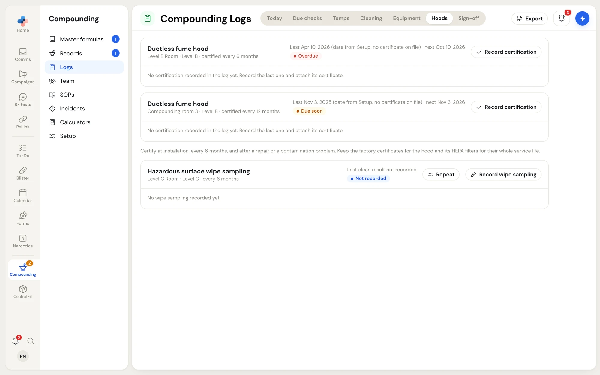
</Frame>

## Sign-off

Each month is **In progress**, **To sign**, **Signed** or **Nothing logged**. Open a month to see its totals (temperature readings, out-of-range readings, cleans, periodic tasks, calibrations, certifications) and **Missed or overdue** items.

<Frame caption="Monthly sign-off for October 2026">
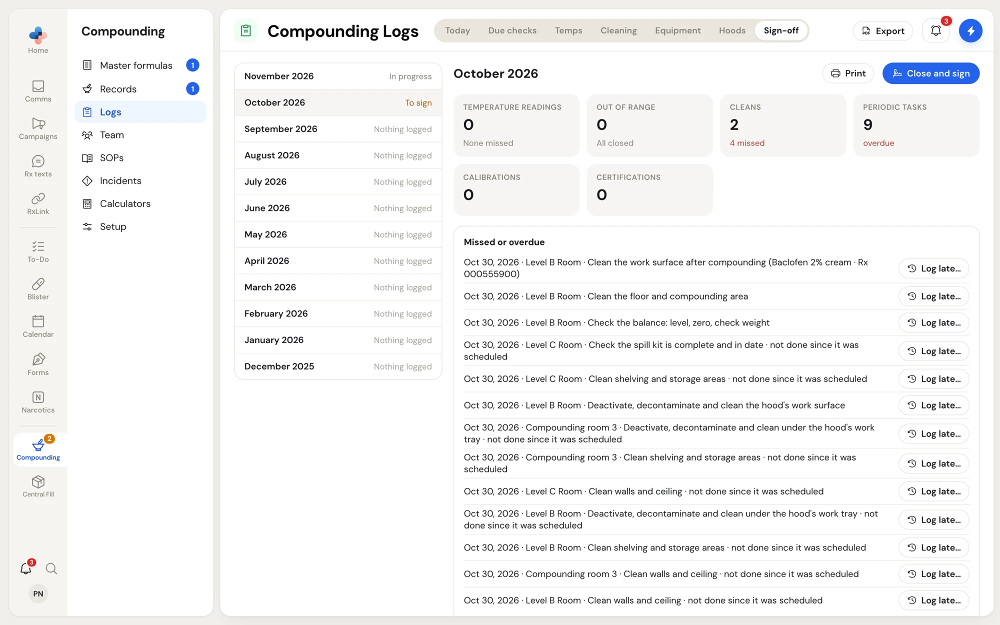
</Frame>

- **Log late…** signs a clean that was done but not signed, with the day it was done and why it is late, until the month is closed.
- **Print** prints the month's logs.
- **Close and sign** (pharmacist, from the 1st of the next month) confirms you reviewed the month's logs. Missed items don't stop the close; they stay on the record you sign, so say what was done about them in the **Review note**. After signing, the month's lines can't be changed, but notes can still be added.

<Frame caption="Close and sign a month">
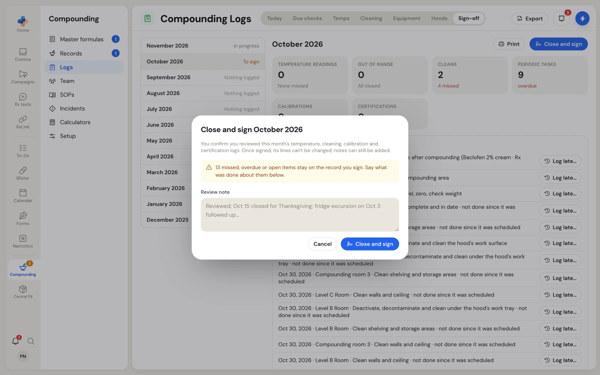
</Frame>

## Export for an inspector

Click **Export**, pick **From** and **To** months (up to 24), and click **Download PDF**. The PDF holds the due checks, each month's logs and sign-off, the incidents, the training file and your SOP list. Tick **Attach the certificates, lab reports and fit tests from the period** to add them at the back, and **Include the full text of every SOP in force** to add the SOPs.

<Frame caption="Export for an inspector">
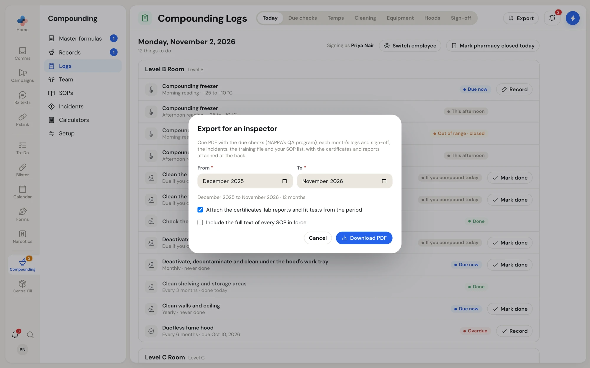
</Frame>
