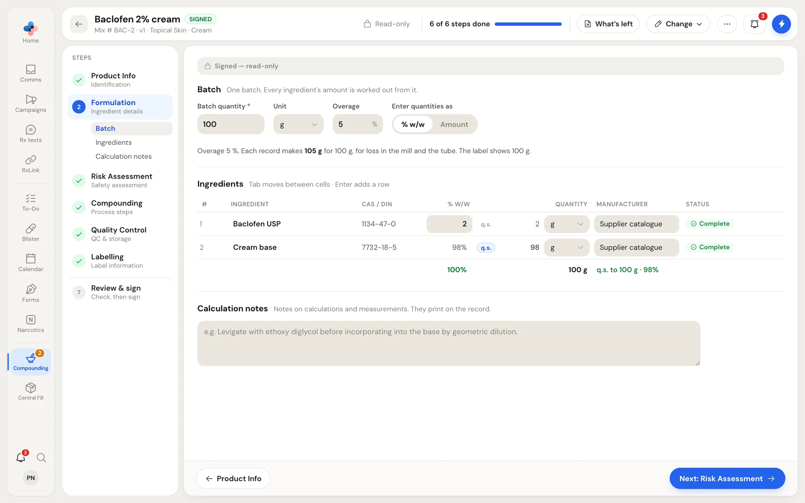

The **Formulation** step holds one batch: its size, and every ingredient with its amount. Enter each ingredient as a percentage of the batch or as an amount, and the other is worked out for you.

This page covers creams, gels, liquids and other forms made by weight or volume. Capsules and molded forms (suppositories, Rectal Rockets, troches, gummies) work per unit instead; see [Capsules and molded forms](/compounding/mfr-unit-dose).

<Frame caption="The Formulation step of a signed cream: the batch, the ingredients table, and the calculation notes.">

</Frame>

## Batch

One batch. Every ingredient's amount is worked out from it.

| Field | What to enter |
|---|---|
| **Batch quantity** \* | The amount one record makes, for example 100. |
| **Unit** | **g** or **mL** (a liquid starts in mL). |
| **Overage** | Extra made for what is lost in the mill, the jar or the tube (or, for liquids, measuring and the bottle), in %. |
| **Enter quantities as** | **% w/w** (percentages; for a liquid measured in mL, grams per 100 mL) or **Amount**. |

The line under the batch says what the overage means, for example "Overage 5 %. Each record makes 105 g for 100 g, for loss in the mill and the tube. The label shows 100 g."

## Ingredients

One row per ingredient. **Tab** moves between cells, and **Enter** on the last row adds one. **Add ingredient** adds a row.

| Column | What it holds |
|---|---|
| **#** | The row's order. Drag the handle to reorder. |
| **Ingredient** | The ingredient, picked from the catalogue search. **+ salt / potency** under the name opens two optional fields: the **salt factor** (grams of this form per gram of the active as written, for example 1.155 for lidocaine HCl written as lidocaine base) and the **potency** (assay or purity from the certificate of analysis, in %). The quantity on the record is then what is weighed. |
| **CAS / DIN** | Filled in from the catalogue. |
| **% w/w** or **Quantity** | The one you type; the other is worked out. |
| **Manufacturer** | Who makes the lot you use. |
| **Status** | **Complete**, or what the row still needs, for example "Needs a quantity". |

Flags such as **Light sensitive**, **Heat sensitive**, **Moisture sensitive**, **Hygroscopic**, **Air sensitive**, **Oxygen sensitive** and **Narrow therapeutic index** come from the catalogue and show on the row.

The footer of the table adds the column up, and says **Adds to 100%** when the batch is complete.

### The vehicle (q.s.)

Mark the base or vehicle **q.s.**: it is whatever the other ingredients leave, to bring the batch to its final quantity. Only one ingredient can be q.s. Click the q.s. amount to type an amount instead.

### Check the name against the ingredients

If the product name mentions a drug that isn't in the formula yet, an amber line says so, for example "The name mentions Ketoprofen, but it isn't in the formula yet. Add it below, or change the name on Product."

## Search for an ingredient

Click an ingredient cell and type. The search box reads **Search catalog — name, brand, DIN, NPN…**. Results come from:

- **Supplier catalogues**: the bulk ingredients and bases your suppliers sell.
- **Health Canada DPD**: approved drug products, found by brand name or DIN.
- **Health Canada LNHPD**: licensed natural health products, found by name or NPN.
- **Your pharmacy**: ingredients your pharmacy added itself, listed first with a **Your pharmacy** badge.

Picking a result carries its catalogue identity onto the ingredient. That is what lets the risk assessment find its safety data sheet and the NIOSH list, so pick from the search rather than typing a name where you can.

A Health Canada product is a finished product, so the row is named for it, for example "PEN-VK 300mg 02238371", and the formula records which approved product it was made from. A combination product fills its first active into the row and adds one row for each other active. A product Health Canada no longer markets says "This product is no longer marketed."

<Note>
If no supplier catalogue has been imported for your pharmacy yet, the search says so. You can still type the ingredient yourself.
</Note>

### Add an ingredient no catalogue lists

When the search finds nothing, or not the one you need, the last row of the results is **Can't find it? Add "…" yourself**.

1. Click it. The **Add an ingredient** form opens, for one no supplier catalogue lists.
2. Check the name, enter the **Supplier** (who you buy it from) and pick its form.
3. Optionally attach its safety data sheet (a PDF, up to 10 MB), so the risk assessment can read it.
4. Click **Add to formula**.

The ingredient is saved to your pharmacy's own list and put straight into the formula. Everyone at the pharmacy then finds it in the same search, and it is listed in **Compounding › Setup › Ingredients you added**.

## Calculation notes

Notes on calculations and measurements, for example "Levigate with ethoxy diglycol before incorporating into the base by geometric dilution." They print on the record.

## When the Formulation step is complete

The step shows a green tick on the left once the batch is set, every ingredient has what it needs, and the batch adds up. The [risk assessment](/compounding/mfr-risk) reads the ingredients next, so finish this step first.
