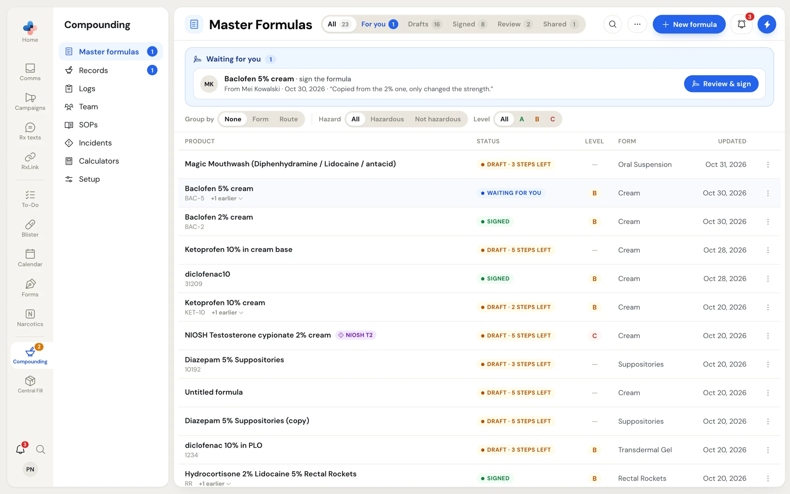
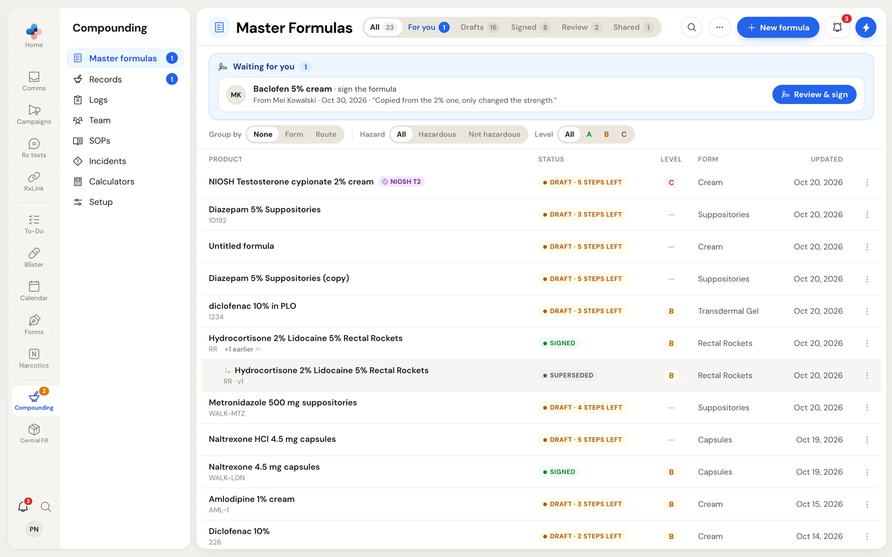
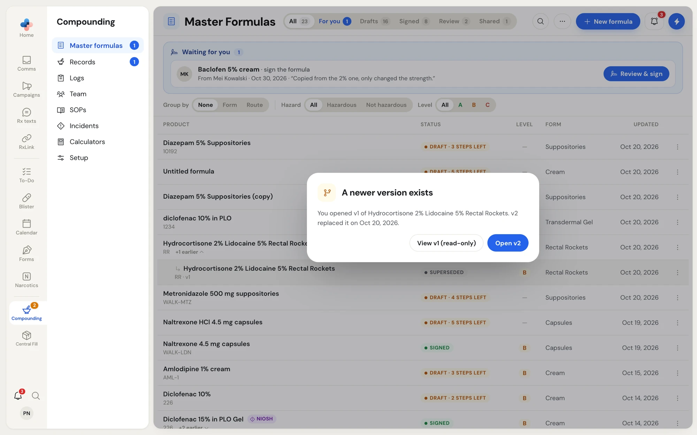
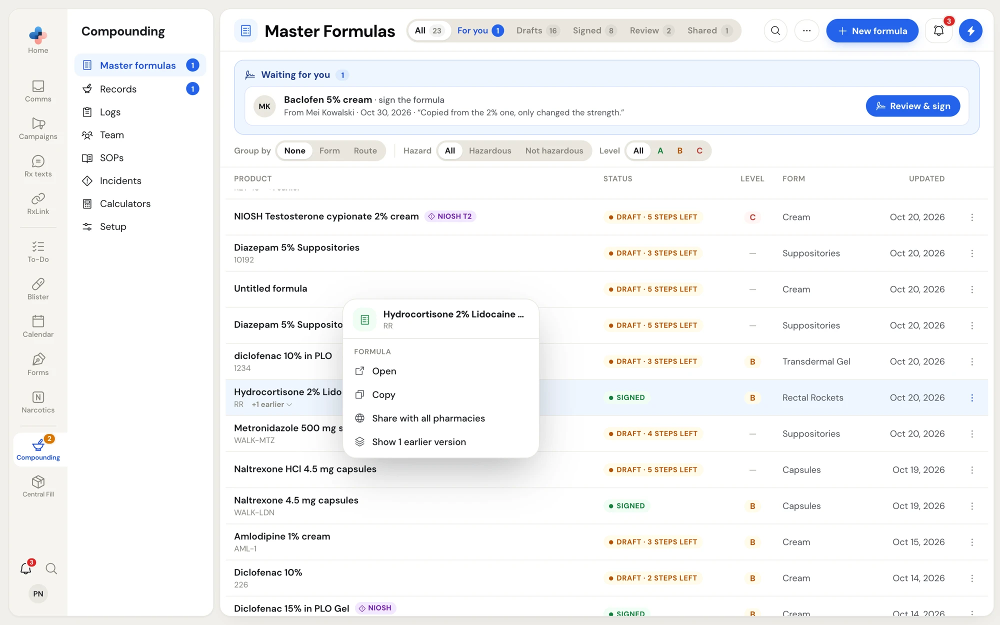
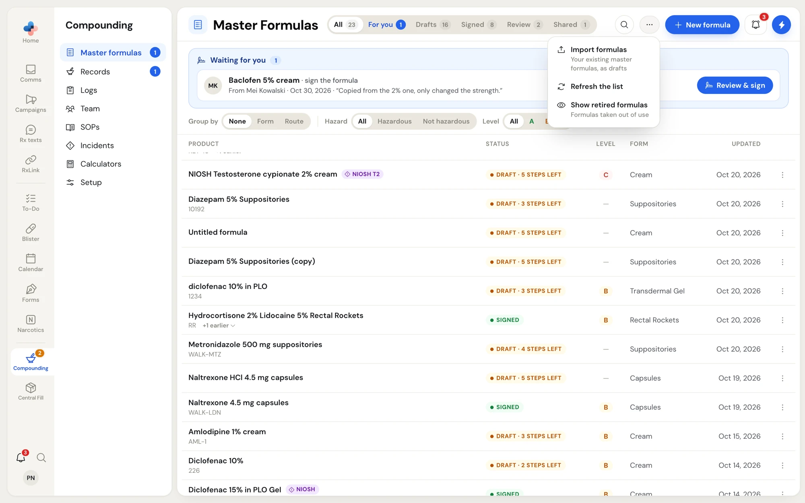
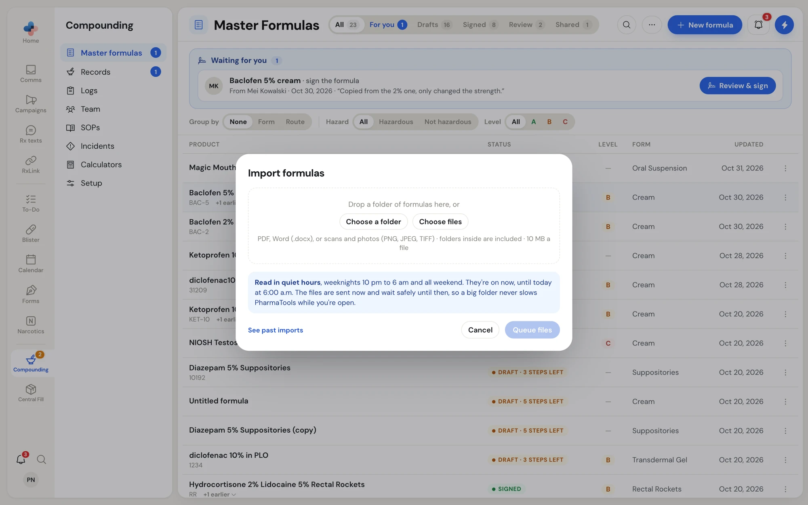

A master formulation record (MFR, or master formula) is the approved recipe for one preparation: its ingredients for one batch, its NAPRA risk assessment, its equipment and method, its quality checks and beyond-use date, and its label. Every compounding record is made from a signed master formula.

Open **Compounding** in the left rail and click **Master formulas**. The blue number beside **Master formulas** is how many formulas are waiting for you.

<Frame caption="Master Formulas: the view tabs, the Waiting for you strip, the filters, and one row per formula.">

</Frame>

## Waiting for you

The blue **Waiting for you** strip at the top lists the formulas that need you now:

| Row | What to do | Button |
|---|---|---|
| A draft a colleague sent you to sign, for example "Baclofen 5% cream · sign the formula", with who sent it, when, and their note. | Review it and sign it, or send it back. | **Review & sign** |
| Your own draft that a pharmacist sent back, with how many notes to fix. | Fix what the pharmacist asked for and send it again. | **Fix and send again** |

A draft sent to **Any pharmacist** appears in every pharmacist's strip until one of them opens it.

## View tabs

| Tab | Shows |
|---|---|
| **All** | Every formula except retired ones. |
| **For you** | Formulas waiting for you (the same ones as the strip). |
| **Drafts** | Formulas not signed yet. |
| **Signed** | Formulas in force. |
| **Review** | Signed formulas due, or soon due, for their annual review. |
| **Shared** | Formulas other PharmaTools pharmacies share with every pharmacy. |

The number on each tab counts formulas, not versions. On a wide screen the tabs read **Waiting for you**, **Review due** and **Published** instead of **For you**, **Review** and **Shared**.

## Formula statuses

| Status | Meaning |
|---|---|
| **Draft · 3 steps left** | Not signed yet; 3 of the 6 writing steps still have something missing. |
| **Draft · ready to send** | Every step is filled in. Open it to send it to a pharmacist. |
| **Draft · ready to sign** | Your own draft, every step filled in, and you are a pharmacist. Open it to sign. |
| **Waiting for you** | Sent to you to sign. |
| **With Mei** / **With any pharmacist** | Sent to that pharmacist, or to every pharmacist, to sign. |
| **Sent back · 2 to fix** | A pharmacist sent it back to whoever drafted it, with 2 notes. |
| **Signed** | Signed and in force. Compounding records can be made from it. |
| **Signed · review soon** | Its annual review is due within 30 days. |
| **Signed · review due** | It is due for review: a year has passed, or a safety data sheet or the NIOSH list changed since it was signed. Hover over the status to read why. |
| **Superseded** | A newer signed version replaced it. |
| **Retired** | Taken out of use. Still readable. |

The **Level** column shows the formula's NAPRA level (**A**, **B** or **C**), and a **NIOSH** tag beside a name marks a formula with an ingredient on the NIOSH hazardous drugs list.

## Search and filter

- Click the search icon and type a name, mix number or ingredient.
- **Group by**: **None**, **Form** or **Route**. Grouped sections fold open and closed.
- **Hazard**: **All**, **Hazardous** or **Not hazardous**.
- **Level**: **All**, **A**, **B** or **C**.

Your grouping, filters and folded sections are kept for you on any computer you sign in on.

## Versions

A formula is one row, with its earlier versions folded under it. **+1 earlier** under a formula's name shows them; click it again to hide them.

<Frame caption="A formula's earlier version shown under it, marked Superseded.">

</Frame>

If you open an older version while a newer one exists, PharmaTools asks which one you meant.

<Frame caption="A newer version exists: view the older version read-only, or open the current one.">

</Frame>

- **View v1 (read-only)** opens the version you clicked.
- **Open v2** opens the newer one.

## Row menu

Click **⋮** at the end of a row, or right-click the row, for its menu.

<Frame caption="The menu for a signed formula.">

</Frame>

| Item | What it does |
|---|---|
| **Open** | Opens the formula. |
| **Copy** | Starts a new draft from it straight away, named "… (copy)", with its signatures cleared. A message confirms "Copied as a new draft · signatures cleared". |
| **Share with all pharmacies** | Signed formulas only. Asks "Share with all pharmacies?" first: every PharmaTools pharmacy will be able to see the formula and copy it into their own formulas. Your patients and records are never shared. One version of a formula is shared at a time. |
| **Stop sharing** | Other pharmacies can no longer see or copy it. |
| **Show 1 earlier version** / **Hide earlier versions** | Folds the earlier versions open or closed. |
| **Delete draft…** | Drafts only. Asks first; the draft and everything typed into it are gone. Signed versions are not affected. |

On the **Shared** tab, a formula from another pharmacy has one item: **Copy to my formulas**, which starts a new draft of your own from it.

## The ⋯ menu

The **⋯** button beside **New formula** has:

- **Import formulas**: bring in your existing master formulas as drafts. See below.
- **Refresh the list**.
- **Show retired formulas** / **Hide retired formulas**: formulas taken out of use.

<Frame caption="The ⋯ menu on the Master Formulas list.">

</Frame>

## Import your existing formulas

If you already have master formulas as files, import them as drafts instead of typing them.

1. Click **⋯** and **Import formulas**.
2. Drop a folder of formulas, or click **Choose a folder** or **Choose files**. PDF, Word (.docx), or scans and photos (PNG, JPEG, TIFF) are accepted, up to 10 MB a file; folders inside the folder are included.
3. Click **Queue files**. Keep the page open while the files are sent.

<Frame caption="Import formulas: the files are sent now and read in quiet hours.">

</Frame>

The files are read in quiet hours (weeknights 10 pm to 6 am, and all weekend), so a big folder never slows PharmaTools while you are open. Each formula read becomes a draft, filled in the same way as [pre-filling from a formula sheet](/compounding/mfr-new#pre-fill-from-a-formula-sheet). Click **See past imports** to follow each import: files waiting for quiet hours, being read, saved as a draft (with **Open the draft**), or that couldn't be read (with **Try it again**).

<Warning>
An imported formula is a draft, not a signed formula. Check every step of it, and have a pharmacist sign it, before anyone compounds from it.
</Warning>

## Start a formula

Click **New formula**. See [Start a new master formula](/compounding/mfr-new).
