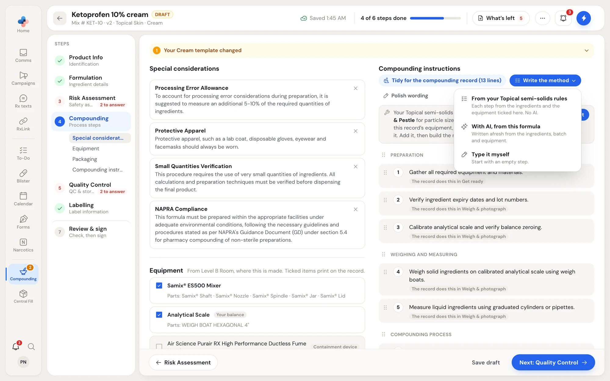
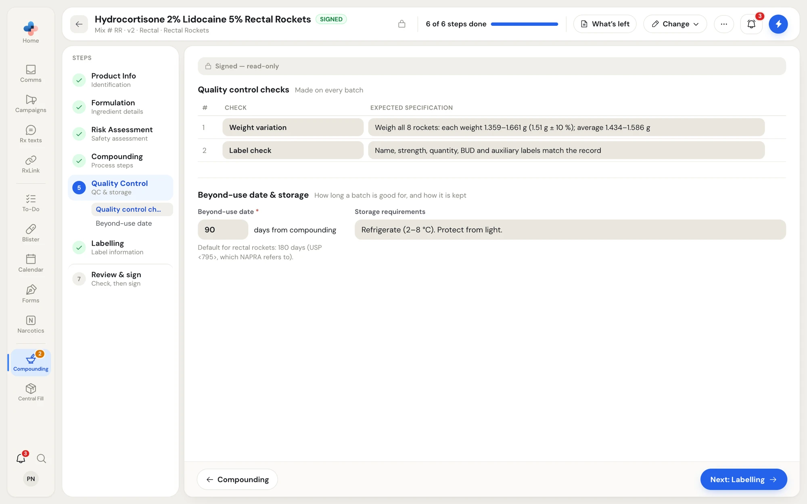
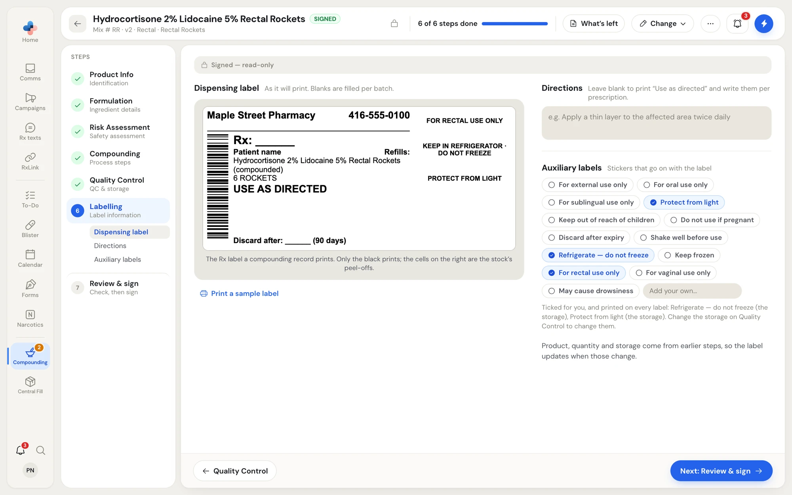

Steps 4 to 6 of a master formula say how it is made, how each batch is checked and kept, and how its label reads. When your pharmacy has a [method](/compounding/profile-methods) for the formula's route, these steps start filled in from it.

## Compounding

The **Compounding** step has the special considerations, equipment and packaging on the left, and the method as numbered steps on the right.

<Frame caption="The Compounding step of a draft: special considerations and equipment on the left, the compounding instructions on the right with the Write the method menu open.">

</Frame>

### Special considerations

Notes that print with the method, for example **Processing Error Allowance**, **Protective Apparel**, **Small Quantities Verification** and **NAPRA Compliance**. Click **×** to remove one, or **Add consideration** to search for and add another.

### Equipment

The devices in the room the formula is made in (from **Result & sign** of the risk assessment), for example "From Level B Room, where this is made. Ticked items print on the record." Tags mark **Your balance**, **The formula's mold** and the **Containment device**. Parts used with a device are listed under it.

- Tick or untick a device to include it on the record.
- Devices you own that are in no room show **Not in a room**. **4 more in your other rooms** shows devices from your other rooms; **Hide the other rooms** hides them again.
- **Add equipment** searches for another device.

If your route's technique names a device that isn't on the formula, a line says so, for example "Your Topical semi-solids technique uses the Mortar & Pestle for particle size reduction, but it isn't on this record's equipment, so the method won't name it." Click **Add to equipment**, then write the method again.

### Packaging

The containers for this formula, from the containers you stock. **Add packaging** searches for another.

### Compounding instructions

The method, as numbered steps under headings such as **Preparation**, **Weighing and measuring** and **Compounding process**.

**Write the method** offers three ways to write it:

| Option | What it does |
|---|---|
| **From your Topical semi-solids rules** | Each step written by rules from the ingredients and the equipment ticked on this Compounding step, using your route's technique. No AI. |
| **With AI, from this formula** | Written afresh from the ingredients, batch and equipment. |
| **Type it myself** | Starts with an empty step. |

A written method goes straight onto the formula, with each new or changed step marked. Read every step. **Undo** puts back the method as it was; **Hide the marks; the method stays as it is** clears the marks.

Other tools above the method:

- **Polish wording** keeps the steps and their order, fixes the wording, and adds a step only where this formula needs one. You see each change before you keep it (**Keep these steps** or **Keep as written**). It may say "Polished · nothing needed changing".
- **Tidy for the compounding record (13 lines)** appears when some lines are things the compounding record already does in its own steps (getting ready, weighing and photographing, quality control, the label, approval). Those lines are tagged, for example "The record does this in Weigh & photograph". Tidying takes them out, so technicians aren't asked to tick them twice; you see each one before anything changes.
- If the method uses placeholders such as `{active ingredient}` and `{base}`, a button puts this formula's ingredient names in.

To edit a step, click its text. Each step's menu has **Add step above**, **Add step below** and **Remove step**. Drag a step's handle to move it; moving a heading moves its whole section. **Add step** at the end adds one.

### Use the method from the formula sheet

If you [pre-filled the formula from a sheet](/compounding/mfr-new#pre-fill-from-a-formula-sheet) that had a method, the sheet's method is shown above the formula's method as a reference. **Use it as is** makes it the method (asking "Replace the method with the sheet's?" if there are steps already; confirm with **Use the sheet's method**). **Write with AI** reads it for technique only.

### Offer a change back to the method

At the bottom of the step, when this formula's method, equipment, packaging, storage or labels differ from your route's method, **Update your Topical semi-solids template?** shows the differences side by side (**Template** and **This record**). **Save to template** saves this formula's version to the route's method, which every new formula of that route starts from. Without a method for the route yet, it reads **Save this as your … template?**

## Quality Control

<Frame caption="Quality Control: the checks made on every batch, and the beyond-use date and storage.">

</Frame>

### Quality control checks

The checks made on every batch, each with its **Expected specification** (what passing looks like), for example "Weight variation: weigh all 6 rockets; each weight within ±10%". **Add check** adds a row; **From your saved checks** picks from your [quality checks](/compounding/profile-whole-pharmacy#quality-checks). Click **×** to remove a check. At least one check is required.

### Beyond-use date and storage

| Field | What to enter |
|---|---|
| **Beyond-use date** \* | Days from compounding. The default for the form is shown under it, for example "Default for cream without a preservative: 14 days, refrigerated (USP &lt;795&gt;, which NAPRA refers to)." |
| **Contains a preservative** | **Yes** or **No**, for water-containing forms. PharmaTools guesses from the ingredients, for example "Guessed: no preservative among the ingredients." |
| **Storage requirements** | How it is kept, for example "Refrigerate (2–8 °C). Protect from light." |
| **Reference for a beyond-use date longer than 14 days** \* | Asked only when you enter a longer date than the default. A longer date needs a stability study or a monograph behind it; name it, and it prints on the record. |

<Note>
On a signed formula that compounding records were made with, the beyond-use date can only change as a new version.
</Note>

## Labelling

<Frame caption="Labelling: the dispensing label as it will print, the directions, and the auxiliary labels.">

</Frame>

### Dispensing label

The label as it will print: the compounding record's Rx label, on the same stock and in the same layout. Product, quantity and storage come from the earlier steps, so the label updates when those change. The Rx number, patient, prescriber and discard date are filled in when a compounding record prints it. Only the black prints; the cells on the right are the stock's peel-offs. **Print a sample label** prints one to check.

### Directions

Leave the box empty to print "Use as directed" and write the directions per prescription. Long directions may not fit; the label shrinks the text to fit.

### Auxiliary labels

The stickers that go on with the label: **For external use only**, **For oral use only**, **For sublingual use only**, **Protect from light**, **Keep out of reach of children**, **Do not use if pregnant**, **Discard after expiry**, **Shake well before use**, **Refrigerate — do not freeze**, **Keep frozen**, **For rectal use only**, **For vaginal use only** and **May cause drowsiness**. **Add your own…** adds one not on the list.

Some labels are ticked for you and printed on every label, and the line under the list says why, for example "Ticked for you, and printed on every label: For external use only (the route). Change the route on Product Info to change it."
