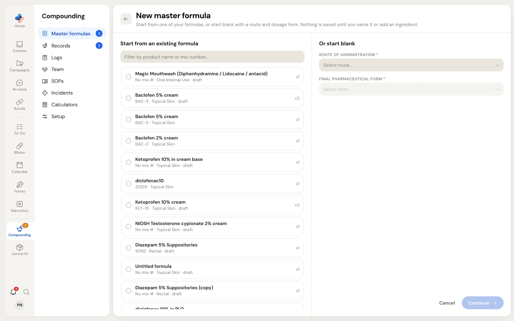
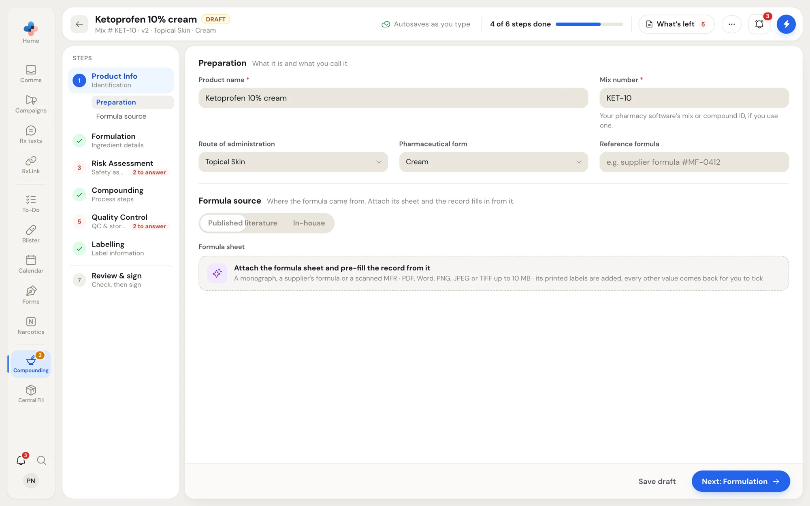
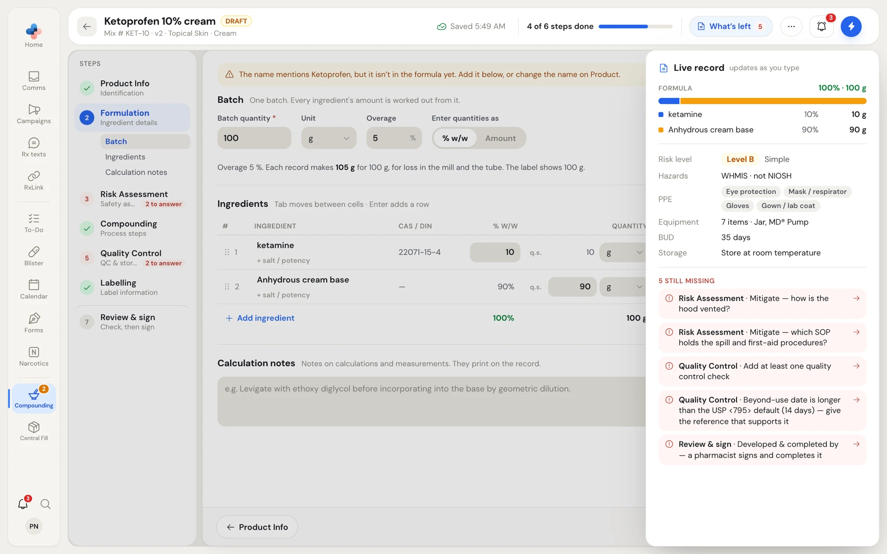
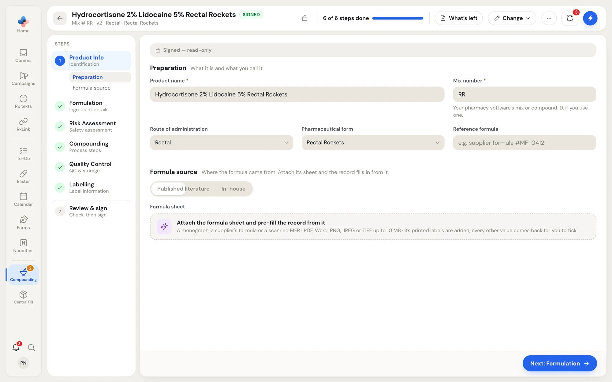

## Start a formula

1. Open **Compounding › Master formulas** and click **New formula**. (The **New master formula** button on **Compounding › Setup**, and **New formula** on the Compounding home page, open the same screen.)
2. Choose how to start:
   - **Start from an existing formula**: click one of your formulas. Filter the list by product name or mix number. It is copied as a new draft named "… (copy)", with its signatures cleared.
   - **Or start blank**: pick the **Route of Administration** and the **Final Pharmaceutical Form**.
3. Click **Continue** (or **Copy and continue** when you picked a formula).

<Frame caption="New master formula: copy one of your formulas on the left, or start blank with a route and form on the right.">

</Frame>

When you start blank and your pharmacy has a [method](/compounding/profile-methods) for that form's route, a purple line says "Steps 4–6 will pre-fill from your Topical semi-solids template": the Compounding, Quality Control and Labelling steps start from it. Without one, a grey line says those steps start empty; once the ingredients are in, the Compounding step can write the method from your equipment.

<Note>
Nothing is saved until you name the formula or add an ingredient. After that, the draft saves itself as you work.
</Note>

## The formula editor

<Frame caption="The formula editor on Product Info: the header with the save state and progress, the steps on the left, and the step's sections in the middle.">

</Frame>

### The header

| Part | What it shows or does |
|---|---|
| **←** | Back to the Master Formulas list. |
| Name and status | The product name, its status (**DRAFT**, **SIGNED**, **SUPERSEDED** or **RETIRED**), and a line with the mix number, version, route and form. |
| Save state | **Autosaves as you type**, **Saving…**, **Saved 10:42 AM**, or **Not saved** (click it to try again). A signed formula shows **Read-only**. |
| **4 of 6 steps done** | How many of the six writing steps are complete. |
| **What's left** | Opens the **Live record** panel: the record so far and everything still missing, with a red count. Click a missing item to go to where it is fixed. |
| **⋯** | **Send to a pharmacist to sign…**, **Print record**, **History** and **Delete draft**. See [Review and sign](/compounding/mfr-sign). |

<Frame caption="What's left: the Live record panel lists what the record says so far and each item still missing.">

</Frame>

### The steps

The steps on the left are the parts of the record. You can open any step at any time, in any order; nothing blocks **Next**. A step shows a green tick when it is complete, or a red **2 to answer** when something is missing. The open step's sections are listed under it; click one to jump to it.

| Step | What it holds |
|---|---|
| **Product Info** | What the preparation is and where the formula came from. |
| **Formulation** | Ingredients and amounts for one batch. See [Formulation](/compounding/mfr-formulation). |
| **Risk Assessment** | The NAPRA non-sterile risk assessment. See [Risk assessment](/compounding/mfr-risk). |
| **Compounding** | Equipment, packaging and the method. See [Compounding, quality control and label](/compounding/mfr-method-qc-label). |
| **Quality Control** | The checks on every batch, the beyond-use date and storage. |
| **Labelling** | How the dispensing label reads. |
| **Review & sign** | The record as it will print, what is left, and the signatures. See [Review and sign](/compounding/mfr-sign). |

At the bottom of each step, **←** goes to the step before, **Save draft** saves straight away, and **Next: Formulation** (or the next step's name) moves on.

### Notices at the top of a step

- **Unsaved changes picked up**: the editor found changes in this browser that had not reached PharmaTools yet (for example after a lost connection) and put them back. They save with your next change.
- **Your Cream template changed**: your pharmacy's method for this route changed after this formula started from it. Nothing on the formula was changed; open the notice to see what differs.
- If someone else saved the same draft while you were working, a dialog offers **Reload their version**, **Keep mine — replace theirs**, or **Not now**.

## Product Info

<Frame caption="Product Info on a signed formula. Every field is locked until the formula is corrected or revised.">

</Frame>

### Preparation

| Field | What to enter |
|---|---|
| **Product name** \* | What you call the preparation, for example "Ketoprofen 10% cream". |
| **Mix number** \* | Your pharmacy software's mix or compound ID, if you use one. |
| **Route of administration** | Filled in from the New master formula screen; you can change it. |
| **Pharmaceutical form** | Filled in from the New master formula screen. Changing between a form made by weight or volume (a cream) and one made per unit (capsules, suppositories) asks first, because the batch and each ingredient's amount per unit are cleared. The ingredients stay. |
| **Reference formula** | The source's own reference, for example "supplier formula #MF-0412". |

### Formula source

Where the formula came from: a supplier catalogue, a published reference, **Published literature** or **In-house**. Attach the formula's sheet and the record fills in from it.

## Pre-fill from a formula sheet

If you have the formula as a document (a monograph, a supplier's formula sheet, or a scanned MFR), PharmaTools can read it and propose values for every step. Nothing is written to the record until you tick and apply each value.

<Steps>
  <Step title="Attach the sheet">
    Under **Formula sheet**, click **Attach the formula sheet and pre-fill the record from it**, or drop the file on it. PDF, Word, PNG, JPEG or TIFF, up to 10 MB. The sheet is attached to the record and read straight away; a scan can take up to a minute.
  </Step>
  <Step title="Check what was found">
    PharmaTools lists what it found, for example "Found in ketoprofen.pdf: 9 things this record could take". Each value comes back as a row with a tick box and a confidence (**High confidence**, **Medium confidence**, **Low confidence**). A row that would replace something already on the record says **Replaces:** and what it replaces. Untick anything that is wrong. A scan is a proposal, not an answer.
  </Step>
  <Step title="Apply">
    Click **Apply 9 to the record** (the number is how many you ticked), or **Discard**.
  </Step>
</Steps>

The auxiliary labels the sheet prints are added to a draft straight away, because they are the sheet's own words; untick any that don't apply on **Labelling**. The sheet's method is kept beside the record's method on the **Compounding** step as a reference; see [Use the sheet's method](/compounding/mfr-method-qc-label#use-the-method-from-the-formula-sheet).

If the sheet can't be read, the attachment stays and the message says "Attached, but the sheet couldn't be read". You can still fill in the record by hand.

<Tip>
To bring in many formulas at once, use **Import formulas** on the Master Formulas list instead. See [Import your existing formulas](/compounding/mfr-list#import-your-existing-formulas).
</Tip>
