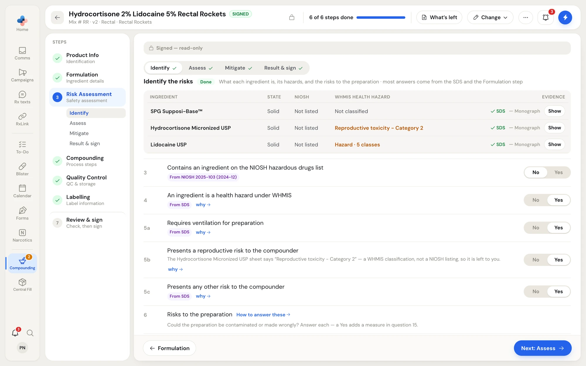
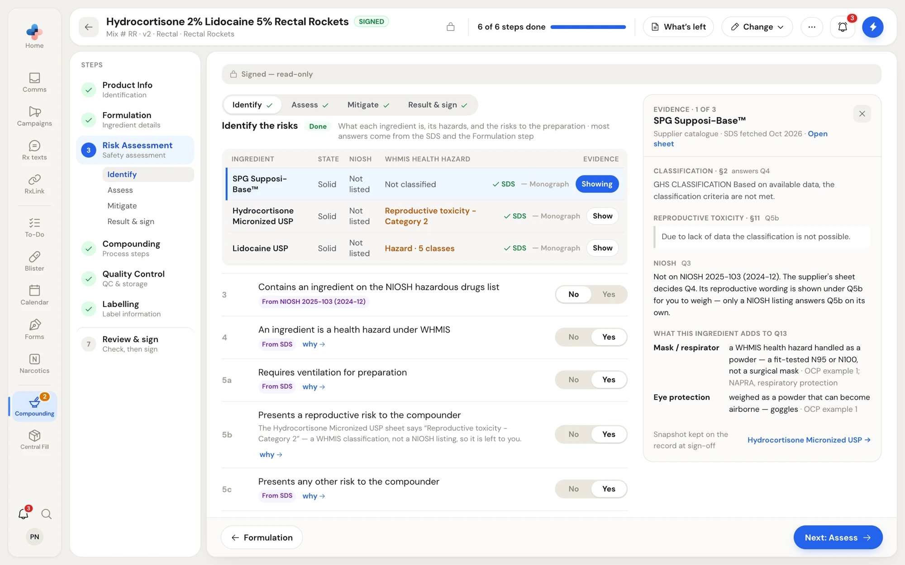
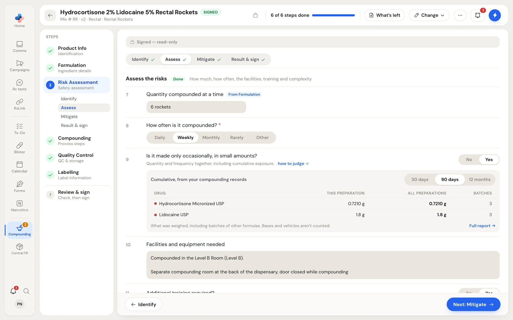
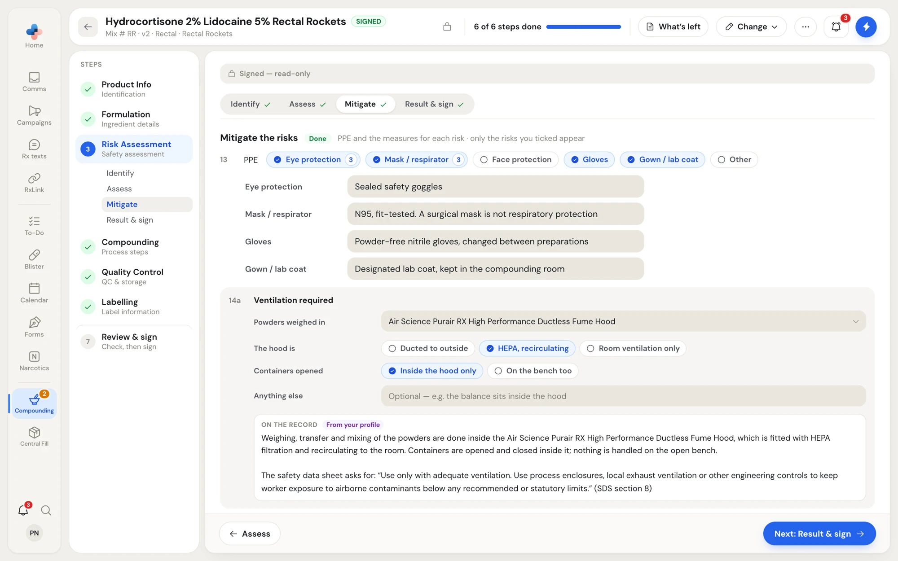
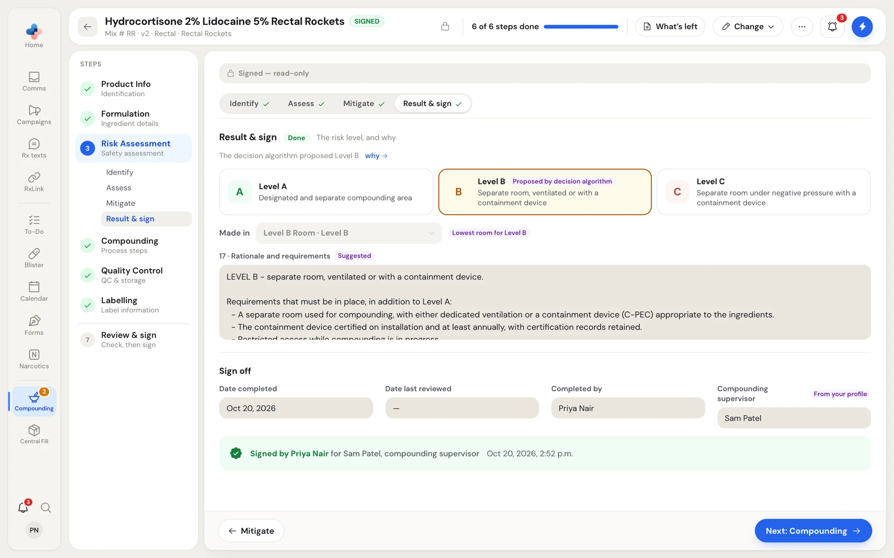

The **Risk Assessment** step is the Ontario College of Pharmacists' non-sterile risk assessment template, in four parts. The question numbers are the template's own (questions 1 to 17), so an inspector finds each answer where they expect it.

Most answers arrive pre-filled. PharmaTools reads each ingredient's safety data sheet (SDS), the NIOSH hazardous drugs list, the dosage form, your Formulation step and your [compounding profile](/compounding/profile-setup), and tags each answer with where it came from: **From SDS**, **From NIOSH 2025-103 (2024-12)**, **From Formulation**, **From your profile**, or **Suggested**. Check every pre-filled answer and fill in the rest.

<Note>
Add the ingredients on **Formulation** first. The ingredients table and several answers are read from them.
</Note>

## The four parts

The parts are tabs across the top of the step, and they are also listed under **Risk Assessment** on the left. Each part shows a tick once it is finished. **Next: Assess** (and so on) at the bottom moves to the next part.

| Part | Questions | What it covers |
|---|---|---|
| **Identify** | 1 to 6 | What each ingredient is, its hazards, and the risks to the preparation. |
| **Assess** | 7 to 12 | How much, how often, the facilities, training and complexity. |
| **Mitigate** | 13 to 15 | PPE, and the measures for each risk you said yes to. |
| **Result & sign** | 16 and 17, and the sign-off | The risk level, why, the room it is made in, and the signatures. |

## Identify the risks

<Frame caption="Identify: the ingredients table with each one's state, NIOSH listing and WHMIS health hazard, and the questions it answers.">

</Frame>

The ingredients table shows each ingredient's **State** (solid, liquid, semi-solid), whether it is on the **NIOSH** list, and its **WHMIS Health Hazard** classification. The **Evidence** column shows whether PharmaTools has its **SDS** and **Monograph**. **Fetch the safety data sheets again** (the **Refetch** link) reads the sheets again.

Then answer, **No** or **Yes**:

| # | Question |
|---|---|
| 3 | Contains an ingredient on the NIOSH hazardous drugs list |
| 4 | An ingredient is a health hazard under WHMIS |
| 5a | Requires ventilation for preparation |
| 5b | Presents a reproductive risk to the compounder |
| 5c | Presents any other risk to the compounder |
| 6 | Risks to the preparation: **Microbial contamination**, **Cross contamination with other products or preparations**, **Interruption to your workflow**, **Other risk(s)** |

Under question 5b, a reproductive classification from WHMIS (not a NIOSH listing) is shown for you to weigh, for example "The Hydrocortisone Micronized USP sheet says 'Reproductive toxicity - Category 2' — a WHMIS classification, not a NIOSH listing, so it is left to you." **How to answer these** beside question 6 explains each risk. A **Yes** in question 6 adds a measure in question 15.

### The evidence panel

Click **Show** on an ingredient's row, or **why →** under an answer, to open the evidence panel beside the questions. It stays open while you work.

<Frame caption="The evidence panel: what the ingredient's safety data sheet says, which question each line answers, and what the ingredient adds to the PPE.">

</Frame>

For one ingredient at a time it shows its classification (section 2 of the SDS, which answers question 4), its reproductive toxicity (section 11, question 5b), its NIOSH status (question 3), the engineering controls the sheet asks for (questions 5a and 14a), and **What this ingredient adds to Q13**, the PPE it calls for and why. **Open sheet** opens the SDS. The footer steps to the next ingredient. A snapshot of the evidence is kept on the record when it is signed.

## Assess the risks

<Frame caption="Assess: the quantity, how often it is made, whether it is occasional and small with the cumulative exposure, and the facilities needed.">

</Frame>

| # | Question | How it is answered |
|---|---|---|
| 7 | Quantity compounded at a time | **From Formulation**: the batch size. |
| 8 | How often is it compounded? | **Daily**, **Weekly**, **Monthly**, **Rarely** or **Other**. |
| 9 | Is it made only occasionally, in small amounts? | **No** or **Yes**. Under it, the cumulative amount of each drug from your compounding records over **30 days**, **90 days** or **12 months**, across this preparation and all preparations, and the number of batches. **How to judge** explains it: NAPRA sets no number for "small" or "occasional"; judge the quantity and frequency together, including cumulative exposure. |
| 10 | Facilities and equipment needed | Filled in from your room, for example "Compounded in the Level B Room (Level B)", with the room's description. |
| 11 | Additional training required? | **No** or **Yes**. With **Yes**, the training is described from facts: who is trained and the training date. |
| 12 | Complexity (USP &lt;795&gt;) | Simple, moderate or complex. Assumed from the form and whether a stability reference is uploaded; capsules and molded forms, transdermals, modified-release forms and suppositories for systemic effect are at least moderate. |

## Mitigate the risks

<Frame caption="Mitigate: the PPE in question 13, and the ventilation measure in question 14a written from facts.">

</Frame>

Only the risks you answered **Yes** to appear. With none, the part says "Nothing to mitigate yet — answer 'yes' in question 5 or tick a risk in question 6 and it appears here."

### Question 13: PPE

The PPE chips are **Eye protection**, **Mask / respirator**, **Face protection**, **Gloves**, **Gown / lab coat** and **Other**. PharmaTools ticks what the ingredients call for. The number on a chip is how many reasons there are; click the number to read them, grouped by ingredient. Under the chips, each ticked item shows what you use, from your [PPE in Setup](/compounding/profile-whole-pharmacy#ppe), for example "N95, fit-tested. A surgical mask is not respiratory protection". If an ingredient needs PPE you don't own, the step tells you. **Other** asks you to name it, for example hair and shoe covers.

### Questions 14 and 15: the measures

| # | Measure for |
|---|---|
| 14a | Ventilation required: how the need is met. |
| 14b | Reproductive risk. |
| 14c | Other risk to the compounder: how it is controlled. |
| 15 | Each risk to the preparation you ticked in question 6, for example microbial contamination or cross contamination. |

Questions 11, 14a, 14c and some question 15 measures are answered as facts, and the sentence on the record is written from them. For 14a, for example: **Powders weighed in** (a device from your room), **The hood is** (**Ducted to outside**, **HEPA, recirculating** or **Room ventilation only**), **Containers opened** (**Inside the hood only** or **On the bench too**) and **Anything else**. **On the record** shows the sentence as it will print, with what the safety data sheet asks for. To write it yourself, click **Edit the wording instead**; **Back to the facts** returns to the facts.

A measure can name an SOP: **Pick an SOP from your library** lists your [SOPs](/compounding/sops), or type a reference that is not in the library.

## Result and sign

<Frame caption="Result & sign: the level the decision algorithm proposed, the room it is made in, the rationale, and the sign-off.">

</Frame>

### Question 16: the level

Once questions 3 to 12 are answered, the decision algorithm proposes **Level A**, **Level B** or **Level C**, marked **Proposed by decision algorithm**. Click **why →** to see the decision path. Click a level to choose it. The designated manager or compounding supervisor decides the level, and must be able to define, defend and document the reasons; if unsure, use the higher level.

**Made in** is the room: by default the lowest room for that level (tagged, for example, **Lowest room for Level B**). Pick **Choose a room** to name another. A room whose level is lower than the formula's cannot be used; the formula can't be signed until the room fits.

### Question 17: rationale and requirements

What must be in place at that level, written for you (tagged **Suggested**). Edit it if your pharmacy's measures differ.

### Sign off

| Field | Filled in from |
|---|---|
| **Date completed** | The day the formula is signed. |
| **Date last reviewed** | The last annual review. |
| **Completed by** | The pharmacist who signs the formula. |
| **Compounding supervisor** | **From your profile**: the supervisor named in Setup. **Update the profile** opens Setup. |

The risk assessment is signed when the formula is: the pharmacist's **Sign & complete** signs both. After signing, a green line reads, for example, "Signed by Priya Nair for Sam Patel, compounding supervisor". See [Review and sign](/compounding/mfr-sign).
