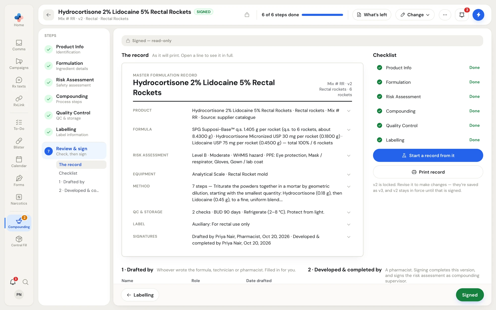
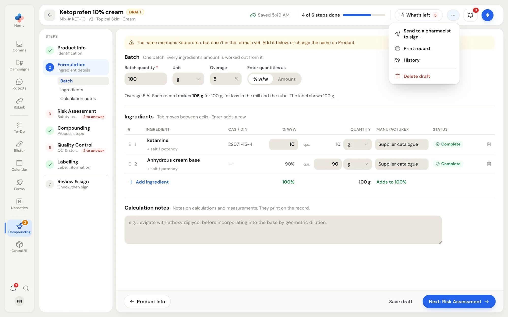
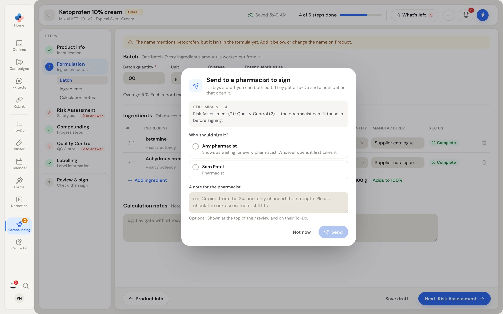
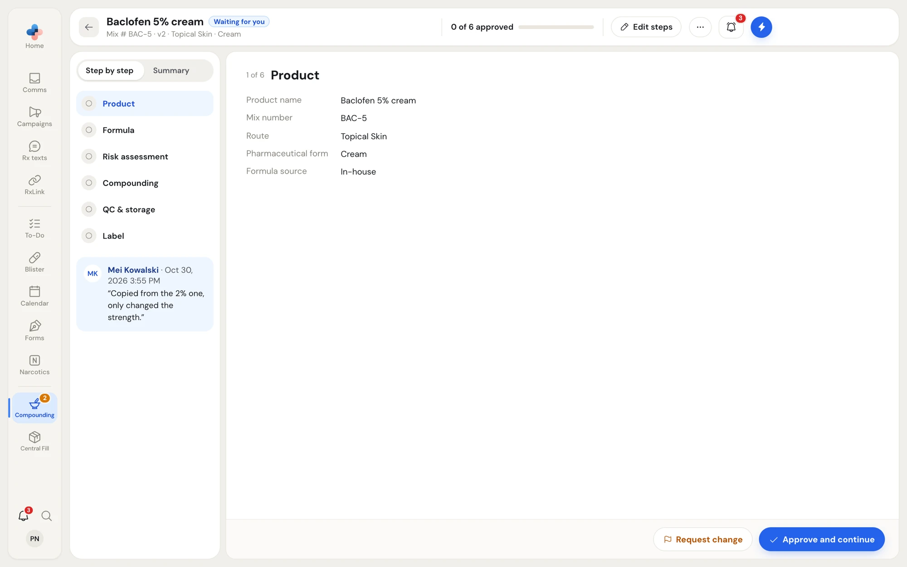
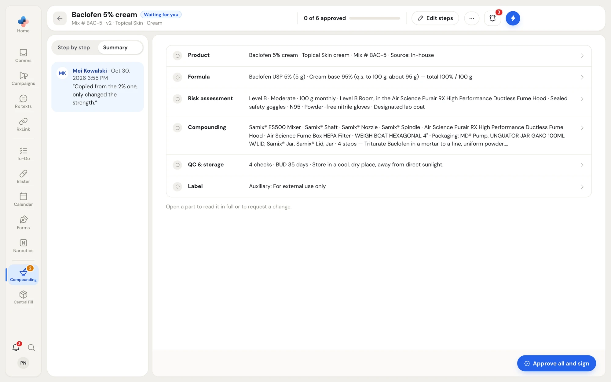

A master formula is a regulated record, so it is drafted by one person and signed by a pharmacist. Anyone at the pharmacy can draft a formula. Only a pharmacist (a Pharmacist, Manager or Admin) can sign and complete it, and only a signed formula can be compounded.

Signing is one sign-off with two names:

- **1 · Drafted by**: whoever wrote the formula, technician or pharmacist. Filled in for you on the first save.
- **2 · Developed & completed by**: the pharmacist who signs. Signing completes this version, locks it, and signs the risk assessment as compounding supervisor.

## Review & sign

The last step, **Review & sign**, shows the record as it will print, a checklist, and the signatures.

<Frame caption="Review & sign on a signed formula: the record as it will print, the checklist, Start a record from it, and the signatures.">

</Frame>

- **The record**: one line per section, as it will print. Click a line to open it in full, with a link to the step where it is edited.
- **Checklist**: each step with **Done**, or what is still missing. The step reads **Ready to sign** once nothing is left; until then, "Sign below once nothing is left."
- **Print record** prints the master formulation record.
- **Start a record from it** (signed formulas only) starts a compounding record from this formula. See [Compounding records](/compounding/records).

## Sign your own draft (pharmacists)

If you are a pharmacist and drafted the formula yourself:

1. Finish every step until **What's left** is empty.
2. On **Review & sign**, click **Sign & complete as Priya Nair** (your name) under **2 · Developed & completed by**.

The formula becomes **Signed**, version 1 (or the next version) is locked, and a message confirms "Signed & completed: v1 of … is locked and ready to compound from". PharmaTools checks the missing list again when you sign; if anything is still missing, the message names it.

## Send a draft to a pharmacist

A technician or assistant cannot sign. In place of the signature they see "Only a pharmacist can sign and complete a master formula", with **Send to a pharmacist**. The pharmacist gets a To-Do that opens the formula, and can finish anything still missing. A pharmacist can also send their draft to another pharmacist.

<Steps>
  <Step title="Open the dialog">
    Click **Send to a pharmacist** on **Review & sign**, or **⋯ › Send to a pharmacist to sign…** on any step.

    <Frame caption="The ⋯ menu on a draft: Send to a pharmacist to sign, Print record, History and Delete draft.">
    
    </Frame>
  </Step>
  <Step title="Pick who signs">
    Under **Who should sign it?**, pick **Any pharmacist** (it waits for every pharmacist, and whoever opens it first takes it) or one pharmacist from your employee list. You can't send it to yourself. Nothing is picked for you.
  </Step>
  <Step title="Add a note">
    Optionally write **A note for the pharmacist**, for example "Copied from the 2% one, only changed the strength. Please check the risk assessment still fits." It shows at the top of their review and on their To-Do.
  </Step>
  <Step title="Send">
    Click **Send**.
  </Step>
</Steps>

<Frame caption="Send to a pharmacist to sign: what is still missing, who should sign it, and a note for them.">

</Frame>

You don't have to finish every step first. The dialog lists what is **Still missing**, and the pharmacist can fill it in before signing.

What happens next:

- The formula stays a draft that both of you can edit. Its status becomes **With Mei** (or **With any pharmacist**).
- The pharmacist gets a **To-Do** and a notification that open the formula's review. The formula also appears in their **Waiting for you** strip and in the count beside **Master formulas**.
- To take it back, click **⋯ › Take back from Mei** (or **Take back from every pharmacist**). The To-Do is closed. Only the person who sent it can take it back.

## Review a formula sent to you

Open it from your To-Do, your notification, or **Review & sign** in the **Waiting for you** strip. A formula sent to **Any pharmacist** becomes yours when you open it.

The header shows **0 of 6 approved** and **Edit steps**. The drafter's note sits on the left. The review opens in your pharmacy's default view (set in [Setup › People › Signing and approving](/compounding/profile-whole-pharmacy#signing-and-approving)); switch with **Step by step** and **Summary**, and your choice is kept for you.

### Step by step

<Frame caption="Step by step: one part at a time, with Request change and Approve and continue.">

</Frame>

The six parts are **Product**, **Formula**, **Risk assessment**, **Compounding**, **QC & storage** and **Label**. For each part:

- **Approve and continue** approves it and moves to the next part not yet approved.
- **Request change** asks what the drafter should change. Type what should change on the part; **Approve instead** cancels the request. **Undo approval** takes an approval back.

On **Risk assessment**, **Show full assessment** opens every answer.

Once all six parts are approved, **Sign & complete as** (your name) appears. If any part has a change requested, the main button becomes **Send back to Mei · 2 requests** instead.

### Summary

<Frame caption="Summary: all six parts on one page, as the record prints, with Approve all and sign.">

</Frame>

Each part is one line, as the record prints. Click a line to open that part step by step, read it in full, or request a change. **Approve all and sign** approves every part not yet approved and signs, after asking "Approve all six parts and sign?": you are signing the version as yourself, as developer and compounding supervisor; it is locked once signed, and the drafter is notified.

### Fix something yourself

For a small correction, click **Edit steps** to open the editor and change it yourself. A part you change loses its approval and shows **Changed since your approval**, so you approve it again before signing.

### Give it to another pharmacist

**⋯ › Give to another pharmacist…** passes the formula on. They get the To-Do to review and sign it instead of you.

## When a pharmacist sends it back

When the pharmacist clicks **Send back**, the drafter gets a To-Do, the formula's status becomes **Sent back · 2 to fix**, and it appears in the drafter's **Waiting for you** strip with **Fix and send again**.

1. Open the formula. A banner says who sent it back and when, and each note sits on the step it is about.
2. Fix each note, then click **Mark fixed** on it (**Fixed · undo** reverses it).
3. When every note is marked fixed, click **Send to Mei again** (in the **⋯** menu, or at the bottom of the step). It goes back to the pharmacist who sent it back, and their review shows which parts changed.

You can't send it again while a note is not marked fixed.

## After signing

The signed formula opens read-only, with "Signed — read-only" on every step. To change it, use **Change** in the header: correct this version, revise it as a new version, retire it or delete it. See [Versions, reviews and history](/compounding/mfr-versions).
