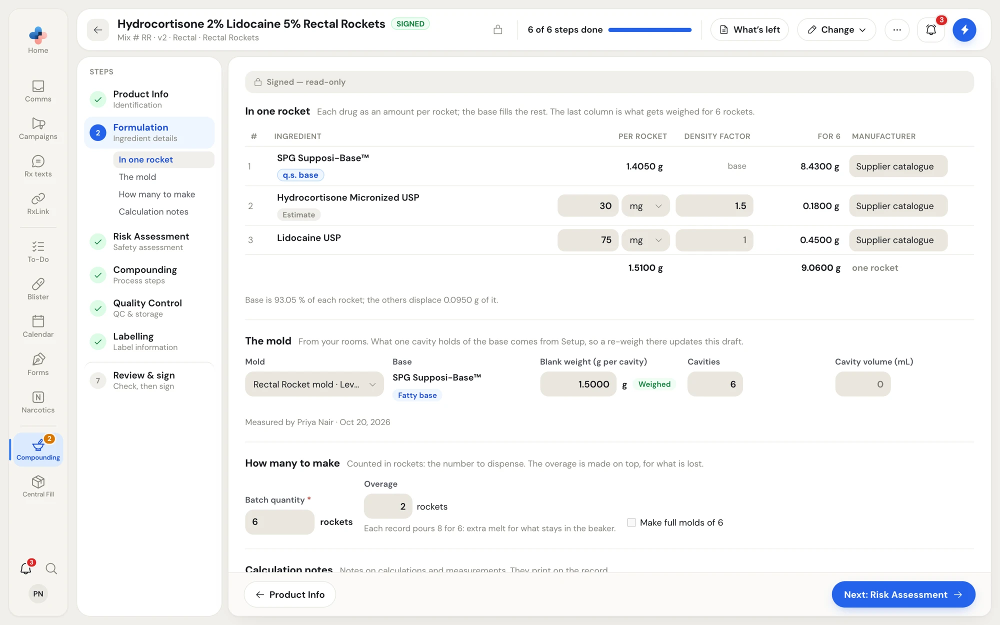
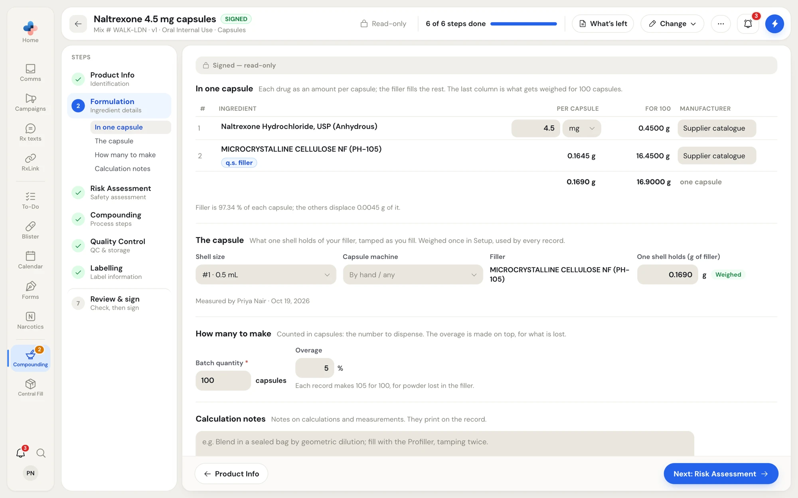
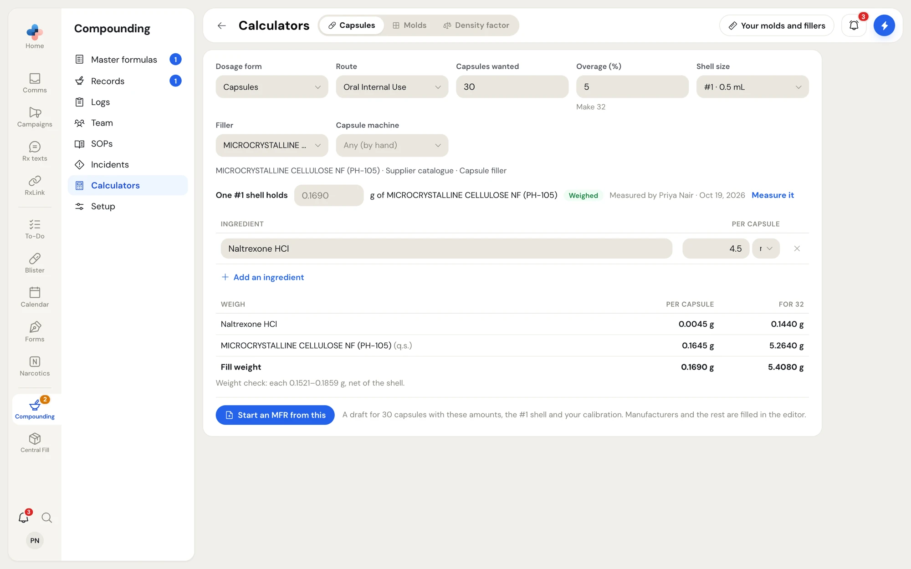

For capsules and molded forms (suppositories, Rectal Rockets, troches, lozenges, gummies and molded tablets), the **Formulation** step works per unit:

- The batch is a count: the number of capsules or units to dispense.
- Each drug is an amount per unit, for example 30 mg per rocket.
- The filler (for capsules) or base (for molds) is **q.s.**: whatever each unit has room for once the drugs are in.

The room each unit has comes from your pharmacy's own calibrations in [Capsules and molds](/compounding/profile-capsules): the shell's fill weight, or the mold's blank weight less what each drug displaces.

## Molded forms

<Frame caption="Formulation for Rectal Rockets: each drug per rocket with its density factor, the mold from your rooms, and how many to make.">

</Frame>

### In one rocket

Each drug as an amount per unit; the base fills the rest. The last column (**For 6**) is what gets weighed for the batch.

| Column | What it holds |
|---|---|
| **Ingredient** | The drug or base, picked from the catalogue search. Mark the base **q.s.** |
| **Per rocket** | The amount of each drug in one unit, in mg or g. The base's amount is worked out. |
| **Density factor** | Grams of this drug that displace 1 g of base. **Estimate** means the published value is used; leave it blank and it counts as 1. Use **Measure it now** to measure it, or **Use the estimate**. |
| **For 6** | The amount to weigh for the batch. |
| **Manufacturer** | Who makes the lot you use. |

The line under the table explains the arithmetic, for example "Base is 93.05 % of each rocket; the others displace 0.0950 g of it."

### The mold

| Field | Where it comes from |
|---|---|
| **Mold** | The molds in your rooms, for example "Rectal Rocket mold · Level B Room". Only molds that suit the form are offered. |
| **Base** | The base the mold was weighed with. |
| **Blank weight (g per cavity)** | What one cavity holds of plain base, from Setup, marked **Weighed** with who measured it and when. A re-weigh in Setup updates every draft that uses the mold. |
| **Cavities** and **Cavity volume (mL)** | From the mold. |

If none of your rooms has a mold for this form, the step says so. Add the mold to the room it is kept in and weigh it once; every formula made in it then uses that weight. **Add a mold** opens the weighing panel.

### How many to make

| Field | What to enter |
|---|---|
| **Batch quantity** \* | The number of units to dispense. |
| **Overage** | Extra units of melt for what stays in the beaker and the pour. |
| **Make full molds of 6** | Rounds the pour up to whole molds. |

The line under it says what each record makes, for example "Each record pours 8 for 6: extra melt for what stays in the beaker."

## Capsules

<Frame caption="Formulation for capsules: each drug per capsule, the capsule size and filler, and how many to make.">

</Frame>

**In one capsule** works the same way as a mold, with the filler as q.s. **The capsule** section holds:

| Field | What it holds |
|---|---|
| **Shell size** | The capsule size, with its volume, for example "#1 · 0.5 mL". |
| **Capsule machine** | Your capsule machine, or **By hand / any**. |
| **Filler** | The filler, picked from your suppliers. |
| **One shell holds (g of filler)** | What one shell holds of your filler, tamped as you fill. Weighed once in Setup and used by every record; marked **Weighed** or **Estimate**. |

An ingredient counted in tablets or capsules (crushed or emptied into the batch) also asks what one unit weighs crushed, because the whole powder, excipients and all, takes room in each capsule.

## A signed formula keeps its numbers

A draft follows Setup: re-weighing a mold or filler updates it, and deleting a weight clears it (a weight typed on the formula itself stays). A signed version keeps the numbers it was signed with.

## Calculators

**Compounding › Calculators** does the same arithmetic without a master formula, for a quick answer at the bench. It has three tabs: **Capsules**, **Molds** and **Density factor**.

<Frame caption="The Capsules calculator: capsules wanted, shell size and filler, each drug per capsule, and what to weigh for the batch.">

</Frame>

- **Capsules**: enter the capsules wanted, the overage, the shell size, the filler and the capsule machine, and each drug per capsule. The table shows what to weigh per capsule and for the batch, with a weight check for each filled capsule.
- **Molds**: the base for a number of units from the mold's blank weight and each drug's density factor.
- **Density factor**: work one out from a test batch. Make a few units of base alone and a few with a known share of the drug, weigh them, and the factor follows. Saved there, every mold formula with this drug and base uses it.

**Your molds and fillers** shows the calibrations the calculators use; **Measure it** weighs a new one. From the Capsules or Molds calculator, **Start an MFR from this** saves the answer as a new draft master formula, with these amounts, the shell or mold and your calibration, and opens it in the editor. Manufacturers and the rest are filled in in the editor.
