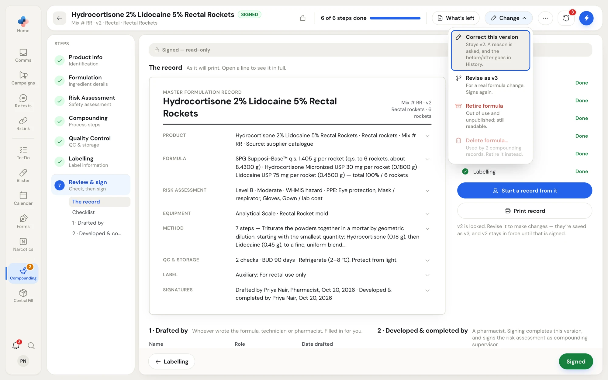
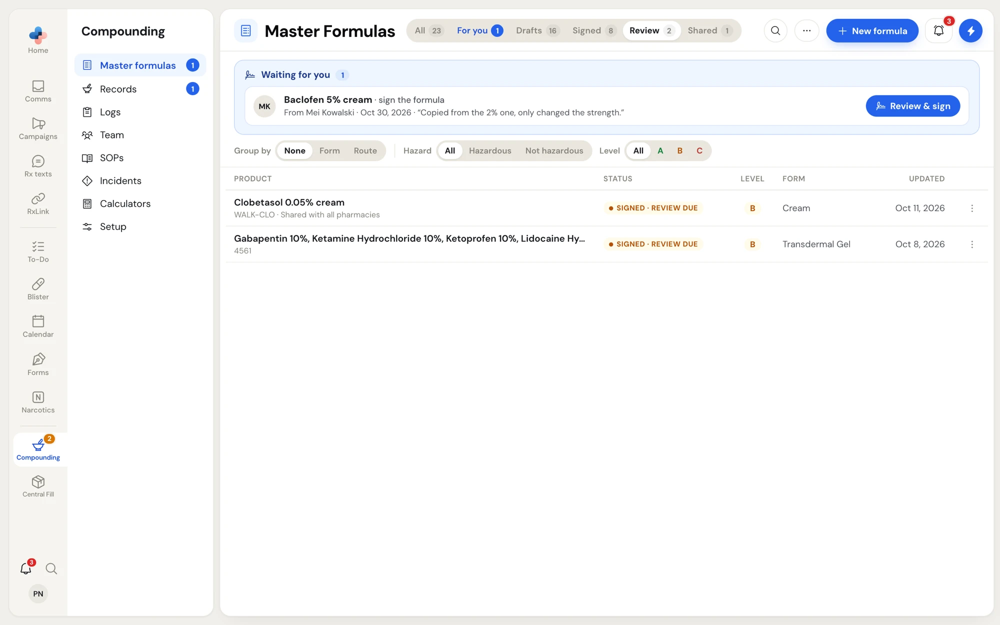
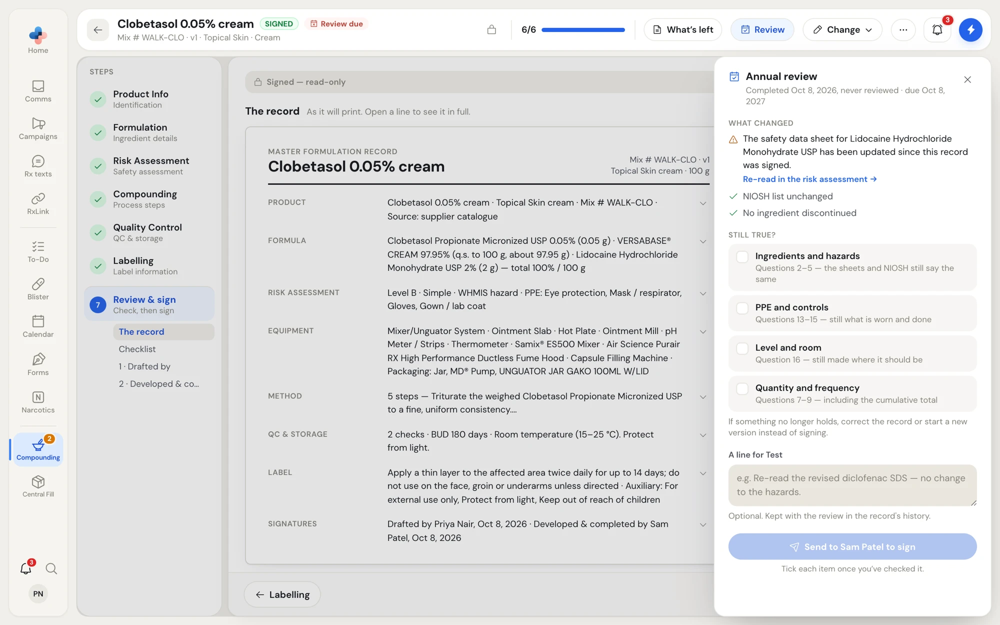
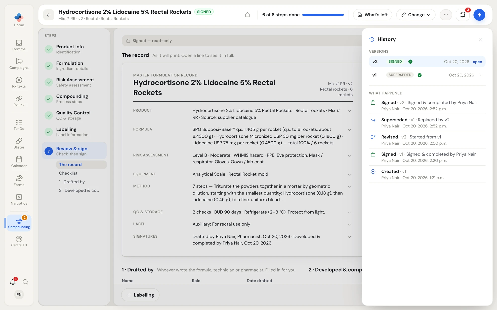
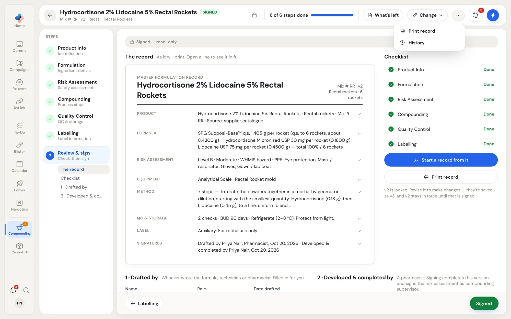

A signed master formula is locked. To change it you either correct the version you have, or revise it as a new version that is signed again. Every change, signature and review is kept in the formula's **History**.

## The Change menu

On a signed formula, click **Change** in the header.

<Frame caption="The Change menu on a signed formula.">

</Frame>

| Item | When to use it | What happens |
|---|---|---|
| **Correct this version** | A mistake in the wording, not a change to the formula. | The version stays v2 and keeps its signatures. A reason is asked first, and the before and after of every field changed go in History. Pharmacists only. |
| **Revise as v3** | A real formula change: a new ingredient, a new strength, a new method. | Starts a draft of the next version. It is saved on its first change. The current version stays in force until the new one is signed. |
| **Retire formula** | The formula is no longer made. | Asks "Retire this formula?" first. The version is taken out of use and unshared; it stays readable and its history is kept. |
| **Delete formula…** | The version was signed by mistake and never used. | Only while no compounding record has used it, and pharmacists only. Asks first. If an earlier version exists, it goes back in force, as it was before this version was signed. History keeps that the deleted version existed. |

A disabled item says why when you hover over it, for example "Used by 3 compounding records. Retire it instead." or "Only a pharmacist can do this to a signed formula".

### Correct a version

1. Click **Change › Correct this version**.
2. Under **Why is it being corrected?**, write the reason, for example "Step 3 named the wrong mixer; the BUD wording left out 'refrigerate'."
3. Click **Start correcting**. The steps open for editing, and the header shows **Cancel** and **Save correction**.
4. Make the correction and click **Save correction**. A message confirms "Correction saved: Still v2, signatures kept · the change is in History".

If compounding records have already been made from the version, only wording can change: the method, the label and QC text, the storage and beyond-use date wording, and notes. The dialog says so before you start. For anything else, revise it as a new version.

### Revise as a new version

Click **Change › Revise as v3**. A message confirms "Revising as v3: v2 stays in force until this one is signed". Edit the steps, then [send it to a pharmacist or sign it](/compounding/mfr-sign). When v3 is signed, v2 becomes **Superseded**.

## Annual review

Every master formula's risk assessment is reviewed at least every 12 months, or sooner when practice or standards change. PharmaTools marks a formula due for review when:

- a year has passed since it was signed or last reviewed, or
- something it relies on changed after it was signed, for example a supplier revised an ingredient's safety data sheet, NIOSH published a new edition, or an ingredient was discontinued.

The formula's status becomes **Signed · review soon** 30 days ahead, then **Signed · review due**, and it appears on the **Review** tab of the Master Formulas list. The formula's header shows a **Review** button.

<Frame caption="The Review tab of the Master Formulas list: signed formulas due for their review.">

</Frame>

<Frame caption="The Annual review panel: what changed since the formula was signed, and what you confirm still holds.">

</Frame>

<Steps>
  <Step title="Open the review">
    Open the formula and click **Review** in the header. The **Annual review** panel opens beside the record, with when it was completed and last reviewed.
  </Step>
  <Step title="Read what changed">
    **What changed** lists each reason it is due, for example "The safety data sheet for Lidocaine Hydrochloride Monohydrate USP has been updated since this record was signed." **Re-read in the risk assessment →** opens the question it affects.
  </Step>
  <Step title="Tick what still holds">
    Under **Still true?**, tick each item once you've checked it: **Ingredients and hazards** (questions 2–5), **PPE and controls** (questions 13–15), **Level and room** (question 16), **Quantity and frequency** (questions 7–9, including the cumulative total), and that the safety data sheets are unchanged and no ingredient is discontinued. If something no longer holds, correct the record or revise it instead of signing.
  </Step>
  <Step title="Sign or send">
    Add an optional note, for example "Re-read the revised diclofenac SDS — no change to the hazards." Then:
    - If you are the non-sterile compounding supervisor named in Setup, click **Sign review · Priya Nair** (your name). It is signed as the supervisor, and the next review is in 12 months.
    - Anyone else clicks **Send to Sam Patel to sign** (the supervisor's name). Only the supervisor signs the review; they get a To-Do.
  </Step>
</Steps>

<Note>
The annual review needs a compounding supervisor named in **Compounding › Setup › People**. Without one, PharmaTools asks you to name the supervisor first.
</Note>

## History

Click **⋯ › History** on any formula to see its story.

<Frame caption="History: every version of the formula, and everything that happened to any of them.">

</Frame>

- **Versions** lists each version with its status and date. Click **open** (or the arrow) to open a version.
- **What happened** lists who did what, and when: **Created**, **Revised**, **Signed**, **Superseded**, **Sent to … for signature**, **Corrected**, **Reviewed**, **Published**, **Unpublished**, **Retired** and **Reinstated**. A correction shows its reason and opens to the before and after of each field it changed.

## The ⋯ menu on a signed formula

| Item | What it does |
|---|---|
| **Print record** | Prints the master formulation record. |
| **History** | Opens the History panel. |

<Frame caption="The ⋯ menu on a signed formula.">

</Frame>

To share a signed formula with every PharmaTools pharmacy, use **Share with all pharmacies** in its row menu on the Master Formulas list. See [Row menu](/compounding/mfr-list#row-menu).
