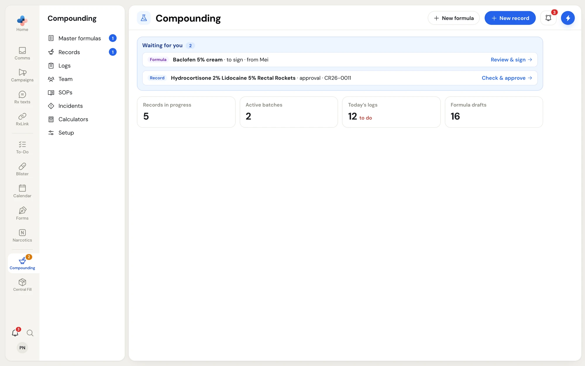

The **Compounding** module holds everything a non-sterile compounding pharmacy keeps for NAPRA and the Ontario College of Pharmacists: where you compound and with what, the master formulation record (MFR) for each preparation, the compounding record for each batch, the daily compliance logs, your SOP manual and your team's training.

Open it from the **Compounding** item in the left rail. The Compounding menu then opens beside the rail, and its first page shows what is waiting for you.

<Frame caption="Compounding home: formulas waiting for your signature and records waiting for your check sit at the top, with counts for records in progress, active batches, today's logs and formula drafts.">

</Frame>

<Note>
Compounding is a module your pharmacy either has or does not. If a Compounding page shows **Access Restricted** ("This module is not currently enabled for your account"), contact PharmaTools at admin@pharmatools.ca to turn it on for your pharmacy.
</Note>

## How the parts connect

Each part feeds the next one, so you answer a question once and every later document fills itself in.

<Steps>
  <Step title="Setup (your compounding profile)">
    **Compounding › Setup** describes your pharmacy once: each compounding room and its NAPRA level, its ventilation and containment device, the balance, mixers and molds in it, the PPE you own, who supervises and checks, the quality checks you run on every batch, and how you make each dosage form. See [Set up compounding](/compounding/profile-setup).
  </Step>
  <Step title="Master formulas">
    **Compounding › Master formulas** holds one master formulation record per preparation: the ingredients for one batch, the NAPRA risk assessment, the equipment and method, the quality checks and beyond-use date, and the label. Anyone at the pharmacy can draft one; a pharmacist signs it, and only a signed formula can be compounded. See [Master formulas](/compounding/mfr-list).
  </Step>
  <Step title="Compounding records">
    **Compounding › Records** holds one compounding record per batch, started from a signed master formula. The technician weighs, mixes, packages and labels step by step, and a pharmacist checks and approves the record. See [Compounding records](/compounding/records).
  </Step>
  <Step title="Logs">
    **Compounding › Logs** holds the compliance logs, in the tabs **Today**, **QA**, **Temperatures**, **Cleaning**, **Equipment**, **Certification** and **Months**. The containment device certification you record under **Logs › Certification** updates the last-certified date on the room in Setup. See [Compliance logs](/compounding/logs).
  </Step>
</Steps>

Two more parts sit beside that chain and are counted in Setup:

<CardGroup cols={2}>
  <Card title="SOPs" icon="book-open" href="/compounding/sops">
    Your policies and procedures: ready-made SOPs, the ones you already have, or new ones written with the assistant.
  </Card>
  <Card title="Team and training" icon="users" href="/compounding/training">
    Who works in compounding, their compounding role, and the training and assessments NAPRA expects of them.
  </Card>
  <Card title="Incidents" icon="triangle-alert" href="/compounding/incidents">
    Incidents, accidents and complaints, recorded and followed up.
  </Card>
  <Card title="Calculators" icon="calculator" href="/compounding/mfr-unit-dose#calculators">
    Capsule fill and suppository base arithmetic on its own, from your own calibrations.
  </Card>
</CardGroup>

## The Compounding menu

| Menu item | What it opens |
|---|---|
| **Master formulas** | The list of your master formulas. The blue count is the number of formulas waiting for you: drafts sent to you to sign, and your drafts a pharmacist sent back to you. |
| **Records** | The list of compounding records. The blue count is the number of records waiting for you. |
| **Logs** | The compliance logs. |
| **Team** | Your compounding team, their roles and training. |
| **SOPs** | Your SOP manual. |
| **Incidents** | Incidents, accidents and complaints. |
| **Calculators** | The capsule, mold and density factor calculators. |
| **Setup** | Your compounding profile. The count beside it, for example **6 of 10**, is how many required parts of setup are answered. |

## Where to start

<Tip>
You do not have to finish Setup before you write your first master formula. Whatever Setup already knows fills itself in on the formula; anything it does not know yet, you type on the formula. Setting up your rooms and PPE first saves the most typing later.
</Tip>

1. Open **Compounding › Setup** and describe your first room. See [Rooms and equipment](/compounding/profile-rooms).
2. Name your compounding supervisor and tick the PPE you own. See [Supplies, people, PPE and checks](/compounding/profile-whole-pharmacy).
3. Click **New master formula** on the Setup page, or **New formula** on the Master formulas list. See [Start a new master formula](/compounding/mfr-new).
4. When a pharmacist has signed the formula, start a compounding record from it. See [Compounding records](/compounding/records).

## Who can do what

| Task | Admin | Manager | Pharmacist | Technician | Assistant |
|---|---|---|---|---|---|
| Fill in Setup (rooms, PPE, checks, methods) | Yes | Yes | Yes | Yes | Yes |
| Change **Signing and approving** in Setup | Yes | Yes | No | No | No |
| Draft and edit a master formula | Yes | Yes | Yes | Yes | Yes |
| Sign and complete a master formula | Yes | Yes | Yes | No, sends it to a pharmacist | No, sends it to a pharmacist |
| Correct or delete a signed formula | Yes | Yes | Yes | No | No |

Managers and admins sign master formulas as pharmacists, and their signature reads "Pharmacist". A formula's annual review is signed only by the non-sterile compounding supervisor named in **Setup › People**; anyone else sends it to them.
