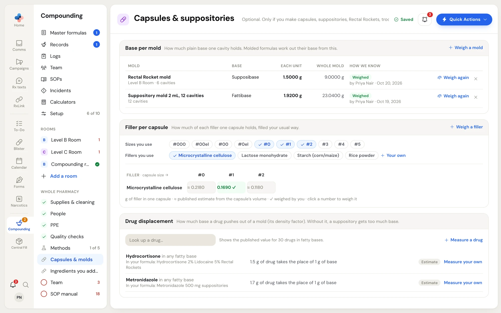

**Setup › Capsules & molds** holds the three numbers capsule and molded formulas need: how much base one mold cavity holds, how much filler one capsule holds, and how much base each drug displaces (its density factor). You only need this page if you make capsules, suppositories, Rectal Rockets, troches or gummies.

Until you weigh your own, formulas use published estimates. Once you weigh a mold or a filler, every formula that uses it works from your number, and a re-weigh updates the drafts that use it.

<Frame caption="Capsules & suppositories: base per mold, filler per capsule, and drug displacement.">

</Frame>

## Base per mold

How much plain base one cavity holds (the mold's blank weight). Molded formulas work out their base from this.

The table lists every mold standing in one of your rooms, with its base, the weight of **Each unit** and the **Whole mold**, and **How we know**:

- **Weighed** by a named person, with the date, for example "by Priya Nair · Oct 20, 2026".
- **Not weighed**: "Formulas use the cavity size until you weigh it".

To weigh a mold:

<Steps>
  <Step title="Open the weighing panel">
    Click **Weigh a mold** at the top of the section, or **Weigh again** on a mold's row. A mold's **Weigh it** link on its room's page opens the same panel.
  </Step>
  <Step title="Say which mold and base">
    Pick the **Mold** (molds from your rooms) and the **Base** (**Pick a base from your suppliers**). Enter the number of **Cavities**, and the **Cavity size (mL)** if the mold says it; it lets a PEG base's density be worked out. With no molds in your rooms yet, the panel is **Weigh a new mold**: enter the **New mold's name** and the **Room it's kept in**, and the mold is added to that room.
  </Step>
  <Step title="Pour the base alone, let it set, trim, then weigh">
    Choose **Each unit** and type each unit's weight under **Weight of each unit (g)**, one per line or separated by spaces. Or choose **All units together** and type the total. If you already know the weight of one unit, type it under **Or type the weight of one unit you already know (g)**.
  </Step>
  <Step title="Save">
    The result shows as grams of base per cavity. Click **Save**. A message confirms, for example "Rectal Rocket mold: 1.5000 g each, saved".
  </Step>
</Steps>

<Frame caption="The Weigh a mold panel: the mold, its base and cavities, and the weights of the units poured from base alone.">

</Frame>

Click **×** on a mold's row ("Remove this weight") to remove a weight. **Undo** appears for a few seconds.

## Filler per capsule

How much of each filler one capsule holds, filled your usual way.

- **Sizes you use**: click the capsule sizes you stock (**#000** to **#5**).
- **Fillers you use**: click the fillers you use, for example **Microcrystalline cellulose**. **Your own** adds a filler not on the list.

The table shows, for each filler and size, the grams of filler in one capsule:

| In a cell | What it means |
|---|---|
| **≈ 0.2180** | A published estimate from the capsule's volume and the filler's typical density. |
| **0.1690 ✓** (green) | Weighed by you. |

Click a number, or **Weigh a filler**, to weigh it:

1. Pick the **Capsule size**, and the **Capsule machine** if you use one (**Any (by hand)** applies the value to any machine).
2. Choose **I weighed the filled capsules** (enter the **Empty shell** weight too) or **I weighed the powder on its own**.
3. Fill 10 shells with the filler alone, tamped as you normally fill, and type each weight. Or type the fill weight you already know.
4. Click **Save calibration**.

To go back to the published estimate, open your value and click **Remove my value, use the estimate**.

## Drug displacement

How much base a drug pushes out of a mold, its density factor. Without it, a suppository gets too much base.

The section lists the drugs in your suppository and Rectal Rocket formulas with their published value, for example "Hydrocortisone in any fatty base · 1.5 g of drug takes the place of 1 g of base · Estimate". **Look up a drug…** shows the published value for 30 drugs in fatty bases.

To use your own value, click **Measure your own** on a drug (or **Measure a drug**). The panel **How much base a drug displaces** asks for:

<Frame caption="How much base a drug displaces: measure the density factor from a test batch, or enter a value you already have.">

</Frame>

| Field | What to enter |
|---|---|
| **Drug** and **Base** | The drug, and the base it is used in. |
| **Applies to** | **This base only** or **Any base of this kind** (fatty, PEG, glycerinated gelatin, troche, gummy or other). |
| **Measure it from a test batch** | The **Blank weight per unit (g)** (filled in from your mold calibration when there is one), the **Drug in the test batch (% w/w)**, and the weight of each medicated unit from the test batch. The density factor is worked out as you type. |
| **I have the value** | The **Density factor** and **Where it comes from**, for example "Supplier's technical sheet, 2025". |

Click **Save calibration**. Every mold formula with this drug and base then uses your value.

## Calculators

The same numbers drive **Compounding › Calculators**, for a quick answer without a master formula. See [Capsules and molded forms](/compounding/mfr-unit-dose#calculators).
