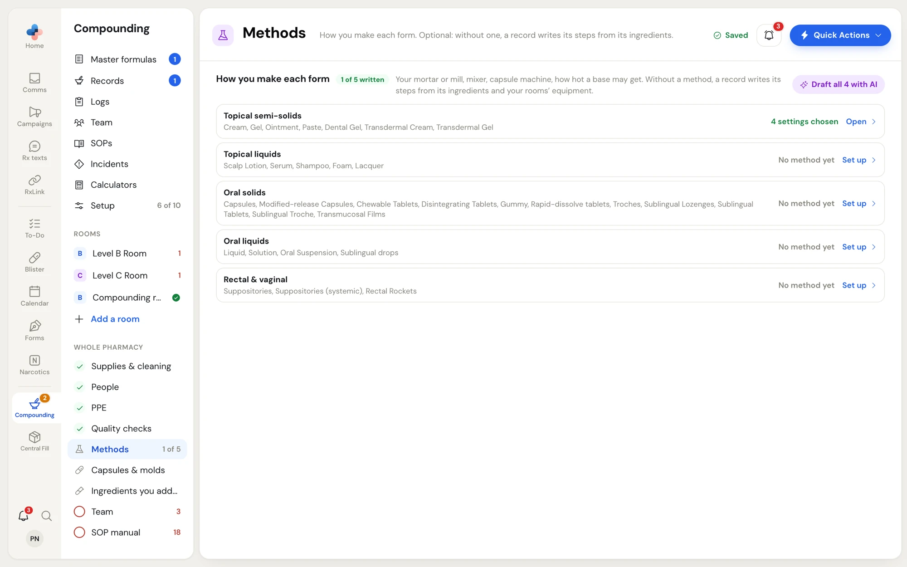
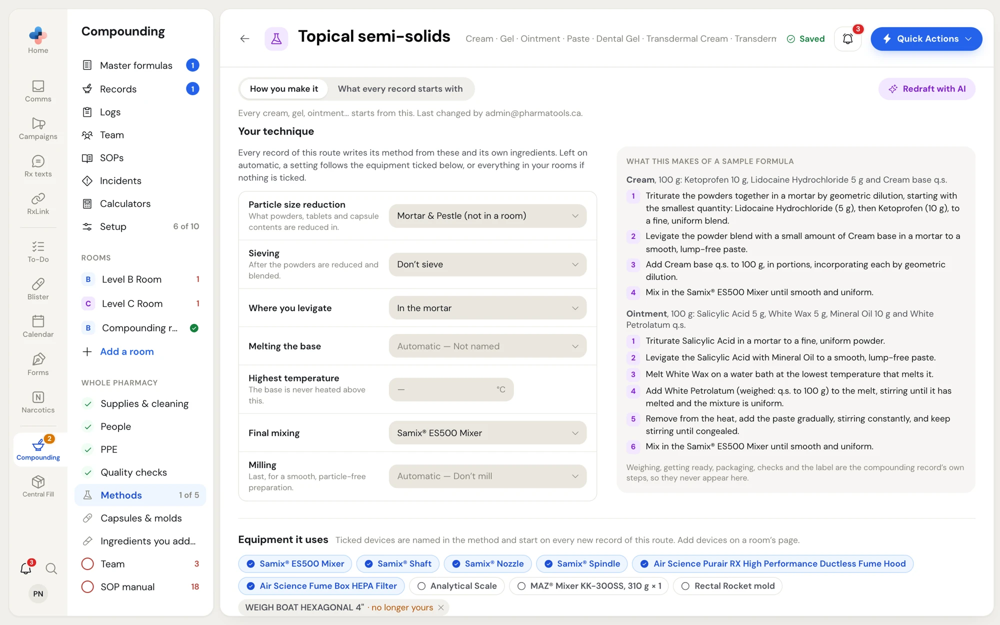
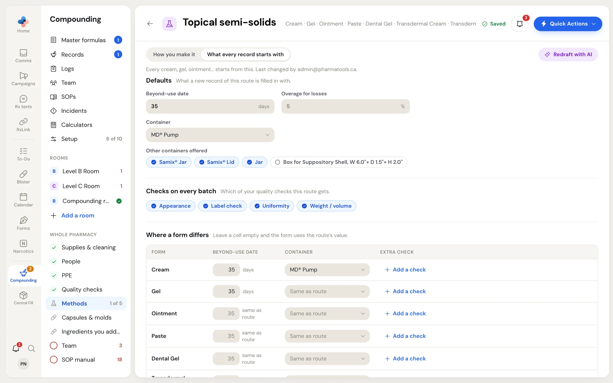

A method is how your pharmacy makes one route's dosage forms: your mortar or mill, where you levigate, your mixer, your capsule machine, how hot a base may get, and what every new formula of that route starts with (beyond-use date, container, checks, storage and labels).

Methods are optional. Without one, a master formula writes its compounding steps from its own ingredients and the equipment in your rooms.

## The five routes

Methods are set per route, not per dosage form. Each route covers several forms:

| Route | Forms it covers |
|---|---|
| **Topical semi-solids** | Cream, Gel, Ointment, Paste, Dental Gel, Transdermal Cream, Transdermal Gel |
| **Topical liquids** | Scalp Lotion, Serum, Shampoo, Foam, Lacquer |
| **Oral solids** | Capsules, Modified-release Capsules, Chewable Tablets, Disintegrating Tablets, Gummy, Rapid-dissolve tablets, Troches, Sublingual Lozenges, Sublingual Tablets, Sublingual Troche, Transmucosal Films |
| **Oral liquids** | Liquid, Solution, Oral Suspension, Sublingual drops |
| **Rectal & vaginal** | Suppositories, Suppositories (systemic), Rectal Rockets |

## Open Methods

Open **Compounding › Setup** and click **Methods** under **Whole pharmacy**. The count beside it, for example **1 of 5**, is how many routes have a method.

<Frame caption="Methods: one row per route, with how far each is set up.">

</Frame>

Each route's row says where it stands: **4 settings chosen**, **Written · automatic** (a method exists with every setting on automatic), or **No method yet**. Click **Open** or **Set up** to open the route's method.

### Draft methods with AI

**Draft all 4 with AI** (the number is how many routes have no method yet) drafts each missing method from your setup and saves each as it lands. A message at the bottom says, for example, "4 methods drafted and saved — read them through". Open each one and read it before you rely on it.

## How you make it

The first tab of a method, **How you make it**, has your technique and the equipment the route uses.

<Frame caption="How you make it, for Topical semi-solids: your technique on the left and what those settings make of two sample formulas on the right.">

</Frame>

### Your technique

Each setting is a choice of device or technique. The settings a route shows depend on the route, for example:

| Setting | What it decides |
|---|---|
| **Particle size reduction** | What powders, tablets and capsule contents are reduced in, for example a mortar and pestle. |
| **Sieving** | Whether, and with what, the powders are sieved after they are reduced and blended, or **Don't sieve**. |
| **Where you levigate** | **On the ointment slab**, **In the mortar**, or in the mixer jar. |
| **Melting the base** | The hot plate or water bath used. |
| **Highest temperature** | The base is never heated above this (°C). |
| **Final mixing** | Your mixer, or **By hand, with a spatula**. |
| **Milling** | Your ointment mill, last, for a smooth, particle-free preparation, or **Don't mill**. |
| **Bringing to volume** | For liquids, for example **In the calibrated bottle**. |
| **Blending capsule powder** and **Filling capsules** | For capsules, for example **By hand, punch method** or your capsule machine. |
| **Molds** | For molded forms. |

A setting left on **Automatic** follows the equipment ticked under **Equipment it uses**, or everything in your rooms if nothing is ticked. Devices are offered from your rooms; a device in no room shows "(not in a room)".

**What this makes of a sample formula** shows, as you change a setting, the method steps it would write for sample formulas of the route. Weighing, getting ready, packaging, checks and the label are the compounding record's own steps, so they never appear in a method.

### Equipment it uses

Ticked devices are named in the method and start ticked on every new formula of this route. You can only tick devices that are already in a room; add devices on a [room's page](/compounding/profile-rooms#everything-in-this-room). A device your pharmacy no longer owns shows "· no longer yours"; click **×** to take it off the method.

## What every record starts with

The second tab holds the values a new master formula of this route is filled in with.

<Frame caption="What every record starts with: the route's defaults, its quality checks, and where one form differs from the rest of the route.">

</Frame>

| Section | Fields |
|---|---|
| **Defaults** | **Beyond-use date** (days), **Overage for losses** (%), **Container** (from the containers you stock), **Other containers offered**. |
| **Checks on every batch** | Which of your [quality checks](/compounding/profile-whole-pharmacy#quality-checks) this route gets. Click a check to tick or untick it. |
| **Where a form differs** | One row per form in the route, with its own **Beyond-use date**, **Container** and **Extra check** (**Add a check**). Leave a cell empty and the form uses the route's value; a container left on **Same as route** follows the route. |
| **Storage and labels** | **Storage**, **Special considerations**, and the **Auxiliary labels** printed with the label. **Add your own…** adds a label not on the list. |

If you have no containers or checks yet, the tab says so and points you to **Supplies & cleaning** or **Quality checks**.

### Draft or redraft with AI

**Draft with AI** (or **Redraft with AI** once a method exists), at the top right of a method, suggests the beyond-use date, container, storage, labels and equipment from your setup. It is saved at once and a message says "Drafted and saved — read it through". Change anything afterwards; your edits save themselves like the rest of Setup.

## When a formula differs from its method

A master formula starts from its route's method. If someone changes the method later, the formula shows "Your Cream template changed" at the top of its **Compounding** step, and nothing on the formula is changed. If a formula's method, equipment, storage or labels differ from the route's method, the formula's **Compounding** step offers **Update your Topical semi-solids template?** with **Save to template**. See [Compounding, quality control and label](/compounding/mfr-method-qc-label#offer-a-change-back-to-the-method).

## Delete a method

At the bottom of a method, **Delete this method** asks "Delete the topical semi-solids method? New records of this route will write their steps from their ingredients." Click **Delete** to confirm or **Keep** to cancel. Formulas already written are not changed.
