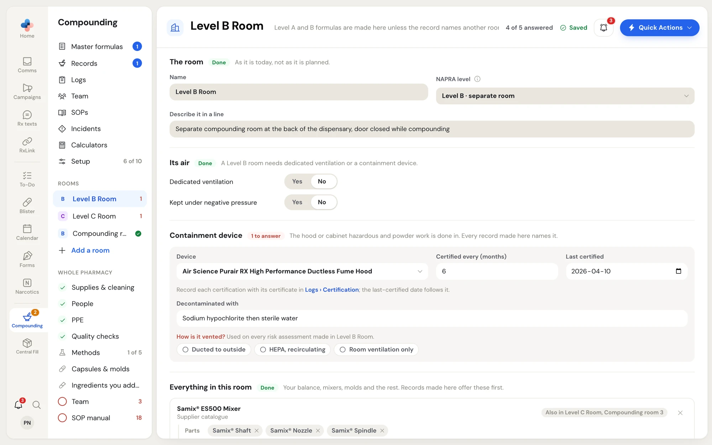
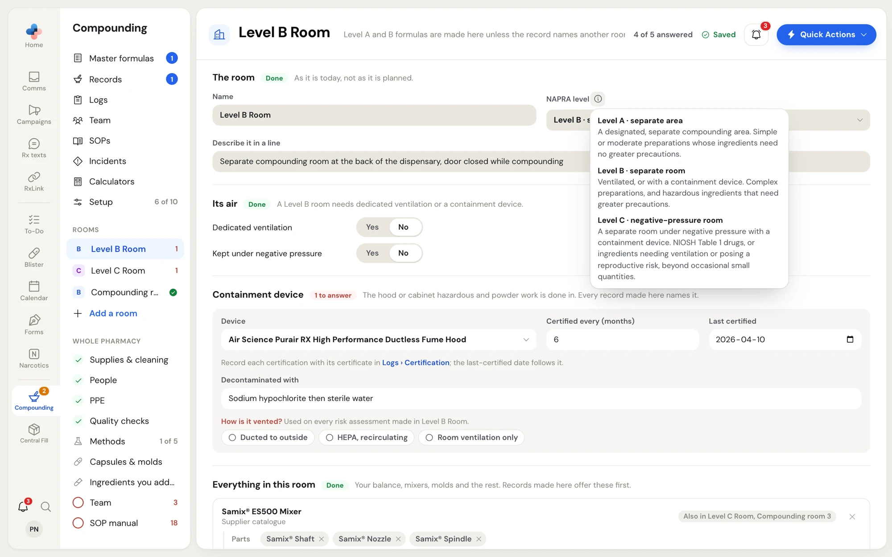
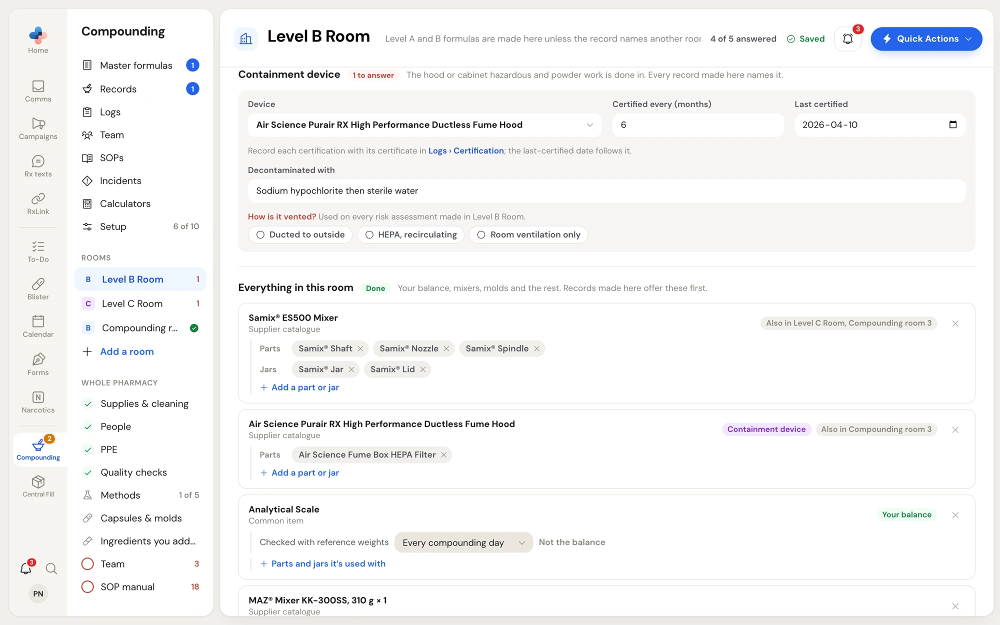
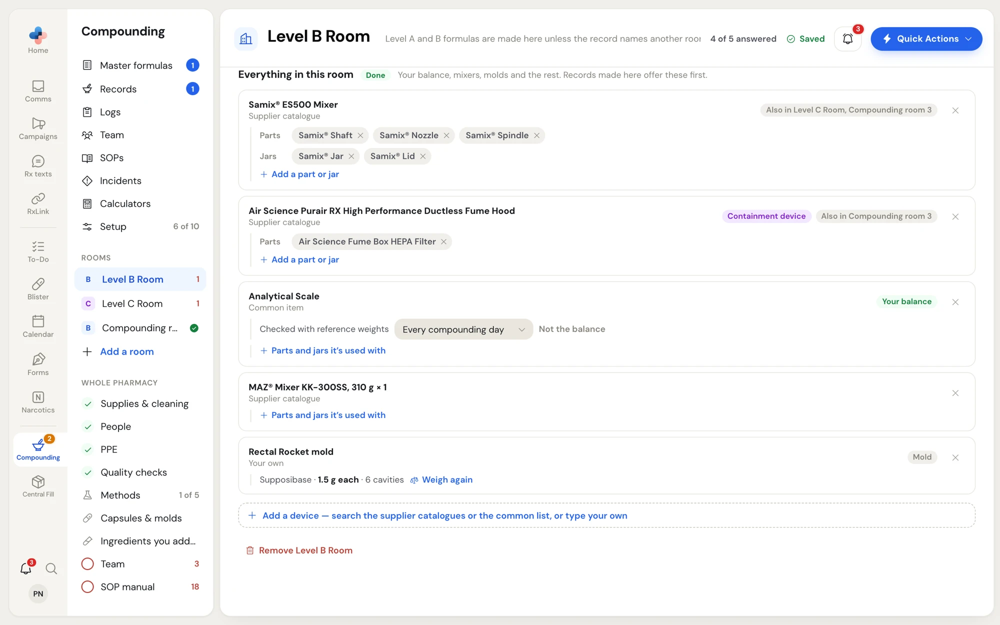
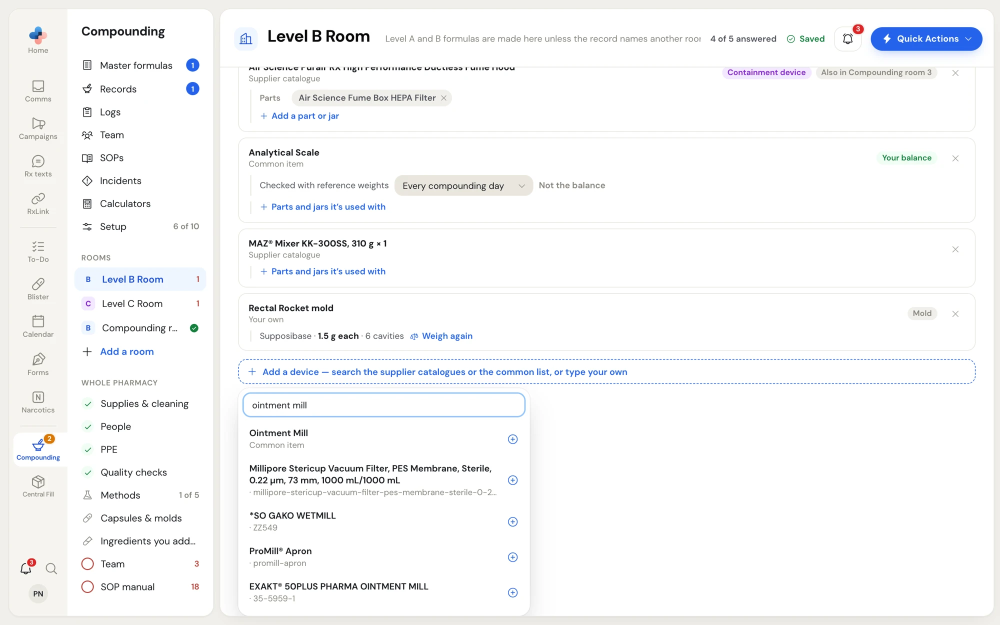

Each room you compound in has its own page in **Compounding › Setup**. A room's page holds its NAPRA level, its ventilation, its containment device (C-PEC) and every device that stands in it. Master formulas use the room to check that a preparation's level can be made there, and compounding records made in the room offer its devices first.

## Open a room

1. Open **Compounding › Setup**.
2. Click the room under **Rooms** in the Compounding menu, or click the **Rooms** card on the overview page.

The header shows the room's name and which formulas land in it by default, for example "Level A and B formulas are made here unless the record names another room." Beside it, **4 of 5 answered** counts the room's questions at its level.

<Frame caption="A Level B room: the room, its air, and its containment device. The red 1 beside Level B Room in the menu is the one question still unanswered.">

</Frame>

<Note>
A pharmacy with no rooms yet starts with one empty room. Your first answer on it stores it.
</Note>

## The room

| Field | What to enter |
|---|---|
| **Name** | What staff call the room, for example "Front compounding room". |
| **NAPRA level** | **Level A · separate area**, **Level B · separate room** or **Level C · negative-pressure room**. Describe the room as it is today, not as it is planned. |
| **Describe it in a line** | One sentence about the room. It prints on risk assessments made in this room. |

Hover over the **ⓘ** beside **NAPRA level** to read what each level requires.

<Frame caption="The NAPRA level definitions, shown when you hover over the information icon beside NAPRA level.">

</Frame>

<Tip>
In an empty **Describe it in a line** box, press **Tab** to fill in the example sentence shown in grey, then change it to match your room.
</Tip>

### Which room a formula is made in

A formula's level decides its room by default: the lowest room whose level meets the formula's. With a Level B room and a Level C room, a Level A or Level B formula lands in the Level B room, and a Level C formula lands in the Level C room. A formula or record can still name another room, as long as that room's level is high enough. A room no level lands in reads "No level lands here by default — a record can still name this room."

## Its air

The questions depend on the room's level:

| Level | What the room needs |
|---|---|
| A | Not needed. Answer if you know. |
| B | Dedicated ventilation or a containment device. |
| C | Kept under negative pressure, and a containment device. |

- **Dedicated ventilation**: **Yes** or **No**. When you click **Yes**, **How it's ventilated** appears; describe it, for example "Ducted to outside, 12 air changes an hour".
- **Kept under negative pressure**: **Yes** or **No**.

An unanswered question shows neither button selected, which is not the same as **No**.

## Containment device

The hood or cabinet where hazardous and powder work is done. Every compounding record made in the room names it.

<Frame caption="The Containment device section once a device is chosen: certification interval and date, what it is decontaminated with, and how it is vented.">

</Frame>

<Steps>
  <Step title="Pick the device">
    If the hood is already in the room's device list, pick it under **Device**. Otherwise click **Add the containment device — search the catalogue or type your own**, search for it, and pick it. A Level C room needs one. A Level B room needs one unless the room has dedicated ventilation.
  </Step>
  <Step title="Certification">
    Enter **Certified every (months)** and the **Last certified** date. Record each certification with its certificate in **Compounding › Logs › Certification**; the last-certified date on the room then follows the log.
  </Step>
  <Step title="Decontaminated with">
    What the device is cleaned with, for example "Sodium hypochlorite, then sterile water".
  </Step>
  <Step title="How is it vented?">
    Pick **Ducted to outside**, **HEPA, recirculating** or **Room ventilation only**. The answer is used on every risk assessment made in the room (question 14a).
  </Step>
</Steps>

To stop using a device as the containment device, pick **None** under **Device**.

## Everything in this room

Your balance, mixers, molds, ointment mill, slab and the rest. Compounding records made in the room offer these first, and a master formula's **Compounding** step lists them as its equipment.

<Frame caption="Everything in this room: each device as a card, with its parts and jars, and tags for the containment device, your balance and molds.">

</Frame>

### Add a device

1. Click **Add a device — search the supplier catalogues or the common list, or type your own**.
2. Type part of the device's name. Results come from the supplier catalogues and a list of common items. A device already in the room shows as **Already in this room**.
3. Click the device. If nothing matches, type the device's name yourself to add your own.

<Frame caption="Searching for a device to add to the room. Common items and supplier catalogue items appear as you type.">

</Frame>

### What each device card shows

| On the card | What it means |
|---|---|
| **Containment device** (purple tag) | This device is the room's containment device. |
| **Your balance** (green tag) | This is the balance named on every record. |
| **Mold** (grey tag) | A mold for suppositories, Rectal Rockets, troches or gummies. Its line shows the base, the weight of one unit and the number of cavities. |
| **Also in Level C Room, Compounding room 3** | The same device is listed in other rooms too. |
| **Parts** and **Jars** | Parts and jars used with the device, for example a mixer's shaft and jars. Click **Add a part or jar** (or **Parts and jars it's used with**) to add one; click **×** on a part to remove it. |
| **×** at the right | Removes the device from this room only ("Not in Level B Room any more"). An **Undo** message appears. |

### Mark your balance

Your balance is named on every compounding record. If the room has devices and none is your balance, an amber line asks "Which of these is your balance? It's named on every record." Pick it under **Pick your balance**. A device whose name looks like a balance also shows a **Make it your balance** link.

On the balance's card:

- **Checked with reference weights** sets how often: **Every compounding day**, **Weekly**, **Monthly** or **Before each preparation**.
- **Not the balance** removes the balance mark.

You have one balance for the pharmacy. A room without it says, for example, "Your balance, Analytical Scale, is in Level B Room."

### Weigh a mold

A mold's line has **Weigh it** (or **Weigh again**). It opens **Capsules & molds** with the weighing panel for that mold. See [Capsules and molds](/compounding/profile-capsules#base-per-mold).

## Add or remove a room

- **Add a room** (in the Compounding menu under **Rooms**) creates a new room and opens it. Name it and pick its level.
- **Remove Level B Room** at the bottom of a room's page removes the room. It appears only when you have more than one room. An **Undo** message appears for a few seconds.

## Devices not in a room

A device your pharmacy owns but that is not in any room is listed on **Supplies & cleaning** under **Not in a room yet**. Use **Put in a room…** to place it, or click **×** ("We no longer have this") to remove it. See [Supplies, people, PPE and checks](/compounding/profile-whole-pharmacy#supplies-and-cleaning).
