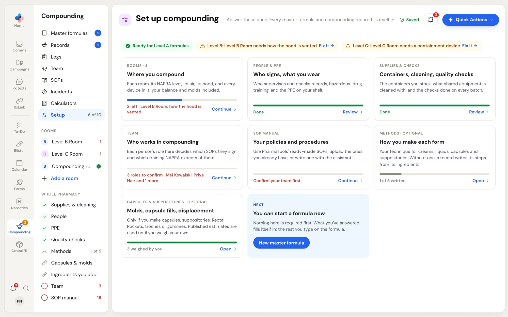

**Compounding › Setup** is your pharmacy's compounding profile. You answer each question once: your rooms and what stands in them, who signs, the PPE you own, your quality checks, how you make each dosage form, and your capsule and mold weights. Every master formula and compounding record reads these answers, so a technician starting a cream record already sees your balance, your mixer and your containers.

## Open Setup

1. Click **Compounding** in the left rail.
2. Click **Setup** in the Compounding menu.

The first page is **Set up compounding**. Its parts fold out in the Compounding menu under **Setup**.

<Frame caption="Set up compounding: readiness for each NAPRA level along the top, one card per part of setup, and the parts listed in the Compounding menu on the left.">

</Frame>

## Read the overview page

### Readiness for each NAPRA level

The chips across the top say whether your rooms are ready for Level A, B and C formulas.

| Chip | What it means |
|---|---|
| **Ready for Level A formulas** (green) | A room at that level or higher has everything NAPRA asks for. |
| **Level B: Level B Room needs how the hood is vented · Fix it →** (amber) | The lowest room that can take Level B formulas still has a question unanswered. Click **Fix it →** to open that room at the question. |
| **No Level C room** (grey) | None of your rooms is set to that level, so formulas at that level cannot be made yet. |

### The setup cards

Each card names a part of setup, shows a progress bar, and says what is left. Click a card to open its page. A finished card reads **Done** and its link reads **Review**.

| Card | What it fills in | Required |
|---|---|---|
| **Rooms** | Each room, its NAPRA level, its air, its containment device, and every device in it, your balance and molds included. | Yes |
| **People & PPE** | Who supervises and checks records, hazardous-drug training, and the PPE on your shelf. | Yes |
| **Supplies & checks** | The containers you stock, what shared equipment is cleaned with, and the checks done on every batch. | Yes |
| **Team** | Each person's compounding role, which decides the SOPs they sign and the training NAPRA expects. Opens **Compounding › Team**. | Yes |
| **SOP manual** | Your policies and procedures. Opens **Compounding › SOPs**. | Yes |
| **Methods** | How you make each dosage form. | Optional |
| **Capsules & suppositories** | Mold weights, capsule fill weights and drug displacement. | Optional |

The last card, **Next**, has the **New master formula** button. It reads **You can start a formula now** until setup is complete, because nothing in Setup has to be finished first.

## The Setup menu

When a Setup page is open, the Compounding menu lists every part of setup in two groups.

**Rooms** lists each room with a letter for its NAPRA level (**A**, **B**, **C**, or **?** when no level is set). A red number beside a room is how many of its questions are unanswered; a green tick means the room is done. **Add a room** adds a new, empty room. See [Rooms and equipment](/compounding/profile-rooms).

**Whole pharmacy** lists the pages that apply to every room:

| Menu item | Page | Required |
|---|---|---|
| **Supplies & cleaning** | Containers you stock, and how shared equipment is cleaned. | Yes |
| **People** | Who supervises, checks records and assesses training; hazardous-drug training; standing policies; signing and approving. | Yes |
| **PPE** | The PPE you own. | Yes |
| **Quality checks** | The checks done on every batch and what passing looks like. | Yes |
| **Methods** | How you make each dosage form. Shows **1 of 5** for how many of the five route methods are written. | Optional |
| **Capsules & molds** | Molds, capsule fills and drug displacement. | Optional |
| **Ingredients you added** | Ingredients your pharmacy added because no catalogue had them. | Optional |
| **Team** | Opens **Compounding › Team**. A red number is how many compounding roles are left to confirm. | Yes |
| **SOP manual** | Opens **Compounding › SOPs**. A red number is how many required SOPs are not in force yet. | Yes |

A required page shows a green tick when it is answered and an empty red ring when it is not. Optional pages show their own icon instead.

The count beside **Setup**, for example **6 of 10**, counts each room, your balance, and the six required whole-pharmacy parts (supplies, people, PPE, quality checks, team and SOP manual).

## Changes save themselves

There is no Save button in Setup. A moment after you change an answer, it is saved, and the top right of the page shows the state:

- **Saving…** while the change is being saved.
- **Saved** once it is stored.
- **Not saved · Try again** if it could not be saved. Click it to try again. A red line under the header also says "Your last change wasn't saved" with the reason.

If you leave a Setup page, anything still waiting is saved first. If you close the browser tab before a change is saved, your browser asks you to confirm leaving.

When you remove something, such as a room or a device, a dark message at the bottom of the page offers **Undo** for a few seconds.

<Tip>
You can link someone straight to one part of setup. The address keeps the part you have open, for example a room or the **PPE** page, so a bookmark or a link in an SOP opens that page.
</Tip>

## Who can change Setup

Everyone at the pharmacy who can open Compounding can fill in Setup. One section is limited: **People › Signing and approving** can only be changed by a Manager or Admin. Everyone else sees it read-only, with the line "Only a pharmacy manager or admin can change these."

## Next steps

<CardGroup cols={2}>
  <Card title="Rooms and equipment" icon="building" href="/compounding/profile-rooms">
    Set up each room, its air, its containment device and its devices.
  </Card>
  <Card title="Supplies, people, PPE and checks" icon="shield-check" href="/compounding/profile-whole-pharmacy">
    The pages that apply to every room.
  </Card>
  <Card title="Methods" icon="flask-conical" href="/compounding/profile-methods">
    Your technique for each dosage form.
  </Card>
  <Card title="Capsules and molds" icon="pill" href="/compounding/profile-capsules">
    Weigh your molds and capsule fills once.
  </Card>
</CardGroup>
