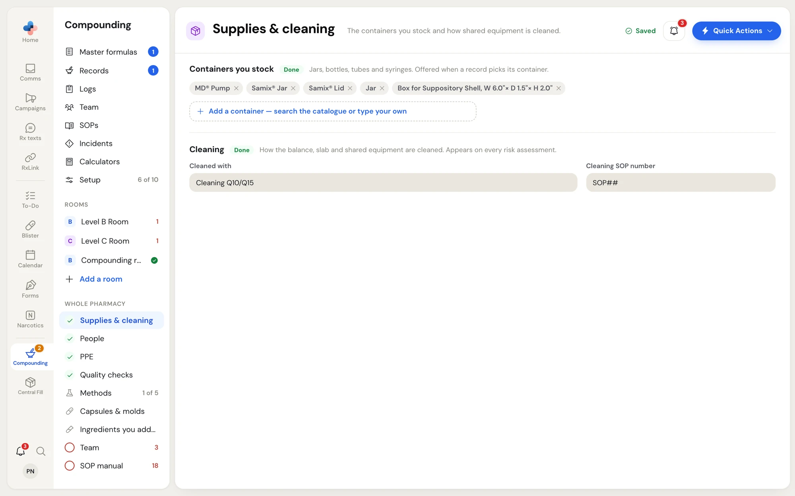
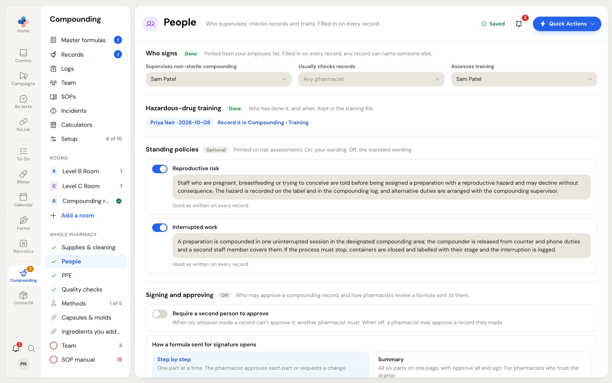
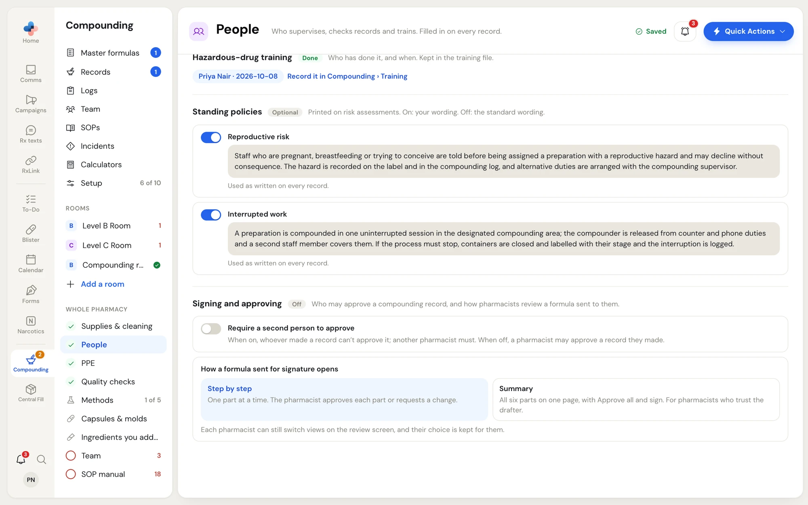
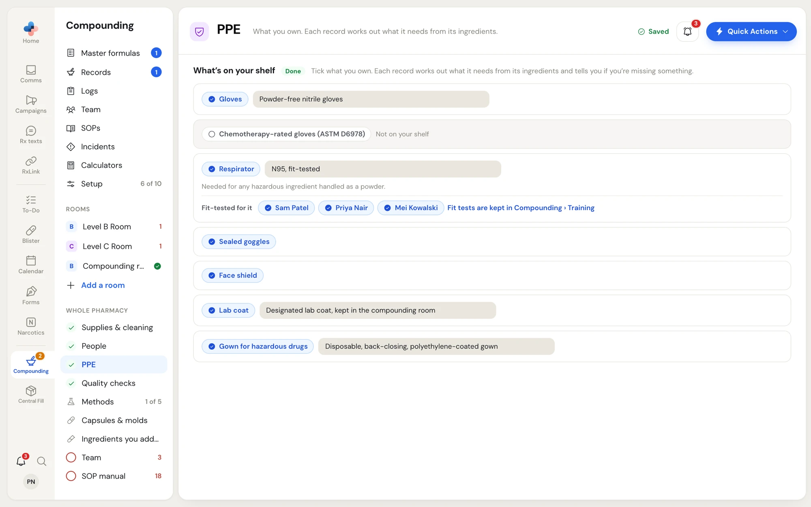
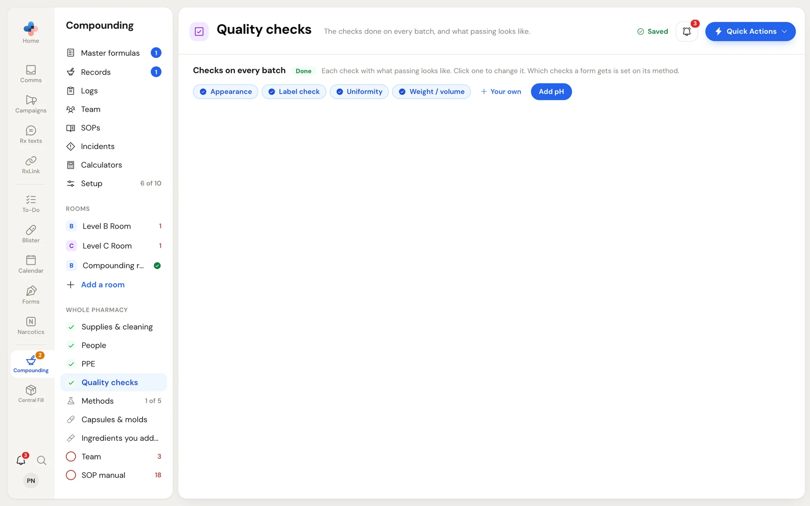
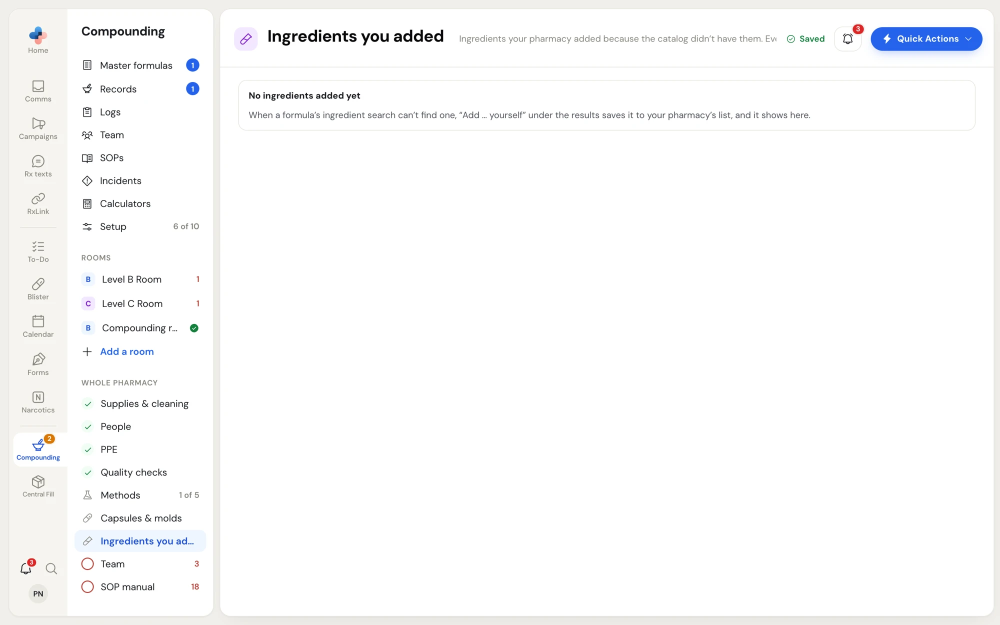

The **Whole pharmacy** pages in **Compounding › Setup** hold the answers that are the same in every room. Open each one from the Compounding menu under **Whole pharmacy**. Each section has a tag beside its title: **Done**, **Optional**, or a red **To answer** (or **2 to answer**).

## Supplies and cleaning

**Setup › Supplies & cleaning**: the containers you stock and how shared equipment is cleaned.

<Frame caption="Supplies & cleaning: the containers you stock, and what the balance, slab and shared equipment are cleaned with.">

</Frame>

### Containers you stock

Jars, bottles, tubes and syringes. A compounding record offers these when it picks its container, and each [method](/compounding/profile-methods) picks its default container from them.

1. Click **Add a container — search the catalogue or type your own**.
2. Type part of the container's name and click it in the results.
3. If no catalogue has it, click **Add your own: "…"** at the bottom of the results to add it under the name you typed.

Click **×** on a container to remove it.

### Cleaning

How the balance, slab and shared equipment are cleaned. It appears on every risk assessment.

| Field | Example |
|---|---|
| **Cleaned with** | Detergent wash, purified-water rinse, 70% IPA wipe; recorded on the cleaning log |
| **Cleaning SOP number** | SOP-C-04 |

### Not in a room yet

This section appears only when your pharmacy owns a device that is not in any room. Put each device in the room it stands in with **Put in a room…**, or click **×** ("We no longer have this") to remove it.

## People

**Setup › People**: who supervises, checks records and trains. These names are filled in on every record.

<Frame caption="People: who signs, hazardous-drug training, and the two standing policies printed on risk assessments.">

</Frame>

### Who signs

Pick each person from your employee list. Any single record can still name someone else.

| Field | Who to pick |
|---|---|
| **Supervises non-sterile compounding** | Your non-sterile compounding (NSC) supervisor, a pharmacist. They sign each formula's risk assessment and its annual review. |
| **Usually checks records** | The pharmacist who usually checks compounding records, or **Any pharmacist**. |
| **Assesses training** | The pharmacist who assesses compounding training. |

### Hazardous-drug training

Lists who has done hazardous-drug training and when, for example "Priya Nair · 2026-10-08". This comes from the training file; click **Record it in Compounding › Training** to add someone.

### Standing policies

Two policies print on every risk assessment: **Reproductive risk** and **Interrupted work**. Each has a switch and a text box.

- **On**: your wording in the box is used as written on every record.
- **Off**: records get the standard wording instead.

Both start on, with the standard wording filled in, the first time the profile is saved. Edit the text to match your pharmacy's policy.

### Signing and approving

<Frame caption="Signing and approving: whether a record needs a second person to approve it, and how a formula sent for signature opens.">

</Frame>

| Setting | What it does |
|---|---|
| **Require a second person to approve** | When on, whoever made a compounding record can't approve it; another pharmacist must. When off, a pharmacist may approve a record they made. |
| **How a formula sent for signature opens** | **Step by step**: one part at a time; the pharmacist approves each part or requests a change. **Summary**: all six parts on one page, with **Approve all and sign**, for pharmacists who trust the drafter. |

The second setting is only the starting view. Each pharmacist can switch views on the review screen, and their choice is kept for them. See [Review and sign a formula](/compounding/mfr-sign#review-a-formula-sent-to-you).

<Note>
Only a Manager or Admin can change **Signing and approving**. Everyone else sees "Only a pharmacy manager or admin can change these." These two settings save the moment you change them.
</Note>

## PPE

**Setup › PPE**: what is on your shelf. The PPE page doesn't decide what each preparation needs. Each master formula works out its PPE from its ingredients (question 13 of the risk assessment) and tells you if you're missing something.

<Frame caption="PPE: tick what you own, and describe the gloves, respirator, lab coat and gown you use.">

</Frame>

Click an item to mark it as owned (a blue tick) or not. Some items have a box beside them to say which one you use; it prints on records.

| Item | Box beside it |
|---|---|
| **Gloves** | Which gloves, for example "Powder-free nitrile gloves". |
| **Chemotherapy-rated gloves (ASTM D6978)** | None. Shows "Not on your shelf" when not ticked. |
| **Respirator** | Which respirator, for example "N95, fit-tested". Needed for any hazardous ingredient handled as a powder. Under it, **Fit-tested for it** lists the people with a fit test in **Compounding › Training**. |
| **Sealed goggles** | None. Ticked by default. |
| **Face shield** | None. |
| **Lab coat** | Which coat, for example "Designated lab coat, kept in the compounding room". |
| **Gown for hazardous drugs** | Which gown, for example "Disposable, back-closing, polyethylene-coated gown". |

The PPE page counts as answered once gloves and a lab coat are ticked.

## Quality checks

**Setup › Quality checks**: the checks done on every batch, and what passing looks like.

<Frame caption="Quality checks: each check as a chip. Click one to change its pass mark.">

</Frame>

- **Start from the standard checks** (when you have none) adds Appearance, Weight / volume, pH, Uniformity and Label check, each with a standard pass mark. When you already have some, the button names the standard ones you are missing, for example **Add pH**.
- **Your own** adds a check. Type the **Check** (for example "Appearance") and **What passing looks like** (for example "Uniform colour and texture; no visible particles or separation"), then click **Add**.
- Click an existing check to change it, then **Save**, **Remove** or **Cancel**. A check with no pass mark shows "· no pass mark".

Which checks each dosage form gets is set on its method. See [Methods](/compounding/profile-methods#what-every-record-starts-with).

## Ingredients you added

**Setup › Ingredients you added**: ingredients your pharmacy added because no catalogue had them. Everyone at the pharmacy can pick them in a formula.

<Frame caption="Ingredients you added, before any have been added.">

</Frame>

You add an ingredient from a formula: when the ingredient search can't find it, click **Add … yourself** under the results. See [Formulation](/compounding/mfr-formulation#add-an-ingredient-no-catalogue-lists).

On this page you can open each ingredient's safety data sheet (**Open safety data sheet**), change it with **Edit** (the **Edit ingredient** panel: **Name**, **Supplier**, form, and the safety data sheet, a PDF up to 10 MB), or **Remove** it.
