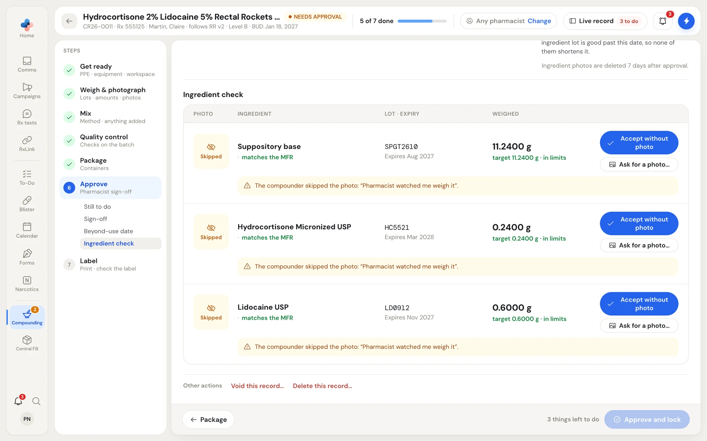
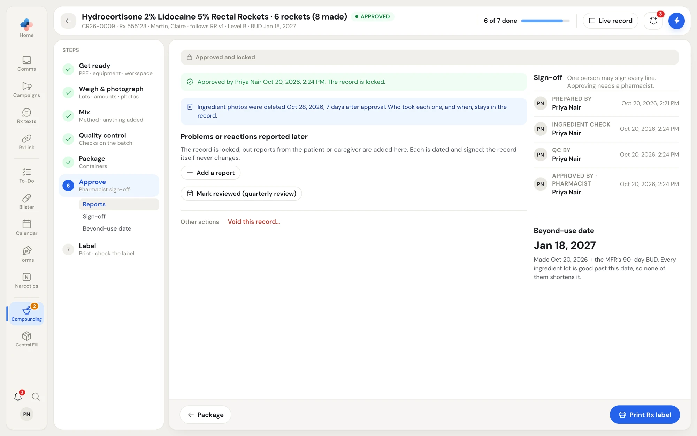
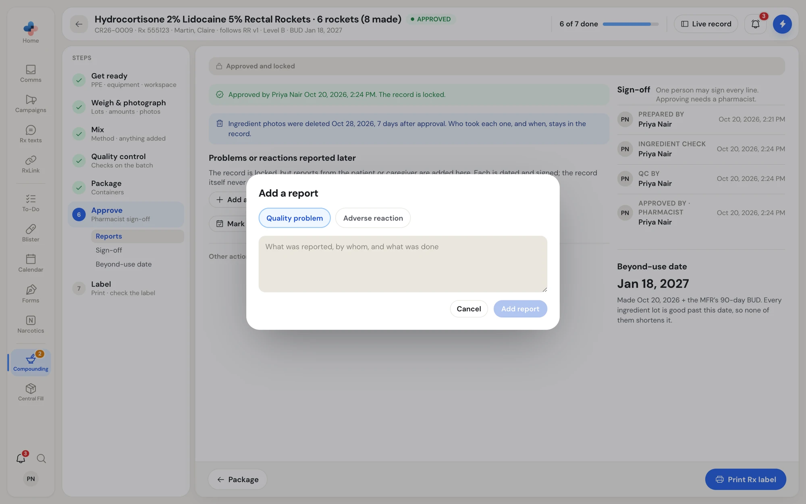
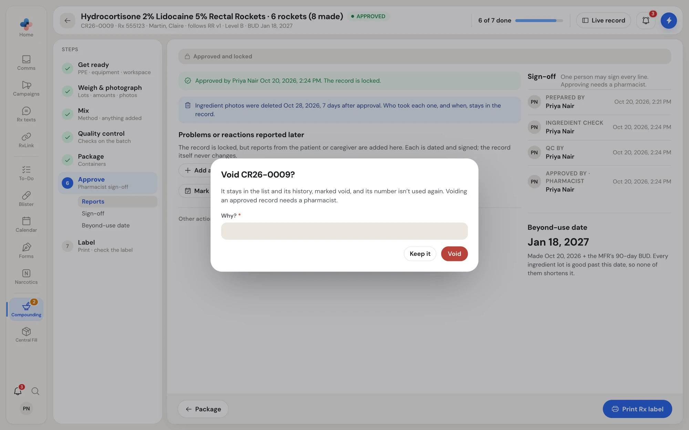
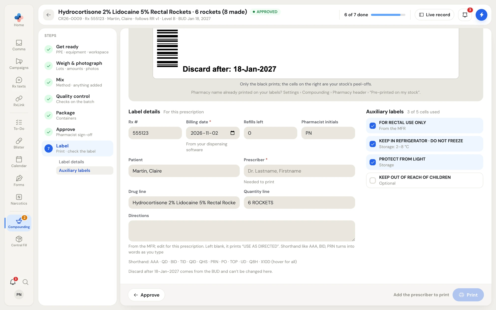
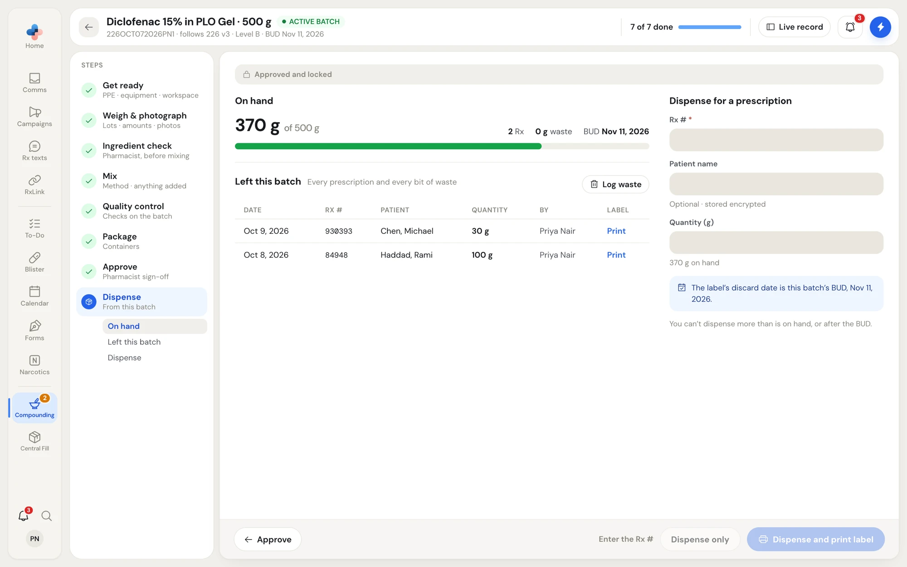
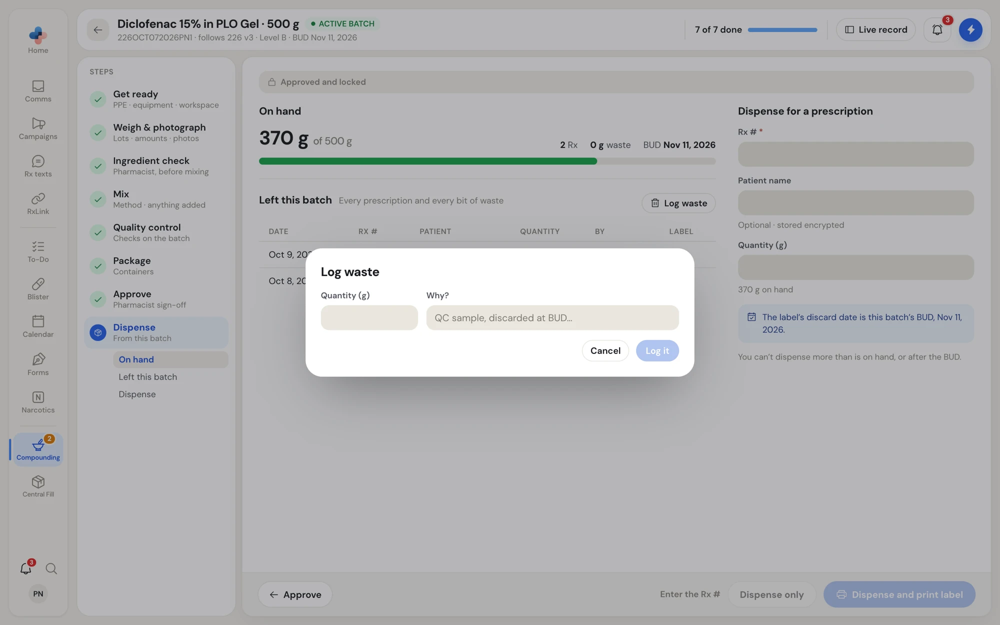

## 6 · Approve

The Approve step is where a pharmacist signs the record off. It has up to five parts, listed under **Approve** in the step list.

- **Still to do before approval**: everything that stops approval, grouped by the step that fixes it, with a link to that step.
- **Changes from the MFR**: each change raised while making the record (an amount outside tolerance, a swapped product, a method line changed, something added). A pharmacist clicks **Approve change** on each.
- **Sign-off**: **Prepared by**, **Ingredient check**, **QC by** and **Approved by · pharmacist**, each with a name and time or **Waiting**. One person may sign every line; approving needs a pharmacist.
- **Beyond-use date**: the date and how it was set ("Made Oct 20, 2026 + the MFR's 90-day BUD"), or which lot moved it earlier.
- **Ingredient check**: when your pharmacy checks at approval, the photos, lots and amounts with **Verify** / **Accept without photo** and **Send back…** / **Ask for a photo…**.

<Frame caption="Approve with the ingredient check at approval; Approve and lock stays greyed until nothing is left to do">

</Frame>

When nothing is left, click **Approve and lock**. The status becomes **APPROVED** (or **ACTIVE BATCH** for a batch) and the record can't be edited again.

<Note>
The bar explains why the button is greyed: **3 things left to do**, **Needs a pharmacist**, or **You made this record: another pharmacist approves it** when your pharmacy requires a second approver. **Switch to a pharmacist** lets a pharmacist sign in with their PIN on a shared device.
</Note>

### After approval

<Frame caption="An approved, locked record">

</Frame>

- Ingredient photos are deleted a set number of days after approval (7 in this example). Who took each one, and when, stays in the record.
- **Problems or reactions reported later**: click **Add a report**, choose **Quality problem** or **Adverse reaction**, describe what was reported, by whom and what was done, and click **Add report**. Each report is dated and signed; the record itself never changes. From a report you can open a pre-filled incident in [Incidents](/compounding/incidents).
- **Mark reviewed (quarterly review)**: a pharmacist marks the record as reviewed for the quarterly records review in **Logs › Due checks**.
- **Print Rx label** (a prescription) or **Dispense from this batch** (a batch) in the action bar.

<Frame caption="Add a report to a locked record">

</Frame>

### Void or delete

Under **Other actions**:

- **Delete this record…** appears only while a record has never been approved. It removes the record with its ingredients, changes and photos, and can't be undone.
- **Void this record…** asks **Why?**. The record stays in the list and history marked **Voided**, and its number isn't used again. Voiding an approved record needs a pharmacist; nothing more can be dispensed from a voided batch.

<Frame caption="Voiding keeps the record, with your reason">

</Frame>

## 7 · Label (prescription records)

When **Print Rx labels from PharmaTools** is on in **Settings › Compounding**, the Label step prints the prescription label on thermal label stock through your printer's own driver. The default stock is 4.625 × 2.125 in, with a 1.5 in strip of auxiliary-label cells on the right. When the setting is off, the step says your dispensing software prints the label, and it doesn't count toward **N of 7 done**.

The preview at the top is exactly the page that prints: only the black prints, and the cells on the right are your stock's peel-offs.

<Frame caption="Label details and auxiliary labels under the live preview">

</Frame>

<Steps>
  <Step title="Fill in the label details">
    **Rx #** comes from the record. Enter the **Billing date** from your dispensing software (it isn't the compounding date), **Refills left**, **Pharmacist initials** and the **Prescriber** (needed to print, as "Dr. Lastname, Firstname"). **Patient**, **Drug line** and **Quantity line** are filled in; edit them if needed.
  </Step>
  <Step title="Write the directions">
    **Directions** start from the MFR. Shorthand turns into words as you type (AAA, QD, BID, TID, QID, QHS, PRN, PO, TOP, UD, Q8H, X10D; hover the list for all). Left blank, the label prints **USE AS DIRECTED**. The **Discard after** date comes from the BUD and can't be changed here.
  </Step>
  <Step title="Pick the auxiliary labels">
    Tick the auxiliary labels to print, one per cell (for example **3 of 5 cells used**). Labels from the MFR and its storage are ticked for you.
  </Step>
  <Step title="Print">
    Click **Print**. If the text is too long for the label, the button reads **Print (text cut off)** and a note says which line to shorten.
  </Step>
  <Step title="Check the printed label">
    Under **Check the printed label**, compare the label with the record and click **Label matches the record**, or **Something's wrong…** to say what doesn't match, fix it and print again. The record shows **Record complete** once the label is printed and checked, with **Start another** and **Back to records**.
  </Step>
</Steps>

<Tip>
If your label stock already has your pharmacy name printed on it, set **Settings › Compounding › Pharmacy header** to **Pre-printed on my stock**. Use **Print test label** there to print the cell outlines and a ruler, then nudge the layout with **Shift right (mm)** and **Shift down (mm)**.
</Tip>

## Dispense from a batch

An approved batch gets a **Dispense** step. **On hand** shows what is left of what was made (or of the units that passed), with the number of prescriptions, waste and the BUD. **Left this batch** lists every prescription and every bit of waste, with who did it and a **Print** link for any label not printed yet.

<Frame caption="An active batch: on hand, what left it, and Dispense for a prescription">

</Frame>

<Steps>
  <Step title="Enter the prescription">
    Under **Dispense for a prescription**, enter the **Rx #**, the **Patient name** (optional, stored encrypted) and the **Quantity**. The hint shows what is left after.
  </Step>
  <Step title="Dispense">
    Click **Dispense and print label** to open the Rx label for this prescription (its discard date is the batch BUD), or **Dispense only**. Without PharmaTools labels, the button is **Dispense**.
  </Step>
</Steps>

You can't dispense more than is on hand, whole units only for counted forms, or after the BUD. **Log waste** records a quantity thrown out and why (a QC sample, discarded at BUD).

<Frame caption="Log waste against a batch">

</Frame>

A batch changes status by itself: **DEPLETED** when nothing is left, and **PAST BUD** after its beyond-use date. A batch past its BUD still takes **Log waste** for what was thrown out.
