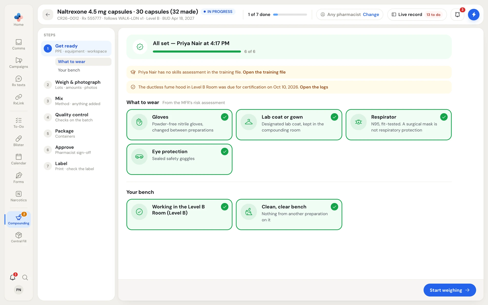
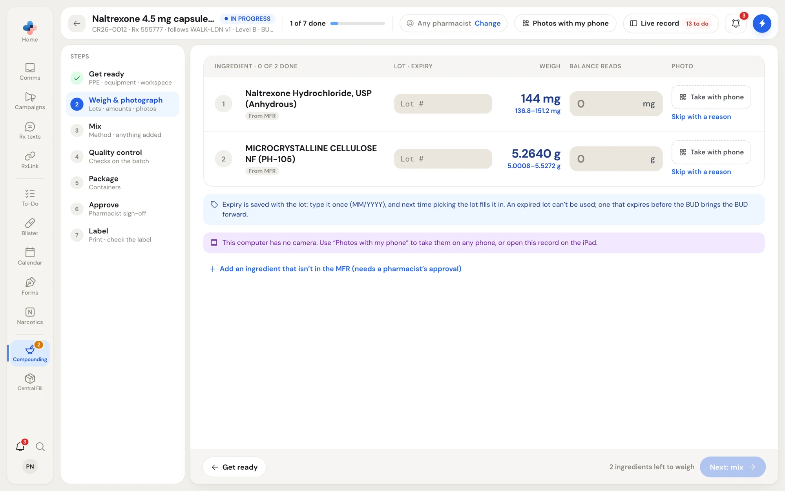
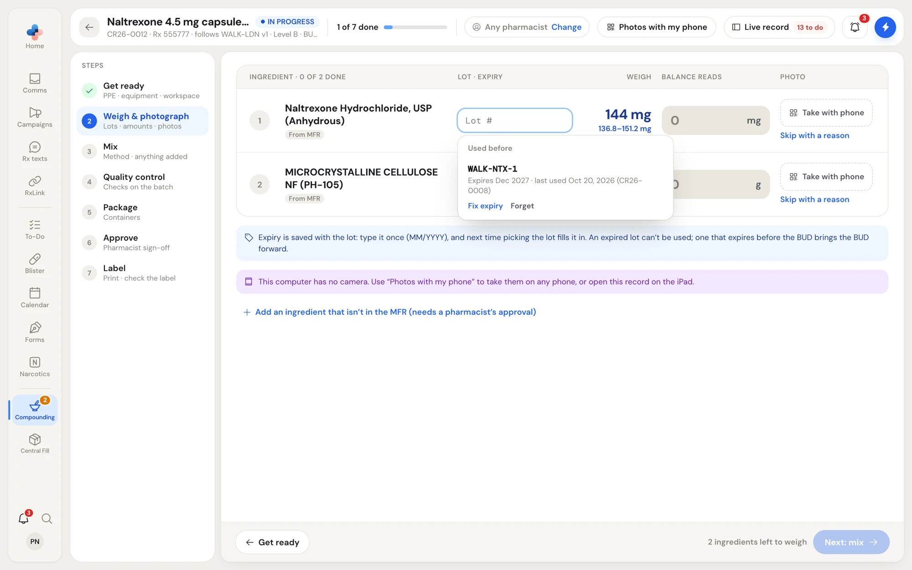
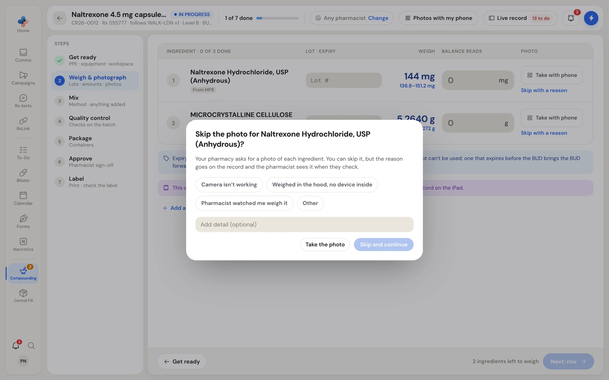
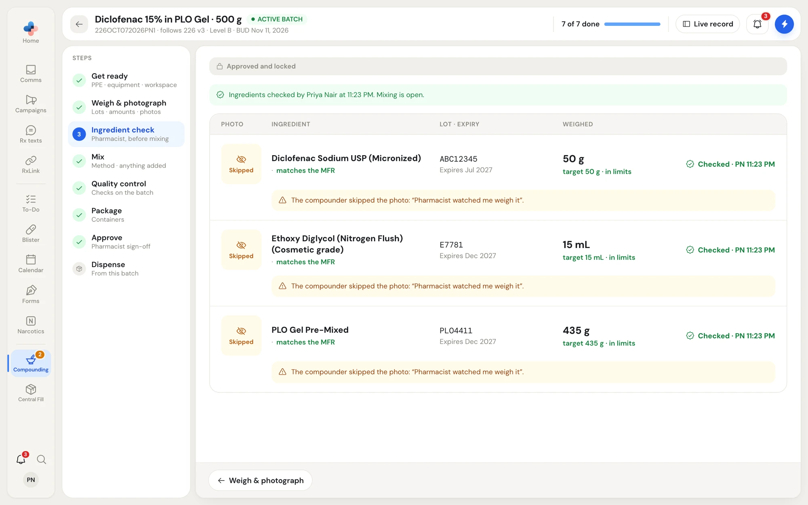
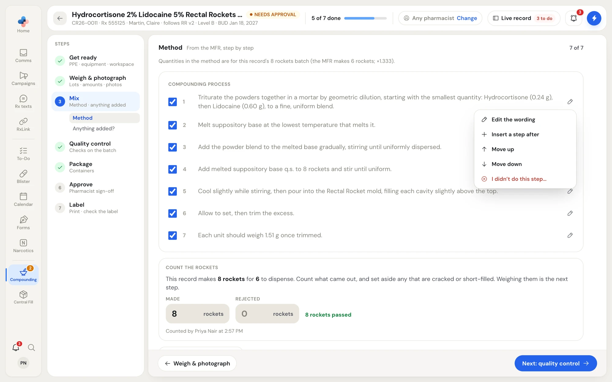
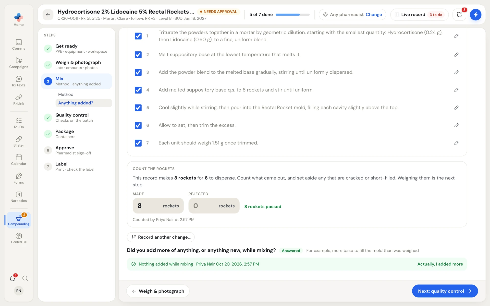
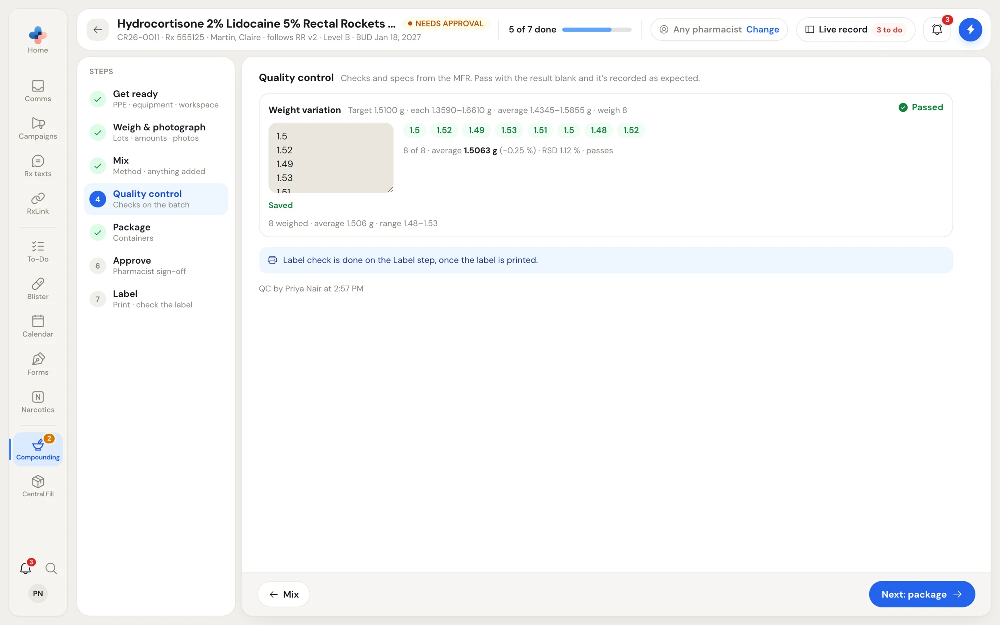
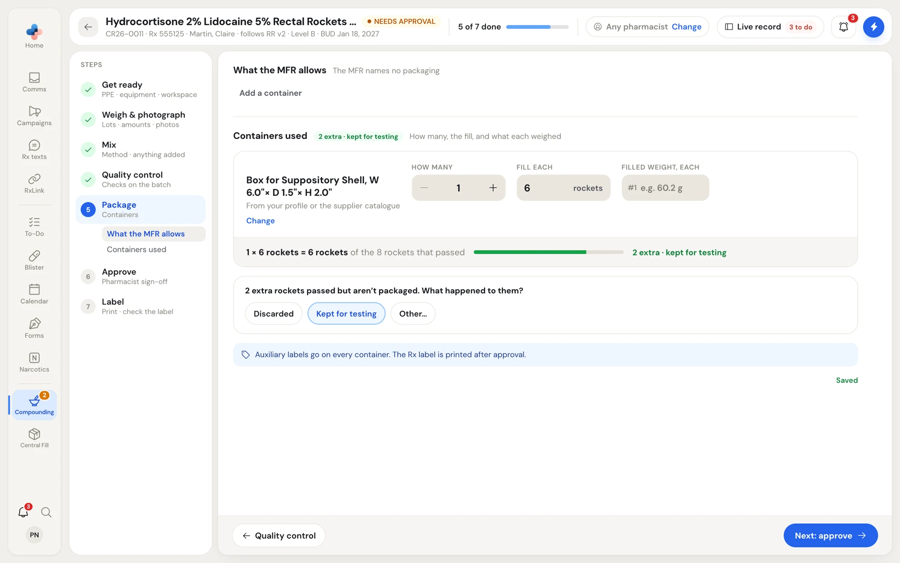

A record walks you through the preparation in order. A prescription record has 7 steps: **Get ready**, **Weigh & photograph**, **Mix**, **Quality control**, **Package**, **Approve** and **Label**. Two things change that list:

- When your pharmacy checks ingredients **before mixing**, an **Ingredient check** step sits between weighing and mixing. When it checks **at final approval**, the check is part of **Approve**. With ingredient photos off, there is no check.
- A batch has no **Label** step; it is labelled each time you dispense from it.

Everything you type or tick saves as you go. The bar under each step shows the next step's button, greyed out with the reason until the step is finished.

<Tip>
On an iPad, the same steps lay out one ingredient at a time with large buttons, and the camera is a tap away. To force a layout on one device, use **Settings › Compounding › This device**.
</Tip>

## 1 · Get ready

The self-check before you weigh. **What to wear** lists the PPE from the MFR's risk assessment (gloves, lab coat or gown, respirator, eye or face protection). **Your bench** lists the room, the equipment to set out clean, a clean, clear bench, and the ingredients to gather.

Tap each card once it's done. The bar shows **8 cards left to tick** until every card is ticked; then **Start weighing** opens. Once finished, the step shows **All set** with your name and the time.

<Frame caption="Get ready: tick each PPE and bench card, then Start weighing">

</Frame>

Amber bench warnings at the top (a lapsed hood certification, overdue calibration, an open temperature excursion, or no current skills assessment for you) link to the log or training file that clears them. They don't stop the record.

## 2 · Weigh & photograph

One row per ingredient: **Lot · expiry**, the amount to **Weigh** with its accepted range, what the **Balance reads**, and the **Photo**.

<Frame caption="Weigh & photograph: lot, target and range, what the balance reads, and the photo">

</Frame>

<Steps>
  <Step title="Pick or type the lot">
    Click the **Lot #** field. **Used before** lists the lots this ingredient used on earlier records, each with its expiry and the record it was last used on. Pick one and its expiry fills in. For a new lot, type it and then type the expiry from the container (**MM/YYYY**, for example 07/2027). The expiry is asked once and saved with the lot.

    <Frame caption="Lot memory: lots used before, with their expiry">
    
    </Frame>

    An expired lot can't be used. A lot that expires before the record's BUD moves the BUD to that date, and a note says which lot did it. Each remembered lot has **Fix expiry** and **Forget** for a typo or a lot you no longer have.
  </Step>
  <Step title="Enter what the balance reads">
    Type the reading in the ingredient's unit. Capsules and molded forms weigh in grams to 4 decimal places (for example **0.2400 g**), the way an analytical balance reads. PharmaTools shows **On target**, **Within limits**, or the difference in red, such as **+6.2%, outside ±5%**.

    Outside your pharmacy's weight tolerance, a **Why is it outside tolerance?** field appears. Click **Save** to raise it as a change for a pharmacist to approve.
  </Step>
  <Step title="Photograph each ingredient">
    When photos are on, photograph the bottle label and the balance display together. On a computer, click **Take with phone** on the row or **Photos with my phone** in the header (see below). On an iPad, tap **Take photo**.

    To skip a photo, click **Skip with a reason** and pick **Camera isn't working**, **Weighed in the hood, no device inside**, **Pharmacist watched me weigh it** or **Other**, then **Skip and continue**. The reason goes on the record and the pharmacist sees it when they check.

    <Frame caption="Skipping a photo needs a reason">
    
    </Frame>
  </Step>
  <Step title="Move on">
    With a check before mixing, pick the pharmacist and click **Send for ingredient check**; the bar then shows **Sent to Priya for the check**. Otherwise click **Next: mix**.
  </Step>
</Steps>

<AccordionGroup>
  <Accordion title="Photos with my phone" icon="qr-code">
    Click **Photos with my phone** on the Weigh step. **Take the photos with your phone** shows a QR code and three steps: scan it with any phone's camera (no app to install), enter your employee PIN so the photos are signed by you, and take each photo. Each one appears on the computer as soon as it's taken, and the phone shows **All photos are on the computer. You can put the phone down.** when every ingredient has one.

    The code opens only this record's photo step and works until the record is approved. After 30 minutes without use, the phone asks for the PIN again. **New code** replaces the code (the old one stops working), and **End phone session** stops the phone.
  </Accordion>
  <Accordion title="Use a different product (Swap)" icon="replace">
    Click **Swap** under an ingredient when the product on your shelf isn't the one the MFR names. **Use a different product for …** offers **Interchangeable (Health Canada)** products, which are recorded without approval, and **Same chemical, another supplier** or **Same drug and strength, another form or route**, which a pharmacist approves. **Other product** lets you name anything else with a reason (**Out of stock**, **On backorder**, **Pharmacist asked**, or your own). Any lot, amount and photo already entered for the replaced product are cleared.
  </Accordion>
  <Accordion title="Add an ingredient that isn't in the MFR" icon="plus">
    Click **Add an ingredient that isn't in the MFR (needs a pharmacist's approval)**. Enter the **Ingredient**, **Supplier**, **Amount**, **Unit** and **Why was it added?**, then **Add**. It is a change from the MFR that a pharmacist approves before the record can be approved.
  </Accordion>
</AccordionGroup>

## Ingredient check (pharmacist)

When your pharmacy checks before mixing, the record waits with the status **INGREDIENT CHECK** and shows in the pharmacist's **Waiting for you** tab and To-Dos. The pharmacist compares each ingredient's photo, lot and expiry, and amount against what the MFR asks for.

- **Verify** confirms the ingredient. For a skipped photo, the button reads **Accept without photo**.
- **Send back…** (or **Ask for a photo…** for a skipped photo) asks for **Retake the photo only**, **Re-weigh it**, **Use a different lot** or **Wrong ingredient: start this one over**, with an optional note. Only that ingredient reopens; it shows **Sent back · redo** for the person who weighed it, and the first attempt stays in the history.
- An amount outside tolerance is flagged; **Verify** accepts it as weighed.

<Frame caption="A checked ingredient list: each row shows who checked it and when">

</Frame>

A technician who has a pharmacist beside them clicks **Switch to a pharmacist on this device**, and the pharmacist signs in with their PIN. When your pharmacy allows it, **Start mixing anyway** opens mixing before the check; it is flagged on the record, and the check still has to happen before approval.

## 3 · Mix

The MFR's method as a checklist, with quantities rescaled for this record ("Quantities in the method are for this record's 8 rockets batch"). Tick each line as you do it.

<Frame caption="Each method line has a pencil menu to record a change from the MFR">

</Frame>

Click the pencil on a line to record what you did differently: **Edit the wording**, **Insert a step after**, **Move up**, **Move down** or **I didn't do this step…**, each with a reason. The MFR's wording stays on the record, struck through, and each change goes to a pharmacist to approve. **Put it back as the MFR says** undoes a change. **Record another change…** records a change that isn't tied to one line.

Depending on the form, Mix also asks for:

- **The final weight or volume** after bringing the preparation up with its q.s. base.
- **Made** and **Rejected** counts for capsules and molded forms ("8 rockets passed").

The step ends with **Did you add more of anything, or anything new, while mixing?** Click **No, nothing changed**, or **Yes, I added more** and list each addition with its amount, lot and expiry, why, and a photo. Each addition is a change from the MFR that a pharmacist approves. **Actually, I added more** reopens the question.

<Frame caption="The closing question on Mix">

</Frame>

## 4 · Quality control

The checks and specs from the MFR, each with **Expected**, **Result** and **Pass?**. Pass a check with the result blank and it's recorded as expected; **All as expected** passes every check at once. A numeric result outside the spec asks **are you sure it passes?** and needs **Pass anyway**.

For capsules and molded forms, the weight-variation check takes one weight per line, typed or pasted from the balance, and judges each against the target and range as it goes in.

<Frame caption="Quality control with a weight-variation check">

</Frame>

A failed check stops approval: redo the check or remake the preparation and enter the new result. A label check on a prescription record waits for the **Label** step, after printing.

## 5 · Package

**What the MFR allows** lists the containers the formula names; pick one to add it. **Containers used** records each container, **How many**, **Fill each** and the **Filled weight, each**. Pick containers from your compounding profile or the supplier catalogue. A container the MFR doesn't name is a change: say why.

When more units passed than you packaged, the step asks what happened to the extras: **Discarded**, **Kept for testing** or **Other…** with a note.

<Frame caption="Package: containers used, and the question about extra units">

</Frame>

Auxiliary labels go on every container; the Rx label is printed after approval. Click **Next: approve**. When every step is done, the record's status changes to **NEEDS APPROVAL** and it appears in the pharmacist's **Waiting for you** tab.

Next: [Approval, labels and batches](/compounding/records-approve).
