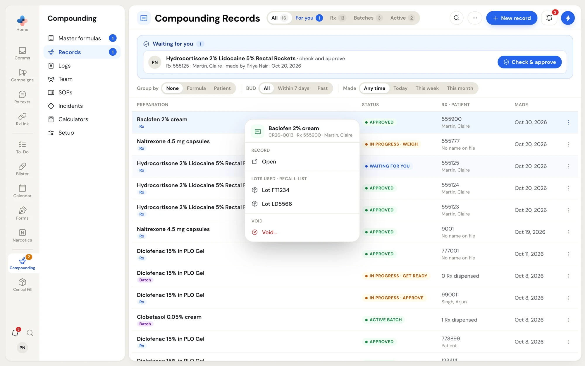
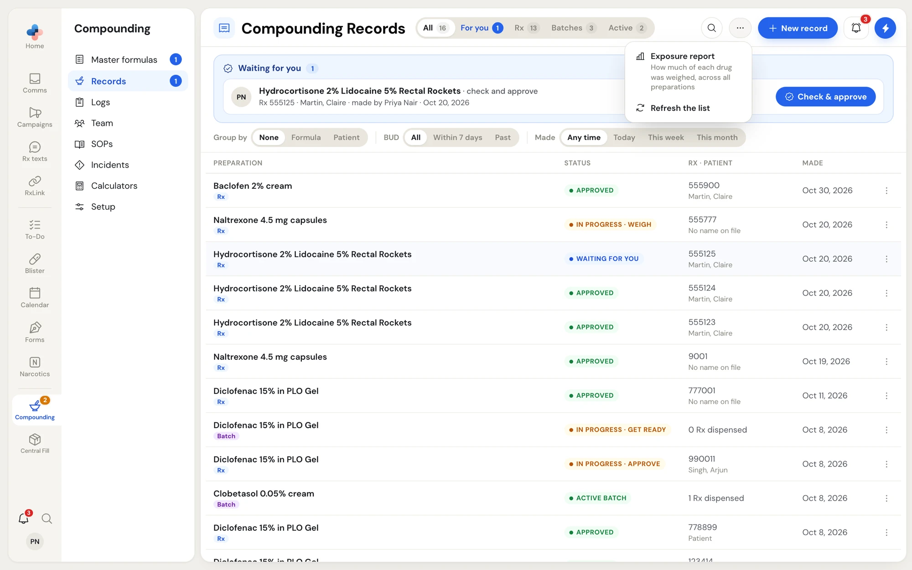
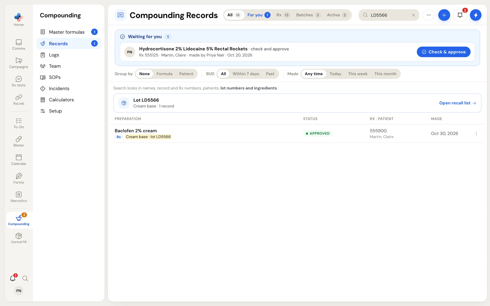
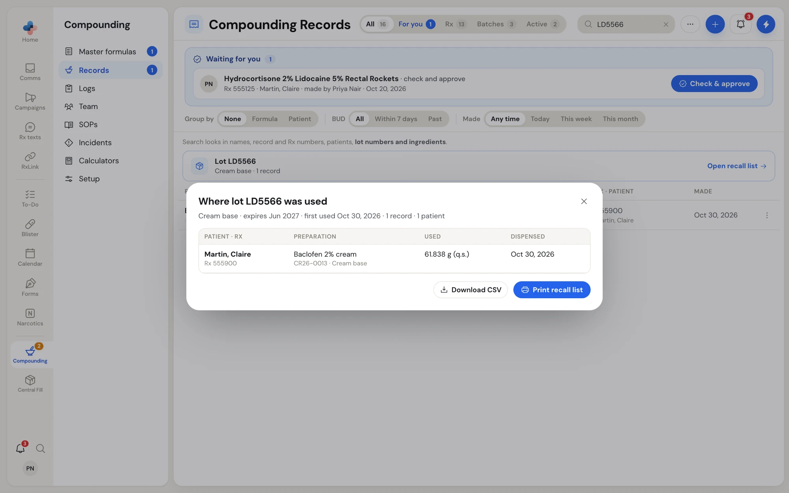
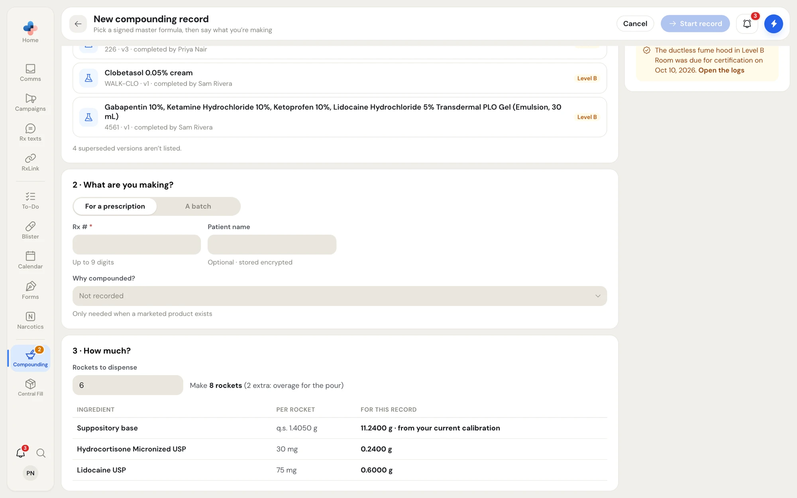
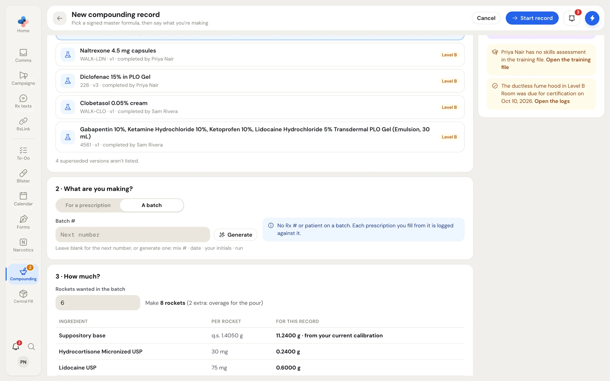
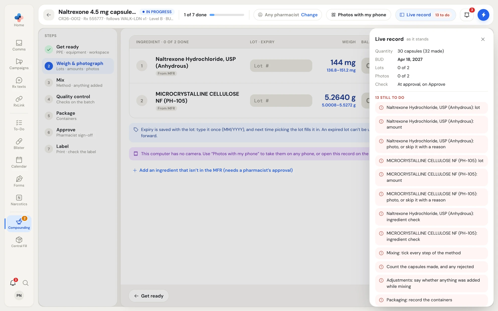
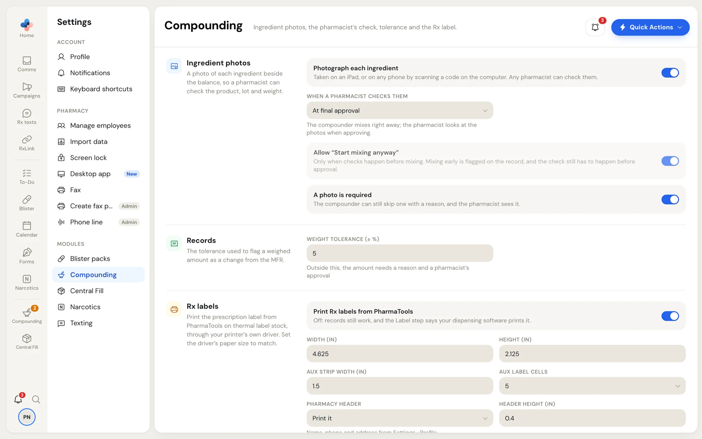
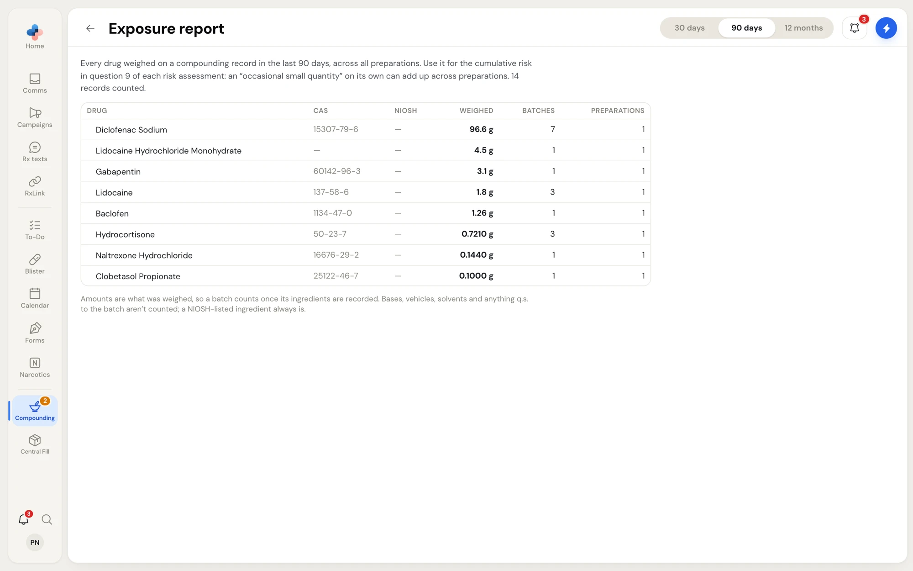

A compounding record is the batch sheet for one preparation. It follows a signed master formula (MFR) and records who prepared it, the lots and amounts weighed, the photos, the method, the quality checks, the packaging, the pharmacist's approval and the Rx label. Once a pharmacist approves it, the record is locked.

Open it from the side menu: **Compounding › Records**.

<Frame caption="Compounding › Records, with the view tabs, the filter bar and one row per record">

</Frame>

## Who can do what

| Role | What they can do on a record |
| --- | --- |
| Technician, Assistant | Start a record, get ready, weigh, take photos, mix, record QC, package, raise changes from the MFR, dispense from an active batch, add a report after approval |
| Pharmacist, Manager, Admin | Everything above, plus the ingredient check, approving changes from the MFR, **Approve and lock**, voiding an approved record and the quarterly review |

<Note>
If your pharmacy turned on **Require a second person to approve** in **Compounding › Setup**, the pharmacist who made a record can't approve it. Another pharmacist approves it, and on a shared device they sign in with their own PIN.
</Note>

## The records list

### View tabs

| Tab | What it shows |
| --- | --- |
| **All** | Every record |
| **Waiting for you** | Records waiting on your ingredient check or approval, and ingredients a pharmacist sent back for you to redo |
| **Prescriptions** | Records made for one prescription (tagged **Rx**) |
| **Batches** | Stock batches (tagged **Batch**) |
| **Active batches** | Approved batches with stock left to dispense |

Each tab shows its count. The **Records** item in the side menu shows how many records are waiting for you.

### The blue strip at the top

When something waits on you, a blue strip lists it with a button that opens the right step: **Check ingredients**, **Check & approve** or **Redo**. A red line in the strip warns when active batches reach their BUD within 7 days; click **Show them** to filter the list to those batches.

### Filters, grouping and search

- **Group by**: **None**, **Formula** or **Patient**. Click a group heading to fold it. Batches group together at the end when you group by patient.
- **BUD**: **All**, **Within 7 days** or **Past**.
- **Made**: **Any time**, **Today**, **This week** or **This month**.

PharmaTools remembers your grouping and filters for your login. **Clear filters** resets them.

Click the search icon to search by product name, record number, Rx #, patient, **lot number** or **ingredient**. A row found through a lot or an ingredient shows a yellow line saying which one matched.

### Record statuses

| Status in the list | What it means |
| --- | --- |
| **In progress · weigh** (or another step) | Someone is making it; the word names the first step not finished |
| **Waiting for you** | It waits on your ingredient check or approval |
| **With Priya** (a first name), or **Waiting for a pharmacist** | It waits on that pharmacist, or on any pharmacist |
| **Sent back · redo** | A pharmacist sent one of your ingredients back to redo |
| **Approved** | Approved and locked (a prescription record) |
| **Active batch** | Approved batch with stock on hand |
| **Used up** | Nothing left in the batch |
| **Past BUD** | The batch passed its beyond-use date |
| **Voided** | Voided with a reason; it stays in the list |

Inside a record, the header pill reads **IN PROGRESS**, **INGREDIENT CHECK**, **NEEDS APPROVAL**, **APPROVED**, **ACTIVE BATCH**, **DEPLETED**, **PAST BUD** or **VOID**.

### Row menu

Right-click a row, or click its **⋯** button, to open its menu.

<Frame caption="The row menu: Open, the lots used for a recall, and Void or Delete">

</Frame>

- **Open** opens the record.
- **Lots used · recall list** lists up to four lots the record used. Click one to open **Where lot … was used**.
- **Delete…** appears on a record that was never approved. It removes the record with its ingredients, changes and photos, after you confirm.
- **Void…** appears on an approved record. A pharmacist gives a reason, and the record stays in the list marked **Voided**. Its number isn't used again.

### More menu

The **⋯** button beside the search has **Exposure report** and **Refresh the list**.

<Frame caption="The More menu on Compounding Records">

</Frame>

## Find every record that used a lot (recall)

<Steps>
  <Step title="Search for the lot number">
    Type at least 3 characters of the lot in the search. A card above the results names the lot, its ingredient and how many records used it.

    <Frame caption="Searching a lot number shows a lot card above the matching records">
    
    </Frame>
  </Step>
  <Step title="Click Open recall list">
    **Where lot … was used** lists each record: the patient and Rx # it went to, the preparation and record number, how much of the lot it used, and when it was dispensed (**Not yet** or **Voided** when it wasn't).

    <Frame caption="The recall list for one lot">
    
    </Frame>
  </Step>
  <Step title="Print or download it">
    Click **Print recall list** for a printed page with your pharmacy name and who printed it, or **Download CSV** for a spreadsheet. Click any row to open that record.
  </Step>
</Steps>

## Start a new record

Click **New record** on the records list. You can also start one from a master formula, and the formula is picked for you.

<Steps>
  <Step title="1 · Which MFR?">
    Pick a formula. Only signed formulas in force are listed; superseded versions are counted under the list but can't be picked. Search by name, mix # or ingredient.
  </Step>
  <Step title="2 · What are you making?">
    Choose **For a prescription** or **A batch**.

    For a prescription, enter the **Rx #** (up to 9 digits; PharmaTools pads it to 9). **Patient name** is optional and stored encrypted. **Why compounded?** is only needed when a marketed product exists; pick a reason such as **No marketed product** or **Strength not available**, or **Other…** and type it.

    <Frame caption="A prescription record for a molded form: the Rx #, the patient and how many to dispense">
    
    </Frame>

    For a batch, there is no Rx # or patient. Leave **Batch #** blank for the next number, or click **Generate** for one made from the mix #, today's date, your initials and the run of the day.

    <Frame caption="A batch record: leave the batch number blank or generate one">
    
    </Frame>
  </Step>
  <Step title="3 · How much?">
    Enter the quantity. The ingredient table rescales as you type and shows exactly what the Weigh step will ask for.

    - A prescription made by weight or volume adds the MFR's overage for losses on top ("Make 63 g, 5 % overage for losses · the label shows 60 g").
    - Capsules and molded forms ask how many to dispense, then add the overage or round up to full plates or molds ("Make 8 rockets, 2 extra: overage for the pour"). Their grams show to 4 decimal places, as the balance reads.
  </Step>
  <Step title="Check the side panel, then start">
    **This record** shows the MFR version and level, today's date, the BUD (today plus the MFR's days) and whether ingredient photos are on. Amber bench warnings appear here when the room's hood certification lapsed, equipment is past calibration, a temperature excursion is open, or you have no current skills assessment. They are warnings only. Click **Start record**.
  </Step>
</Steps>

<Tip>
The BUD moves earlier by itself if a lot you weigh expires before it.
</Tip>

## Inside a record

A record opens on its first step that isn't finished. The header shows the product, quantity, status, record number, Rx #, patient, MFR version, level and BUD, and a progress bar such as **5 of 7 done**.

- **Steps** down the left: click any step to open it. A green tick marks a finished step.
- The action bar at the bottom: the previous step on the left, the step's main action on the right. When the action can't be pressed yet, the reason sits beside it, for example **2 ingredients left to weigh**.
- The pharmacist chip (**Any pharmacist** or a name) with **Change**: pick who gets the To-Dos for this record's ingredient check, changes and approval.
- **Live record**: a panel with the quantity, BUD, lots, photos and check timing, and a red list of everything still to do before approval.

<Frame caption="The Live record panel lists what is still to do before approval">

</Frame>

Everything you enter saves as you go. Continue to [Making the preparation](/compounding/records-making) for the steps, and [Approval, labels and batches](/compounding/records-approve) for what happens after.

## Compounding settings that shape records

**Settings › Compounding** holds the choices that change how records work. A pharmacist or admin changes them; everyone else can read them.

<Frame caption="Settings › Compounding: ingredient photos, weight tolerance and Rx labels">

</Frame>

- **Photograph each ingredient**: a photo of each ingredient beside the balance.
- **When a pharmacist checks them**: **Before mixing (mixing waits for them)** adds an **Ingredient check** step; **At final approval** moves the check onto **Approve**. With photos off, there is no ingredient check.
- **Allow "Start mixing anyway"**: only when checks happen before mixing.
- **A photo is required**: the compounder can still skip one with a reason.
- **Weight tolerance (± %)**: outside it, the amount needs a reason and a pharmacist's approval.
- **Rx labels**: **Print Rx labels from PharmaTools**, the label size (4.625 × 2.125 in by default), the aux strip and cells, **Pharmacy header** (**Print it** or **Pre-printed on my stock**), rotation, shifts and **Print test label**.
- **Bench warnings**: a manager or admin switches each warning on or off.
- **This device**: **Automatic**, **Touch (tablet)** or **Mouse and keyboard** layout.

## Exposure report

**⋯ › Exposure report** lists every drug weighed on compounding records in the last **30 days**, **90 days** or **12 months**: CAS number, NIOSH listing, total weighed, and how many batches and preparations. Use it for the cumulative-risk question in each risk assessment. Bases, vehicles, solvents and q.s. ingredients aren't counted; a NIOSH-listed ingredient always is.

<Frame caption="The exposure report across all preparations">

</Frame>
