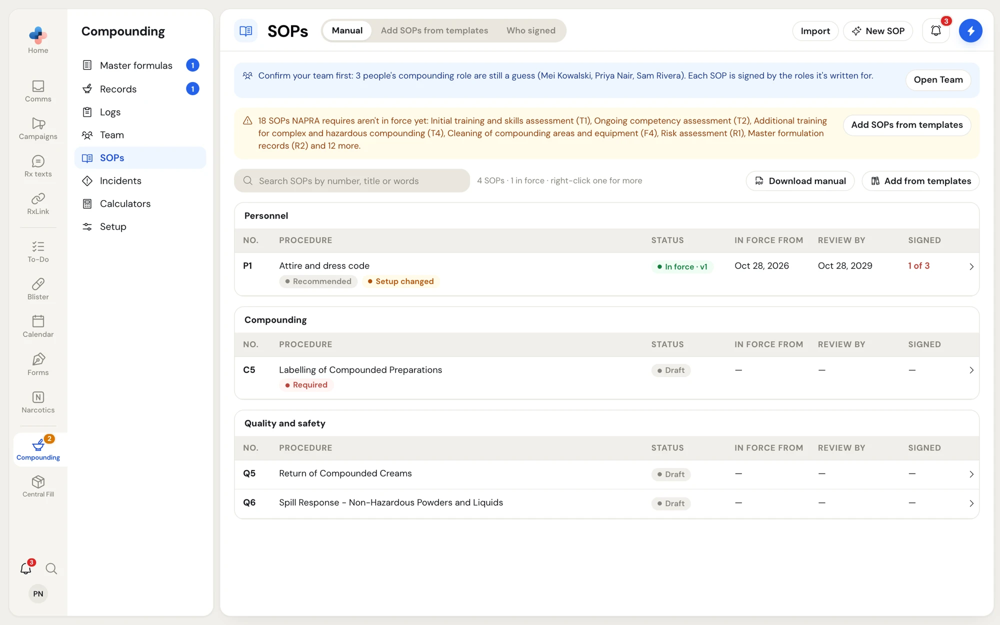
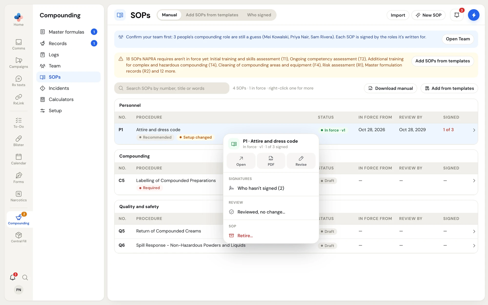
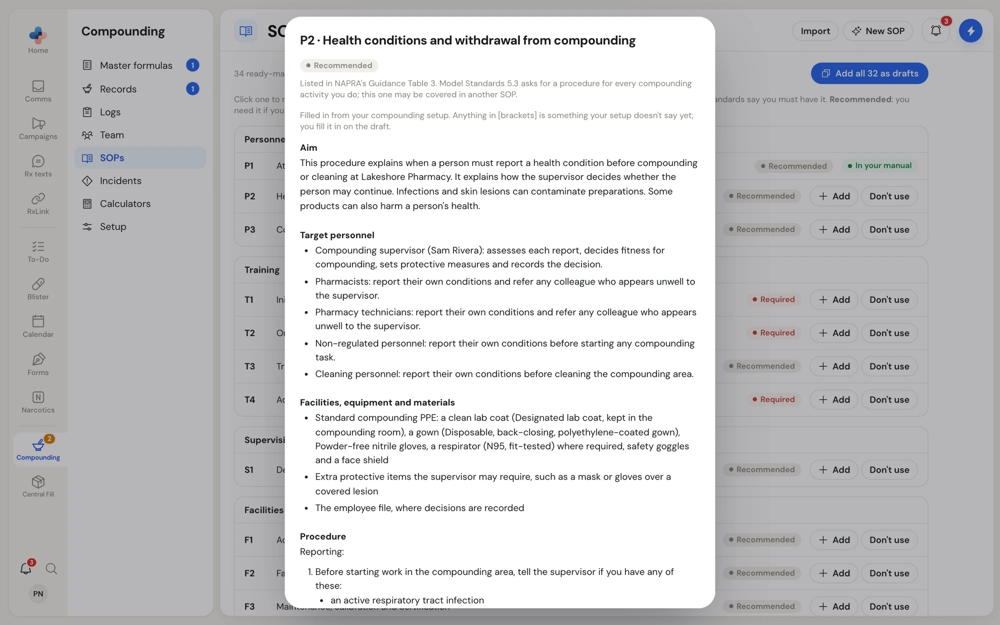
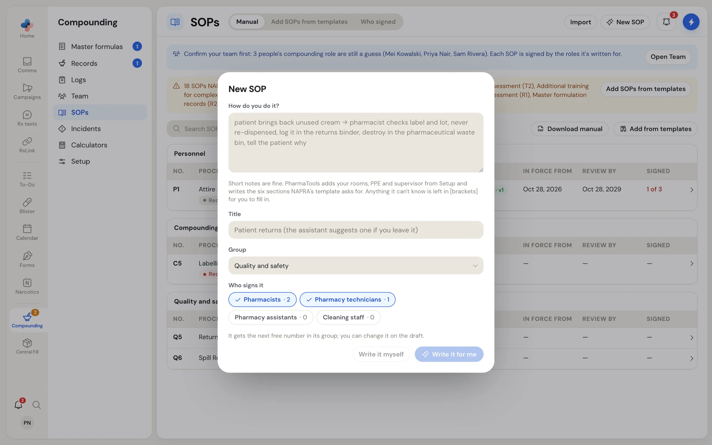
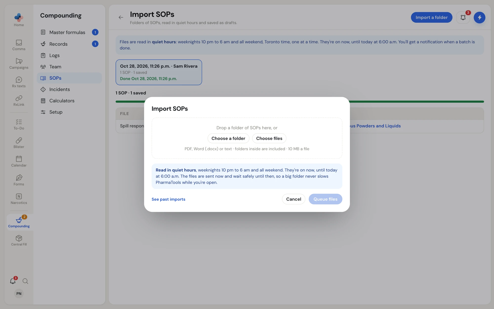
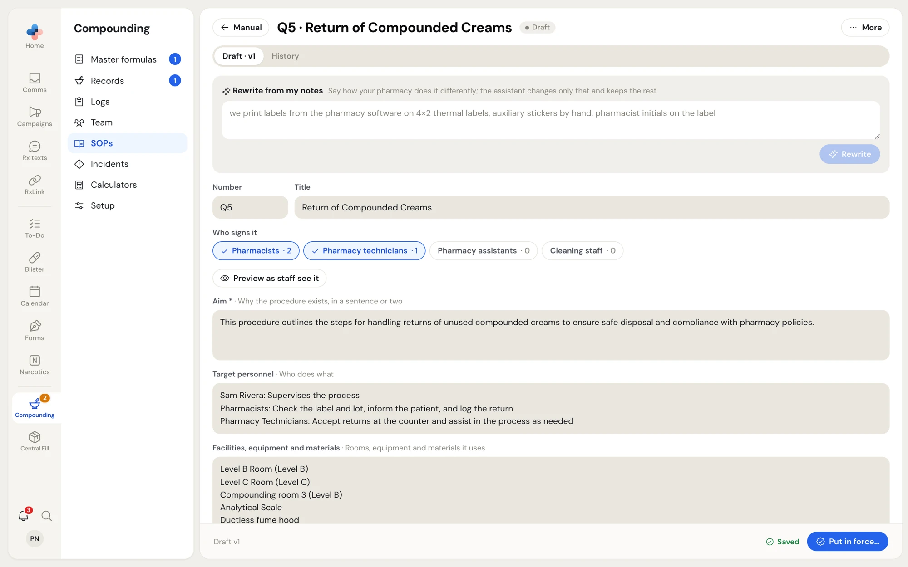
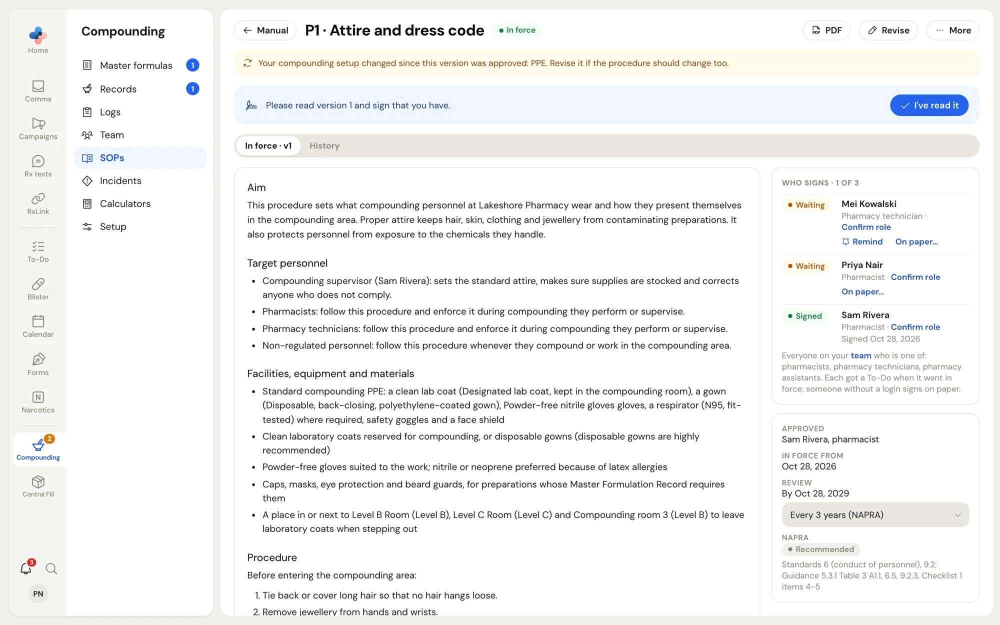
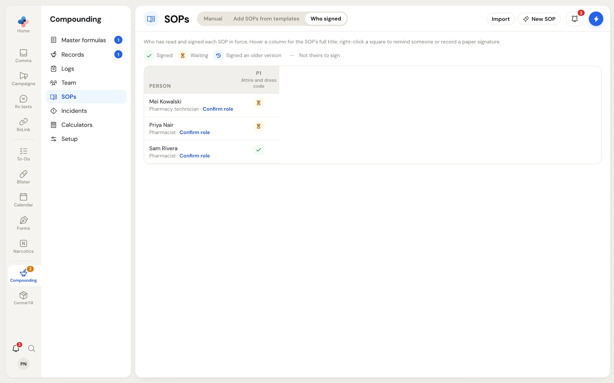

**Compounding › SOPs** is your pharmacy's manual of compounding policies and procedures. Each SOP is written in NAPRA's six sections, goes in force signed by a pharmacist, and is read and signed by everyone in the roles it is written for.

<Frame caption="Compounding › SOPs › Manual, grouped by NAPRA's sections">

</Frame>

## Who can do what

| Action | Who |
| --- | --- |
| Read SOPs in force, click **I've read it**, download the manual | Everyone |
| Add SOPs from templates, write or import SOPs, edit drafts, put an SOP in force, revise, review, retire, remind someone, record a paper signature | Pharmacist, Manager, Admin |

<Note>
Who signs an SOP depends on each person's compounding role. Confirm everyone's role in [Team & training](/compounding/training) first; the manual shows a blue note with **Open Team** while any role is still a guess.
</Note>

## Tabs

- **Manual**: the SOPs in your manual, by group, with **NO.**, **PROCEDURE**, **STATUS** (**Draft** or **In force · v1**), **IN FORCE FROM**, **REVIEW BY** and **SIGNED** (for example **1 of 3**, red while anyone is waiting). Tags flag **Required** or **Recommended** by NAPRA, **Draft open**, **Setup changed** (your compounding setup changed since this version was approved) and **Newer version available**.
- **Add SOPs from templates**: 34 ready-made SOPs written to NAPRA's list, filled in from your setup.
- **Who signed**: people against SOPs in force.

An amber note on **Manual** lists the SOPs NAPRA requires that aren't in force yet, with **Add SOPs from templates**. Search by number, title or words in the text; **Download manual** gives a PDF of every SOP in force.

### Right-click an SOP

<Frame caption="Right-click an SOP for Open, PDF, Revise, signatures, review and Retire">

</Frame>

**Open**, **PDF**, **Revise** (starts a new draft from the version in force) or **Draft** (opens the open draft), **Who hasn't signed (2)**, **Reviewed, no change…** (signs a review and sets the next review a full period from today) and **Retire…** (it leaves the manual and nobody needs to read it; its versions and history are kept).

## Three ways to add SOPs

<Tabs>
  <Tab title="From templates">
    Open **Add SOPs from templates**. Click any SOP to read it filled in from your compounding setup; anything in [brackets] is something your setup doesn't say yet.

    <Frame caption="Reading a template before adding it">
    
    </Frame>

    Click **Add** (or **Add to my manual** in the preview) to add it as a draft. **Add all 32 as drafts** adds every template that applies to you. **Don't use** asks why and marks it not used; **Use it again** brings it back.
  </Tab>
  <Tab title="Write one with the assistant">
    Click **New SOP**. Under **How do you do it?**, write a few short lines about your procedure. Give it a **Title** (or leave it for the assistant to suggest), pick the **Group** and **Who signs it** (**Pharmacists**, **Pharmacy technicians**, **Pharmacy assistants**, **Cleaning staff**; each shows how many people have that role).

    Click **Write it for me**. In about 20 seconds PharmaTools writes the six sections, adding your rooms, PPE and supervisor from Setup. **Write it myself** makes an empty SOP with that title instead. It gets the next free number in its group.

    <Frame caption="New SOP: describe the procedure and let the assistant write it">
    
    </Frame>
  </Tab>
  <Tab title="Import your own files">
    Click **Import**, then **Choose a folder** or **Choose files** (PDF, Word .docx or text, 10 MB a file; folders inside are included) and **Queue files**.

    <Frame caption="Import a folder of your own SOPs">
    
    </Frame>

    Files are read in quiet hours, weeknights 10 pm to 6 am and all weekend (Toronto time), one at a time. You get a notification when a batch is done. **Import SOPs** lists each batch and file: waiting, being read, **Saved as draft** with a link, or couldn't be read with **Retry**. Each file is sorted into NAPRA's sections in your own wording, and the draft keeps **Your original** file.
  </Tab>
</Tabs>

## Edit a draft and put it in force

Open a draft from **Manual**. The draft saves as you type (**Saved** shows at the bottom).

<Frame caption="An SOP draft: rewrite from notes, who signs it, and the six sections">

</Frame>

<Steps>
  <Step title="Adjust the text">
    Edit **Number**, **Title**, **Who signs it** and each section: **Aim**, **Target personnel**, **Facilities, equipment and materials**, **Procedure**, **Logs and competencies** and **References**. In **Procedure**, start a line with "1." for a step and "- " for a point, and indent for a sub-step.

    To change something quickly, write under **Rewrite from my notes** how your pharmacy does it differently and click **Rewrite**. The assistant changes only that and keeps the rest; **Undo the rewrite** puts it back.
  </Step>
  <Step title="Fill every blank">
    Anything left in [brackets] blocks the SOP from going in force; the draft lists what to fill in. An SOP needs at least an aim and a procedure. **Preview as staff see it** shows the reading view.
  </Step>
  <Step title="Put it in force">
    Add **What changed in this version**, then click **Put in force…**. Pick the **In force from** date (today, or an earlier day for an SOP you have used since then). The sheet names everyone who gets a To-Do to read and sign it, and anyone without a login who signs on paper. Click **Put in force, signed by you**.
  </Step>
</Steps>

## Read and sign an SOP

When an SOP you must sign goes in force, you get a To-Do. Open the SOP, read the version in force, and click **I've read it**. The page then says **You signed version 1**.

<Frame caption="An SOP in force: I've read it, who signs, approval and review">

</Frame>

The **Who signs** panel lists each person as **Waiting**, **Signed** or **Older** (signed an older version). A pharmacist can click **Remind** (their To-Do moves to today) or **On paper…** to record the day someone signed a printed copy. The panel below shows who approved it, **In force from**, the **Review** date and interval (**Every 3 years (NAPRA)** by default; longer than 3 years shows a warning) and NAPRA's basis. **History** lists every version and what happened.

## Who signed

A grid of people against every SOP in force: **Signed**, **Waiting**, **Signed an older version**, or **—** (not theirs to sign). Hover a column for the SOP's full title. Right-click a square to open the SOP or the person's training file, to **Remind … to sign**, or to **Record a paper signature…**.

<Frame caption="Who signed each SOP in force">

</Frame>

## Reviews and changes

- **Review due by …** appears when an SOP reaches its review date: revise it and put the new version in force, or use **More › Reviewed, no change…**.
- **Your compounding setup changed since this version was approved** names what changed (for example PPE). Revise the SOP if the procedure should change too.
- **PharmaTools has updated the ready-made SOP this one came from** means a template you started from has a newer version; compare it when you next revise.
