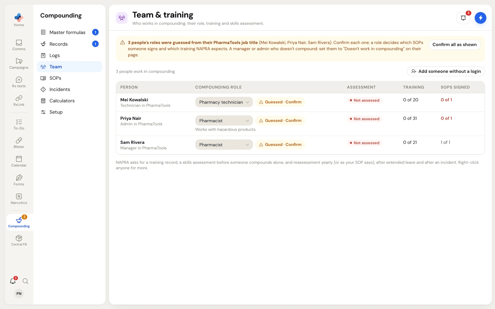
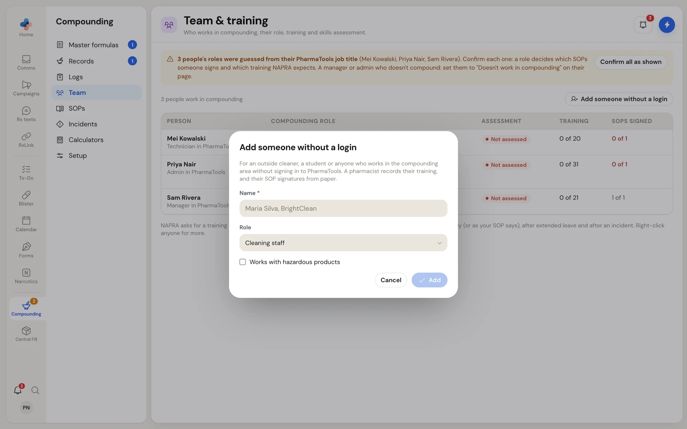
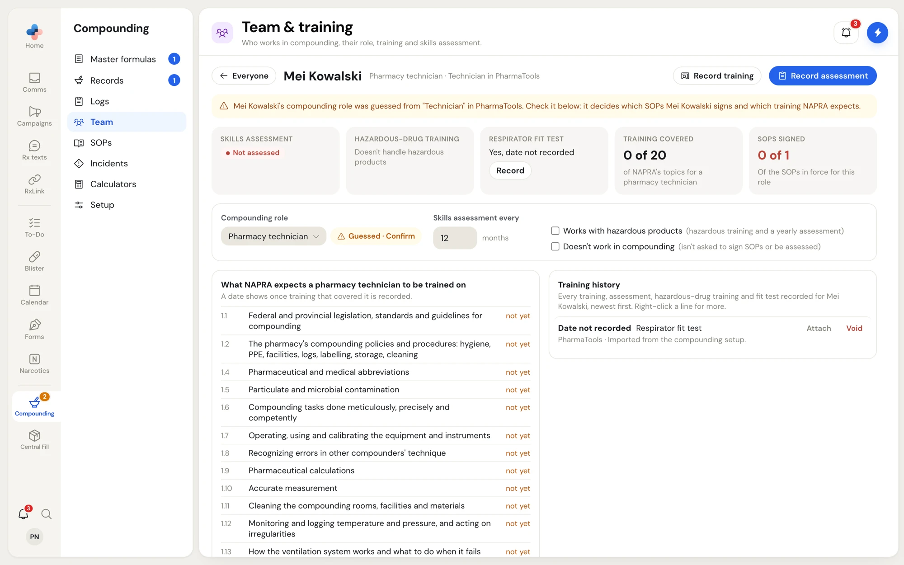
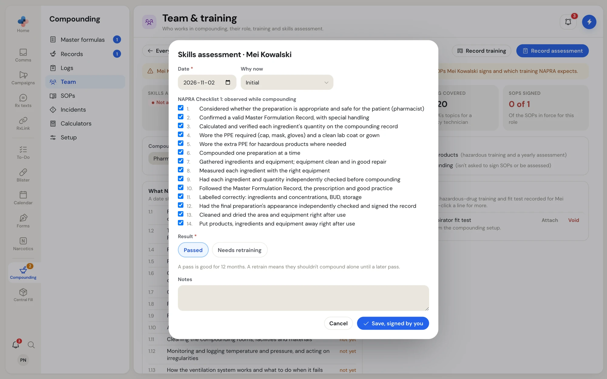

**Compounding › Team** lists everyone who works in compounding: your PharmaTools employees, plus anyone without a login such as an outside cleaner or a student. For each person it shows their compounding role, whether their skills assessment is current, how much of NAPRA's training list for their role they have covered, and the SOPs they have signed.

<Frame caption="Compounding › Team: roles, assessments, training and SOPs signed">

</Frame>

## Who can do what

Everyone can open the team list and each person's training file. A pharmacist, manager or admin confirms or changes roles, records training and assessments, adds people without a login and attaches files.

## Confirm each person's compounding role

The compounding role decides which SOPs someone signs and which training NAPRA expects. PharmaTools guesses it from each employee's PharmaTools job title (for example **Technician in PharmaTools** becomes **Pharmacy technician**) and marks it **Guessed · Confirm**.

<Steps>
  <Step title="Check the role">
    The roles are **Pharmacist**, **Pharmacy technician**, **Pharmacy assistant** (not regulated: no licence, works under supervision) and **Cleaning staff**. Pick another from the dropdown if the guess is wrong.
  </Step>
  <Step title="Confirm it">
    Click **Guessed · Confirm** on the row, or **Confirm all as shown** in the amber note to confirm every guess at once.
  </Step>
  <Step title="Take out anyone who doesn't compound">
    A manager or admin who doesn't compound: open their page and tick **Doesn't work in compounding**. They aren't asked to sign SOPs or be assessed.
  </Step>
</Steps>

**Works with hazardous products** adds hazardous-drug training and a yearly assessment for that person.

## Assessment statuses

| Status | Meaning |
| --- | --- |
| **Current** | A passed skills assessment within the interval |
| **Due soon** | The reassessment is coming up |
| **Overdue** | The interval has passed |
| **Not assessed** | No skills assessment recorded |
| **Retraining** | The last assessment was **Needs retraining** |

A compounder who isn't **Current** gets a bench warning when they start a compounding record (unless a manager switched that warning off in **Settings › Compounding**).

## Right-click a person

<Frame caption="Right-click a person for quick actions">

</Frame>

**Open**, **Training**, **Assess**, **Confirm: Pharmacy technician** (the guessed role), **Change role**, **Works with hazardous products**, **SOPs not signed yet (1)**, and **Doesn't work in compounding** or **Works in compounding again**.

## Add someone without a login

Click **Add someone without a login**. Enter the **Name** (for example "Maria Silva, BrightClean"), pick the **Role** and tick **Works with hazardous products** if needed, then **Add**. A pharmacist records their training here and their SOP signatures from paper on each SOP.

<Frame caption="Add someone without a login">

</Frame>

## One person's training file

Click a person to open their file. **Everyone** goes back to the list.

<Frame caption="A training file: status cards, settings, and NAPRA's topics for the role">

</Frame>

- Cards at the top: **Skills assessment**, **Hazardous-drug training**, **Respirator fit test**, **Training covered** (for example **0 of 20** of NAPRA's topics for a pharmacy technician) and **SOPs signed**.
- **Compounding role**, **Skills assessment every** (1 to 36 months), **Works with hazardous products** and **Doesn't work in compounding**.
- **What NAPRA expects a … to be trained on**: each topic from NAPRA's training table for the role (cleaning staff have their own table), with the date it was covered or **not yet**.
- **Training history**: every line, signed by the pharmacist who recorded it. Right-click a line for **File**, **Attach** or **Replace** a certificate, **Copy line** and **Void line…** (with a reason).

### Record training

Click **Record training**. Pick the **Date**, tick what the training covered from the topic list, add notes, and click **Save, signed by you**. The topics covered get that date.

### Record a skills assessment

Click **Record assessment**. Pick the **Date** and **Why now** (**Initial**, **Periodic**, **After extended leave**, **After an incident** or **Contamination found**). Under **NAPRA Checklist 1: observed while compounding**, untick any step that wasn't met. Choose **Passed** or **Needs retraining** and click **Save, signed by you**.

<Frame caption="A skills assessment against NAPRA Checklist 1">

</Frame>

A pass is good for the person's interval (12 months by default). A retrain means they shouldn't compound alone until a later pass. Passing with steps not met asks you to say why in the notes.

### Hazardous-drug training and fit tests

On the **Hazardous-drug training** and **Respirator fit test** cards, click **Record**. For a fit test, note the respirator model and size, and attach the fit-test report after saving.
