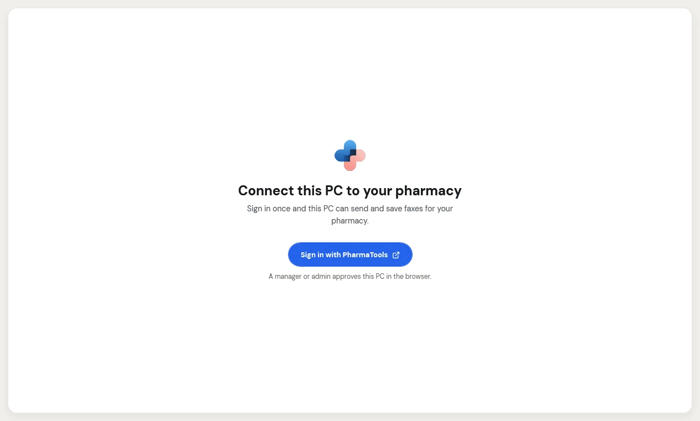
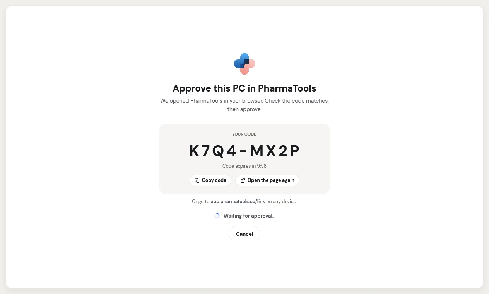
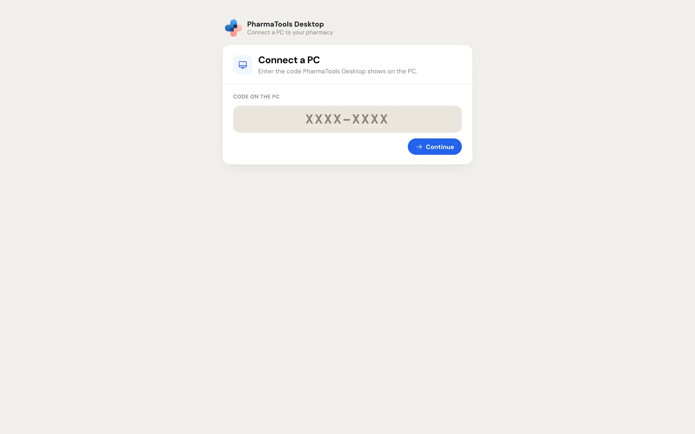
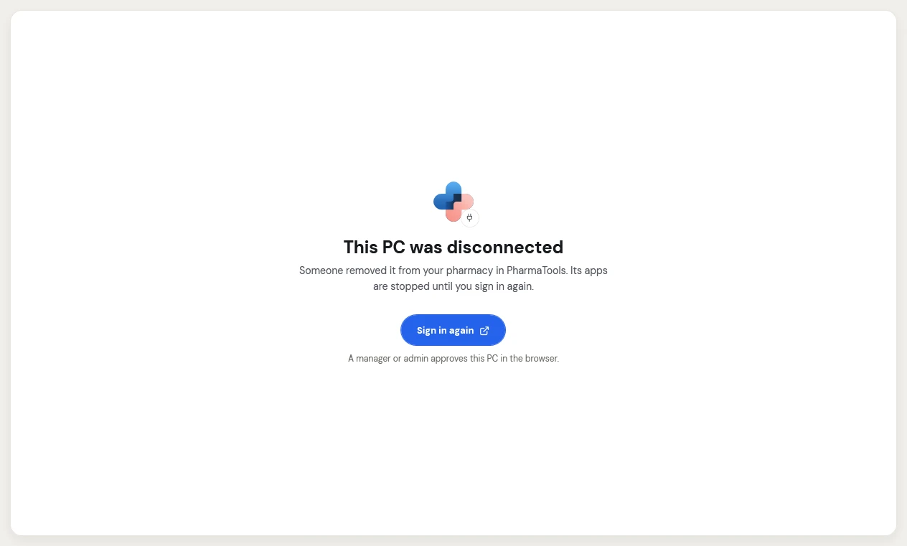

You install PharmaTools Desktop once on each PC that should send or save faxes. Then you connect the PC to your pharmacy: the app shows a code, and a manager or an admin approves it in PharmaTools. The PC then belongs to the pharmacy, not to the person who approved it.

## Install it

<Steps>
  <Step title="Download the installer">
    In the PharmaTools web app, open **Settings › Desktop app** and click **Download** beside **PharmaTools Desktop for Windows**. Only managers and admins see this page; they can download it and copy it to the PC.
  </Step>
  <Step title="Run it on the PC">
    Double-click the file, accept the licence and click **Install**. Windows asks for an administrator once.
  </Step>
  <Step title="Open the app">
    On the last page, leave **Open PharmaTools Desktop** ticked and click **Finish**.
  </Step>
</Steps>

<Tip>
If Windows shows **Windows protected your PC**, check that the publisher shown is PharmaTools, then click **More info** and **Run anyway**. If it says **Unknown publisher**, don't install the file: it isn't a PharmaTools release.
</Tip>

After that the app updates itself. Nobody needs to reinstall it for a new version.

## Connect the PC to your pharmacy

You need two people, or one person who is a manager or admin: someone at the PC, and a manager or admin signed in to PharmaTools.

<Steps>
  <Step title="Start on the PC">
    The app opens on **Connect this PC to your pharmacy**. Click **Sign in with PharmaTools**.

    <Frame caption="The first screen of PharmaTools Desktop">
      
    </Frame>
  </Step>
  <Step title="Note the code">
    The app shows **Approve this PC in PharmaTools** with **YOUR CODE**, such as `K7Q4-MX2P`, and opens PharmaTools in the browser. The code expires in 10 minutes. **Copy code** copies it, and **Open the page again** reopens the browser page. You can also go to `app.pharmatools.ca/link` on any device.

    <Frame caption="The code to approve, with the time left">
      
    </Frame>
  </Step>
  <Step title="Approve it in PharmaTools">
    A manager or admin signs in to PharmaTools in that browser (if they aren't already). The page **Connect a PC** asks for the **Code on the PC**. Type it and click **Continue**.

    <Frame caption="The PharmaTools page that approves a PC">
      
    </Frame>
  </Step>
  <Step title="Check and connect">
    **Connect this PC?** shows what the PC reported (**PC name**, **Windows**, **App version**) and which **Pharmacy** and **Fax number** it will work for. Check that the code matches the one on the PC, then click **Connect**. **Don't connect** refuses the request.
  </Step>
  <Step title="Confirm on the PC">
    The PC shows **This PC is now linked to** your pharmacy and asks **Is this your pharmacy?** Click **Yes, this is my pharmacy**. If you don't know the pharmacy, click **No, sign out**: someone may have tricked a manager into approving this PC. Its apps start only after someone at the PC says yes.
  </Step>
</Steps>

The PC now shows in **Settings › Desktop app › Connected PCs**.

### Approving from another network

<Warning>
Only connect a PC you're sitting at. If the PC isn't on the same network as you, PharmaTools says so, and you must type the code from the PC's screen before **Connect** works.
</Warning>

When you approve a PC from another network, PharmaTools shows a 6-digit **Code for the PC** after **Connect**. Type it on that PC: the PC asks for **CODE FROM THE PHARMATOOLS PAGE**. The code shows only there and only once. Never read it to anyone; nobody from PharmaTools asks you for it.

### If the code doesn't work

| What you see | What to do |
| --- | --- |
| **This code has expired** | Codes work for 10 minutes, once. On the PC, click **Get a new code** (or start again with **Sign in with PharmaTools**) and enter the new code. |
| **This code was already used** | The PC that showed it is connected, or the code was answered in another tab. To connect another PC, enter the code it shows. |
| **Not connected** | The request was declined, or the code was typed wrong too many times on the PC. Start again on the PC. |
| **That code isn't right** (on the PC) | Check the 6-digit code on the PharmaTools page and type it again. |
| **A manager or an admin types the code.** | You aren't a manager or admin. Ask one to approve the PC, or click **Sign in as someone else**. |

## Turn on an add-on

<Steps>
  <Step title="Pick the add-on">
    In the app, click the add-on under **Apps**. An add-on marked **Not in your plan** shows what it does, **How it works**, and **Add to plan**, which opens **Plan & modules** in PharmaTools. Only a manager or admin can add apps.
  </Step>
  <Step title="Fill in its settings">
    Each add-on asks for what it needs, such as a folder. Until then it shows what is missing, for example **Choose the folder to watch to finish setting up.**
  </Step>
  <Step title="Check and save">
    Click **Check it works** to run a quick check without sending a real fax. Then click **Save**. If saving needs a Windows administrator, the button says **Save (needs administrator)** and Windows asks for one.
  </Step>
  <Step title="Start it">
    Click **Start** at the top right. The add-on shows **Running since** the time.
  </Step>
</Steps>

Each add-on keeps running after the window closes and starts again when Windows starts. Click **Stop** to stop it on this PC.

## Sign a PC out

- **On the PC**: **Account › Sign out of this PC**, then **Sign out**. Its apps stop and it leaves your pharmacy until someone signs in again. Other PCs aren't affected.
- **In PharmaTools**: **Settings › Desktop app**, then **Disconnect** on the PC's row. The PC shows **This PC was disconnected** and its apps stop until someone signs in again.

<Frame caption="A PC that was disconnected in PharmaTools">
  
</Frame>

Signing a PC back in after it was signed in before needs a Windows administrator: the button says **Sign in again (needs administrator)**.

## Uninstall

In Windows, open **Settings › Apps › Installed apps**, find **PharmaTools Desktop** and click **Uninstall**. When a PC leaves the pharmacy for good, disconnect it in **Settings › Desktop app** first.
