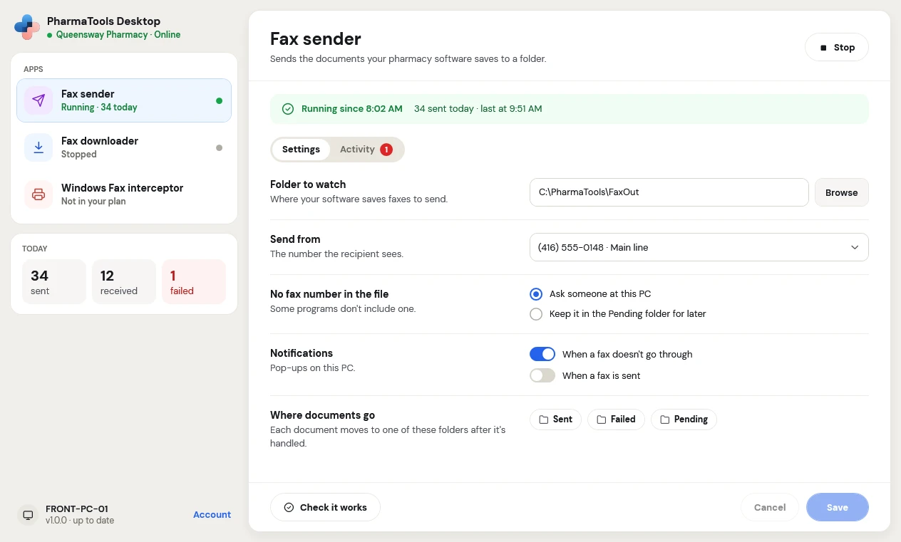
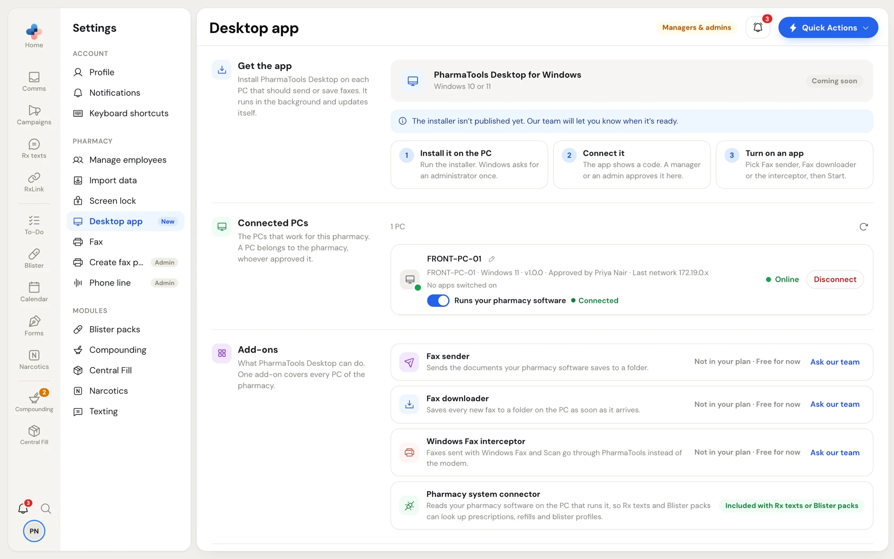

**PharmaTools Desktop** is a Windows app you install on the pharmacy's PCs. It connects each PC to your pharmacy's PharmaTools account and runs small apps on it, called **add-ons**. It runs in the background, starts with Windows and updates itself.

<Note>
The installer is published from **Settings › Desktop app**. Until it is, that page shows **Coming soon** and **The installer isn't published yet. Our team will let you know when it's ready.**
</Note>

## What it can do

| Add-on | What it does | Guide |
| --- | --- | --- |
| **Fax sender** | Sends the documents your pharmacy software saves to a folder. It reads the fax number from each document and faxes it through PharmaTools. | [Send faxes from Windows](/desktop/send-faxes-from-windows#fax-sender) |
| **Windows Fax interceptor** | Faxes sent with Windows Fax and Scan, from any program or Windows account, go through PharmaTools instead of the modem. Windows still marks them sent or failed. | [Send faxes from Windows](/desktop/send-faxes-from-windows#windows-fax-interceptor) |
| **Fax downloader** | Saves every new fax that arrives on your PharmaTools numbers to a folder on the PC, as a PDF, as soon as it arrives. | [Save incoming faxes](/desktop/save-incoming-faxes) |
| **Pharmacy system connector** | Reads your pharmacy software on the PC that runs it, so **Rx texts** and **Blister packs** can look up prescriptions, refills and blister profiles. Included with Rx texts or Blister packs. | [Connect your pharmacy software](/desktop/pharmacy-software-connection) |

One add-on covers every PC of the pharmacy. Your pharmacy gets an add-on in **Settings › Plan & modules**, or PharmaTools adds it for you. An add-on that isn't in your plan shows **Not in your plan** on the PC and in **Settings › Desktop app**.

## What you need

- A PC with **Windows 10 (version 2004 or later) or Windows 11, 64-bit**.
- A **Windows administrator** once, to install it. Some settings changes on the PC ask for an administrator again.
- A **manager or admin** at your pharmacy, signed in to PharmaTools, to approve the PC.
- An internet connection. Nothing else is needed: the app brings everything it uses.

## The app on the PC

<Frame caption="PharmaTools Desktop on a pharmacy PC: the add-ons on the left, the selected one on the right">
  
</Frame>

- **Top left**: your pharmacy's name and whether the PC is **Online**.
- **Apps**: each add-on with its state: **Running** (with how many it handled today), **Stopped**, **Needs attention** or **Not in your plan**. Click one to open it.
- **Today**: faxes **sent**, **received** and **failed** on this PC today.
- **Bottom left**: the PC's name, the app version and whether it is up to date, and **Account**.
- **Right side**: the selected add-on with **Start** or **Stop** at the top right, its status, and the tabs **Settings** and **Activity**.

Open the app from the Start menu (**PharmaTools Desktop**) or from its icon in the Windows notification area. Closing the window doesn't stop the add-ons: they keep running in the background.

### The Account menu

Click **Account** at the bottom left:

- **Check for updates**: looks for a new version now. The app also updates itself on its own.
- **Open logs**: opens the folder of log files, for PharmaTools support. On some PCs it says **Open logs (needs administrator)**.
- **Sign out of this PC**: stops every add-on on this PC and disconnects it from your pharmacy. Other PCs aren't affected.

## Manage your PCs in PharmaTools

Managers and admins see **Settings › Desktop app** in the PharmaTools web app.

<Frame caption="Settings › Desktop app: the installer, your connected PCs and the add-ons">
  
</Frame>

| Section | What it has |
| --- | --- |
| **Get the app** | **PharmaTools Desktop for Windows** with the version, size and **Download**, and three steps: **Install it on the PC**, **Connect it**, **Turn on an app** |
| **Connected PCs** | Every PC that works for your pharmacy: its name, Windows version, app version, who approved it, its last network, which add-ons it runs and their state, and **Online** or when it was last seen. A PC belongs to the pharmacy, whoever approved it. |
| **Add-ons** | Each add-on and whether your pharmacy has it: **On · in your plan**, **On · added by PharmaTools**, or **Not in your plan** with **Add in Plan & modules** or **Ask our team** |

On a PC's row:

- Click the pencil beside its name to **rename** it. Press Escape to cancel.
- Click **Disconnect** to remove it from your pharmacy. It stops sending and saving faxes right away. To use it again, connect it with a new code from the PC.
- If something is wrong on the PC, the row says what, in plain words, for example **The folder this app uses is missing. Choose it again in the app on the PC.** See [Troubleshooting](/desktop/troubleshooting).

Click the refresh arrow at the top right of **Connected PCs** to reload the list.

<CardGroup cols={2}>
  <Card title="Install and connect" icon="download" href="/desktop/install-and-connect">
    Put PharmaTools Desktop on a PC and approve it.
  </Card>
  <Card title="Troubleshooting" icon="life-buoy" href="/desktop/troubleshooting">
    What the messages mean and what to do.
  </Card>
</CardGroup>
