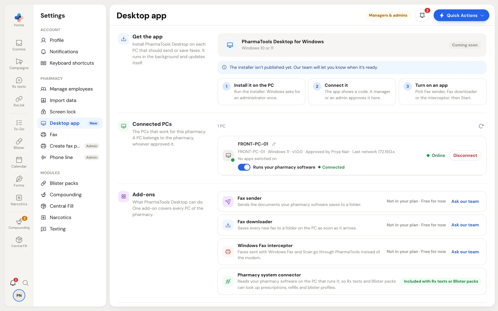

**Rx texts** and **Blister packs** look things up in your pharmacy software: a prescription when someone scans an Rx, the refills that are due, a patient's phone numbers, the patients and medications on blister packs. They do it through the **Pharmacy system connector**, a part of PharmaTools Desktop that runs on the one PC where your pharmacy software keeps its database.

When someone scans an Rx in Rx texts, PharmaTools asks that PC, and the PC looks the Rx up in your pharmacy software and answers.

<Info>
The connector isn't sold on its own. It is included with Rx texts or Blister packs, and runs while your pharmacy has one of them.
</Info>

## What it reads, and what it never sends

- It **only reads**. It never changes anything in your pharmacy software.
- It reads only what Rx texts and Blister packs need: prescriptions, refills due, patients' phone numbers, and blister pack patients and medications.
- **Health card numbers, notes, allergies and PINs never leave the PC.**
- PharmaTools never sends its own database queries to the PC: each lookup is one of a fixed list built into the app.

## Set it up

You need PharmaTools Desktop installed and connected on the PC that runs your pharmacy software's database (see [Install and connect](/desktop/install-and-connect)). That is usually the pharmacy's main or server PC.

<Steps>
  <Step title="Choose the PC in PharmaTools">
    A manager or admin opens **Settings › Desktop app** in the PharmaTools web app. Under **Connected PCs**, on the PC that runs your pharmacy software, turn on the switch labelled **Runs** and your pharmacy software's name. Confirm with the **Make it the** … **PC** button. Only one PC can have it on: turning it on for one PC turns it off for the others.
  </Step>
  <Step title="Start it on the PC">
    On that PC, open PharmaTools Desktop and click **Pharmacy system connector**. It finds your pharmacy software's database by itself. If it can't, click **Can't find** … **? Set it by hand** and enter the database details; **Find it automatically instead** goes back. Ask PharmaTools support if you don't know them.
  </Step>
  <Step title="Test and start">
    Click **Test connection**. It connects to your pharmacy software from this PC and checks its tables; nothing is sent to PharmaTools. Then click **Save** and **Start**.
  </Step>
</Steps>

Back in **Settings › Desktop app**, the PC's row now shows **Connected** beside the switch.

<Frame caption="Settings › Desktop app: the PC that runs the pharmacy software, Connected">
  
</Frame>

## When the connection is down

Rx texts and Blister packs show an amber banner at the top when they can't read your pharmacy software:

| Banner | What it means | What to do |
| --- | --- | --- |
| Your pharmacy software **isn't reachable** | The PC is off, PharmaTools Desktop isn't running on it, or the connector is stopped | Check that the PC is on and that the **Pharmacy system connector** is **Running** on it. Then click **Check Again**. |
| **Choose the PC that runs** your pharmacy software **in Settings → Desktop app** | No PC has the switch on | A manager or admin turns it on for the right PC. The link in the banner opens the page. |
| Your pharmacy software **changed** | An update to your pharmacy software changed its database, so some features are off until PharmaTools Desktop is updated | Nothing. The app updates itself. If it lasts, contact PharmaTools support. |

In **Settings › Desktop app**, the PC's row also says **Not reachable since** a time, or that some features are off after a change.

While the banner shows, the parts of Rx texts and Blister packs that need your pharmacy software wait; the rest keeps working. Steps that need the PC show **Try Again**.

<Note>
On the PC, a stopped connector says **Stopped. Rx texts can't look up prescriptions until you start it again.** If the PC isn't the one chosen in PharmaTools, it asks you to set it as that PC in **Settings › Desktop app**.
</Note>

<CardGroup cols={2}>
  <Card title="Rx texts" icon="message-square" href="/rx-texts/overview">
    Texts to patients when their Rx is ready.
  </Card>
  <Card title="Blister packs" icon="pill" href="/blister-packs/overview">
    Blister pack billing, preparation and checks.
  </Card>
</CardGroup>
