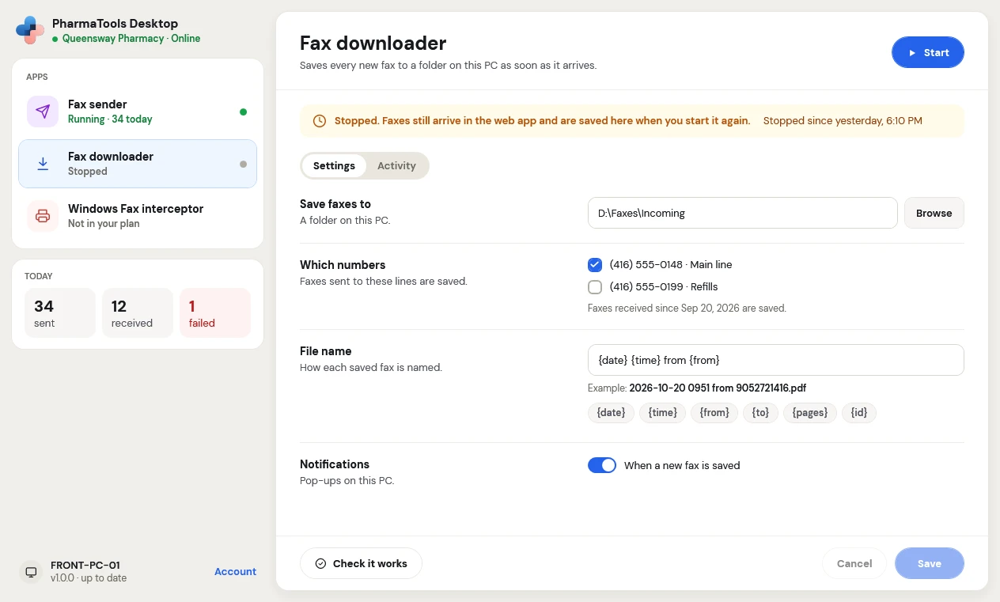

The **Fax downloader** add-on saves every fax that arrives on your PharmaTools numbers to a folder on the PC, as a PDF, as soon as it arrives. Use it when your pharmacy software or your team picks up faxes from a folder.

Faxes still arrive in **Comms** in the PharmaTools web app, as always. The Fax downloader saves a copy on the PC as well.

<Frame caption="Fax downloader settings, stopped">
  
</Frame>

## Set it up

In the app, click **Fax downloader**.

| Setting | What to choose |
| --- | --- |
| **Save faxes to** | A folder on this PC. Click **Browse** to pick it. Use a folder on the PC's own drive, outside Windows and Program Files. |
| **Which numbers** | Tick the numbers whose faxes this PC saves. Pick at least one. The line under them says from when faxes are saved, for example **Faxes received since Sep 20, 2026 are saved.** |
| **File name** | How each saved fax is named. Build it from the parts below the box; **Example** shows the result. |
| **Notifications** | **When a new fax is saved**: a pop-up on this PC |

### File name parts

| Part | What it becomes |
| --- | --- |
| `{date}` | The date the fax arrived, like `2026-10-20` |
| `{time}` | The time it arrived (Toronto time), like `09.51.00` |
| `{from}` | The sender's fax number, like `905-272-1416` |
| `{to}` | Your number it arrived on, like `416-555-0148` |
| `{pages}` | The number of pages |
| `{id}` | The fax's PharmaTools ID |

For example, `{date} {time} from {from}` names a fax `2026-10-20 09.51.00 from 905-272-1416.pdf`. Every name ends in `.pdf`; if a file with the same name is already there, a number is added. File names can't contain `\ / : * ? " < > |`.

Click **Check it works**, then **Save** and **Start**.

## While it runs

The status says when it started and how many faxes it saved today. The **Activity** tab lists each saved fax. Faxes received while the Fax downloader was stopped are saved when you start it again: the status says **Stopped. Faxes still arrive in the web app and are saved here when you start it again.**

If the PC is offline, faxes wait until it is back.

<CardGroup cols={2}>
  <Card title="Send faxes from Windows" icon="send" href="/desktop/send-faxes-from-windows">
    The Windows Fax interceptor and the Fax sender.
  </Card>
  <Card title="Troubleshooting" icon="life-buoy" href="/desktop/troubleshooting">
    What the messages mean and what to do.
  </Card>
</CardGroup>
