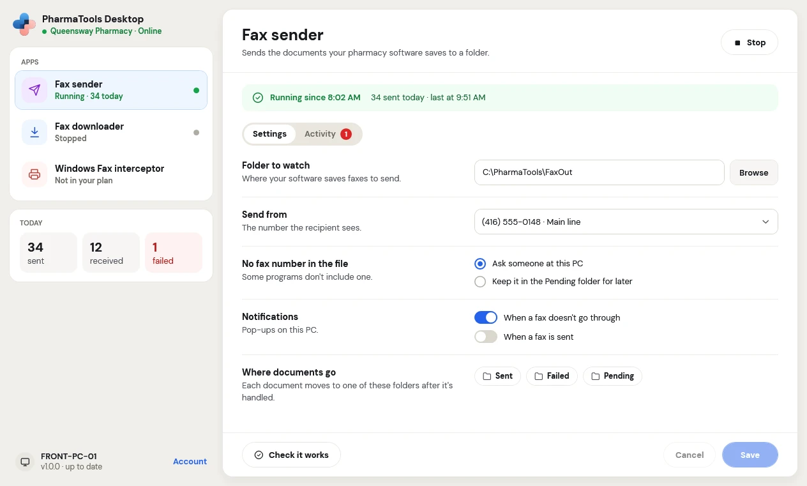
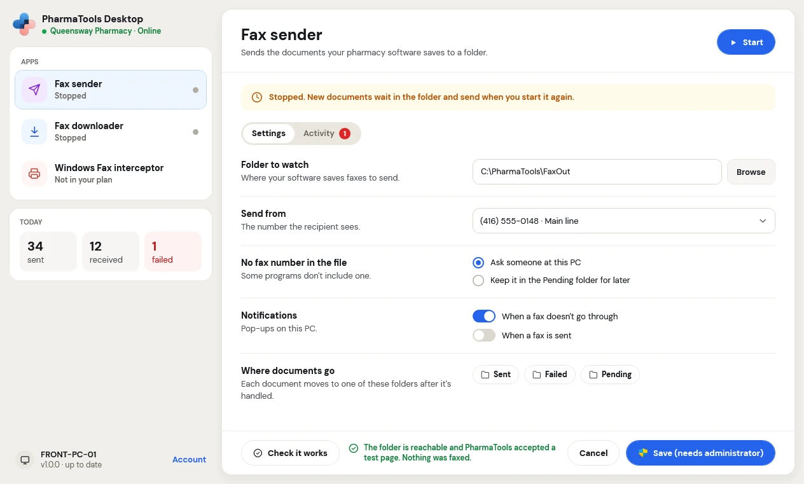
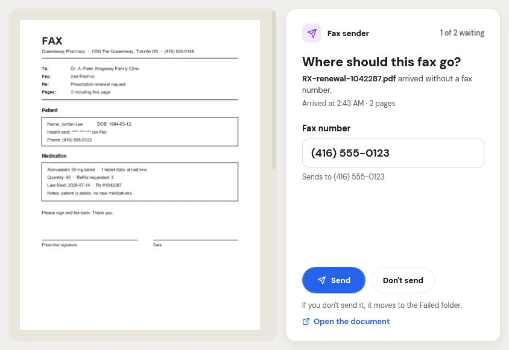
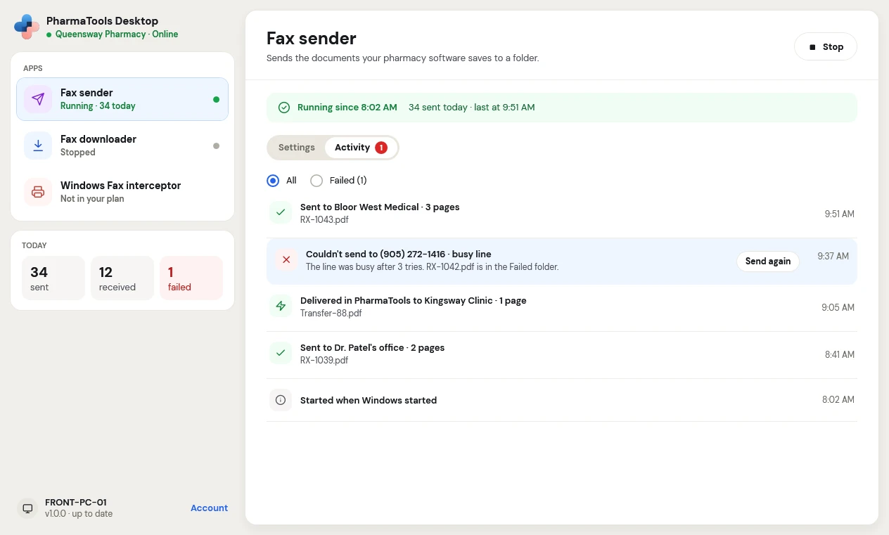

PharmaTools Desktop has two ways to send faxes from a pharmacy PC without opening PharmaTools in a browser. Both send through your pharmacy's PharmaTools fax number.

| | **Windows Fax interceptor** | **Fax sender** |
| --- | --- | --- |
| Use it when | You or a program fax with the Windows fax printer (**Windows Fax and Scan**) | Your pharmacy software saves faxes as files in a folder |
| What you do | Print to the Windows fax printer, the same as today | Nothing: the software saves the file and PharmaTools faxes it |
| Where the fax number comes from | What you type in Windows | The document. If it has none, someone at the PC is asked. |

Both need the add-on in your pharmacy's plan and the PC connected (see [Install and connect](/desktop/install-and-connect)).

## Windows Fax interceptor

When the interceptor is running, every fax sent through the Windows fax service on that PC, from any program and any Windows account, goes through PharmaTools over the internet instead of the phone line. Windows Fax and Scan still shows each fax as sent or failed, like before.

**How it works**:

1. Any program prints to the Windows Fax printer, the same as today.
2. PharmaTools sends the fax over the internet instead of the phone line.
3. Windows Fax and Scan shows it as sent or failed, like before.

### Set it up

<Steps>
  <Step title="Turn on Windows Fax and Scan">
    The interceptor uses the fax service built into Windows. If it isn't installed, the app says **Windows Fax isn't set up on this PC. Turn on Windows Fax and Scan, then start it again.** Ask whoever looks after the PC to add **Windows Fax and Scan** in Windows' optional features.
  </Step>
  <Step title="Choose the number">
    In the app, click **Windows Fax interceptor**. Under **Send from**, pick the PharmaTools number the recipient sees.
  </Step>
  <Step title="Choose the pop-ups">
    Under **Notifications**, choose **When a fax doesn't go through** and **When a fax is sent**.
  </Step>
  <Step title="Save and start">
    Click **Save**, then **Start**. Setting up Windows Fax can take a minute the first time.
  </Step>
</Steps>

### Send a fax

Send it the way you always do: print to the fax printer from your program, or use **Windows Fax and Scan › New Fax**. The fax goes through PharmaTools. Its result shows in Windows Fax and Scan and on the interceptor's **Activity** tab.

If a fax fails, send it again from Windows Fax and Scan. The interceptor's activity doesn't offer **Send again** for Windows faxes, because Windows has already marked that fax failed.

<Warning>
While the interceptor is on, a fax sent when the PC is offline, isn't connected, or the PharmaTools Desktop service is stopped fails straight away in Windows with a message. It never waits in the Outbox. Send it again once the problem is fixed.
</Warning>

### Stop it

Click **Stop**. Windows Fax goes back to the fax device it used before. If the PC has no fax modem, faxes sent from Windows fail until you start the interceptor again; the app says **Stopped. Faxes sent from Windows fail until you start it again.**

## Fax sender

The Fax sender watches one folder on the PC. When your pharmacy software saves a document there, PharmaTools reads the fax number in the document and faxes it. It handles PDF, Word (`.doc`, `.docx`) and RTF documents, and the fax files some pharmacy software saves.

<Frame caption="Fax sender settings">
  
</Frame>

### Settings

| Setting | What to choose |
| --- | --- |
| **Folder to watch** | Where your software saves faxes to send. Click **Browse** to pick it. Use a folder on the PC's own drive, outside Windows and Program Files. |
| **Send from** | The number the recipient sees |
| **No fax number in the file** | Some programs don't include one. **Ask someone at this PC** shows a window asking for the number. **Keep it in the Pending folder for later** keeps the document there until someone sends it. |
| **Notifications** | Pop-ups on this PC: **When a fax doesn't go through**, **When a fax is sent** |
| **Where documents go** | Each document moves to one of these folders after it's handled. Click **Sent**, **Failed** or **Pending** to open the folder. |

Click **Check it works** to make sure the folder is reachable and PharmaTools accepts a test page. Nothing is faxed: it says **The folder is reachable and PharmaTools accepted a test page. Nothing was faxed.** Then click **Save** and **Start**.

<Frame caption="Saving settings that need a Windows administrator">
  
</Frame>

If the button says **Save (needs administrator)**, Windows asks for an administrator, then saves. If the request is cancelled, nothing is saved and your changes stay on screen.

### When a document has no fax number

With **Ask someone at this PC**, a window opens beside a preview of the document: **Where should this fax go?**

<Frame caption="The Fax sender asks for a fax number">
  
</Frame>

- Type the **Fax number**. North American numbers, or + and the country code for others. The line under it shows **Sends to** the number as PharmaTools reads it.
- Click **Send** to fax it, or **Don't send**. If you don't send it, it moves to the **Failed** folder.
- **Open the document** opens it in its own program to check it.
- The top right shows how many documents are waiting, for example **1 of 2 waiting**.

### Activity

The **Activity** tab lists what the Fax sender did today: each fax sent, with the recipient and pages, faxes **Delivered in PharmaTools** directly to another PharmaTools pharmacy, faxes that couldn't be sent and why, and when it started. Choose **All** or **Failed**. A red number on the tab counts the failed ones.

<Frame caption="The Fax sender's Activity tab">
  
</Frame>

On a failed fax, click **Send again**. The document is also in the **Failed** folder.

### Stopping the Fax sender

Click **Stop**. New documents wait in the folder and send when you start it again.

<CardGroup cols={2}>
  <Card title="Save incoming faxes" icon="hard-drive-download" href="/desktop/save-incoming-faxes">
    Save every new fax to a folder on the PC.
  </Card>
  <Card title="Troubleshooting" icon="life-buoy" href="/desktop/troubleshooting">
    What the messages mean and what to do.
  </Card>
</CardGroup>
