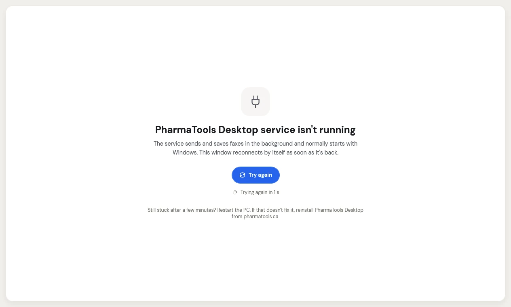

## Check a PC's status

- **On the PC**: open PharmaTools Desktop. The top left says whether the PC is **Online**. Each add-on under **Apps** shows **Running**, **Stopped**, **Needs attention** or **Not in your plan**. Click an add-on for its status line and its **Activity** tab.
- **In PharmaTools**: managers and admins open **Settings › Desktop app**. Each PC shows **Online** or when it was **Last seen**, the add-ons it runs, and a plain sentence when something is wrong.

## The service isn't running

<Frame caption="The app can't reach the PharmaTools Desktop service">
  
</Frame>

PharmaTools Desktop has two parts: the window you see, and a Windows service that sends and saves faxes in the background and starts with Windows. If the window says **PharmaTools Desktop service isn't running**, it reconnects by itself as soon as the service is back. Click **Try again** to check now.

Still stuck after a few minutes? Restart the PC. If that doesn't fix it, reinstall PharmaTools Desktop from **Settings › Desktop app**. Your settings and the PC's connection are kept.

## Messages in Settings › Desktop app

| Message on the PC's row | What to do |
| --- | --- |
| **The folder this app uses is missing. Choose it again in the app on the PC.** | Open the add-on on the PC and pick the folder again with **Browse**. |
| **The folder this app uses isn't allowed. Choose a folder on the PC's own drive in the app there.** | Pick a folder on the PC's own drive, outside Windows and Program Files. Shortcuts to other folders aren't allowed. |
| **The app can't open its folder. Check the folder's permissions on the PC.** | Ask whoever looks after the PC to give the folder normal permissions, or pick another folder. |
| **The PC's drive is full. Free up some space on it.** | Free up space, then start the add-on again. |
| **This PC can't reach PharmaTools. Check its internet connection.** | Check the PC's internet. Faxes wait until it is back. |
| **This add-on isn't in your plan, so it stopped. Add it in Plan & modules.** | A manager or admin adds it in **Settings › Plan & modules**, or asks PharmaTools. |
| **This PC isn't connected any more. Connect it again from the app on the PC.** | Connect it again (see [Install and connect](/desktop/install-and-connect)). |
| **Windows Fax isn't installed on this PC. Turn it on in Windows features there.** | For the Windows Fax interceptor: add **Windows Fax and Scan** in Windows' optional features. |
| **Windows Fax couldn't be set up on this PC. The app keeps trying.** | Wait a few minutes. If it lasts, restart the PC. |
| **Some faxes couldn't be sent. Check the failed folder on the PC.** | Open the Fax sender's **Activity** tab and use **Send again**, or check the **Failed** folder. |
| **New faxes couldn't be saved on the PC. The app keeps trying.** | Check the Fax downloader's folder and the drive's free space. |
| **This app stopped after a problem and is restarting.** | Nothing. If it keeps happening, contact PharmaTools support. |
| **An update couldn't be installed on this PC. The app keeps trying.** | Check the PC's internet. If it lasts, contact PharmaTools support. |
| **This app needs setting up. Finish it in the app on the PC.** | Open the add-on on the PC and fill in what it asks for. |
| **This PC must update before it can send or save faxes.** | The PC updates itself and starts again. Make sure it is on and online. |
| **Another program on the PC is blocking PharmaTools.** | Restart the PC. If it keeps happening, contact PharmaTools support. |

For the pharmacy software connection messages, see [When the connection is down](/desktop/pharmacy-software-connection#when-the-connection-is-down).

## Common problems on the PC

| What you see | What to do |
| --- | --- |
| A fax sent from Windows failed straight away | The interceptor is on but the PC is offline, isn't connected, or the service is stopped. Fix that, then send the fax again from Windows Fax and Scan. |
| **This PC was disconnected** | Someone removed it in **Settings › Desktop app**. Click **Sign in again** and have a manager or admin approve it. |
| The add-on says **Not in your plan** | Your pharmacy doesn't have it. **Add to plan** opens **Plan & modules** in PharmaTools; only a manager or admin can add it. |
| A save, sign-in or sign-out says it **needs a Windows administrator** | Windows asks for an administrator. If the request was cancelled, nothing changed; try again with an administrator. |
| No icon in the Windows notification area after signing in to Windows | Open **PharmaTools Desktop** from the Start menu. In Task Manager › **Startup apps**, **PharmaTools Desktop** should be **Enabled**. |
| No pop-ups | In Windows Settings › System › Notifications, turn on **PharmaTools Desktop** and turn off Do not disturb. Check the add-on's **Notifications** settings. |
| **A newer version of PharmaTools Desktop is already installed** | You ran an older installer. Nothing to do. |
| The installer says the PC needs a newer Windows | The PC needs Windows 10 version 2004 or later, or Windows 11, 64-bit. |
| The PC stays on an old version | It needs internet access and the service running. Use **Account › Check for updates**. |

## Send the logs to PharmaTools support

Click **Account › Open logs** in the app (it may say **Open logs (needs administrator)**). The logs never contain document contents or sign-in keys, so you can email them to PharmaTools support.
